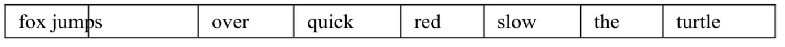
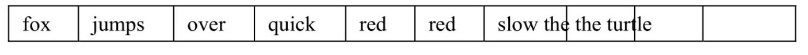
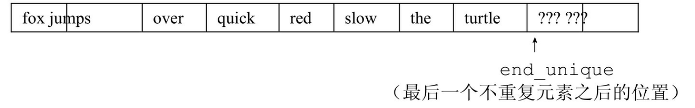

[总目录](<../目录.md>) · [本章目录](<01 章节导读.md>) · [上一篇](<../第10章 泛型算法/10.1 概述.md>) · [下一篇](<../第10章 泛型算法/10.3 定制操作.md>)

> 原 PDF 第 561–570 页。

<!-- PDF 第 561 页 -->

# **10.2** 初识泛型算法

标准库提供了超过100个算法。幸运的是,与容器类似,这些算法有一致的结构。比起死记硬背全部100多个算法,理解此结构可以帮助我们更容易地学习和使用这些算法。在本章中,我们将展示如何使用这些算法,并介绍刻画了这些算法的统一原则。附录A按操作方式列出了所有算法。

除了少数例外,标准库算法都对一个范围内的元素进行操作。我们将此元素范围称为"输入范围"。接受输入范围的算法总是使用前两个参数来表示此范围,两个参数分别是指向要处理的第一个元素和尾元素之后位置的迭代器。

虽然大多数算法遍历输入范围的方式相似,但它们使用范围中元素的方式不同。理解算法的最基本的方法就是了解它们是否读取元素、改变元素或是重排元素顺序。

## **10.2.1** 只读算法

一些算法只会读取其输入范围内的元素,而从不改变元素。find就是这样一种算法,我们在10.1节练习(第337页)中使用的count函数也是如此。

另一个只读算法是accumulate,它定义在头文件numeric中。 accumulate函数接受三个参数,前两个指出了需要求和的元素的范围, 第三个参数是和的初值。假定vec是一个整数序列,则:

<!-- 代码原图: ../images/_page_560_Picture_107.png -->
```c++
// 对 vec 中的元素求和，和的初值是 0
int sum = accumulate(vec.cbegin(), vec.cend(), 0);
```

这条语句将sum设置为vec中元素的和,和的初值被设置为0。


<!-- PDF 第 562 页 -->

accumulate的第三个参数的类型决定了函数中使用哪个加法运算符以及返回值的类型。

算法和元素类型

accumulate将第三个参数作为求和起点,这蕴含着一个编程假定: 将元素类型加到和的类型上的操作必须是可行的。即,序列中元素的类型必须与第三个参数匹配,或者能够转换为第三个参数的类型。在上例中,vec中的元素可以是int,或者是double、long long或任何其他可以加到int上的类型。

下面是另一个例子,由于string定义了+运算符,所以我们可以通过调用accumulate来将vector中所有string元素连接起来:

<!-- 代码原图: ../images/_page_561_Picture_150.png -->
```c++
string sum = accumulate(v.cbegin(), v.cend(), string(""));
```

此调用将v中每个元素连接到一个string上,该string初始时为空串。 注意,我们通过第三个参数显式地创建了一个string。将空串当做一个字符串字面值传递给第三个参数是不可以的,会导致一个编译错误。

<!-- 代码原图: ../images/_page_561_Picture_151.png -->
```c++
// 错误：const char*上没有定义+运算符
string sum = accumulate(v.cbegin(), v.cend(), "");
```

原因在于,如果我们传递了一个字符串字面值,用于保存和的对象的类型将是const char\*。如前所述,此类型决定了使用哪个+运算符。由于const char\*并没有+运算符,此调用将产生编译错误。


对于只读取而不改变元素的算法,通常最好使用cbegin()和cend()(参见9.2.3 节,第298页)。但是,如果你计划使用算法返回的迭代器来改变元素的值,就需要使用begin()和end()的结果作为参数。

操作两个序列的算法

另一个只读算法是equal,用于确定两个序列是否保存相同的值。它将第一个序列中的每个元素与第二个序列中的对应元素进行比较。如果所有对应元素都相等,则返回true,否则返回false。此算法接受三个迭代器:前两个(与以往一样)表示第一个序列中的元素范围,第三个表示第二个序列的首元素:

<!-- PDF 第 563 页 -->

<!-- 代码原图: ../images/_page_562_Picture_139.png -->
```c++
// roster2 中的元素数目应该至少与 roster1一样多
equal(roster1.cbegin(), roster1.cend(), roster2.cbegin());
```

由于equal利用迭代器完成操作,因此我们可以通过调用equal来比较两个不同类型的容器中的元素。而且,元素类型也不必一样,只要我们能用==来比较两个元素类型即可。例如,在此例中,roster1可以是 vector<string>,而roster2是list<const char\*>。

但是,equal基于一个非常重要的假设:它假定第二个序列至少与第一个序列一样长。此算法要处理第一个序列中的每个元素,它假定每个元素在第二个序列中都有一个与之对应的元素。


那些只接受一个单一迭代器来表示第二个序列的算法,都假定第二个序列至少与第一个序列一样长。

## **10.2.1**节练习

练习**10.3**:用accumulate求一个vector<int>中的元素之和。

练习**10.4**:假定v是一个vector<double>,那么调用

accumulate(v.cbegin(),v.cend(),0)有何错误(如果存在的

话)?

练习**10.5**:在本节对名册(roster)调用equal的例子中,如果两个名册中保存的都是C风格字符串而不是string,会发生什么?

## **10.2.2** 写容器元素的算法

一些算法将新值赋予序列中的元素。当我们使用这类算法时,必须注意确保序列原大小至少不小于我们要求算法写入的元素数目。记住, 算法不会执行容器操作,因此它们自身不可能改变容器的大小。

一些算法会自己向输入范围写入元素。这些算法本质上并不危险, 它们最多写入与给定序列一样多的元素。

例如,算法fill接受一对迭代器表示一个范围,还接受一个值作为第三个参数。fill将给定的这个值赋予输入序列中的每个元素。

<!-- PDF 第 564 页 -->

<!-- 代码原图: ../images/_page_563_Picture_116.png -->
```c++
fill(vec.begin(), vec.end(), 0); // 将每个元素重置为0
// 将容器的一个子序列设置为10
fill(vec.begin(), vec.begin() + vec.size()/2, 10);
```

由于fill向给定输入序列中写入数据,因此,只要我们传递了一个有效的输入序列,写入操作就是安全的。

## 关键概念:迭代器参数

一些算法从两个序列中读取元素。构成这两个序列的元素可以来自于不同类型的容器。例如,第一个序列可能保存于一个vector中,而第二个序列可能保存于一个 list、deque、内置数组或其他容器中。而且,两个序列中元素的类型也不要求严格匹配。算法要求的只是能够比较两个序列中的元素。例如,对equal算法,元素类型不要求相同,但是我们必须能使用==来比较来自两个序列中的元素。

操作两个序列的算法之间的区别在于我们如何传递第二个序列。一些算法,例如 equal,接受三个迭代器:前两个表示第一个序列的范围,第三个表示第二个序列中的首元素。其他算法接受四个迭代器:前两个表示第一个序列的元素范围,后两个表示第二个序列的范围。

用一个单一迭代器表示第二个序列的算法都假定第二个序列至少与第一个一样长。确保算法不会试图访问第二个序列中不存在的元素是程序员的责任。例如,算法 equal会将其第一个序列中的每个元素与第二个序列中的对应元素进行比较。如果第二个序列是第一个序列的一个子集,则程序会产生一个严重错误——equal会试图访问第二个序列中末尾之后(不存在)的元素。

### 算法不检查写操作

一些算法接受一个迭代器来指出一个单独的目的位置。这些算法将新值赋予一个序列中的元素,该序列从目的位置迭代器指向的元素开始。例如,函数fill\_n接受一个单迭代器、一个计数值和一个值。它将给定值赋予迭代器指向的元素开始的指定个元素。我们可以用fill\_n将一个新值赋予vector中的元素:

<!-- 代码原图: ../images/_page_563_Picture_117.png -->
```c++
vector<int> vec; // 空 vector
// 使用 vec，赋予它不同值
fill_n(vec.begin(), vec.size(), 0); // 将所有元素重置为 0
```

函数fill\_n假定写入指定个元素是安全的。即,如下形式的调用

<!-- 代码原图: ../images/_page_563_Picture_118.png -->
```c++
fill_n(dest, n, val)
```

fill\_n假定dest指向一个元素,而从dest开始的序列至少包含n个元

<!-- PDF 第 565 页 -->

素。

一个初学者非常容易犯的错误是在一个空容器上调用fill\_n(或类似的写元素的算法):

<!-- 代码原图: ../images/_page_564_Picture_96.png -->
```c++
vector<int> vec; // 空向量
// 灾难：修改 vec 中的 10 个（不存在）元素
fill_n(vec.begin(), 10, 0);
```

这个调用是一场灾难。我们指定了要写入10个元素,但vec中并没有元素——它是空的。这条语句的结果是未定义的。


向目的位置迭代器写入数据的算法假定目的位置足够大,能容纳要写入的元素。

## 介绍**back\_inserter**

一种保证算法有足够元素空间来容纳输出数据的方法是使用插入迭代器(insert iterator)。插入迭代器是一种向容器中添加元素的迭代器。通常情况,当我们通过一个迭代器向容器元素赋值时,值被赋予迭代器指向的元素。而当我们通过一个插入迭代器赋值时,一个与赋值号右侧值相等的元素被添加到容器中。

我们将在10.4.1节中(第358页)详细介绍插入迭代器的内容。但是,为了展示如何用算法向容器写入数据,我们现在将使用**back\_inserter**,它是定义在头文件iterator中的一个函数。

back\_inserter接受一个指向容器的引用,返回一个与该容器绑定的插入迭代器。当我们通过此迭代器赋值时,赋值运算符会调用 push\_back将一个具有给定值的元素添加到容器中:

<!-- 代码原图: ../images/_page_564_Picture_98.png -->
```c++
vector<int> vec; // 空向量
auto it = back_inserter(vec); // 通过它赋值会将元素添加到 vec 中
*it = 42; // vec 中现在有一个元素，值为 42
```

我们常常使用back\_inserter来创建一个迭代器,作为算法的目的位置来使用。例如:

<!-- PDF 第 566 页 -->

<!-- 代码原图: ../images/_page_565_Picture_131.png -->
```c++
vector<int> vec; // 空向量
// 正确：back_inserter 创建一个插入迭代器，可用来向 vec 添加元素
fill_n(back_inserter(vec), 10, 0); // 添加10个元素到 vec
```

在每步迭代中,fill\_n向给定序列的一个元素赋值。由于我们传递的参数是back\_inserter返回的迭代器,因此每次赋值都会在vec上调用 push\_back。最终,这条fill\_n调用语句向vec的末尾添加了10个元素,每个元素的值都是0.

### 拷贝算法

拷贝(copy)算法是另一个向目的位置迭代器指向的输出序列中的元素写入数据的算法。此算法接受三个迭代器,前两个表示一个输入范围,第三个表示目的序列的起始位置。此算法将输入范围中的元素拷贝到目的序列中。传递给copy的目的序列至少要包含与输入序列一样多的元素,这一点很重要。

我们可以用copy实现内置数组的拷贝,如下面代码所示:

<!-- 代码原图: ../images/_page_565_Picture_132.png -->
```c++
int a1[] = {0,1,2,3,4,5,6,7,8,9};
int a2[sizeof(a1)/sizeof(*a1)]; // a2与a1大小一样
// ret指向拷贝到a2的尾元素之后的位置
auto ret = copy(begin(a1), end(a1), a2); // 把a1的内容拷贝给a2
```

此例中我们定义了一个名为a2的数组,并使用sizeof确保a2与数组 a1包含同样多的元素(参见4.9节,第139页)。接下来我们调用copy完成从a1到a2的拷贝。在调用copy后,两个数组中的元素具有相同的值。

copy返回的是其目的位置迭代器(递增后)的值。即,ret恰好指向拷贝到a2的尾元素之后的位置。

多个算法都提供所谓的"拷贝"版本。这些算法计算新元素的值,但不会将它们放置在输入序列的末尾,而是创建一个新序列保存这些结果。

例如,replace算法读入一个序列,并将其中所有等于给定值的元素都改为另一个值。此算法接受4个参数:前两个是迭代器,表示输入序列,后两个一个是要搜索的值,另一个是新值。它将所有等于第一个值的元素替换为第二个值:

<!-- PDF 第 567 页 -->

<!-- 代码原图: ../images/_page_566_Picture_93.png -->
```c++
// 将所有值为0的元素改为42
replace(ilst.begin(), ilst.end(), 0, 42);
```

此调用将序列中所有的0都替换为42。如果我们希望保留原序列不变,可以调用replace\_copy。此算法接受额外第三个迭代器参数,指出调整后序列的保存位置:

<!-- 代码原图: ../images/_page_566_Picture_94.png -->
```c++
// 使用 back_inserter 按需要增长目标序列 replace_copy(ilst.cbegin(), ilst.cend(),
back_inserter(ivec), 0, 42);
```

此调用后,ilst并未改变,ivec包含ilst的一份拷贝,不过原来在ilst 中值为0的元素在ivec中都变为42。

## **10.2.2**节练习

练习**10.6**:编写程序,使用fill\_n将一个序列中的int值都设置为0。

练习**10.7**:下面程序是否有错误?如果有,请改正。

<!-- 代码原图: ../images/_page_566_Picture_95.png -->
```c++
(a) vector<int> vec; list<int> lst; int i;
while (cin >> i)
    lst.push_back(i);
copy(lst.cbegin(), lst.cend(), vec.begin());

(b) vector<int> vec;
vec.reserve(10); // reverse 将在 9.4 节(第 318 页)介绍
fill_n(vec.begin(), 10, 0);
```

练习**10.8**:本节提到过,标准库算法不会改变它们所操作的容器的大小。为什么使用back\_inserter不会使这一断言失效?

## **10.2.3** 重排容器元素的算法

某些算法会重排容器中元素的顺序,一个明显的例子是sort。调用 sort会重排输入序列中的元素,使之有序,它是利用元素类型的<运算符来实现排序的。

<!-- PDF 第 568 页 -->

例如,假定我们想分析一系列儿童故事中所用的词汇。假定已有一个vector,保存了多个故事的文本。我们希望化简这个vector,使得每个单词只出现一次,而不管单词在任意给定文档中到底出现了多少次。

为了便于说明问题,我们将使用下面简单的故事作为输入:

## **the quick red fox jumps over the slow red turtle**

给定此输入,我们的程序应该生成如下vector:



## 消除重复单词

为了消除重复单词,首先将vector排序,使得重复的单词都相邻出现。一旦vector排序完毕,我们就可以使用另一个称为unique的标准库算法来重排vector,使得不重复的元素出现在vector的开始部分。由于算法不能执行容器的操作,我们将使用vector的erase成员来完成真正的删除操作:

<!-- 代码原图: ../images/_page_567_Picture_110.png -->
```c++
void elimDups(vector<string> &words)
{
    // 按字典序排序 words，以便查找重复单词
    sort(words.begin(), words.end());
    // unique 重排输入范围，使得每个单词只出现一次
    // 排列在范围的前部，返回指向不重复区域之后一个位置的迭代器
    auto end_unique = unique(words.begin(), words.end());
    // 使用向量操作 erase 删除重复单词
    words.erase(end_unique, words.end());
}
```

sort算法接受两个迭代器,表示要排序的元素范围。在此例中,我们排序整个vector。完成sort后,words的顺序如下所示:



注意,单词red和the各出现了两次。

## 使用**unique**

<!-- PDF 第 569 页 -->

words排序完毕后,我们希望将每个单词都只保存一次。unique算法重排输入序列,将相邻的重复项"消除",并返回一个指向不重复值范围末尾的迭代器。调用unique后,vector将变为:



words的大小并未改变,它仍有10个元素。但这些元素的顺序被改变了——相邻的重复元素被"删除"了。我们将删除打引号是因为unique 并不真的删除任何元素,它只是覆盖相邻的重复元素,使得不重复元素出现在序列开始部分。unique返回的迭代器指向最后一个不重复元素之后的位置。此位置之后的元素仍然存在,但我们不知道它们的值是什么。


标准库算法对迭代器而不是容器进行操作。因此,算法不能(直接)添加或删除元素。

## 使用容器操作删除元素

为了真正地删除无用元素,我们必须使用容器操作,本例中使用 erase(参见9.3.3节,第311页)。我们删除从end\_unique开始直至words 末尾的范围内的所有元素。这个调用之后,words包含来自输入的8个不重复的单词。

值得注意的是,即使words中没有重复单词,这样调用erase也是安全的。在此情况下,unique会返回words.end()。因此,传递给erase的两个参数具有相同的值:words.end()。迭代器相等意味着传递给erase 的元素范围为空。删除一个空范围没有什么不良后果,因此程序即使在输入中无重复元素的情况下也是正确的。

## **10.2.3**节练习

练习**10.9**:实现你自己的elimDups。测试你的程序,分别在读取输入后、调用unique后以及调用erase后打印vector的内容。

<!-- PDF 第 570 页 -->

练习**10.10**:你认为算法不改变容器大小的原因是什么?


