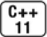
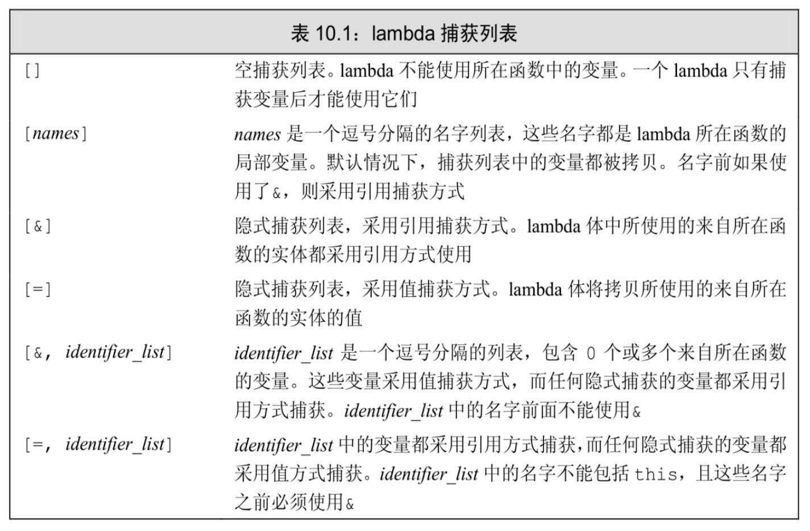

[总目录](<../目录.md>) · [本章目录](<01 章节导读.md>) · [上一篇](<../第10章 泛型算法/10.2 初识泛型算法.md>) · [下一篇](<../第10章 泛型算法/10.4 再探迭代器.md>)

> 原 PDF 第 571–592 页。

<!-- PDF 第 571 页 -->

# **10.3** 定制操作

很多算法都会比较输入序列中的元素。默认情况下,这类算法使用元素类型的<或==运算符完成比较。标准库还为这些算法定义了额外的版本,允许我们提供自己定义的操作来代替默认运算符。

例如,sort算法默认使用元素类型的<运算符。但可能我们希望的排序顺序与<所定义的顺序不同,或是我们的序列可能保存的是未定义<运算符的元素类型(如Sales\_data)。在这两种情况下,都需要重载sort的默认行为。

## **10.3.1** 向算法传递函数

作为一个例子,假定希望在调用elimDups(参见10.2.3节,第343 页)后打印vector的内容。此外还假定希望单词按其长度排序,大小相同的再按字典序排列。为了按长度重排vector,我们将使用sort的第二个版本,此版本是重载过的,它接受第三个参数,此参数是一个谓词 (predicate)。

## 谓词

谓词是一个可调用的表达式,其返回结果是一个能用作条件的值。 标准库算法所使用的谓词分为两类:一元谓词(unary predicate,意味着它们只接受单一参数)和二元谓词(binary predicate,意味着它们有两个参数)。接受谓词参数的算法对输入序列中的元素调用谓词。因此,元素类型必须能转换为谓词的参数类型。

接受一个二元谓词参数的sort版本用这个谓词代替<来比较元素。我们提供给sort的谓词必须满足将在11.2.2节(第378页)中所介绍的条件。当前,我们只需知道,此操作必须在输入序列中所有可能的元素值上定义一个一致的序。我们在6.2.2节(第189页)中定义的isShorter就是一个满足这些要求的函数,因此可以将isShorter传递给sort。这样做会将元素按大小重新排序:

<!-- PDF 第 572 页 -->

<!-- 代码原图: ../images/_page_571_Picture_103.png -->
```c++
// 比较函数，用来按长度排序单词
bool isShorter(const string &s1, const string &s2)
{
    return s1.size() < s2.size();
}
```

<!-- 代码原图: ../images/_page_571_Picture_104.png -->
```c++
// 按长度由短至长排序 words
sort(words.begin(), words.end(), isShorter);
```

如果words包含的数据与10.2.3节(第343页)中一样,此调用会将 words重排,使得所有长度为3的单词排在长度为4的单词之前,然后是长度为5的单词,依此类推。

### 排序算法

在我们将words按大小重排的同时,还希望具有相同长度的元素按字典序排列。为了保持相同长度的单词按字典序排列,可以使用 stable\_sort算法。这种稳定排序算法维持相等元素的原有顺序。

通常情况下,我们不关心有序序列中相等元素的相对顺序,它们毕竟是相等的。但是,在本例中,我们定义的"相等"关系表示"具有相同长度"。而具有相同长度的元素,如果看其内容,其实还是各不相同的。通过调用stable\_sort,可以保持等长元素间的字典序:

<!-- 代码原图: ../images/_page_571_Picture_105.png -->
```c++
elimDups(words); // 将 words 按字典序重排，并消除重复单词
// 按长度重新排序，长度相同的单词维持字典序
stable_sort(words.begin(), words.end(), isShorter);
for (const auto &s : words) // 无须拷贝字符串
    cout << s << " "; // 打印每个元素，以空格分隔
cout << endl;
```

假定在此调用前words是按字典序排列的,则调用之后,words会按元素大小排序,而长度相同的单词会保持字典序。如果我们对原来的 vector内容运行这段代码,输出为:

### **fox red the over slow jumps quick turtle**

**10.3.1**节练习

<!-- PDF 第 573 页 -->

练习**10.11**:编写程序,使用stable\_sort和isShorter将传递给你的elimDups 版本的vector排序。打印vector的内容,验证你的程序的正确性。

练习**10.12**:编写名为compareIsbn的函数,比较两个Sales\_data对象的 isbn()成员。使用这个函数排序一个保存Sales\_data对象的vector。

练习**10.13**:标准库定义了名为partition的算法,它接受一个谓词,对容器内容进行划分,使得谓词为true的值会排在容器的前半部分,而使谓词为false的值会排在后半部分。算法返回一个迭代器,指向最后一个使谓词为true的元素之后的位置。编写函数,接受一个string,返回一个 bool值,指出string是否有5个或更多字符。使用此函数划分words。打印出长度大于等于5的元素。

## **10.3.2 lambda**表达式

根据算法接受一元谓词还是二元谓词,我们传递给算法的谓词必须严格接受一个或两个参数。但是,有时我们希望进行的操作需要更多参数,超出了算法对谓词的限制。例如,为上一节最后一个练习所编写的程序中,就必须将大小5硬编码到划分序列的谓词中。如果在编写划分序列的谓词时,可以不必为每个可能的大小都编写一个独立的谓词,显然更有实际价值。

一个相关的例子是,我们将修改10.3.1节(第345页)中的程序,求大于等于一个给定长度的单词有多少。我们还会修改输出,使程序只打印大于等于给定长度的单词。

我们将此函数命名为biggies,其框架如下所示:

<!-- PDF 第 574 页 -->

<!-- 代码原图: ../images/_page_573_Picture_124.png -->
```c++
void biggies(vector<string> &words,
              vector<string>::size_type sz)
{
    elimDups(words); // 将 words 按字典序排序，删除重复单词
    // 按长度排序，长度相同的单词维持字典序
    stable_sort(words.begin(), words.end(), isShorter);
    // 获取一个迭代器，指向第一个满足 size()>= sz 的元素
    // 计算满足 size >= sz 的元素的数目
    // 打印长度大于等于给定值的单词，每个单词后面接一个空格
}
```

我们的新问题是在vector中寻找第一个大于等于给定长度的元素。 一旦找到了这个元素,根据其位置,就可以计算出有多少元素的长度大于等于给定值。

我们可以使用标准库find\_if算法来查找第一个具有特定大小的元素。类似find(参见10.1节,第336页),find\_if算法接受一对迭代器, 表示一个范围。但与find不同的是,find\_if的第三个参数是一个谓词。 find\_if算法对输入序列中的每个元素调用给定的这个谓词。它返回第一个使谓词返回非0值的元素,如果不存在这样的元素,则返回尾迭代器。

编写一个函数,令其接受一个string和一个长度,并返回一个bool值表示该string的长度是否大于给定长度,是一件很容易的事情。但是, find\_if接受一元谓词——我们传递给find\_if的任何函数都必须严格接受一个参数,以便能用来自输入序列的一个元素调用它。没有任何办法能传递给它第二个参数来表示长度。为了解决此问题,需要使用另外一些语言特性。

## 介绍**lambda**

我们可以向一个算法传递任何类别的可调用对象(callable object)。对于一个对象或一个表达式,如果可以对其使用调用运算符 (参见1.5.2节,第21页),则称它为可调用的。即,如果e是一个可调用的表达式,则我们可以编写代码e(args),其中args是一个逗号分隔的一个或多个参数的列表。

到目前为止,我们使用过的仅有的两种可调用对象是函数和函数指针(参见6.7节,第221页)。还有其他两种可调用对象:重载了函数调

<!-- PDF 第 575 页 -->

用运算符的类,我们将在14.8节(第506页)介绍,以及**lambda**表达式 (lambda expression)。



一个lambda表达式表示一个可调用的代码单元。我们可以将其理解为一个未命名的内联函数。与任何函数类似,一个lambda具有一个返回类型、一个参数列表和一个函数体。但与函数不同,lambda可能定义在函数内部。一个lambda表达式具有如下形式

<!-- 代码原图: ../images/_page_574_Picture_141.png -->
```c++
[ capture list] (parameter list) -> return type { function body }
```

其中,*capture list*(捕获列表)是一个lambda所在函数中定义的局部变量的列表(通常为空);*return type*、*parameter list*和*function body* 与任何普通函数一样,分别表示返回类型、参数列表和函数体。但是, 与普通函数不同,lambda必须使用尾置返回(参见6.3.3节,第206页) 来指定返回类型。

我们可以忽略参数列表和返回类型,但必须永远包含捕获列表和函数体

<!-- 代码原图: ../images/_page_574_Picture_142.png -->
```c++
auto f = [] { return 42; };
```

此例中,我们定义了一个可调用对象f,它不接受参数,返回42。

lambda的调用方式与普通函数的调用方式相同,都是使用调用运算符:

<!-- 代码原图: ../images/_page_574_Picture_143.png -->
```c++
cout << f() << endl; // 打印42
```

在lambda中忽略括号和参数列表等价于指定一个空参数列表。在此例中,当调用f时,参数列表是空的。如果忽略返回类型,lambda根据函数体中的代码推断出返回类型。如果函数体只是一个return语句,则返回类型从返回的表达式的类型推断而来。否则,返回类型为void。


如果lambda的函数体包含任何单一return语句之外的内容,且未指定返回类型,则返回void。

<!-- PDF 第 576 页 -->

向**lambda**传递参数

与一个普通函数调用类似,调用一个lambda时给定的实参被用来初始化lambda的形参。通常,实参和形参的类型必须匹配。但与普通函数不同,lambda不能有默认参数(参见6.5.1节,第211页)。因此,一个 lambda调用的实参数目永远与形参数目相等。一旦形参初始化完毕,就可以执行函数体了。

作为一个带参数的lambda的例子,我们可以编写一个与isShorter函数完成相同功能的lambda:

<!-- 代码原图: ../images/_page_575_Picture_136.png -->
```c++
[] (const string &a, const string &b)
{ return a.size() < b.size();}
```

空捕获列表表明此lambda不使用它所在函数中的任何局部变量。 lambda的参数与isShorter的参数类似,是const string的引用。lambda的函数体也与isShorter类似,比较其两个参数的size(),并根据两者的相对大小返回一个布尔值。

如下所示,可以使用此lambda来调用stable\_sort:

<!-- 代码原图: ../images/_page_575_Picture_137.png -->
```c++
// 按长度排序，长度相同的单词维持字典序
stable_sort(words.begin(), words.end(),
[](const string &a, const string &b)
{ return a.size() < b.size(); });
```

当stable\_sort需要比较两个元素时,它就会调用给定的这个lambda 表达式。

## 使用捕获列表

我们现在已经准备好解决原来的问题了——编写一个可以传递给 find\_if的可调用表达式。我们希望这个表达式能将输入序列中每个string 的长度与biggies函数中的sz参数的值进行比较。

虽然一个lambda可以出现在一个函数中,使用其局部变量,但它只能使用那些明确指明的变量。一个lambda通过将局部变量包含在其捕获列表中来指出将会使用这些变量。捕获列表指引lambda在其内部包含访问局部变量所需的信息。

<!-- PDF 第 577 页 -->

在本例中,我们的lambda会捕获sz,并只有单一的string参数。其函数体会将string的大小与捕获的sz的值进行比较:

<!-- 代码原图: ../images/_page_576_Picture_108.png -->
```c++
[sz] (const string &a)
{ return a.size() >= sz; };
```

lambda以一对[]开始,我们可以在其中提供一个以逗号分隔的名字列表,这些名字都是它所在函数中定义的。

由于此lambda捕获sz,因此lambda的函数体可以使用sz。lambda不捕获words,因此不能访问此变量。如果我们给lambda提供一个空捕获列表,则代码会编译错误:

<!-- 代码原图: ../images/_page_576_Picture_109.png -->
```c++
// 错误：sz 未捕获
[ ] (const string &a)
{ return a.size() >= sz; };
```


一个lambda只有在其捕获列表中捕获一个它所在函数中的局部变量,才能在函数体中使用该变量。

#### 调用**find\_if**

使用此lambda,我们就可以查找第一个长度大于等于sz的元素:

<!-- 代码原图: ../images/_page_576_Picture_111.png -->
```c++
// 获取一个迭代器，指向第一个满足 size()>= sz 的元素
auto wc = find_if(words.begin(), words.end(),
[sz] (const string &a)
{ return a.size() >= sz; });
```

这里对find\_if的调用返回一个迭代器,指向第一个长度不小于给定参数sz的元素。如果这样的元素不存在,则返回words.end()的一个拷贝。

我们可以使用find\_if返回的迭代器来计算从它开始到words的末尾一共有多少个元素(参见3.4.2节,第99页):

<!-- PDF 第 578 页 -->

<!-- 代码原图: ../images/_page_577_Picture_114.png -->
```c++
// 计算满足 size >= sz 的元素的数目
auto count = words.end() - wc;
cout << count << " " << make_plural(count, "word", "s")
<< " of length " << sz << " or longer" << endl;
```

我们的输出语句调用make\_plural(参见6.3.2节,第201页)来输出"word"或"words",具体输出哪个取决于大小是否等于1。

#### **for\_each**算法

问题的最后一部分是打印words中长度大于等于sz的元素。为了达到这一目的,我们可以使用for\_each算法。此算法接受一个可调用对象,并对输入序列中每个元素调用此对象:

<!-- 代码原图: ../images/_page_577_Picture_115.png -->
```c++
// 打印长度大于等于给定值的单词，每个单词后面接一个空格
for_each(wc, words.end(),
    [](const string &s){cout << s << " ";});
cout << endl;
```

此lambda中的捕获列表为空,但其函数体中还是使用了两个名字: s和cout,前者是它自己的参数。

捕获列表为空,是因为我们只对lambda所在函数中定义的(非 static)变量使用捕获列表。一个lambda可以直接使用定义在当前函数之外的名字。在本例中,cout不是定义在biggies中的局部名字,而是定义在头文件iostream中。因此,只要在biggies出现的作用域中包含了头文件iostream,我们的lambda就可以使用cout。


捕获列表只用于局部非static变量,lambda可以直接使用局部static变量和在它所在函数之外声明的名字。

#### 完整的**biggies**

到目前为止,我们已经解决了程序的所有细节,下面就是完整的程序:

<!-- PDF 第 579 页 -->

<!-- 代码原图: ../images/_page_578_Picture_102.png -->
```c++
void biggies(vector<string> &words,
            vector<string>::size_type sz)
{
    elimDups(words); // 将 words 按字典序排序，删除重复单词
    // 按长度排序，长度相同的单词维持字典序
    stable_sort(words.begin(), words.end(),
            [](const string &a, const string &b)
            { return a.size() < b.size(); });
    // 获取一个迭代器，指向第一个满足 size()>= sz 的元素
    auto wc = find_if(words.begin(), words.end(),
            [sz](const string &a)
            { return a.size() >= sz; });
    // 计算满足 size >= sz 的元素的数目
    auto count = words.end() - wc;
    cout << count << " " << make_plural(count, "word", "s")
        << " of length " << sz << " or longer" << endl;
    // 打印长度大于等于给定值的单词，每个单词后面接一个空格
    for_each(wc, words.end(),
            [](const string &s){cout << s << " ";});
    cout << endl;
}
```

#### **10.3.2**节练习

练习**10.14**:编写一个lambda,接受两个int,返回它们的和。

练习**10.15**:编写一个lambda,捕获它所在函数的int,并接受一个int参数。lambda应该返回捕获的int和int参数的和。

练习**10.16**:使用lambda编写你自己版本的biggies。

练习**10.17**:重写10.3.1节练习10.12(第345页)的程序,在对sort的调用中使用lambda来代替函数compareIsbn。

练习**10.18**:重写biggies,用partition代替find\_if。我们在10.3.1节练习 10.13(第345页)中介绍了partition算法。

练习**10.19**:用stable\_partition重写前一题的程序,与stable\_sort类似,在划分后的序列中维持原有元素的顺序。

<!-- PDF 第 580 页 -->

## **10.3.3 lambda**捕获和返回

当定义一个lambda时,编译器生成一个与lambda对应的新的(未命名的)类类型。我们将在14.8.1节(第507页)介绍这种类是如何生成的。目前,可以这样理解,当向一个函数传递一个lambda时,同时定义了一个新类型和该类型的一个对象:传递的参数就是此编译器生成的类类型的未命名对象。类似的,当使用auto定义一个用lambda初始化的变量时,定义了一个从lambda生成的类型的对象。

默认情况下,从lambda生成的类都包含一个对应该lambda所捕获的变量的数据成员。类似任何普通类的数据成员,lambda的数据成员也在 lambda对象创建时被初始化。

#### 值捕获

类似参数传递,变量的捕获方式也可以是值或引用。表10.1(第 352页)列出了几种不同的构造捕获列表的方式。到目前为止,我们的 lambda采用值捕获的方式。与传值参数类似,采用值捕获的前提是变量可以拷贝。与参数不同,被捕获的变量的值是在lambda创建时拷贝,而不是调用时拷贝:

<!-- 代码原图: ../images/_page_579_Picture_106.png -->
```c++
void fcn1()
{
    size_t v1 = 42; // 局部变量
    // 将 v1 拷贝到名为 f 的可调用对象
    auto f = [v1] { return v1; };
    v1 = 0;
    auto j = f(); // j 为 42; f 保存了我们创建它时 v1 的拷贝
}
```

由于被捕获变量的值是在lambda创建时拷贝,因此随后对其修改不会影响到lambda内对应的值。

### 引用捕获

我们定义lambda时可以采用引用方式捕获变量。例如:

<!-- PDF 第 581 页 -->

<!-- 代码原图: ../images/_page_580_Picture_93.png -->
```c++
void fcn2()
{
    size_t v1 = 42; // 局部变量
    // 对象 f2 包含 v1 的引用
    auto f2 = [&v1] { return v1; };
    v1 = 0;
    auto j = f2(); // j 为 0; f2 保存 v1 的引用，而非拷贝
}
```

v1之前的&指出v1应该以引用方式捕获。一个以引用方式捕获的变量与其他任何类型的引用的行为类似。当我们在lambda函数体内使用此变量时,实际上使用的是引用所绑定的对象。在本例中,当lambda返回 v1时,它返回的是v1指向的对象的值。

引用捕获与返回引用(参见6.3.2节,第201页)有着相同的问题和限制。如果我们采用引用方式捕获一个变量,就必须确保被引用的对象在lambda执行的时候是存在的。lambda捕获的都是局部变量,这些变量在函数结束后就不复存在了。如果lambda可能在函数结束后执行,捕获的引用指向的局部变量已经消失。

引用捕获有时是必要的。例如,我们可能希望biggies函数接受一个 ostream的引用,用来输出数据,并接受一个字符作为分隔符:

<!-- 代码原图: ../images/_page_580_Picture_94.png -->
```c++
void biggies(vector<string> &words,
            vector<string>::size_type sz,
            ostream &os = cout, char c = ' ')
{
    // 与之前例子一样的重排 words 的代码
```

<!-- 代码原图: ../images/_page_580_Picture_95.png -->
```c++
// 打印 count 的语句改为打印到 os
for_each(words.begin(), words.end(),
[&os, c](const string &s) { os << s << c; });
}
```

我们不能拷贝ostream对象(参见8.1.1节,第279页),因此捕获os 的唯一方法就是捕获其引用(或指向os的指针)。

当我们向一个函数传递一个lambda时,就像本例中调用for\_each那样,lambda会立即执行。在此情况下,以引用方式捕获os没有问题,因 

<!-- PDF 第 582 页 -->

为当for\_each执行时,biggies中的变量是存在的。

我们也可以从一个函数返回lambda。函数可以直接返回一个可调用对象,或者返回一个类对象,该类含有可调用对象的数据成员。如果函数返回一个lambda,则与函数不能返回一个局部变量的引用类似,此 lambda也不能包含引用捕获。


当以引用方式捕获一个变量时,必须保证在lambda执行时变量是存在的。

### 建议:尽量保持**lambda**的变量捕获简单化

一个lambda捕获从lambda被创建(即,定义lambda的代码执行时)到lambda自身执行(可能有多次执行)这段时间内保存的相关信息。确保lambda每次执行的时候这些信息都有预期的意义,是程序员的责任。

捕获一个普通变量,如int、string或其他非指针类型,通常可以采用简单的值捕获方式。在此情况下,只需关注变量在捕获时是否有我们所需的值就可以了。

如果我们捕获一个指针或迭代器,或采用引用捕获方式,就必须确保在lambda执行时,绑定到迭代器、指针或引用的对象仍然存在。而且,需要保证对象具有预期的值。在lambda从创建到它执行的这段时间内,可能有代码改变绑定的对象的值。也就是说,在指针(或引用)被捕获的时刻,绑定的对象的值是我们所期望的,但在 lambda执行时,该对象的值可能已经完全不同了。

一般来说,我们应该尽量减少捕获的数据量,来避免潜在的捕获导致的问题。而且,如果可能的话,应该避免捕获指针或引用。

#### 隐式捕获

除了显式列出我们希望使用的来自所在函数的变量之外,还可以让编译器根据lambda体中的代码来推断我们要使用哪些变量。为了指示编译器推断捕获列表,应在捕获列表中写一个&或=。&告诉编译器采用捕获引用方式,=则表示采用值捕获方式。例如,我们可以重写传递给 find\_if的lambda:

<!-- 代码原图: ../images/_page_581_Picture_140.png -->
```c++
// sz 为隐式捕获，值捕获方式
wc = find_if(words.begin(), words.end(),
[=] (const string &s)
{ return s.size() >= sz; });
```

如果我们希望对一部分变量采用值捕获,对其他变量采用引用捕获,可以混合使用隐式捕获和显式捕获:

<!-- PDF 第 583 页 -->

<!-- 代码原图: ../images/_page_582_Picture_35.png -->
```c++
void biggies(vector<string> &words,
```

<!-- 代码原图: ../images/_page_582_Picture_36.png -->
```c++
    vector<string>::size_type sz,
    ostream &os = cout, char c = ' ')
{
    // 其他处理与前例一样
    // os 隐式捕获，引用捕获方式；c 显式捕获，值捕获方式
    for_each(words.begin(), words.end(),
    [&, c](const string &s) { os << s << c; });
    // os 显式捕获，引用捕获方式；c 隐式捕获，值捕获方式
    for_each(words.begin(), words.end(),
    [=, &os](const string &s) { os << s << c; });
}
```

当我们混合使用隐式捕获和显式捕获时,捕获列表中的第一个元素必须是一个&或=。此符号指定了默认捕获方式为引用或值。

当混合使用隐式捕获和显式捕获时,显式捕获的变量必须使用与隐式捕获不同的方式。即,如果隐式捕获是引用方式(使用了&),则显式捕获命名变量必须采用值方式,因此不能在其名字前使用&。类似的,如果隐式捕获采用的是值方式(使用了=),则显式捕获命名变量必须采用引用方式,即,在名字前使用&。

<!-- PDF 第 584 页 -->



#### 可变**lambda**

默认情况下,对于一个值被拷贝的变量,lambda不会改变其值。如果我们希望能改变一个被捕获的变量的值,就必须在参数列表首加上关键字mutable。因此,可变lambda能省略参数列表:

<!-- 代码原图: ../images/_page_583_Picture_34.png -->
```c++
void fcn3()
{
    size_t v1 = 42; // 局部变量
    // f 可以改变它所捕获的变量的值
    auto f = [v1] () mutable { return ++v1; };
    v1 = 0;
    auto j = f(); // j 为 43
}
```

一个引用捕获的变量是否(如往常一样)可以修改依赖于此引用指向的是一个const类型还是一个非const类型:

<!-- PDF 第 585 页 -->

<!-- 代码原图: ../images/_page_584_Picture_98.png -->
```c++
void fcn4()
{
    size_t v1 = 42; // 局部变量
    // v1 是一个非 const 变量的引用
    // 可以通过 f2 中的引用来改变它
    auto f2 = [&v1] { return ++v1; };
    v1 = 0;
    auto j = f2(); // j 为 1
}
```

#### 指定**lambda**返回类型

到目前为止,我们所编写的lambda都只包含单一的return语句。因此,我们还未遇到必须指定返回类型的情况。默认情况下,如果一个 lambda体包含return之外的任何语句,则编译器假定此lambda返回void。 与其他返回void的函数类似,被推断返回void的lambda不能返回值。

下面给出了一个简单的例子,我们可以使用标准库transform算法和一个lambda来将一个序列中的每个负数替换为其绝对值:

<!-- 代码原图: ../images/_page_584_Picture_99.png -->
```c++
transform(vi.begin(), vi.end(), vi.begin(),
[](int i) { return i < 0 ? -i : i; });
```

函数transform接受三个迭代器和一个可调用对象。前两个迭代器表示输入序列,第三个迭代器表示目的位置。算法对输入序列中每个元素调用可调用对象,并将结果写到目的位置。如本例所示,目的位置迭代器与表示输入序列开始位置的迭代器可以是相同的。当输入迭代器和目的迭代器相同时,transform将输入序列中每个元素替换为可调用对象操作该元素得到的结果。

在本例中,我们传递给transform一个lambda,它返回其参数的绝对值。lambda体是单一的return语句,返回一个条件表达式的结果。我们无须指定返回类型,因为可以根据条件运算符的类型推断出来。

但是,如果我们将程序改写为看起来是等价的if语句,就会产生编译错误:

<!-- PDF 第 586 页 -->

<!-- 代码原图: ../images/_page_585_Picture_127.png -->
```c++
// 错误：不能推断 lambda 的返回类型
transform(vi.begin(), vi.end(), vi.begin(),
[](int i) { if (i < 0) return -i; else return i; });
```

编译器推断这个版本的lambda返回类型为void,但它返回了一个int 值。


当我们需要为一个lambda定义返回类型时,必须使用尾置返回类型 (参见6.3.3节,第206页):

<!-- 代码原图: ../images/_page_585_Picture_129.png -->
```c++
transform(vi.begin(), vi.end(), vi.begin(),
[](int i) -> int
{ if (i < 0) return -i; else return i; });
```

在此例中,传递给transform的第四个参数是一个lambda,它的捕获列表是空的,接受单一int参数,返回一个int值。它的函数体是一个返回其参数的绝对值的if语句。

#### **10.3.3**节练习

练习**10.20**:标准库定义了一个名为count\_if的算法。类似find\_if,此函数接受一对迭代器,表示一个输入范围,还接受一个谓词,会对输入范围中每个元素执行。count\_if返回一个计数值,表示谓词有多少次为真。使用count\_if重写我们程序中统计有多少单词长度超过6的部分。

练习**10.21**:编写一个lambda,捕获一个局部int变量,并递减变量值, 直至它变为0。一旦变量变为0,再调用lambda应该不再递减变量。 lambda应该返回一个bool值,指出捕获的变量是否为0。

## **10.3.4** 参数绑定

对于那种只在一两个地方使用的简单操作,lambda表达式是最有用的。如果我们需要在很多地方使用相同的操作,通常应该定义一个函数,而不是多次编写相同的lambda表达式。类似的,如果一个操作需要很多语句才能完成,通常使用函数更好。

<!-- PDF 第 587 页 -->

如果lambda的捕获列表为空,通常可以用函数来代替它。如前面章节所示,既可以用一个lambda,也可以用函数isShorter来实现将vector中的单词按长度排序。类似的,对于打印vector内容的lambda,编写一个函数来替换它也是很容易的事情,这个函数只需接受一个string并在标准输出上打印它即可。

但是,对于捕获局部变量的lambda,用函数来替换它就不是那么容易了。例如,我们用在find\_if调用中的lambda比较一个string和一个给定大小。我们可以很容易地编写一个完成同样工作的函数:

<!-- 代码原图: ../images/_page_586_Picture_152.png -->
```c++
bool check_size(const string &s, string::size_type sz)
{
    return s.size() >= sz;
}
```

但是,我们不能用这个函数作为find\_if的一个参数。如前文所示, find\_if接受一个一元谓词,因此传递给find\_if的可调用对象必须接受单一参数。biggies传递给find\_if的lambda使用捕获列表来保存sz。为了用 check\_size来代替此lambda,必须解决如何向sz形参传递一个参数的问题。

#### 标准库**bind**函数


我们可以解决向check\_size传递一个长度参数的问题,方法是使用一个新的名为**bind**的标准库函数,它定义在头文件functional中。可以将 bind函数看作一个通用的函数适配器(参见9.6节,第329页),它接受一个可调用对象,生成一个新的可调用对象来"适应"原对象的参数列表。

调用bind的一般形式为:

<!-- 代码原图: ../images/_page_586_Picture_154.png -->
```c++
auto newCallable = bind (callable, arg_list) ;
```

其中,*newCallable*本身是一个可调用对象,*arg\_list*是一个逗号分隔的参数列表,对应给定的*callable*的参数。即,当我们调用*newCallable* 时,*newCallable*会调用*callable*,并传递给它*arg\_list*中的参数。

<!-- PDF 第 588 页 -->

*arg\_list*中的参数可能包含形如*\_n*的名字,其中*n*是一个整数。这些参数是"占位符",表示*newCallable*的参数,它们占据了传递给 *newCallable*的参数的"位置"。数值*n*表示生成的可调用对象中参数的位置:\_1为*newCallable*的第一个参数,\_2为第二个参数,依此类推。

#### 绑定**check\_size**的**sz**参数

作为一个简单的例子,我们将使用bind生成一个调用check\_size的对象,如下所示,它用一个定值作为其大小参数来调用check\_size:

<!-- 代码原图: ../images/_page_587_Picture_158.png -->
```c++
// check6 是一个可调用对象，接受一个 string 类型的参数
// 并用此 string 和值 6 来调用 check_size
auto check6 = bind(check_size, _1, 6);
```

此bind调用只有一个占位符,表示check6只接受单一参数。占位符出现在*arg\_list*的第一个位置,表示check6的此参数对应check\_size的第一个参数。此参数是一个const string&。因此,调用check6必须传递给它一个string类型的参数,check6会将此参数传递给check\_size。

<!-- 代码原图: ../images/_page_587_Picture_159.png -->
```c++
string s = "hello";
bool b1 = check6(s); // check6(s)会调用 check_size(s, 6)
```

使用bind,我们可以将原来基于lambda的find\_if调用:

<!-- 代码原图: ../images/_page_587_Picture_160.png -->
```c++
auto wc = find_if(words.begin(), words.end(),
[sz] (const string &a)
```

替换为如下使用check\_size的版本:

<!-- 代码原图: ../images/_page_587_Picture_161.png -->
```c++
auto wc = find_if(words.begin(), words.end(),
bind(check_size, _1, sz));
```

此bind调用生成一个可调用对象,将check\_size的第二个参数绑定到 sz的值。当find\_if对words中的string调用这个对象时,这些对象会调用 check\_size,将给定的string和sz传递给它。因此,find\_if可以有效地对输入序列中每个string调用check\_size,实现string的大小与sz的比较。

使用**placeholders**名字

<!-- PDF 第 589 页 -->

名字\_*n*都定义在一个名为placeholders的命名空间中,而这个命名空间本身定义在std命名空间(参见3.1节,第74页)中。为了使用这些名字,两个命名空间都要写上。与我们的其他例子类似,对bind的调用代码假定之前已经恰当地使用了using声明。例如,\_1对应的using声明为:

<!-- 代码原图: ../images/_page_588_Picture_130.png -->
```c++
using std::placeholders::_1;
```

此声明说明我们要使用的名字\_1定义在命名空间placeholders中,而此命名空间又定义在命名空间std中。

对每个占位符名字,我们都必须提供一个单独的using声明。编写这样的声明很烦人,也很容易出错。可以使用另外一种不同形式的using语句(详细内容将在18.2.2节(第702页)中介绍),而不是分别声明每个占位符,如下所示:

<!-- 代码原图: ../images/_page_588_Picture_131.png -->
```c++
using namespace namespace_name;
```

这种形式说明希望所有来自*namespace\_name*的名字都可以在我们的程序中直接使用。例如:

<!-- 代码原图: ../images/_page_588_Picture_132.png -->
```c++
using namespace std::placeholders;
```

使得由placeholders定义的所有名字都可用。与bind函数一样, placeholders命名空间也定义在functional头文件中。

#### **bind**的参数

如前文所述,我们可以用bind修正参数的值。更一般的,可以用 bind绑定给定可调用对象中的参数或重新安排其顺序。例如,假定f是一个可调用对象,它有5个参数,则下面对bind的调用:

<!-- 代码原图: ../images/_page_588_Picture_133.png -->
```c++
// g 是一个有两个参数的可调用对象
auto g = bind(f, a, b, _2, c, _1);
```

生成一个新的可调用对象,它有两个参数,分别用占位符\_2和\_1表示。这个新的可调用对象将它自己的参数作为第三个和第五个参数传递

<!-- PDF 第 590 页 -->

给f。f的第一个、第二个和第四个参数分别被绑定到给定的值a、b和c 上。

传递给g的参数按位置绑定到占位符。即,第一个参数绑定到\_1, 第二个参数绑定到\_2。因此,当我们调用g时,其第一个参数将被传递给f作为最后一个参数,第二个参数将被传递给f作为第三个参数。实际上,这个bind调用会将

<!-- 代码原图: ../images/_page_589_Picture_146.png -->
```c++
g(_1,_2)
```

映射为

<!-- 代码原图: ../images/_page_589_Picture_147.png -->
```c++
f(a,b,_2,c,_1)
```

即,对g的调用会调用f,用g的参数代替占位符,再加上绑定的参数a、b和c。例如,调用g(X,Y)会调用

<!-- 代码原图: ../images/_page_589_Picture_148.png -->
```c++
f(a,b,Y,c,X)
```

### 用**bind**重排参数顺序

下面是用bind重排参数顺序的一个具体例子,我们可以用bind颠倒 isShroter的含义:

<!-- 代码原图: ../images/_page_589_Picture_149.png -->
```c++
// 按单词长度由短至长排序
sort(words.begin(), words.end(), isShorter);
// 按单词长度由长至短排序
sort(words.begin(), words.end(), bind(isShorter, _2, _1));
```

在第一个调用中,当sort需要比较两个元素A和B时,它会调用 isShorter(A,B)。在第二个对sort的调用中,传递给isShorter的参数被交换过来了。因此,当sort比较两个元素时,就好像调用isShorter(B, A)一样。

#### 绑定引用参数

默认情况下,bind的那些不是占位符的参数被拷贝到bind返回的可调用对象中。但是,与lambda类似,有时对有些绑定的参数我们希望以 

<!-- PDF 第 591 页 -->

引用方式传递,或是要绑定参数的类型无法拷贝。

例如,为了替换一个引用方式捕获ostream的lambda:

<!-- 代码原图: ../images/_page_590_Picture_102.png -->
```c++
// os 是一个局部变量，引用一个输出流
// c 是一个局部变量，类型为 char
for_each(words.begin(), words.end(),
```

<!-- 代码原图: ../images/_page_590_Picture_103.png -->
```c++
[&os, c] (const string &s) { os << s << c; });
```

可以很容易地编写一个函数,完成相同的工作:

<!-- 代码原图: ../images/_page_590_Picture_104.png -->
```c++
ostream &print(ostream &os, const string &s, char c)
{
    return os << s << c;
}
```

但是,不能直接用bind来代替对os的捕获:

<!-- 代码原图: ../images/_page_590_Picture_105.png -->
```c++
// 错误：不能拷贝 os
for_each(words.begin(), words.end(), bind(print, os, _1, ' '));
```

原因在于bind拷贝其参数,而我们不能拷贝一个ostream。如果我们希望传递给bind一个对象而又不拷贝它,就必须使用标准库**ref**函数:

<!-- 代码原图: ../images/_page_590_Picture_106.png -->
```c++
for_each(words.begin(), words.end(),
bind(print, ref(os), _1, ' '));
```

函数ref返回一个对象,包含给定的引用,此对象是可以拷贝的。标准库中还有一个**cref**函数,生成一个保存const引用的类。与bind一样, 函数ref和cref也定义在头文件functional中。

向后兼容:参数绑定

旧版本C++提供的绑定函数参数的语言特性限制更多,也更复杂。标准库定义了两个分别名为bind1st和bind2nd的函数。类似bind,这两个函数接受一个函数作为参数,生成一个新的可调用对象,该对象调用给定函数,并将绑定的参数传递给它。但是,这些函数分别只能绑定第一个或第二个参数。由于这些函数局限太强,在新标准中已被弃用(deprecated)。所谓被弃用的特性就是在新版本中不再支持的特性。新的 C++程序应该使用bind。

<!-- PDF 第 592 页 -->

### **10.3.4**节练习

练习**10.22**:重写统计长度小于等于6的单词数量的程序,使用函数代替 lambda。

练习**10.23**:bind接受几个参数?

练习**10.24**:给定一个string,使用bind和check\_size在一个int的vector中查找第一个大于string长度的值。

练习**10.25**:在10.3.2节(第349页)的练习中,编写了一个使用partition 的biggies版本。使用check\_size和bind重写此函数。


