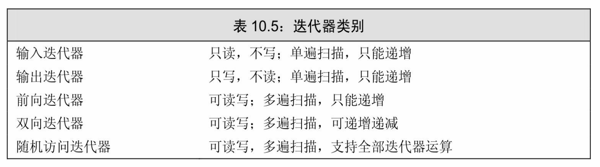

[总目录](<../目录.md>) · [本章目录](<01 章节导读.md>) · [上一篇](<../第10章 泛型算法/10.4 再探迭代器.md>) · [下一篇](<../第10章 泛型算法/10.6 特定容器算法.md>)

> 原 PDF 第 605–611 页。

<!-- PDF 第 605 页 -->

# **10.5** 泛型算法结构

任何算法的最基本的特性是它要求其迭代器提供哪些操作。某些算法,如find,只要求通过迭代器访问元素、递增迭代器以及比较两个迭代器是否相等这些能力。其他一些算法,如sort,还要求读、写和随机访问元素的能力。算法所要求的迭代器操作可以分为5个迭代器类别 (iterator category),如表10.5所示。每个算法都会对它的每个迭代器参数指明须提供哪类迭代器。



第二种算法分类的方式(如我们在本章开始所做的)是按照是否读、写或是重排序列中的元素来分类。附录A按这种分类方法列出了所有算法。

算法还共享一组参数传递规范和一组命名规范,我们在介绍迭代器类别之后将介绍这些内容。

### **10.5.1 5**类迭代器

类似容器,迭代器也定义了一组公共操作。一些操作所有迭代器都支持,另外一些只有特定类别的迭代器才支持。例如,ostream\_iterator 只支持递增、解引用和赋值。vector、string和deque的迭代器除了这些操作外,还支持递减、关系和算术运算。

迭代器是按它们所提供的操作来分类的,而这种分类形成了一种层次。除了输出迭代器之外,一个高层类别的迭代器支持低层类别迭代器

<!-- PDF 第 606 页 -->

的所有操作。

C++标准指明了泛型和数值算法的每个迭代器参数的最小类别。例如,find算法在一个序列上进行一遍扫描,对元素进行只读操作,因此至少需要输入迭代器。replace函数需要一对迭代器,至少是前向迭代器。类似的,replace\_copy的前两个迭代器参数也要求至少是前向迭代器。其第三个迭代器表示目的位置,必须至少是输出迭代器。其他的例子类似。对每个迭代器参数来说,其能力必须与规定的最小类别至少相当。向算法传递一个能力更差的迭代器会产生错误。


对于向一个算法传递错误类别的迭代器的问题,很多编译器不会给出任何警告或提示。

### 迭代器类别

输入迭代器(**input iterator**):可以读取序列中的元素。一个输入迭代器必须支持

· 用于比较两个迭代器的相等和不相等运算符(==、!=) · 用于推进迭代器的前置和后置递增运算(++) · 用于读取元素的解引用运算符(\*);解引用只会出现在赋值运算

符的右侧

· 箭头运算符(->),等价于(\*it).member,即,解引用迭代器, 并提取对象的成员

输入迭代器只用于顺序访问。对于一个输入迭代器,\*it++保证是有效的,但递增它可能导致所有其他指向流的迭代器失效。其结果就是, 不能保证输入迭代器的状态可以保存下来并用来访问元素。因此,输入迭代器只能用于单遍扫描算法。算法find和accumulate要求输入迭代器; 而istream\_iterator是一种输入迭代器。

输出迭代器(**output iterator**):可以看作输入迭代器功能上的补集——只写而不读元素。输出迭代器必须支持

· 用于推进迭代器的前置和后置递增运算(++) · 解引用运算符(\*),只出现在赋值运算符的左侧(向一个已经解 

<!-- PDF 第 607 页 -->

引用的输出迭代器赋值,就是将值写入它所指向的元素)

我们只能向一个输出迭代器赋值一次。类似输入迭代器,输出迭代器只能用于单遍扫描算法。用作目的位置的迭代器通常都是输出迭代器。例如,copy函数的第三个参数就是输出迭代器。ostream\_iterator类型也是输出迭代器。

前向迭代器(**forward iterator**):可以读写元素。这类迭代器只能在序列中沿一个方向移动。前向迭代器支持所有输入和输出迭代器的操作,而且可以多次读写同一个元素。因此,我们可以保存前向迭代器的状态,使用前向迭代器的算法可以对序列进行多遍扫描。算法replace要求前向迭代器,forward\_list上的迭代器是前向迭代器。

双向迭代器(**bidirectional iterator**):可以正向/反向读写序列中的元素。除了支持所有前向迭代器的操作之外,双向迭代器还支持前置和后置递减运算符(--)。算法reverse要求双向迭代器,除了 forward\_list之外,其他标准库都提供符合双向迭代器要求的迭代器。

随机访问迭代器(**random-access iterator**):提供在常量时间内访问序列中任意元素的能力。此类迭代器支持双向迭代器的所有功能,此外还支持表3.7(第99页)中的操作:

· 用于比较两个迭代器相对位置的关系运算符(<、<=、>和>=) 迭代器在序列中前进(或后退)给定整数个元素后的位置 · 用于两个迭代器上的减法运算符(-),得到两个迭代器的距离 · 下标运算符(iter[n]),与\*(iter[n])等价

· 迭代器和一个整数值的加减运算(+、+=、-和-=),计算结果是

算法sort要求随机访问迭代器。array、deque、string和vector的迭代器都是随机访问迭代器,用于访问内置数组元素的指针也是。

### **10.5.1**节练习

练习**10.38**:列出5个迭代器类别,以及每类迭代器所支持的操作。

练习**10.39**:list上的迭代器属于哪类?vector呢?

练习**10.40**:你认为copy要求哪类迭代器?reverse和unique呢?

<!-- PDF 第 608 页 -->

### **10.5.2** 算法形参模式

在任何其他算法分类之上,还有一组参数规范。理解这些参数规范对学习新算法很有帮助——通过理解参数的含义,你可以将注意力集中在算法所做的操作上。大多数算法具有如下4种形式之一:

<!-- 代码原图: ../images/_page_607_Picture_123.png -->
```c++
alg(beg, end, other args) ;
alg(beg, end, dest, other args) ;
alg(beg, end, beg2, other args) ;
alg(beg, end, beg2, end2, other args) ;
```

其中*alg*是算法的名字,beg和end表示算法所操作的输入范围。几乎所有算法都接受一个输入范围,是否有其他参数依赖于要执行的操作。 这里列出了常见的一种——dest、beg2和end2,都是迭代器参数。顾名思义,如果用到了这些迭代器参数,它们分别承担指定目的位置和第二个范围的角色。除了这些迭代器参数,一些算法还接受额外的、非迭代器的特定参数。

### 接受单个目标迭代器的算法

dest参数是一个表示算法可以写入的目的位置的迭代器。算法假定 (assume):按其需要写入数据,不管写入多少个元素都是安全的。


向输出迭代器写入数据的算法都假定目标空间足够容纳写入的数据。

如果dest是一个直接指向容器的迭代器,那么算法将输出数据写到容器中已存在的元素内。更常见的情况是,dest被绑定到一个插入迭代器(参见10.4.1节,第358页)或是一个ostream\_iterator(参见10.4.2节, 第359页)。插入迭代器会将新元素添加到容器中,因而保证空间是足够的。ostream\_iterator会将数据写入到一个输出流,同样不管要写入多少个元素都没有问题。

### 接受第二个输入序列的算法

接受单独的beg2或是接受beg2和end2的算法用这些迭代器表示第二个输入范围。这些算法通常使用第二个范围中的元素与第一个输入范围

<!-- PDF 第 609 页 -->

结合来进行一些运算。

如果一个算法接受beg2和end2,这两个迭代器表示第二个范围。这类算法接受两个完整指定的范围:[beg,end)表示的范围和[beg2 end2)表示的第二个范围。

只接受单独的beg2(不接受end2)的算法将beg2作为第二个输入范围中的首元素。此范围的结束位置未指定,这些算法假定从beg2开始的范围与beg和end所表示的范围至少一样大。


接受单独beg2的算法假定从beg2开始的序列与beg和end所表示的范围至少一样大。

### **10.5.3** 算法命名规范

除了参数规范,算法还遵循一套命名和重载规范。这些规范处理诸如:如何提供一个操作代替默认的<或==运算符以及算法是将输出数据写入输入序列还是一个分离的目的位置等问题。

### 一些算法使用重载形式传递一个谓词

接受谓词参数来代替<或==运算符的算法,以及那些不接受额外参数的算法,通常都是重载的函数。函数的一个版本用元素类型的运算符来比较元素;另一个版本接受一个额外谓词参数,来代替<或==:

<!-- 代码原图: ../images/_page_608_Picture_144.png -->
```c++
unique(beg,end); // 使用 == 运算符比较元素
unique(beg,end,comp); // 使用 comp 比较元素
```

两个调用都重新整理给定序列,将相邻的重复元素删除。第一个调用使用元素类型的==运算符来检查重复元素;第二个则调用comp来确定两个元素是否相等。由于两个版本的函数在参数个数上不相等,因此具体应该调用哪个版本不会产生歧义(参见6.4节,第208页)。

### **\_if**版本的算法

接受一个元素值的算法通常有另一个不同名的(不是重载的)版本,该版本接受一个谓词(参见10.3.1节,第344页)代替元素值。接受 

<!-- PDF 第 610 页 -->

谓词参数的算法都有附加的\_if前缀:

<!-- 代码原图: ../images/_page_609_Picture_90.png -->
```c++
find(beg,end,val); // 查找输入范围中 val 第一次出现的位置
find_if(beg,end,pred); // 查找第一个令 pred 为真的元素
```

这两个算法都在输入范围中查找特定元素第一次出现的位置。算法 find查找一个指定值;算法find\_if查找使得pred返回非零值的元素。

这两个算法提供了命名上差异的版本,而非重载版本,因为两个版本的算法都接受相同数目的参数。因此可能产生重载歧义,虽然很罕见,但为了避免任何可能的歧义,标准库选择提供不同名字的版本而不是重载。

区分拷贝元素的版本和不拷贝的版本

默认情况下,重排元素的算法将重排后的元素写回给定的输入序列中。这些算法还提供另一个版本,将元素写到一个指定的输出目的位置。如我们所见,写到额外目的空间的算法都在名字后面附加一个 \_copy(参见10.2.2节,第341页):

<!-- 代码原图: ../images/_page_609_Picture_91.png -->
```c++
reverse(beg, end); // 反转输入范围中元素的顺序
reverse_copy(beg, end, dest); // 将元素按逆序拷贝到 dest
```

一些算法同时提供\_copy和\_if版本。这些版本接受一个目的位置迭代器和一个谓词:

<!-- 代码原图: ../images/_page_609_Picture_92.png -->
```c++
// 从 v1 中删除奇数元素
remove_if(v1.begin(), v1.end(),
[](int i) { return i % 2; });
// 将偶数元素从 v1 拷贝到 v2；v1 不变
remove_copy_if(v1.begin(), v1.end(), back_inserter(v2),
[](int i) { return i % 2; });
```

两个算法都调用了lambda(参见10.3.2节,第346页)来确定元素是否为奇数。在第一个调用中,我们从输入序列中将奇数元素删除。在第二个调用中,我们将非奇数(亦即偶数)元素从输入范围拷贝到v2中。 **10.5.3**节练习

<!-- PDF 第 611 页 -->

练习**10.41**:仅根据算法和参数的名字,描述下面每个标准库算法执行什么操作:

<!-- 代码原图: ../images/_page_610_Picture_9.png -->
```c++
replace(beg, end, old_val, new_val);
replace_if(beg, end, pred, new_val);
replace_copy(beg, end, dest, old_val, new_val);
replace_copy_if(beg, end, dest, pred, new_val);
```


