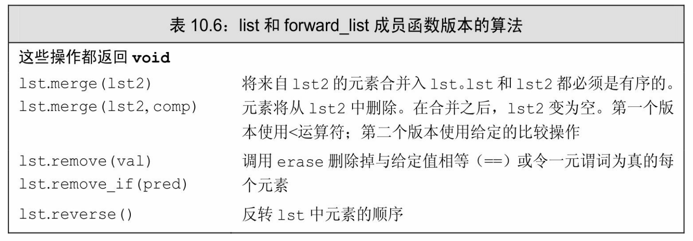
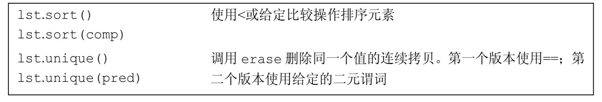
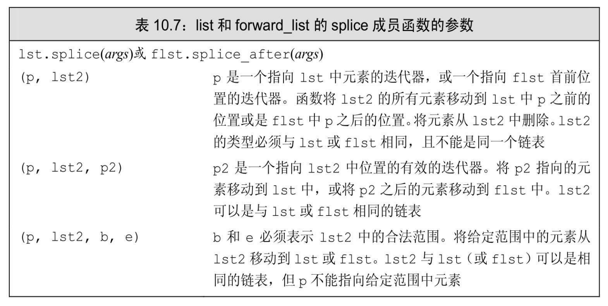

[总目录](<../目录.md>) · [本章目录](<01 章节导读.md>) · [上一篇](<../第10章 泛型算法/10.5 泛型算法结构.md>) · [下一篇](<../第10章 泛型算法/小结.md>)

> 原 PDF 第 612–613 页。

<!-- PDF 第 612 页 -->

# **10.6** 特定容器算法

与其他容器不同,链表类型list和forward\_list定义了几个成员函数形式的算法,如表10.6所示。特别是,它们定义了独有的sort、merge、 remove、reverse和unique。通用版本的sort要求随机访问迭代器,因此不能用于list和forward\_list,因为这两个类型分别提供双向迭代器和前向迭代器。

链表类型定义的其他算法的通用版本可以用于链表,但代价太高。 这些算法需要交换输入序列中的元素。一个链表可以通过改变元素间的链接而不是真的交换它们的值来快速"交换"元素。因此,这些链表版本的算法的性能比对应的通用版本好得多。

对于list和forward\_list,应该优先使用成员函数版本的算法而不是通用算法。

续表

**splice**成员

<!-- PDF 第 613 页 -->

链表类型还定义了splice算法,其描述见表10.7。此算法是链表数据结构所特有的,因此不需要通用版本。

### 链表特有的操作会改变容器

多数链表特有的算法都与其通用版本很相似,但不完全相同。链表特有版本与通用版本间的一个至关重要的区别是链表版本会改变底层的容器。例如,remove的链表版本会删除指定的元素。unique的链表版本会删除第二个和后继的重复元素。

类似的,merge和splice会销毁其参数。例如,通用版本的merge将合并的序列写到一个给定的目的迭代器;两个输入序列是不变的。而链表版本的merge函数会销毁给定的链表——元素从参数指定的链表中删除,被合并到调用merge的链表对象中。在merge之后,来自两个链表中的元素仍然存在,但它们都已在同一个链表中。

### **10.6**节练习

练习**10.42**:使用list代替vector重新实现10.2.3节(第343页)中的去除重复单词的程序。

