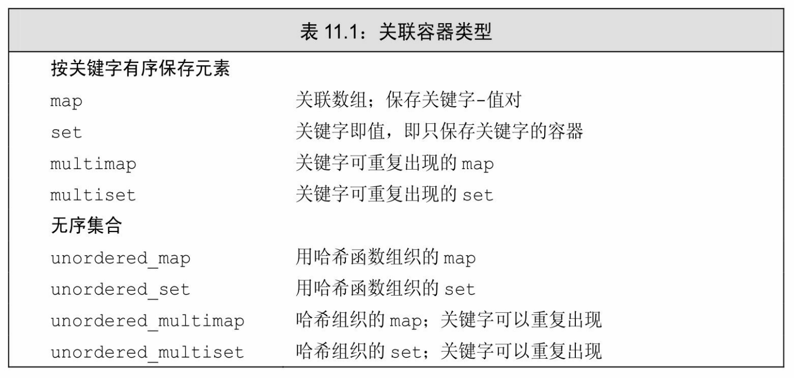

[总目录](<../目录.md>) · [上一篇](<../第10章 泛型算法/术语表.md>) · [下一篇](<../第11章 关联容器/11.1 使用关联容器.md>)

> 原 PDF 第 618–619 页。

<!-- PDF 第 618 页 -->

# 第**11**章关联容器

内容

**11.1** 使用关联容器.............................................................................................**374**

**11.2** 关联容器概述.............................................................................................**376**

**11.3** 关联容器操作.............................................................................................**381**

**11.4** 无序容器....................................................................................................**394**

小结.....................................................................................................................**397**

术语表..................................................................................................................**397**

关联容器和顺序容器有着根本的不同:关联容器中的元素是按关键字来保存和访问的。与之相对,顺序容器中的元素是按它们在容器中的位置来顺序保存和访问的。

虽然关联容器的很多行为与顺序容器相同,但其不同之处反映了关键字的作用。

关联容器支持高效的关键字查找和访问。两个主要的关联容器 (associative-container)类型是**map**和**set**。map中的元素是一些关键字-值(key-value)对:关键字起到索引的作用,值则表示与索引相关联的数据。set中每个元素只包含一个关键字;set支持高效的关键字查询操作——检查一个给定关键字是否在set中。例如,在某些文本处理过程中,可以用一个set来保存想要忽略的单词。字典则是一个很好的使用 map的例子:可以将单词作为关键字,将单词释义作为值。

<!-- PDF 第 619 页 -->

标准库提供8个关联容器,如表11.1所示。这8个容器间的不同体现在三个维度上:每个容器(1)或者是一个set,或者是一个map;(2) 或者要求不重复的关键字,或者允许重复关键字;(3)按顺序保存元素,或无序保存。允许重复关键字的容器的名字中都包含单词multi;不保持关键字按顺序存储的容器的名字都以单词unordered开头。因此一个 unordered\_multi\_set是一个允许重复关键字,元素无序保存的集合,而一个set则是一个要求不重复关键字,有序存储的集合。无序容器使用哈希函数来组织元素,我们将在11.4节(第394页)中详细介绍有关哈希函数的更多内容。

类型map和**multimap**定义在头文件map中;set和**multiset**定义在头文件set中;无序容器则定义在头文件unordered\_map和unordered\_set中。

---

## 本章笔记

- [11.1 使用关联容器](<11.1 使用关联容器.md>)
- [11.2 关联容器概述](<11.2 关联容器概述.md>)
- [11.3 关联容器操作](<11.3 关联容器操作.md>)
- [11.4 无序容器](<11.4 无序容器.md>)
- [小结](<小结.md>)
- [术语表](<术语表.md>)
