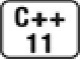
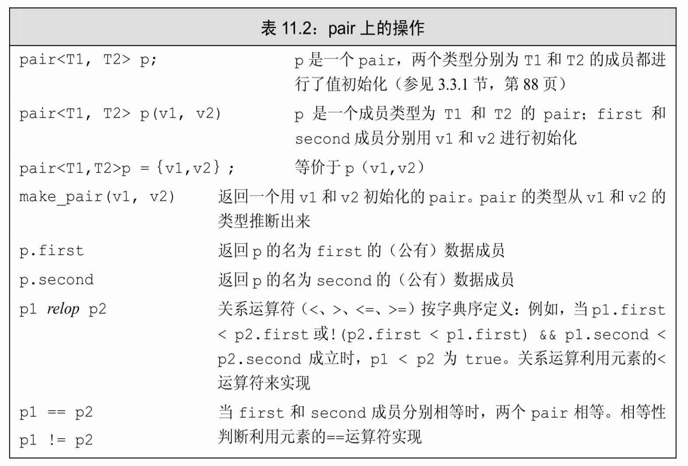

[总目录](<../目录.md>) · [本章目录](<01 章节导读.md>) · [上一篇](<../第11章 关联容器/11.1 使用关联容器.md>) · [下一篇](<../第11章 关联容器/11.3 关联容器操作.md>)

> 原 PDF 第 624–631 页。

<!-- PDF 第 624 页 -->

## **11.2** 关联容器概述

关联容器(有序的和无序的)都支持9.2节(第294页)中介绍的普通容器操作(列于表9.2,第295页)。关联容器不支持顺序容器的位置相关的操作,例如push\_front或push\_back。原因是关联容器中元素是根据关键字存储的,这些操作对关联容器没有意义。而且,关联容器也不支持构造函数或插入操作这些接受一个元素值和一个数量值的操作。

除了与顺序容器相同的操作之外,关联容器还支持一些顺序容器不支持的操作(参见表11.7,第388页)和类型别名(参见表11.3,第381 页)。此外,无序容器还提供一些用来调整哈希性能的操作,我们将在 11.4节(第394页)中介绍。

关联容器的迭代器都是双向的(参见10.5.1节,第365页)。

### **11.2.1** 定义关联容器

如前所示,当定义一个map时,必须既指明关键字类型又指明值类型;而定义一个set时,只需指明关键字类型,因为set中没有值。每个关联容器都定义了一个默认构造函数,它创建一个指定类型的空容器。 我们也可以将关联容器初始化为另一个同类型容器的拷贝,或是从一个值范围来初始化关联容器,只要这些值可以转化为容器所需类型就可以。在新标准下,我们也可以对关联容器进行值初始化:



<!-- 代码原图: ../images/_page_623_Picture_98.png -->
```c++
map<string, size_t> word_count; // 空容器
// 列表初始化
set<string> exclude = {"the", "but", "and", "or", "an", "a",
    "The", "But", "And", "Or", "An", "A"};
// 三个元素；authors 将姓映射为名
map<string, string> authors = { {"Joyce", "James"},
    {"Austen", "Jane"},
    {"Dickens", "Charles"} };
```

<!-- PDF 第 625 页 -->

与以往一样,初始化器必须能转换为容器中元素的类型。对于set, 元素类型就是关键字类型。

当初始化一个map时,必须提供关键字类型和值类型。我们将每个关键字-值对包围在花括号中:

<!-- 代码原图: ../images/_page_624_Picture_109.png -->
```c++
{key, value}
```

来指出它们一起构成了map中的一个元素。在每个花括号中,关键字是第一个元素,值是第二个。因此,authors将姓映射到名,初始化后它包含三个元素。

### 初始化**multimap**或**multiset**

一个map或set中的关键字必须是唯一的,即,对于一个给定的关键字,只能有一个元素的关键字等于它。容器multimap和multiset没有此限制,它们都允许多个元素具有相同的关键字。例如,在我们用来统计单词数量的map中,每个单词只能有一个元素。另一方面,在一个词典中,一个特定单词则可具有多个与之关联的词义。

下面的例子展示了具有唯一关键字的容器与允许重复关键字的容器之间的区别。首先,我们将创建一个名为ivec的保存int的vector,它包含20个元素:0到9每个整数有两个拷贝。我们将使用此vector初始化一个set和一个multiset:

<!-- 代码原图: ../images/_page_624_Picture_110.png -->
```c++
// 定义一个有 20 个元素的 vector，保存 0 到 9 个整数的两个拷贝
vector<int> ivec;
for (vector<int>::size_type i = 0; i != 10; ++i) {
    ivec.push_back(i);
    ivec.push_back(i); // 每个数重复保存一次
}
// iset 包含来自 ivec的不重复的元素；miset 包含所有 20 个元素
set<int> iset(ivec.cbegin(), ivec.cend());
multiset<int> miset(ivec.cbegin(), ivec.cend());
cout << ivec.size() << endl;        // 打印出 20
cout << iset.size() << endl;        // 打印出 10
cout << miset.size() << endl;        // 打印出 20
```

即使我们用整个ivec容器来初始化iset,它也只含有10个元素:对应

<!-- PDF 第 626 页 -->

ivec中每个不同的元素。另一方面,miset有20个元素,与ivec中的元素数量一样多。

### **11.2.1**节练习

练习**11.5**:解释map和set的区别。你如何选择使用哪个?

练习**11.6**:解释set和list的区别。你如何选择使用哪个?

练习**11.7**:定义一个map,关键字是家庭的姓,值是一个vector,保存家中孩子(们)的名。编写代码,实现添加新的家庭以及向已有家庭中添加新的孩子。

练习**11.8**:编写一个程序,在一个vector而不是一个set中保存不重复的单词。使用set的优点是什么?

## **11.2.2** 关键字类型的要求

关联容器对其关键字类型有一些限制。对于无序容器中关键字的要求,我们将在11.4节(第396页)中介绍。对于有序容器——map、 multimap、set以及multiset,关键字类型必须定义元素比较的方法。默认情况下,标准库使用关键字类型的<运算符来比较两个关键字。在集合类型中,关键字类型就是元素类型;在映射类型中,关键字类型是元素的第一部分的类型。因此,11.2节(第377页)中word\_count的关键字类型是string。类似的,exclude的关键字类型也是string。


传递给排序算法的可调用对象(参见10.3.1节,第344页)必须满足与关联容器中关键字一样的类型要求。

有序容器的关键字类型

可以向一个算法提供我们自己定义的比较操作(参见10.3节,第 344页),与之类似,也可以提供自己定义的操作来代替关键字上的<运算符。所提供的操作必须在关键字类型上定义一个严格弱序(strict weak ordering)。可以将严格弱序看作"小于等于",虽然实际定义的操作可能是一个复杂的函数。无论我们怎样定义比较函数,它必须具备如下基本性质:

<!-- PDF 第 627 页 -->

· 两个关键字不能同时"小于等于"对方;如果k1"小于等于"k2,那么k2绝不能"小于等于"k1。

· 如果k1"小于等于"k2,且k2"小于等于"k3,那么k1必须"小于等于"k3。

· 如果存在两个关键字,任何一个都不"小于等于"另一个,那么我们称这两个关键字是"等价"的。如果k1"等价于"k2,且k2"等价于"k3, 那么k1必须"等价于"k3。

如果两个关键字是等价的(即,任何一个都不"小于等于"另一个),那么容器将它们视作相等来处理。当用作map的关键字时,只能有一个元素与这两个关键字关联,我们可以用两者中任意一个来访问对应的值。


在实际编程中,重要的是,如果一个类型定义了"行为正常"的<运算符,则它可以用作关键字类型。

#### 使用关键字类型的比较函数

用来组织一个容器中元素的操作的类型也是该容器类型的一部分。 为了指定使用自定义的操作,必须在定义关联容器类型时提供此操作的类型。如前所述,用尖括号指出要定义哪种类型的容器,自定义的操作类型必须在尖括号中紧跟着元素类型给出。

在尖括号中出现的每个类型,就仅仅是一个类型而已。当我们创建一个容器(对象)时,才会以构造函数参数的形式提供真正的比较操作 (其类型必须与在尖括号中指定的类型相吻合)。

例如,我们不能直接定义一个Sales\_data的multiset,因为Sales\_data 没有<运算符。但是,可以用10.3.1节练习(第345页)中的compareIsbn 函数来定义一个multiset。此函数在Sales\_data对象的ISBN成员上定义了一个严格弱序。函数compareIsbn应该像下面这样定义

<!-- 代码原图: ../images/_page_626_Picture_175.png -->
```c++
bool compareIsbn(const Sales_data &lhs, const Sales_data &rhs)
{
    return lhs.isbn() < rhs.isbn();
}
```

<!-- PDF 第 628 页 -->

为了使用自己定义的操作,在定义multiset时我们必须提供两个类型:关键字类型Sales\_data,以及比较操作类型——应该是一种函数指针类型(参见6.7节,第221页),可以指向compareIsbn。当定义此容器类型的对象时,需要提供想要使用的操作的指针。在本例中,我们提供一个指向compareIsbn的指针:

<!-- 代码原图: ../images/_page_627_Picture_161.png -->
```c++
// bookstore 中多条记录可以有相同的 ISBN
// bookstore 中的元素以 ISBN 的顺序进行排列
multiset<Sales_data, decltype(compareIsbn) *>
    bookstore(compareIsbn);
```

此处,我们使用decltype来指出自定义操作的类型。记住,当用 decltype来获得一个函数指针类型时,必须加上一个\*来指出我们要使用一个给定函数类型的指针(参见6.7节,第223页)。用compareIsbn来初始化bookstore对象,这表示当我们向bookstore添加元素时,通过调用 compareIsbn来为这些元素排序。即,bookstore中的元素将按它们的 ISBN成员的值排序。可以用compareIsbn代替&compareIsbn作为构造函数的参数,因为当我们使用一个函数的名字时,在需要的情况下它会自动转化为一个指针(参见6.7节,第221页)。当然,使用&compareIsbn 的效果也是一样的。

### **11.2.2**节练习

练习**11.9**:定义一个map,将单词与一个行号的list关联,list中保存的是单词所出现的行号。

练习**11.10**:可以定义一个vector<int>::iterator到int的map吗? list<int>::iterator到int的map呢?对于两种情况,如果不能,解释为什么。

练习**11.11**:不使用decltype重新定义bookstore。

## **11.2.3 pair**类型

在介绍关联容器操作之前,我们需要了解名为**pair**的标准库类型, 它定义在头文件utility中。

<!-- PDF 第 629 页 -->

一个pair保存两个数据成员。类似容器,pair是一个用来生成特定类型的模板。当创建一个pair时,我们必须提供两个类型名,pair的数据成员将具有对应的类型。两个类型不要求一样:

<!-- 代码原图: ../images/_page_628_Picture_136.png -->
```c++
pair<string, string> anon; // 保存两个 string
pair<string, size_t> word_count; // 保存一个 string和一个 size_t
pair<string, vector<int>> line; // 保存 string 和 vector<int>
```

pair的默认构造函数对数据成员进行值初始化(参见3.3.1节,第88 页)。因此,anon是一个包含两个空string的pair,line保存一个空string 和一个空vector。word\_count中的size\_t成员值为0,而string成员被初始化为空。

我们也可以为每个成员提供初始化器:

<!-- 代码原图: ../images/_page_628_Picture_137.png -->
```c++
pair<string, string> author{"James", "Joyce"};
```

这条语句创建一个名为author的pair,两个成员被初始化为"James"和"Joyce"。

与其他标准库类型不同,pair的数据成员是public的(参见7.2节, 第240页)。两个成员分别命名为first和second。我们用普通的成员访问符号(参见1.5.2节,第20页)来访问它们,例如,在第375页的单词计数程序的输出语句中我们就是这么做的:

<!-- 代码原图: ../images/_page_628_Picture_138.png -->
```c++
// 打印结果
cout << w.first << " occurs " << w.second
<< ((w.second > 1) ? " times" : " time") << endl;
```

此处,w是指向map中某个元素的引用。map的元素是pair。在这条语句中,我们首先打印关键字——元素的first成员,接着打印计数器 ——second成员。标准库只定义了有限的几个pair操作,表11.2列出了这些操作。

<!-- PDF 第 630 页 -->



#### 创建**pair**对象的函数


想象有一个函数需要返回一个pair。在新标准下,我们可以对返回值进行列表初始化(参见6.3.2节,第203页)

<!-- 代码原图: ../images/_page_629_Picture_39.png -->
```c++
pair<string, int>
process(vector<string> &v)
{
    // 处理 v
```

<!-- 代码原图: ../images/_page_629_Picture_40.png -->
```c++
if (!v.empty())
    return {v.back(), v.back().size()}; // 列表初始化
else
    return pair<string, int>(); // 隐式构造返回值
}
```

若v不为空,我们返回一个由v中最后一个string及其大小组成的 pair。否则,隐式构造一个空pair,并返回它。

<!-- PDF 第 631 页 -->

在较早的C++版本中,不允许用花括号包围的初始化器来返回pair 这种类型的对象,必须显式构造返回值:

<!-- 代码原图: ../images/_page_630_Picture_87.png -->
```c++
if (!v.empty())
    return pair<string, int>(v.back(), v.back().size());
```

我们还可以用make\_pair来生成pair对象,pair的两个类型来自于 make\_pair的参数:

<!-- 代码原图: ../images/_page_630_Picture_88.png -->
```c++
if (!v.empty())
    return make_pair(v.back(), v.back().size());
```

#### **11.2.3**节练习

练习**11.12**:编写程序,读入string和int的序列,将每个string和int存入一个pair中,pair保存在一个vector中。

练习**11.13**:在上一题的程序中,至少有三种创建pair的方法。编写此程序的三个版本,分别采用不同的方法创建pair。解释你认为哪种形式最易于编写和理解,为什么?

练习**11.14**:扩展你在11.2.1节练习(第378页)中编写的孩子姓到名的 map,添加一个pair的vector,保存孩子的名和生日。


