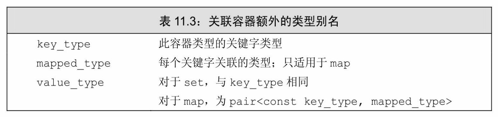
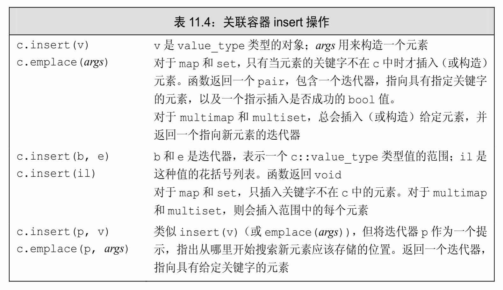
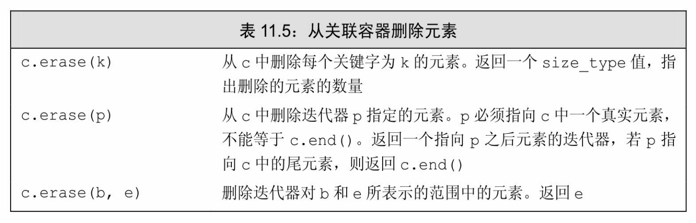
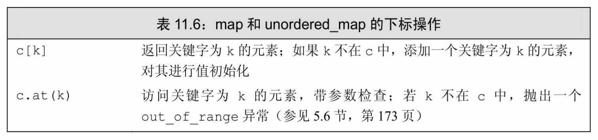
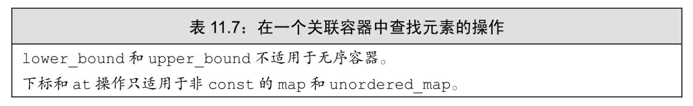
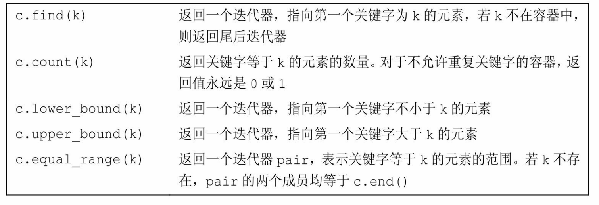

[总目录](<../目录.md>) · [本章目录](<01 章节导读.md>) · [上一篇](<../第11章 关联容器/11.2 关联容器概述.md>) · [下一篇](<../第11章 关联容器/11.4 无序容器.md>)

> 原 PDF 第 632–651 页。

<!-- PDF 第 632 页 -->

# **11.3** 关联容器操作

除了表9.2(第295页)中列出的类型,关联容器还定义了表11.3中列出的类型。这些类型表示容器关键字和值的类型。



对于set类型,**key\_type**和**value\_type**是一样的;set中保存的值就是关键字。在一个map中,元素是关键字-值对。即,每个元素是一个pair 对象,包含一个关键字和一个关联的值。由于我们不能改变一个元素的关键字,因此这些pair的关键字部分是const的:

<!-- 代码原图: ../images/_page_631_Picture_116.png -->
```c++
set<string>::value_type v1; // v1 是一个 string
set<string>::key_type v2; // v2 是一个 string
map<string, int>::value_type v3; // v3 是一个 pair<const string, int>
map<string, int>::key_type v4; // v4 是一个 string
map<string, int>::mapped_type v5; // v5 是一个 int
```

与顺序容器一样(参见9.2.2节,第297页),我们使用作用域运算符来提取一个类型的成员——例如,map<string,int>::key\_type。

只有map类型(unordered\_map、unordered\_multimap、multimap和 map)才定义了**mapped\_type**。

## **11.3.1** 关联容器迭代器

当解引用一个关联容器迭代器时,我们会得到一个类型为容器的 value\_type的值的引用。对map而言,value\_type是一个pair类型,其first 成员保存const的关键字,second成员保存值:

<!-- PDF 第 633 页 -->

<!-- 代码原图: ../images/_page_632_Picture_84.png -->
```c++
// 获得指向 word_count 中一个元素的迭代器
auto map_it = word_count.begin();
// *map_it 是指向一个 pair<const string, size_t>对象的引用
cout << map_it->first; // 打印此元素的关键字
cout << " " << map_it->second; // 打印此元素的值
map_it->first = "new key"; // 错误：关键字是 const 的
++map_it->second; // 正确：我们可以通过迭代器改变元素
```


必须记住,一个map的value\_type是一个pair,我们可以改变pair的值,但不能改变关键字成员的值。

#### **set**的迭代器是**const**的

虽然set类型同时定义了iterator和const\_iterator类型,但两种类型都只允许只读访问set中的元素。与不能改变一个map元素的关键字一样, 一个set中的关键字也是const的。可以用一个set迭代器来读取元素的值,但不能修改:

<!-- 代码原图: ../images/_page_632_Picture_86.png -->
```c++
set<int> iset = {0,1,2,3,4,5,6,7,8,9};
set<int>::iterator set_it = iset.begin();
if (set_it != iset.end()) {
    *set_it = 42;                // 错误：set 中的关键字是只读的
    cout << *set_it << endl;    // 正确：可以读关键字
}
```

#### 遍历关联容器

map和set类型都支持表9.2(第295页)中的begin和end操作。与往常一样,我们可以用这些函数获取迭代器,然后用迭代器来遍历容器。 例如,我们可以编写一个循环来打印第375页中单词计数程序的结果, 如下所示:

<!-- PDF 第 634 页 -->

<!-- 代码原图: ../images/_page_633_Picture_120.png -->
```c++
// 获得一个指向首元素的迭代器
auto map_it = word_count.cbegin();
// 比较当前迭代器和尾后迭代器
while (map_it != word_count.cend()) {
    // 解引用迭代器，打印关键字-值对
    cout << map_it->first << " occurs "
        << map_it->second << " times" << endl;
    ++map_it; // 递增迭代器，移动到下一个元素
}
```

while的循环条件和循环中的迭代器递增操作看起来很像我们之前编写的打印一个vector或一个string的程序。我们首先初始化迭代器 map\_it,让它指向word\_count中的首元素。只要迭代器不等于end,就打印当前元素并递增迭代器。输出语句解引用map\_it来获得pair的成员, 否则与我们之前的程序一样。


本程序的输出是按字典序排列的。当使用一个迭代器遍历一个map、multimap、 set或multiset时,迭代器按关键字升序遍历元素。

关联容器和算法

我们通常不对关联容器使用泛型算法(参见第10章)。关键字是 const这一特性意味着不能将关联容器传递给修改或重排容器元素的算法,因为这类算法需要向元素写入值,而set类型中的元素是const的, map中的元素是pair,其第一个成员是const的。

关联容器可用于只读取元素的算法。但是,很多这类算法都要搜索序列。由于关联容器中的元素不能通过它们的关键字进行(快速)查找,因此对其使用泛型搜索算法几乎总是个坏主意。例如,我们将在 11.3.5节(第388页)中看到,关联容器定义了一个名为find的成员,它通过一个给定的关键字直接获取元素。我们可以用泛型find算法来查找一个元素,但此算法会进行顺序搜索。使用关联容器定义的专用的find 成员会比调用泛型find快得多。

在实际编程中,如果我们真要对一个关联容器使用算法,要么是将它当作一个源序列,要么当作一个目的位置。例如,可以用泛型copy算法将元素从一个关联容器拷贝到另一个序列。类似的,可以调用inserter

<!-- PDF 第 635 页 -->

将一个插入器绑定(参见10.4.1节,第358页)到一个关联容器。通过使用inserter,我们可以将关联容器当作一个目的位置来调用另一个算法。

**11.3.1**节练习

练习**11.15**:对一个int到vector<int>的map,其mapped\_type、key\_type和 value\_type分别是什么?

练习**11.16**:使用一个map迭代器编写一个表达式,将一个值赋予一个元素。

练习**11.17**:假定c是一个string的multiset,v是一个string的vector,解释下面的调用。指出每个调用是否合法:

<!-- 代码原图: ../images/_page_634_Picture_144.png -->
```c++
copy(v.begin(), v.end(), inserter(c, c.end()));
copy(v.begin(), v.end(), back_inserter(c));
copy(c.begin(), c.end(), inserter(v, v.end()));
copy(c.begin(), c.end(), back_inserter(v));
```

练习**11.18**:写出第382页循环中map\_it的类型,不要使用auto或 decltype。

练习**11.19**:定义一个变量,通过对11.2.2节(第378页)中的名为 bookstore的multiset调用begin()来初始化这个变量。写出变量的类型,不要使用auto或decltype。

## **11.3.2** 添加元素

关联容器的insert成员(见表11.4,第384页)向容器中添加一个元素或一个元素范围。由于map和set(以及对应的无序类型)包含不重复的关键字,因此插入一个已存在的元素对容器没有任何影响:

<!-- 代码原图: ../images/_page_634_Picture_145.png -->
```c++
vector<int> ivec = {2,4,6,8,2,4,6,8};          // ivec 有 8 个元素
set<int>  set2;                                 // 空集合
set2.insert(ivec.cbegin(), ivec.cend());     // set2 有 4 个元素
set2.insert({1,3,5,7,1,3,5,7});             // set2 现在有 8 个元素
```

insert有两个版本,分别接受一对迭代器,或是一个初始化器列

<!-- PDF 第 636 页 -->

表,这两个版本的行为类似对应的构造函数(参见11.2.1节,第376页) ——对于一个给定的关键字,只有第一个带此关键字的元素才被插入到容器中。

#### 向**map**添加元素

对一个map进行insert操作时,必须记住元素类型是pair。通常,对于想要插入的数据,并没有一个现成的pair对象。可以在insert的参数列表中创建一个pair:

<!-- 代码原图: ../images/_page_635_Picture_75.png -->
```c++
// 向 word_count 插入 word 的 4 种方法
word_count.insert({word, 1});
word_count.insert(make_pair(word, 1));
word_count.insert(pair<string, size_t>(word, 1));
word_count.insert(map<string, size_t>::value_type(word, 1));
```


如我们所见,在新标准下,创建一个pair最简单的方法是在参数列表中使用花括号初始化。也可以调用make\_pair或显式构造pair。最后一个insert调用中的参数:

<!-- 代码原图: ../images/_page_635_Picture_77.png -->
```c++
map<string, size_t>::value_type(s, 1)
```

构造一个恰当的pair类型,并构造该类型的一个新对象,插入到 map中。

<!-- PDF 第 637 页 -->



#### 检测**insert**的返回值

insert(或emplace)返回的值依赖于容器类型和参数。对于不包含重复关键字的容器,添加单一元素的insert和emplace版本返回一个pair, 告诉我们插入操作是否成功。pair的first成员是一个迭代器,指向具有给定关键字的元素;second成员是一个bool值,指出元素是插入成功还是已经存在于容器中。如果关键字已在容器中,则insert什么事情也不做,且返回值中的bool部分为false。如果关键字不存在,元素被插入容器中,且bool值为true。

作为一个例子,我们用insert重写单词计数程序:

<!-- 代码原图: ../images/_page_636_Picture_63.png -->
```c++
// 统计每个单词在输入中出现次数的一种更烦琐的方法
map<string, size_t> word_count; // 从 string 到 size_t 的空 map
string word;
while (cin >> word) {
    // 插入一个元素，关键字等于 word，值为 1;
    // 若 word 已在 word_count 中，insert 什么也不做
    auto ret = word_count.insert({word, 1});
    if (!ret.second)             // word 已在 word_count 中
        ++ret.first->second;     // 递增计数器
}
```

<!-- PDF 第 638 页 -->

对于每个word,我们尝试将其插入到容器中,对应的值为1。若 word已在map中,则什么都不做,特别是与word相关联的计数器的值不变。若word还未在map中,则此string对象被添加到map中,且其计数器的值被置为1。

if语句检查返回值的bool部分,若为false,则表明插入操作未发生。在此情况下,word已存在于word\_count中,因此必须递增此元素所关联的计数器。

#### 展开递增语句

在这个版本的单词计数程序中,递增计数器的语句很难理解。通过添加一些括号来反映出运算符的优先级(参见4.1.2节,第121页),会使表达式更容易理解一些:

<!-- 代码原图: ../images/_page_637_Picture_147.png -->
```c++
++((ret.first)->second); // 等价的表达式
```

下面我们一步一步来解释此表达式:

**ret** 保存insert返回的值,是一个pair。

**ret.first**是pair的第一个成员,是一个map迭代器,指向具有给定关键字的元素。

**ret.first->** 解引用此迭代器,提取map中的元素,元素也是一个 pair。

**ret.first->second** map中元素的值部分。

**++ret.first->second** 递增此值。

再回到原来完整的递增语句,它提取匹配关键字word的元素的迭代器,并递增与我们试图插入的关键字相关联的计数器。

如果读者使用的是旧版本的编译器,或者是在阅读新标准推出之前编写的代码,ret的声明和初始化可能复杂些:

<!-- 代码原图: ../images/_page_637_Picture_148.png -->
```c++
pair<map<string, size_t>::iterator, bool> ret =
word_count.insert(make_pair(word, 1));
```

应该容易看出这条语句定义了一个pair,其第二个类型为bool类

<!-- PDF 第 639 页 -->

型。第一个类型理解起来有点儿困难,它是一个在map<string,size\_t> 类型上定义的iterator类型。

#### 向**multiset**或**multimap**添加元素

我们的单词计数程序依赖于这样一个事实:一个给定的关键字只能出现一次。这样,任意给定的单词只有一个关联的计数器。我们有时希望能添加具有相同关键字的多个元素。例如,可能想建立作者到他所著书籍题目的映射。在此情况下,每个作者可能有多个条目,因此我们应该使用multimap而不是map。由于一个multi容器中的关键字不必唯一, 在这些类型上调用insert总会插入一个元素:

<!-- 代码原图: ../images/_page_638_Picture_140.png -->
```c++
multimap<string, string> authors;
// 插入第一个元素，关键字为 Barth，John
authors.insert({"Barth, John", "Sot-Weed Factor"});
// 正确：添加第二个元素，关键字也是 Barth，John
authors.insert({"Barth, John", "Lost in the Funhouse"});
```

对允许重复关键字的容器,接受单个元素的insert操作返回一个指向新元素的迭代器。这里无须返回一个bool值,因为insert总是向这类容器中加入一个新元素。

#### **11.3.2**节练习

练习**11.20**:重写11.1节练习(第376页)的单词计数程序,使用insert代替下标操作。你认为哪个程序更容易编写和阅读?解释原因。

练习**11.21**:假定word\_count是一个string到size\_t的map,word是一个 string,解释下面循环的作用:

<!-- 代码原图: ../images/_page_638_Picture_141.png -->
```c++
while (cin >> word)
    ++word_count.insert({word, 0}).first->second;
```

练习**11.22**:给定一个map<string,vector<int>>,对此容器的插入一个元素的insert版本,写出其参数类型和返回类型。

练习**11.23**:11.2.1节练习(第378页)中的map以孩子的姓为关键字,保存他们的名的vector,用multimap重写此map。

<!-- PDF 第 640 页 -->

## **11.3.3** 删除元素

关联容器定义了三个版本的erase,如表11.5所示。与顺序容器一样,我们可以通过传递给erase一个迭代器或一个迭代器对来删除一个元素或者一个元素范围。这两个版本的erase与对应的顺序容器的操作非常相似:指定的元素被删除,函数返回void。

关联容器提供一个额外的erase操作,它接受一个key\_type参数。此版本删除所有匹配给定关键字的元素(如果存在的话),返回实际删除的元素的数量。我们可以用此版本在打印结果之前从word\_count中删除一个特定的单词:

<!-- 代码原图: ../images/_page_639_Picture_89.png -->
```c++
// 删除一个关键字，返回删除的元素数量
if (word_count.erase(removal_word))
    cout << "ok: " << removal_word << " removed\n";
else cout << "oops: " << removal_word << " not found!\n";
```

对于保存不重复关键字的容器,erase的返回值总是0或1。若返回值为0,则表明想要删除的元素并不在容器中

对允许重复关键字的容器,删除元素的数量可能大于1:

<!-- 代码原图: ../images/_page_639_Picture_90.png -->
```c++
auto cnt = authors.erase("Barth, John");
```

如果authors是我们在11.3.2节(第386页)中创建的multimap,则cnt 的值为2。



<!-- PDF 第 641 页 -->

## **11.3.4 map**的下标操作

map和unordered\_map容器提供了下标运算符和一个对应的at函数 (参见9.3.2节,第311页),如表11.6所示。set类型不支持下标,因为 set中没有与关键字相关联的"值"。元素本身就是关键字,因此"获取与一个关键字相关联的值"的操作就没有意义了。我们不能对一个 multimap或一个unordered\_multimap进行下标操作,因为这些容器中可能有多个值与一个关键字相关联。

类似我们用过的其他下标运算符,map下标运算符接受一个索引 (即,一个关键字),获取与此关键字相关联的值。但是,与其他下标运算符不同的是,如果关键字并不在map中,会为它创建一个元素并插入到map中,关联值将进行值初始化(参见3.3.1节,第88页)。

例如,如果我们编写如下代码

<!-- 代码原图: ../images/_page_640_Picture_143.png -->
```c++
map <string, size_t> word_count; // empty map
// 插入一个关键字为 Anna的元素，关联值进行值初始化；然后将1赋予它
word_count["Anna"] = 1;
```

将会执行如下操作:

· 在word\_count中搜索关键字为Anna的元素,未找到。

· 将一个新的关键字-值对插入到word\_count中。关键字是一个const string,保存Anna。值进行值初始化,在本例中意味着值为0。

· 提取出新插入的元素,并将值1赋予它。

由于下标运算符可能插入一个新元素,我们只可以对非const的map 使用下标操作。


对一个map使用下标操作,其行为与数组或vector上的下标操作很不相同:使用一个不在容器中的关键字作为下标,会添加一个具有此关键字的元素到map中。

<!-- PDF 第 642 页 -->



#### 使用下标操作的返回值

map的下标运算符与我们用过的其他下标运算符的另一个不同之处是其返回类型。通常情况下,解引用一个迭代器所返回的类型与下标运算符返回的类型是一样的。但对map则不然:当对一个map进行下标操作时,会获得一个mapped\_type对象;但当解引用一个map迭代器时,会得到一个value\_type对象(参见11.3节,第381页)。

与其他下标运算符相同的是,map的下标运算符返回一个左值(参见4.1.1节,第121页)。由于返回的是一个左值,所以我们既可以读也可以写元素:

<!-- 代码原图: ../images/_page_641_Picture_103.png -->
```c++
cout << word_count["Anna"]; // 用 Anna 作为下标提取元素；会打印出 1
++word_count["Anna"]; // 提取元素，将其增 1
cout << word_count["Anna"]; // 提取元素并打印它；会打印出 2
```


与vector与string不同,map的下标运算符返回的类型与解引用map迭代器得到的类型不同。

如果关键字还未在map中,下标运算符会添加一个新元素,这一特性允许我们编写出异常简洁的程序,例如单词计数程序中的循环(参见 11.1节,第375页)。另一方面,有时只是想知道一个元素是否已在map 中,但在不存在时并不想添加元素。在这种情况下,就不能使用下标运算符。

#### **11.3.4**节练习

练习**11.24**:下面的程序完成什么功能?

<!-- PDF 第 643 页 -->

<!-- 代码原图: ../images/_page_642_Picture_75.png -->
```c++
map<int, int> m;
m[0] = 1;
```

练习**11.25**:对比下面程序与上一题程序

<!-- 代码原图: ../images/_page_642_Picture_76.png -->
```c++
vector<int> v;
v[0] = 1;
```

练习**11.26**:可以用什么类型来对一个map进行下标操作?下标运算符返回的类型是什么?请给出一个具体例子——即,定义一个map,然后写出一个可以用来对map进行下标操作的类型以及下标运算符将会返回的类型。

## **11.3.5** 访问元素

关联容器提供多种查找一个指定元素的方法,如表11.7所示。应该使用哪个操作依赖于我们要解决什么问题。如果我们所关心的只不过是一个特定元素是否已在容器中,可能find是最佳选择。对于不允许重复关键字的容器,可能使用find还是count没什么区别。但对于允许重复关键字的容器,count还会做更多的工作:如果元素在容器中,它还会统计有多少个元素有相同的关键字。如果不需要计数,最好使用find:

<!-- 代码原图: ../images/_page_642_Picture_77.png -->
```c++
set<int> iset = {0,1,2,3,4,5,6,7,8,9};
iset.find(1);    // 返回一个迭代器，指向 key == 1 的元素
iset.find(11);   // 返回一个迭代器，其值等于 iset.end()
iset.count(1);   // 返回 1
iset.count(11); // 返回 0
```



续表

<!-- PDF 第 644 页 -->



### 对**map**使用**find**代替下标操作

对map和unordered\_map类型,下标运算符提供了最简单的提取元素的方法。但是,如我们所见,使用下标操作有一个严重的副作用:如果关键字还未在map中,下标操作会插入一个具有给定关键字的元素。这种行为是否正确完全依赖于我们的预期是什么。例如,单词计数程序依赖于这样一个特性:使用一个不存在的关键字作为下标,会插入一个新元素,其关键字为给定关键字,其值为0。也就是说,下标操作的行为符合我们的预期。

但有时,我们只是想知道一个给定关键字是否在map中,而不想改变map。这样就不能使用下标运算符来检查一个元素是否存在,因为如果关键字不存在的话,下标运算符会插入一个新元素。在这种情况下, 应该使用find:

<!-- 代码原图: ../images/_page_643_Picture_96.png -->
```c++
if (word_count.find("foobar") == word_count.end())
    cout << "foobar is not in the map" << endl;
```

#### 在**multimap**或**multiset**中查找元素

在一个不允许重复关键字的关联容器中查找一个元素是一件很简单的事情——元素要么在容器中,要么不在。但对于允许重复关键字的容器来说,过程就更为复杂:在容器中可能有很多元素具有给定的关键字。如果一个multimap或multiset中有多个元素具有给定关键字,则这些元素在容器中会相邻存储。

例如,给定一个从作者到著作题目的映射,我们可能想打印一个特定作者的所有著作。可以用三种不同方法来解决这个问题。最直观的方

<!-- PDF 第 645 页 -->

#### 法是使用find和count:

<!-- 代码原图: ../images/_page_644_Picture_109.png -->
```c++
string search_item("Alain de Botton");        // 要查找的作者
auto entries = authors.count(search_item);    // 元素的数量
auto iter = authors.find(search_item);      // 此作者的第一本书
// 用一个循环查找此作者的所有著作
while(entries) {
    cout << iter->second << endl;            // 打印每个题目
    ++iter;                                 // 前进到下一本书
    --entries;                               // 记录已经打印了多少本书
}
```

首先调用count确定此作者共有多少本著作,并调用find获得一个迭代器,指向第一个关键字为此作者的元素。for循环的迭代次数依赖于 count的返回值。特别是,如果count返回0,则循环一次也不执行。


当我们遍历一个multimap或multiset时,保证可以得到序列中所有具有给定关键字的元素。

一种不同的,面向迭代器的解决方法

我们还可以用lower\_bound和upper\_bound来解决此问题。这两个操作都接受一个关键字,返回一个迭代器。如果关键字在容器中, lower\_bound返回的迭代器将指向第一个具有给定关键字的元素,而 upper\_bound返回的迭代器则指向最后一个匹配给定关键字的元素之后的位置。如果元素不在multimap中,则lower\_bound和upper\_bound会返回相等的迭代器——指向一个不影响排序的关键字插入位置。因此,用相同的关键字调用lower\_bound和upper\_bound会得到一个迭代器范围 (参见9.2.1节,第296页),表示所有具有该关键字的元素的范围。

当然,这两个操作返回的迭代器可能是容器的尾后迭代器。如果我们查找的元素具有容器中最大的关键字,则此关键字的upper\_bound返回尾后迭代器。如果关键字不存在,且大于容器中任何关键字,则 lower\_bound返回的也是尾后迭代器。


<!-- PDF 第 646 页 -->

lower\_bound返回的迭代器可能指向一个具有给定关键字的元素,但也可能不指向。如果关键字不在容器中,则lower\_bound会返回关键字的第一个安全插入点——不影响容器中元素顺序的插入位置。

使用这两个操作,我们可以重写前面的程序:

<!-- 代码原图: ../images/_page_645_Picture_138.png -->
```c++
// authors 和 search_item 的定义，与前面的程序一样
// beg 和 end 表示对应此作者的元素的范围
for (auto beg = authors.lower_bound(search_item),
    end = authors.upper_bound(search_item);
    beg != end; ++beg)
    cout << beg->second << endl; // 打印每个题目
```

此程序与使用count和find的版本完成相同的工作,但更直接。对 lower\_bound的调用将beg定位到第一个与search\_item匹配的元素(如果存在的话)。如果容器中没有这样的元素,beg将指向第一个关键字大于search\_item的元素,有可能是尾后迭代器。upper\_bound调用将end指向最后一个匹配指定关键字的元素之后的元素。这两个操作并不报告关键字是否存在,重要的是它们的返回值可作为一个迭代器范围(参见 9.2.1节,第296页)。

如果没有元素与给定关键字匹配,则lower\_bound和upper\_bound会返回相等的迭代器——都指向给定关键字的插入点,能保持容器中元素顺序的插入位置。

假定有多个元素与给定关键字匹配,beg将指向其中第一个元素。 我们可以通过递增beg来遍历这些元素。end中的迭代器会指出何时完成遍历——当beg等于end时,就表明已经遍历了所有匹配给定关键字的元素了。

由于这两个迭代器构成一个范围,我们可以用一个for循环来遍历这个范围。循环可能执行零次,如果存在给定作者的话,就会执行多次, 打印出该作者的所有项。如果给定作者不存在,beg和end相等,循环就一次也不会执行。否则,我们知道递增beg最终会使它到达end,在此过程中我们就会打印出与此作者关联的每条记录。


如果lower\_bound和upper\_bound返回相同的迭代器,则给定关键字不在容器中。

<!-- PDF 第 647 页 -->

#### **equal\_range**函数

解决此问题的最后一种方法是三种方法中最直接的:不必再调用 upper\_bound和lower\_bound,直接调用equal\_range即可。此函数接受一个关键字,返回一个迭代器pair。若关键字存在,则第一个迭代器指向第一个与关键字匹配的元素,第二个迭代器指向最后一个匹配元素之后的位置。若未找到匹配元素,则两个迭代器都指向关键字可以插入的位置。

可以用equal\_range来再次修改我们的程序:

<!-- 代码原图: ../images/_page_646_Picture_160.png -->
```c++
// authors 和 search_item 的定义，与前面的程序一样
// pos 保存迭代器对，表示与关键字匹配的元素范围
for (auto pos = authors.equal_range(search_item);
    pos.first != pos.second; ++pos.first)
    cout << pos.first->second << endl; // 打印每个题目
```

此程序本质上与前一个使用upper\_bound和lower\_bound的程序是一样的。不同之处就是,没有用局部变量beg和end来保存元素范围,而是使用了equal\_range返回的pair。此pair的first成员保存的迭代器与 lower\_bound返回的迭代器是一样的,second保存的迭代器与 upper\_bound的返回值是一样的。因此,在此程序中,pos.first等价于 beg,pos.second等价于end。

### **11.3.5**节练习

练习**11.27**:对于什么问题你会使用count来解决?什么时候你又会选择 find呢?

练习**11.28**:对一个string到int的vector的map,定义并初始化一个变量来保存在其上调用find所返回的结果。

练习**11.29**:如果给定的关键字不在容器中,upper\_bound、lower\_bound 和equal\_range分别会返回什么?

练习**11.30**:对于本节最后一个程序中的输出表达式,解释运算对象 pos.first->second的含义。

练习**11.31**:编写程序,定义一个作者及其作品的multimap。使用find在 multimap中查找一个元素并用erase删除它。确保你的程序在元素不在

<!-- PDF 第 648 页 -->

map中时也能正常运行。

练习**11.32**:使用上一题定义的multimap编写一个程序,按字典序打印作者列表和他们的作品。

## **11.3.6** 一个单词转换的**map**

我们将以一个程序结束本节的内容,它将展示map的创建、搜索以及遍历。这个程序的功能是这样的:给定一个string,将它转换为另一个string。程序的输入是两个文件。第一个文件保存的是一些规则,用来转换第二个文件中的文本。每条规则由两部分组成:一个可能出现在输入文件中的单词和一个用来替换它的短语。表达的含义是,每当第一个单词出现在输入中时,我们就将它替换为对应的短语。第二个输入文件包含要转换的文本。

如果单词转换文件的内容如下所示:

**brb be right back**

**k okay?**

**y why**

**r are**

**u you**

**pic picture**

**thk thanks!**

**l8r later**

我们希望转换的文本为

**where r u**

**y dont u send me a pic**

**k thk l8r**

则程序应该生成这样的输出:

<!-- PDF 第 649 页 -->

**where are you**

### **why dont you send me a picture**

**okay? thanks! later**

### 单词转换程序

我们的程序将使用三个函数。函数word\_transform管理整个过程。 它接受两个ifstream参数:第一个参数应绑定到单词转换文件,第二个参数应绑定到我们要转换的文本文件。函数buildMap会读取转换规则文件,并创建一个map,用于保存每个单词到其转换内容的映射。函数 transform接受一个string,如果存在转换规则,返回转换后的内容。

我们首先定义word\_transform函数。最重要的部分是调用buildMap 和transform:

<!-- 代码原图: ../images/_page_648_Picture_97.png -->
```c++
void word_transform(ifstream &map_file, ifstream &input)
{
    auto trans_map = buildMap(map_file); // 保存转换规则
    string text;                        // 保存输入中的每一行
    while (getline(input, text)) {        // 读取一行输入
        istringstream stream(text);        // 读取每个单词
        string word;
        bool firstword = true;            // 控制是否打印空格
        while (stream >> word) {
            if (firstword)
                firstword = false;
            else
                cout << " ";                // 在单词间打印一个空格
            // transform 返回它的第一个参数或其转换之后的形式
            cout << transform(word, trans_map); // 打印输出
        }
        cout << endl;                  // 完成一行的转换
    }
}
```

函数首先调用buildMap来生成单词转换map,我们将它保存在 trans\_map中。函数的剩余部分处理输入文件。while循环用getline一行一行地读取输入文件。这样做的目的是使得输出中的换行位置能和输入文

<!-- PDF 第 650 页 -->

件中一样。为了从每行中获取单词,我们使用了一个嵌套的while循环,它用一个istringstream(参见8.3节,第287页)来处理当前行中的每个单词。

在输出过程中,内层while循环使用一个bool变量firstword来确定是否打印一个空格。它通过调用transform来获得要打印的单词。transform 的返回值或者是word中原来的string,或者是trans\_map中指出的对应的转换内容。

建立转换映射

函数buildMap读入给定文件,建立起转换映射。

<!-- 代码原图: ../images/_page_649_Picture_121.png -->
```c++
map<string, string> buildMap(ifstream &map_file)
{
    map<string, string> trans_map; // 保存转换规则
    string key;        // 要转换的单词
    string value;     // 替换后的内容
    // 读取第一个单词存入 key 中，行中剩余内容存入 value
    while (map_file >> key && getline(map_file, value))
        if (value.size() > 1) // 检查是否有转换规则
            trans_map[key] = value.substr(1); // 跳过前导空格
        else
            throw runtime_error("no rule for " + key);
    return trans_map;
}
```

map\_file中的每一行对应一条规则。每条规则由一个单词和一个短语组成,短语可能包含多个单词。我们用>>读取要转换的单词,存入 key中,并调用getline读取这一行中的剩余内容存入value。由于getline不会跳过前导空格(参见3.2.2节,第78页),需要我们来跳过单词和它的转换内容之间的空格。在保存转换规则之前,检查是否获得了一个以上的字符。如果是,调用substr(参见9.5.1节,第321页)来跳过分隔单词及其转换短语之间的前导空格,并将得到的子字符串存入trans\_map。

注意,我们使用下标运算符来添加关键字-值对。我们隐含地忽略了一个单词在转换文件中出现多次的情况。如果真的有单词出现多次, 循环会将最后一个对应短语存入trans\_map。当while循环结束后, trans\_map中将保存着用来转换输入文本的规则。

<!-- PDF 第 651 页 -->

生成转换文本

函数transform进行实际的转换工作。其参数是需要转换的string的引用和转换规则map。如果给定string在map中,transform返回相应的短语。否则,transform直接返回原string:

<!-- 代码原图: ../images/_page_650_Picture_111.png -->
```c++
const string &
transform(const string &s, const map<string, string> &m)
{
    // 实际的转换工作；此部分是程序的核心
    auto map_it = m.find(s);
    // 如果单词在转换规则 map 中
    if (map_it != m.cend())
        return map_it->second;    // 使用替换短语
    else
        return s;                // 否则返回原 string
}
```

函数首先调用find来确定给定string是否在map中。如果存在,则 find返回一个指向对应元素的迭代器。否则,find返回尾后迭代器。如果元素存在,我们解引用迭代器,获得一个保存关键字和值的pair(参见11.3节,第381页),然后返回成员second,即用来替代s的内容。

**11.3.6**节练习

练习**11.33**:实现你自己版本的单词转换程序。

练习**11.34**:如果你将transform函数中的find替换为下标运算符,会发生什么情况?

练习**11.35**:在buildMap中,如果进行如下改写,会有什么效果?

<!-- 代码原图: ../images/_page_650_Picture_112.png -->
```c++
trans_map[key] = value.substr(1);
```

改为

```c++
trans_map.insert({key, value.substr(1)})
```

练习**11.36**:我们的程序并没有检查输入文件的合法性。特别是,它假定转换规则文件中的规则都是有意义的。如果文件中的某一行包含一个关键字、一个空格,然后就结束了,会发生什么?预测程序的行为并进行验证,再与你的程序进行比较。


