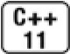
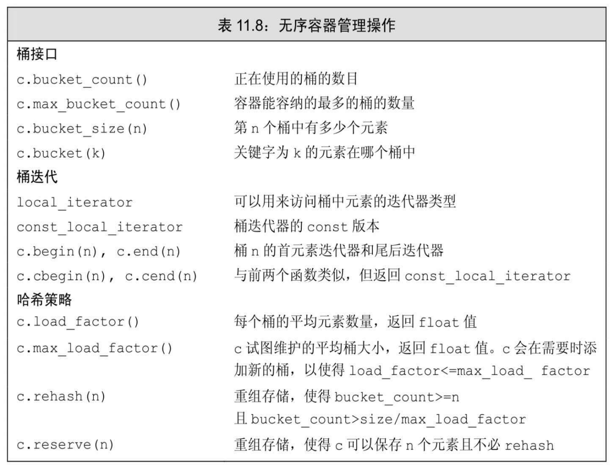

[总目录](<../目录.md>) · [本章目录](<01 章节导读.md>) · [上一篇](<../第11章 关联容器/11.3 关联容器操作.md>) · [下一篇](<../第11章 关联容器/小结.md>)

> 原 PDF 第 652–656 页。

<!-- PDF 第 652 页 -->

# **11.4** 无序容器



新标准定义了4个无序关联容器(unordered associative container)。这些容器不是使用比较运算符来组织元素,而是使用一个哈希函数(hash function)和关键字类型的==运算符。在关键字类型的元素没有明显的序关系的情况下,无序容器是非常有用的。在某些应用中,维护元素的序代价非常高昂,此时无序容器也很有用。

虽然理论上哈希技术能获得更好的平均性能,但在实际中想要达到很好的效果还需要进行一些性能测试和调优工作。因此,使用无序容器通常更为简单(通常也会有更好的性能)。


如果关键字类型固有就是无序的,或者性能测试发现问题可以用哈希技术解决, 就可以使用无序容器。

### 使用无序容器

除了哈希管理操作之外,无序容器还提供了与有序容器相同的操作 (find、insert等)。这意味着我们曾用于map和set的操作也能用于 unordered\_map和unordered\_set。类似的,无序容器也有允许重复关键字的版本。

因此,通常可以用一个无序容器替换对应的有序容器,反之亦然。 但是,由于元素未按顺序存储,一个使用无序容器的程序的输出(通常)会与使用有序容器的版本不同。

例如,可以用unordered\_map重写最初的单词计数程序(参见11.1 节,第375页):

<!-- PDF 第 653 页 -->

<!-- 代码原图: ../images/_page_652_Picture_97.png -->
```c++
// 统计出现次数，但单词不会按字典序排列
unordered_map<string, size_t> word_count;
string word;
while (cin >> word)
    ++word_count[word];                // 提取并递增 word 的计数器
for (const auto &w : word_count) // 对 map 中的每个元素
    // 打印结果
    cout << w.first << " occurs " << w.second
        << ((w.second > 1) ? " times" : " time") << endl;
```

此程序与原程序的唯一区别是word\_count的类型。如果在相同的输入数据上运行此版本,会得到这样的输出:

**containers.occurs 1 time use occurs 1 time can occurs 1 time examples occurs 1 time ...**

对于每个单词,我们将得到相同的计数结果。但单词不太可能按字典序输出。

### 管理桶

无序容器在存储上组织为一组桶,每个桶保存零个或多个元素。无序容器使用一个哈希函数将元素映射到桶。为了访问一个元素,容器首先计算元素的哈希值,它指出应该搜索哪个桶。容器将具有一个特定哈希值的所有元素都保存在相同的桶中。如果容器允许重复关键字,所有具有相同关键字的元素也都会在同一个桶中。因此,无序容器的性能依赖于哈希函数的质量和桶的数量和大小。

对于相同的参数,哈希函数必须总是产生相同的结果。理想情况下,哈希函数还能将每个特定的值映射到唯一的桶。但是,将不同关键字的元素映射到相同的桶也是允许的。当一个桶保存多个元素时,需要顺序搜索这些元素来查找我们想要的那个。计算一个元素的哈希值和在桶中搜索通常都是很快的操作。但是,如果一个桶中保存了很多元素, 那么查找一个特定元素就需要大量比较操作。

<!-- PDF 第 654 页 -->

无序容器提供了一组管理桶的函数,如表11.8所示。这些成员函数允许我们查询容器的状态以及在必要时强制容器进行重组。



### 无序容器对关键字类型的要求

默认情况下,无序容器使用关键字类型的==运算符来比较元素,它们还使用一个hash<key\_type>类型的对象来生成每个元素的哈希值。标准库为内置类型(包括指针)提供了**hash**模板。还为一些标准库类型, 包括string和我们将要在第12章介绍的智能指针类型定义了hash。因此, 我们可以直接定义关键字是内置类型(包括指针类型)、string还是智能指针类型的无序容器。

但是,我们不能直接定义关键字类型为自定义类类型的无序容器。 与容器不同,不能直接使用哈希模板,而必须提供我们自己的hash模板版本。我们将在16.5节(第626页)中介绍如何做到这一点。

我们不使用默认的hash,而是使用另一种方法,类似于为有序容器

<!-- PDF 第 655 页 -->

重载关键字类型的默认比较操作(参见11.2.2节,第378页)。为了能将 Sale\_data用作关键字,我们需要提供函数来替代==运算符和哈希值计算函数。我们从定义这些重载函数开始:

<!-- 代码原图: ../images/_page_654_Picture_95.png -->
```c++
size_t hasher(const Sales_data &sd)
{
    return hash<string>()(sd.isbn());
}

bool eqOp(const Sales_data &lhs, const Sales_data &rhs)
{
    return lhs.isbn() == rhs.isbn();
}
```

我们的hasher函数使用一个标准库hash类型对象来计算ISBN成员的哈希值,该hash类型建立在string类型之上。类似的,eqOp函数通过比较ISBN号来比较两个Sales\_data。

我们使用这些函数来定义一个unordered\_multiset

<!-- 代码原图: ../images/_page_654_Picture_96.png -->
```c++
using SD_multiset = unordered_multiset<Sales_data,
    decltype(hasher)*, decltype(eqOp)*>;
// 参数是桶大小、哈希函数指针和相等性判断运算符指针
SD_multiset bookstore(42, hasher, eqOp);
```

为了简化bookstore的定义,首先为unordered\_multiset定义了一个类型别名(参见2.5.1节,第60页),此集合的哈希和相等性判断操作与 hasher和eqOp函数有着相同的类型。通过使用这种类型,在定义 bookstore时可以将我们希望它使用的函数的指针传递给它。

如果我们的类定义了==运算符,则可以只重载哈希函数:

<!-- 代码原图: ../images/_page_654_Picture_97.png -->
```c++
// 使用 FooHash 生成哈希值；Foo 必须有==运算符
unordered_set<Foo, decltype(FooHash)*> fooSet(10, FooHash);
```

### **11.4**节练习

练习**11.37**:一个无序容器与其有序版本相比有何优势?有序版本有何优势?

<!-- PDF 第 656 页 -->

练习**11.38**:用unordered\_map重写单词计数程序(参见11.1节,第375 页)和单词转换程序(参见11.3.6节,第391页)。


