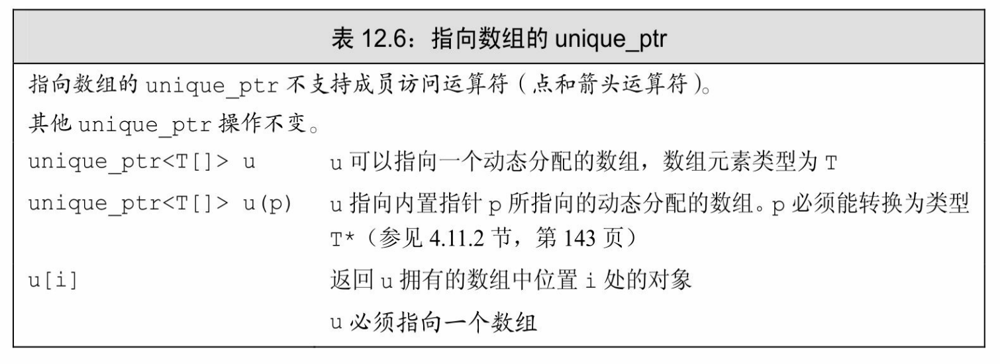
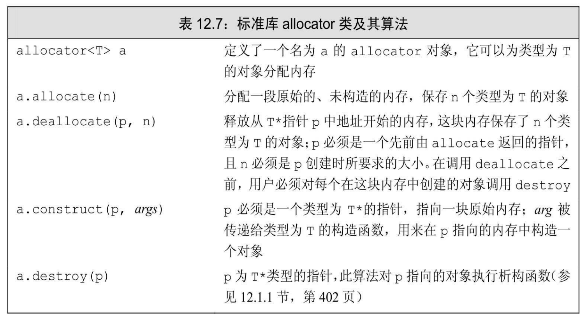
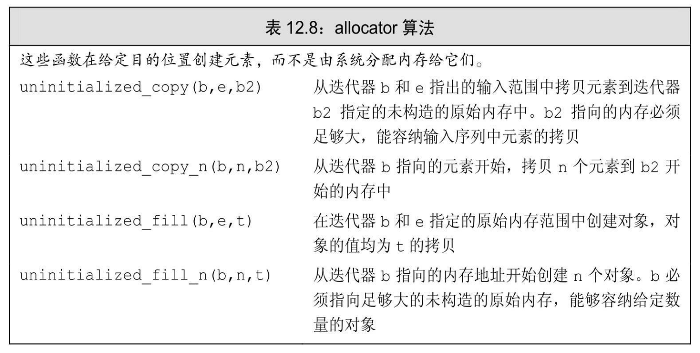

[总目录](<../目录.md>) · [本章目录](<01 章节导读.md>) · [上一篇](<../第12章 动态内存/12.1 动态内存与智能指针.md>) · [下一篇](<../第12章 动态内存/12.3 使用标准库：文本查询程序.md>)

> 原 PDF 第 697–708 页。

<!-- PDF 第 697 页 -->

# **12.2** 动态数组

new和delete运算符一次分配/释放一个对象,但某些应用需要一次为很多对象分配内存的功能。例如,vector和string都是在连续内存中保存它们的元素,因此,当容器需要重新分配内存时(参见9.4节,第317 页),必须一次性为很多元素分配内存。

为了支持这种需求,C++语言和标准库提供了两种一次分配一个对象数组的方法。C++语言定义了另一种new表达式语法,可以分配并初始化一个对象数组。标准库中包含一个名为allocator的类,允许我们将分配和初始化分离。使用allocator通常会提供更好的性能和更灵活的内存管理能力,原因我们将在12.2.2节(第427页)中解释。

很多(可能是大多数)应用都没有直接访问动态数组的需求。当一个应用需要可变数量的对象时,我们在StrBlob中所采用的方法几乎总是更简单、更快速并且更安全的——即,使用vector(或其他标准库容器)。如我们将在13.6节(第470页)中看到的,使用标准库容器的优势在新标准下更为显著。在支持新标准的标准库中,容器操作比之前的版本要快速得多。


大多数应用应该使用标准库容器而不是动态分配的数组。使用容器更为简单、更不容易出现内存管理错误并且可能有更好的性能。

如前所述,使用容器的类可以使用默认版本的拷贝、赋值和析构操作(参见7.1.5节,第239页)。分配动态数组的类则必须定义自己版本的操作,在拷贝、复制以及销毁对象时管理所关联的内存。


直到学习完第13章,不要在类内的代码中分配动态内存。

## **12.2.1 new**和数组

<!-- PDF 第 698 页 -->

为了让new分配一个对象数组,我们要在类型名之后跟一对方括号,在其中指明要分配的对象的数目。在下例中,new分配要求数量的对象并(假定分配成功后)返回指向第一个对象的指针:

<!-- 代码原图: ../images/_page_697_Picture_121.png -->
```c++
// 调用 get_size 确定分配多少个 int
int *pia = new int[get_size()]; // pia 指向第一个 int
```

方括号中的大小必须是整型,但不必是常量。

也可以用一个表示数组类型的类型别名(参见2.5.1节,第60页)来分配一个数组,这样,new表达式中就不需要方括号了:

<!-- 代码原图: ../images/_page_697_Picture_122.png -->
```c++
typedef int arrT[42]; // arrT 表示 42 个 int 的数组类型
int *p = new arrT; // 分配一个 42 个 int 的数组；p 指向第一个 int
```

在本例中,new分配一个int数组,并返回指向第一个int的指针。即使这段代码中没有方括号,编译器执行这个表达式时还是会用new[]。 即,编译器执行如下形式:

<!-- 代码原图: ../images/_page_697_Picture_123.png -->
```c++
int *p = new int[42];
```

分配一个数组会得到一个元素类型的指针

虽然我们通常称new T[]分配的内存为"动态数组",但这种叫法某种程度上有些误导。当用new分配一个数组时,我们并未得到一个数组类型的对象,而是得到一个数组元素类型的指针。即使我们使用类型别名定义了一个数组类型,new也不会分配一个数组类型的对象。在上例中,我们正在分配一个数组的事实甚至都是不可见的——连[*num*]都没有。new返回的是一个元素类型的指针。


由于分配的内存并不是一个数组类型,因此不能对动态数组调用 begin或end(参见3.5.3节,第106页)。这些函数使用数组维度(回忆一下,维度是数组类型的一部分)来返回指向首元素和尾后元素的指针。 出于相同的原因,也不能用范围for语句来处理(所谓的)动态数组中的元素。

<!-- PDF 第 699 页 -->


要记住我们所说的动态数组并不是数组类型,这是很重要的。

## 初始化动态分配对象的数组

默认情况下,new分配的对象,不管是单个分配的还是数组中的, 都是默认初始化的。可以对数组中的元素进行值初始化(参见3.3.1节, 第88页),方法是在大小之后跟一对空括号。

<!-- 代码原图: ../images/_page_698_Picture_92.png -->
```c++
int *pia = new int[10]; // 10个未初始化的 int
int *pia2 = new int[10](); // 10个值初始化为0的 int
string *psa = new string[10]; // 10个空 string
string *psa2 = new string[10]; // 10个空 string
```

在新标准中,我们还可以提供一个元素初始化器的花括号列表:


<!-- 代码原图: ../images/_page_698_Picture_94.png -->
```c++
// 10个int分别用列表中对应的初始化器初始化
int *pia3 = new int[10]{0,1,2,3,4,5,6,7,8,9};
// 10个string，前4个用给定的初始化器初始化，剩余的进行值初始化
string *psa3 = new string[10]{"a", "an", "the", string(3,'x')};
```

与内置数组对象的列表初始化(参见3.5.1节,第102页)一样,初始化器会用来初始化动态数组中开始部分的元素。如果初始化器数目小于元素数目,剩余元素将进行值初始化。如果初始化器数目大于元素数目,则new表达式失败,不会分配任何内存。在本例中,new会抛出一个类型为bad\_array\_new\_length的异常。类似bad\_alloc,此类型定义在头文件new中。


虽然我们用空括号对数组中元素进行值初始化,但不能在括号中给出初始化器,这意味着不能用auto分配数组(参见12.1.2节,第407 页)。

## 动态分配一个空数组是合法的

可以用任意表达式来确定要分配的对象的数目:

<!-- PDF 第 700 页 -->

<!-- 代码原图: ../images/_page_699_Picture_129.png -->
```c++
size_t n = get_size();    // get_size 返回需要的元素的数目
int* p = new int[n];     // 分配数组保存元素
for (int* q = p; q != p + n; ++q)
    /* 处理数组 */ ;
```

这产生了一个有意思的问题:如果get\_size返回0,会发生什么?答案是代码仍能正常工作。虽然我们不能创建一个大小为0的静态数组对象,但当n等于0时,调用new[n]是合法的:

<!-- 代码原图: ../images/_page_699_Picture_130.png -->
```c++
char arr[0]; // 错误：不能定义长度为0的数组
char *cp = new char[0]; // 正确：但cp不能解引用
```

当我们用new分配一个大小为0的数组时,new返回一个合法的非空指针。此指针保证与new返回的其他任何指针都不相同。对于零长度的数组来说,此指针就像尾后指针一样(参见3.5.3节,第106页),我们可以像使用尾后迭代器一样使用这个指针。可以用此指针进行比较操作,就像上面循环代码中那样。可以向此指针加上(或从此指针减去) 0,也可以从此指针减去自身从而得到0。但此指针不能解引用——毕竟它不指向任何元素。

在我们假想的循环中,若get\_size返回0,则n也是0,new会分配0个对象。for循环中的条件会失败(p等于q+n,因为n为0)。因此,循环体不会被执行。

## 释放动态数组

为了释放动态数组,我们使用一种特殊形式的delete——在指针前加上一个空方括号对:

<!-- 代码原图: ../images/_page_699_Picture_131.png -->
```c++
delete p; // p必须指向一个动态分配的对象或为空
delete [] pa; // pa必须指向一个动态分配的数组或为空
```

第二条语句销毁pa指向的数组中的元素,并释放对应的内存。数组中的元素按逆序销毁,即,最后一个元素首先被销毁,然后是倒数第二个,依此类推。

当我们释放一个指向数组的指针时,空方括号对是必需的:它指示编译器此指针指向一个对象数组的第一个元素。如果我们在delete一个

<!-- PDF 第 701 页 -->

指向数组的指针时忽略了方括号(或者在delete一个指向单一对象的指针时使用了方括号),其行为是未定义的。

回忆一下,当我们使用一个类型别名来定义一个数组类型时,在 new表达式中不使用[]。即使是这样,在释放一个数组指针时也必须使用方括号:

<!-- 代码原图: ../images/_page_700_Picture_123.png -->
```c++
typedef int arrT[42]; // arrT是42个int的数组的类型别名
int *p = new arrT; // 分配一个42个int的数组；p指向第一个元素
delete [] p; // 方括号是必需的，因为我们当初分配的是一个数组
```

不管外表如何,p指向一个对象数组的首元素,而不是一个类型为 arrT的单一对象。因此,在释放p时我们必须使用[]。


如果我们在delete一个数组指针时忘记了方括号,或者在delete一个单一对象的指针时使用了方括号,编译器很可能不会给出警告。我们的程序可能在执行过程中在没有任何警告的情况下行为异常。

## 智能指针和动态数组

标准库提供了一个可以管理new分配的数组的unique\_ptr版本。为了用一个unique\_ptr管理动态数组,我们必须在对象类型后面跟一对空方括号:

<!-- 代码原图: ../images/_page_700_Picture_125.png -->
```c++
// up 指向一个包含 10 个未初始化 int 的数组
unique_ptr<int[]> up(new int[10]);
up.release(); // 自动用 delete[]销毁其指针
```

类型说明符中的方括号(<int[]>)指出up指向一个int数组而不是一个int。由于up指向一个数组,当up销毁它管理的指针时,会自动使用 delete[]。

指向数组的unique\_ptr提供的操作与我们在12.1.5节(第417页)中使用的那些操作有一些不同,我们在表12.6中描述了这些操作。当一个 unique\_ptr指向一个数组时,我们不能使用点和箭头成员运算符。毕竟 unique\_ptr指向的是一个数组而不是单个对象,因此这些运算符是无意义的。另一方面,当一个unique\_ptr指向一个数组时,我们可以使用下

<!-- PDF 第 702 页 -->

标运算符来访问数组中的元素:

<!-- 代码原图: ../images/_page_701_Picture_75.png -->
```c++
for (size_t i = 0; i != 10; ++i)
    up[i] = i; // 为每个元素赋予一个新值
```



与unique\_ptr不同,shared\_ptr不直接支持管理动态数组。如果希望使用shared\_ptr管理一个动态数组,必须提供自己定义的删除器:

<!-- 代码原图: ../images/_page_701_Picture_77.png -->
```c++
// 为了使用 shared_ptr，必须提供一个删除器
shared_ptr<int> sp(new int[10], [](int *p) { delete[] p; });
sp.reset(); // 使用我们提供的 lambda 释放数组，它使用 delete[]
```

本例中我们传递给shared\_ptr一个lambda(参见10.3.2节,第346页) 作为删除器,它使用delete[]释放数组。

如果未提供删除器,这段代码将是未定义的。默认情况下, shared\_ptr使用delete销毁它指向的对象。如果此对象是一个动态数组, 对其使用delete所产生的问题与释放一个动态数组指针时忘记[]产生的问题一样(参见12.2.1节,第425页)。

shared\_ptr不直接支持动态数组管理这一特性会影响我们如何访问数组中的元素:

<!-- 代码原图: ../images/_page_701_Picture_78.png -->
```c++
// shared_ptr 未定义下标运算符，并且不支持指针的算术运算
for (size_t i = 0; i != 10; ++i)
    * (sp.get() + i) = i; // 使用 get 获取一个内置指针
```

shared\_ptr未定义下标运算符,而且智能指针类型不支持指针算术

<!-- PDF 第 703 页 -->

运算。因此,为了访问数组中的元素,必须用get获取一个内置指针, 然后用它来访问数组元素。

## **12.2.1**节练习

练习**12.23**:编写一个程序,连接两个字符串字面常量,将结果保存在一个动态分配的char数组中。重写这个程序,连接两个标准库string对象。

练习**12.24**:编写一个程序,从标准输入读取一个字符串,存入一个动态分配的字符数组中。描述你的程序如何处理变长输入。测试你的程序,输入一个超出你分配的数组长度的字符串。

练习**12.25**:给定下面的new表达式,你应该如何释放pa?

<!-- 代码原图: ../images/_page_702_Picture_95.png -->
```c++
int *pa = new int[10];
```

## **12.2.2 allocator**类

new有一些灵活性上的局限,其中一方面表现在它将内存分配和对象构造组合在了一起。类似的,delete将对象析构和内存释放组合在了一起。我们分配单个对象时,通常希望将内存分配和对象初始化组合在一起。因为在这种情况下,我们几乎肯定知道对象应有什么值。

当分配一大块内存时,我们通常计划在这块内存上按需构造对象。 在此情况下,我们希望将内存分配和对象构造分离。这意味着我们可以分配大块内存,但只在真正需要时才真正执行对象创建操作(同时付出一定开销)。

一般情况下,将内存分配和对象构造组合在一起可能会导致不必要的浪费。例如:

<!-- PDF 第 704 页 -->

<!-- 代码原图: ../images/_page_703_Picture_103.png -->
```c++
string *const p = new string[n]; // 构造 n 个空 string
string s;
string *q = p; // q 指向第一个 string
while (cin >> s && q != p + n)
    *q++ = s; // 赋予 *q 一个新值
const size_t size = q - p; // 记住我们读取了多少个 string
// 使用数组
delete[] p; // p 指向一个数组；记得用 delete[] 来释放
```

new表达式分配并初始化了n个string。但是,我们可能不需要n个 string,少量string可能就足够了。这样,我们就可能创建了一些永远也用不到的对象。而且,对于那些确实要使用的对象,我们也在初始化之后立即赋予了它们新值。每个使用到的元素都被赋值了两次:第一次是在默认初始化时,随后是在赋值时。

更重要的是,那些没有默认构造函数的类就不能动态分配数组了。

## **allocator**类

标准库**allocator**类定义在头文件memory中,它帮助我们将内存分配和对象构造分离开来。它提供一种类型感知的内存分配方法,它分配的内存是原始的、未构造的。表12.7概述了allocator支持的操作。在本节中,我们将介绍这些allocator操作。在13.5节(第464页),我们将看到如何使用这个类的典型例子。

类似vector,allocator是一个模板(参见3.3节,第86页)。为了定义一个allocator对象,我们必须指明这个allocator可以分配的对象类型。 当一个allocator对象分配内存时,它会根据给定的对象类型来确定恰当的内存大小和对齐位置:

<!-- 代码原图: ../images/_page_703_Picture_104.png -->
```c++
allocator<string> alloc; // 可以分配 string 的 allocator 对象
auto const p = alloc.allocate(n); // 分配 n 个未初始化的 string
```

这个allocate调用为n个string分配了内存。

<!-- PDF 第 705 页 -->



## **allocator**分配未构造的内存


allocator分配的内存是未构造的(unconstructed)。我们按需要在此内存中构造对象。在新标准库中,construct成员函数接受一个指针和零个或多个额外参数,在给定位置构造一个元素。额外参数用来初始化构造的对象。类似make\_shared的参数(参见12.1.1节,第401页),这些额外参数必须是与构造的对象的类型相匹配的合法的初始化器:

<!-- 代码原图: ../images/_page_704_Picture_55.png -->
```c++
auto q = p; // q指向最后构造的元素之后的位置
alloc.construct(q++); // *q为空字符串
alloc.construct(q++, 10, 'c'); // *q为 ccccccccc
alloc.construct(q++, "hi"); // *q为 hi!
```

在早期版本的标准库中,construct只接受两个参数:指向创建对象位置的指针和一个元素类型的值。因此,我们只能将一个元素拷贝到未构造空间中,而不能用元素类型的任何其他构造函数来构造一个元素。

还未构造对象的情况下就使用原始内存是错误的:

<!-- 代码原图: ../images/_page_704_Picture_56.png -->
```c++
cout << *p << endl; // 正确：使用 string 的输出运算符
cout << *q << endl; // 灾难：q指向未构造的内存！
```

<!-- PDF 第 706 页 -->


为了使用allocate返回的内存,我们必须用construct构造对象。使用未构造的内存,其行为是未定义的。

当我们用完对象后,必须对每个构造的元素调用destroy来销毁它们。函数destroy接受一个指针,对指向的对象执行析构函数(参见 12.1.1节,第402页):

<!-- 代码原图: ../images/_page_705_Picture_112.png -->
```c++
while (q != p)
alloc.destroy(--q); // 释放我们真正构造的 string
```

在循环开始处,q指向最后构造的元素之后的位置。我们在调用 destroy之前对q进行了递减操作。因此,第一次调用destroy时,q指向最后一个构造的元素。最后一步循环中我们destroy了第一个构造的元素, 随后q将与p相等,循环结束。


我们只能对真正构造了的元素进行destroy操作。

一旦元素被销毁后,就可以重新使用这部分内存来保存其他 string,也可以将其归还给系统。释放内存通过调用deallocate来完成:

<!-- 代码原图: ../images/_page_705_Picture_114.png -->
```c++
alloc.deallocate(p, n);
```

我们传递给deallocate的指针不能为空,它必须指向由allocate分配的内存。而且,传递给deallocate的大小参数必须与调用allocated分配内存时提供的大小参数具有一样的值。

## 拷贝和填充未初始化内存的算法

标准库还为allocator类定义了两个伴随算法,可以在未初始化内存中创建对象。表12.8描述了这些函数,它们都定义在头文件memory中。

<!-- PDF 第 707 页 -->



作为一个例子,假定有一个int的vector,希望将其内容拷贝到动态内存中。我们将分配一块比vector中元素所占用空间大一倍的动态内存,然后将原vector中的元素拷贝到前一半空间,对后一半空间用一个给定值进行填充:

<!-- 代码原图: ../images/_page_706_Picture_85.png -->
```c++
// 分配比 vi 中元素所占用空间大一倍的动态内存
auto p = alloc.allocate(vi.size() * 2);
// 通过拷贝 vi 中的元素来构造从 p 开始的元素
auto q = uninitialized_copy(vi.begin(), vi.end(), p);
// 将剩余元素初始化为 42
uninitialized_fill_n(q, vi.size(), 42);
```

类似拷贝算法(参见10.2.2节,第341页),uninitialized\_copy接受三个迭代器参数。前两个表示输入序列,第三个表示这些元素将要拷贝到的目的空间。传递给uninitialized\_copy的目的位置迭代器必须指向未构造的内存。与copy不同,uninitialized\_copy在给定目的位置构造元素。

类似copy,uninitialized\_copy返回(递增后的)目的位置迭代器。 因此,一次uninitialized\_copy调用会返回一个指针,指向最后一个构造的元素之后的位置。在本例中,我们将此指针保存在q中,然后将q传递给uninitialized\_fill\_n。此函数类似fill\_n(参见10.2.2节,第340页),接受一个指向目的位置的指针、一个计数和一个值。它会在目的位置指针

<!-- PDF 第 708 页 -->

指向的内存中创建给定数目个对象,用给定值对它们进行初始化。

## **12.2.2**节练习

练习**12.26**:用allocator重写第427页中的程序。


