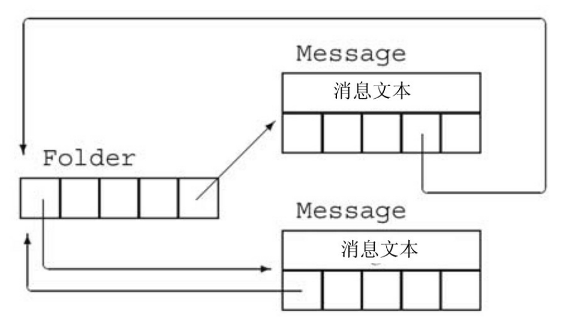

[总目录](<../目录.md>) · [本章目录](<01 章节导读.md>) · [上一篇](<../第13章 拷贝控制/13.3 交换操作.md>) · [下一篇](<../第13章 拷贝控制/13.5 动态内存管理类.md>)

> 原 PDF 第 757–763 页。

<!-- PDF 第 757 页 -->

# **13.4** 拷贝控制示例

虽然通常来说分配资源的类更需要拷贝控制,但资源管理并不是一个类需要定义自己的拷贝控制成员的唯一原因。一些类也需要拷贝控制成员的帮助来进行簿记工作或其他操作。

作为类需要拷贝控制来进行簿记操作的例子,我们将概述两个类的设计,这两个类可能用于邮件处理应用中。两个类命名为Message和 Folder,分别表示电子邮件(或者其他类型的)消息和消息目录。每个 Message对象可以出现在多个Folder中。但是,任意给定的Message的内容只有一个副本。这样,如果一条Message的内容被改变,则我们从它所在的任何Folder来浏览此Message时,都会看到改变后的内容。

为了记录Message位于哪些Folder中,每个Message都会保存一个它所在Folder的指针的set,同样的,每个Folder都保存一个它包含的 Message的指针的set。图13.1说明了这种设计思路。



图13.1:Message和Folder类设计

我们的Message类会提供save和remove操作,来向一个给定Folder添加一条Message或是从中删除一条Message。为了创建一个新的 Message,我们会指明消息内容,但不会指出Folder。为了将一条 Message放到一个特定Folder中,我们必须调用save。

当我们拷贝一个Message时,副本和原对象将是不同的Message对象,但两个Message都出现在相同的Folder中。因此,拷贝Message的操 

<!-- PDF 第 758 页 -->

作包括消息内容和Folder指针set的拷贝。而且,我们必须在每个包含此消息的Folder中都添加一个指向新创建的Message的指针。

当我们销毁一个Message时,它将不复存在。因此,我们必须从包含此消息的所有Folder中删除指向此Message的指针。

当我们将一个Message对象赋予另一个Message对象时,左侧 Message的内容会被右侧Message的内容所替代。我们还必须更新Folder 集合,从原来包含左侧Message的Folder中将它删除,并将它添加到包含右侧Message的Folder中。

观察这些操作,我们可以看到,析构函数和拷贝赋值运算符都必须从包含一条Message的所有Folder中删除它。类似的,拷贝构造函数和拷贝赋值运算符都要将一个Message添加到给定的一组Folder中。我们将定义两个private的工具函数来完成这些工作。


拷贝赋值运算符通常执行拷贝构造函数和析构函数中也要做的工作。这种情况下,公共的工作应该放在private的工具函数中完成。

Folder类也需要类似的拷贝控制成员,来添加或删除它保存的 Message。

我们将Folder类的设计和实现留作练习。但是,我们将假定Folder 类包含名为addMsg和remMsg的成员,分别完成在给定Folder对象的消息集合中添加和删除Message的工作。

# **Message**类

根据上述设计,我们可以编写Message类,如下所示:

<!-- PDF 第 759 页 -->

<!-- 代码原图: ../images/_page_758_Picture_63.png -->
```c++
class Message {
    friend class Folder;
public:
    // folders 被隐式初始化为空集合
    explicit Message(const std::string &str = ""):
        contents(str) { }
    // 拷贝控制成员，用来管理指向本 Message 的指针
    Message(const Message&);                // 拷贝构造函数
    Message& operator=(const Message&);    // 拷贝赋值运算符
    ~Message();                          // 析构函数
    // 从给定 Folder 集合中添加/删除本 Message
    void save(Folder&);
    void remove(Folder&);
private:
    std::string contents;              // 实际消息文本
    std::set<Folder*> folders;         // 包含本 Message 的 Folder
    // 拷贝构造函数、拷贝赋值运算符和析构函数所使用的工具函数
    // 将本 Message 添加到指向参数的 Folder 中
    void add_to_Folders(const Message&);
    // 从 folders 中的每个 Folder 中删除本 Message
    void remove_from_Folders();
};
```

这个类定义了两个数据成员:contents,保存消息文本;folders,保存指向本Message所在Folder的指针。接受一个string参数的构造函数将给定string拷贝给contents,并将folders(隐式)初始化为空集。由于此构造函数有一个默认参数,因此它也被当作Message的默认构造函数 (参见7.5.1节,第260页)。

## **save**和**remove**成员

除拷贝控制成员外,Message类只有两个公共成员:save,将本 Message存放在给定Folder中;remove,删除本Message:

<!-- PDF 第 760 页 -->

<!-- 代码原图: ../images/_page_759_Picture_101.png -->
```c++
void Message::save(Folder &f)
{
    folders.insert(&f);    // 将给定 Folder 添加到我们的 Folder 列表中
    f.addMsg(this);        // 将本 Message 添加到 f 的 Message 集合中
}

void Message::remove(Folder &f)
{
    folders.erase(&f);    // 将给定 Folder 从我们的 Folder 列表中删除
    f.remMsg(this);        // 将本 Message 从 f 的 Message 集合中删除
}
```

为了保存(或删除)一个Message,需要更新本Message的folders成员。当save一个Message时,我们应保存一个指向给定Folder的指针;当 remove一个Message时,我们要删除此指针。

这些操作还必须更新给定的Folder。更新一个Folder的任务是由 Folder类的addMsg和remMsg成员来完成的,分别添加和删除给定 Message的指针。

**Message**类的拷贝控制成员

当我们拷贝一个Message时,得到的副本应该与原Message出现在相同的Folder中。因此,我们必须遍历Folder指针的set,对每个指向原 Message的Folder添加一个指向新Message的指针。拷贝构造函数和拷贝赋值运算符都需要做这个工作,因此我们定义一个函数来完成这个公共操作:

<!-- 代码原图: ../images/_page_759_Picture_102.png -->
```c++
// 将本 Message 添加到指向 m 的 Folder 中
void Message::add_to_Folders(const Message &m)
{
    for (auto f : m.folders) // 对每个包含 m 的 Folder
        f->addMsg(this); // 向该 Folder 添加一个指向本 Message 的指针
}
```

此例中我们对m.folders中每个Folder调用addMsg。函数addMsg会将本Message的指针添加到每个Folder中。

<!-- PDF 第 761 页 -->

Message 的拷贝构造函数拷贝给定对象的数据成员：

<!-- 代码原图: ../images/_page_760_Picture_88.png -->
```c++
Message::Message(const Message &m):
    contents(m.contents), folders(m.folders)
{
    add_to_Folders(m); // 将本消息添加到指向 m 的 Folder 中
}
```

并调用add\_to\_Folders将新创建的Message的指针添加到每个包含原 Message的Folder中。

**Message**的析构函数

当一个Message被销毁时,我们必须从指向此Message的Folder中删除它。拷贝赋值运算符也要执行此操作,因此我们会定义一个公共函数来完成此工作:

<!-- 代码原图: ../images/_page_760_Picture_89.png -->
```c++
// 从对应的 Folder 中删除本 Message
void Message::remove_from_Folders()
{
    for (auto f : folders)    // 对 folders 中每个指针
        f->remMsg(this);    // 从该 Folder 中删除本 Message
}
```

函数remove\_from\_Folders的实现类似add\_to\_Folders,不同之处是它调用remMsg来删除当前Message而不是调用addMsg来添加Message。

有了remove\_from\_Folders函数,编写析构函数就很简单了:

<!-- 代码原图: ../images/_page_760_Picture_90.png -->
```c++
Message::~Message()
{
    remove_from_Folders();
}
```

调用remove\_from\_Folders确保没有任何Folder保存正在销毁的 Message的指针。编译器自动调用string的析构函数来释放contents,并自动调用set的析构函数来清理集合成员使用的内存。

**Message**的拷贝赋值运算符

<!-- PDF 第 762 页 -->

与大多数赋值运算符相同,我们的Message类的拷贝赋值运算符必须执行拷贝构造函数和析构函数的工作。与往常一样,最重要的是我们要组织好代码结构,使得即使左侧和右侧运算对象是同一个Message, 拷贝赋值运算符也能正确执行。

在本例中,我们先从左侧运算对象的folders中删除此Message的指针,然后再将指针添加到右侧运算对象的folders中,从而实现了自赋值的正确处理:

<!-- 代码原图: ../images/_page_761_Picture_145.png -->
```c++
Message& Message::operator=(const Message &rhs)
{
    // 通过先删除指针再插入它们来处理自赋值情况
    remove_from_Folders();    // 更新已有 Folder
    contents = rhs.contents; // 从 rhs 拷贝消息内容
    folders = rhs.folders;    // 从 rhs 拷贝 Folder 指针
    add_to_Folders(rhs);    // 将本 Message 添加到那些 Folder 中
    return *this;
}
```

如果左侧和右侧运算对象是相同的Message,则它们具有相同的地址。如果我们在add\_to\_Folders之后调用remove\_from\_Folders,就会将此 Message从它所在的所有Folder中删除。

# **Message**的**swap**函数

标准库中定义了string和set的swap版本(参见9.2.5节,第303页)。 因此,如果为我们的Message类定义它自己的swap版本,它将从中受益。通过定义一个Message特定版本的swap,我们可以避免对contents和 folders成员进行不必要的拷贝。

但是,我们的swap函数必须管理指向被交换Message的Folder指针。 在调用swap(m1,m2)之后,原来指向m1的Folder现在必须指向m2, 反之亦然。

我们通过两遍扫描folders中每个成员来正确处理Folder指针。第一遍扫描将Message从它们所在的Folder中删除。接下来我们调用swap来交换数据成员。最后对folders进行第二遍扫描来添加交换过的Message:

<!-- PDF 第 763 页 -->

<!-- 代码原图: ../images/_page_762_Picture_92.png -->
```c++
void swap(Message &lhs, Message &rhs)
{
    using std::swap; // 在本例中严格来说并不需要，但这是一个好习惯
    // 将每个消息的指针从它（原来）所在 Folder 中删除
    for (auto f: lhs.folders)
        f->remMsg(&lhs);
    for (auto f: rhs.folders)
        f->remMsg(&rhs);
    // 交换 contents 和 Folder 指针 set
    swap(lhs.folders, rhs.folders);        // 使用 swap(set&, set&)
    swap(lhs.contents, rhs.contents);      // swap(string&, string&)
    // 将每个 Message 的指针添加到它的（新）Folder 中
    for (auto f: lhs.folders)
        f->addMsg(&lhs);
    for (auto f: rhs.folders)
        f->addMsg(&rhs);
}
```

## **13.4**节练习

练习**13.33**:为什么Message的成员save和remove的参数是一个Folder&? 为什么我们不将参数定义为Folder或是const Folder&?

练习**13.34**:编写本节所描述的Message。

练习**13.35**:如果Message使用合成的拷贝控制成员,将会发生什么?

练习**13.36**:设计并实现对应的Folder类。此类应该保存一个指向Folder 中包含的Message的set。

练习**13.37**:为Message类添加成员,实现向folders添加或删除一个给定的Folder\*。这两个成员类似Folder类的addMsg和remMsg操作。

练习**13.38**:我们并未使用拷贝和交换方式来设计Message的赋值运算符。你认为其原因是什么?


