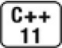

[总目录](<../目录.md>) · [本章目录](<01 章节导读.md>) · [上一篇](<../第13章 拷贝控制/13.5 动态内存管理类.md>) · [下一篇](<../第13章 拷贝控制/小结.md>)

> 原 PDF 第 773–796 页。

<!-- PDF 第 773 页 -->

# **13.6** 对象移动

新标准的一个最主要的特性是可以移动而非拷贝对象的能力。如我们在13.1.1节(第440页)中所见,很多情况下都会发生对象拷贝。在其中某些情况下,对象拷贝后就立即被销毁了。在这些情况下,移动而非拷贝对象会大幅度提升性能。

如我们已经看到的,我们的StrVec类是这种不必要的拷贝的一个很好的例子。在重新分配内存的过程中,从旧内存将元素拷贝到新内存是不必要的,更好的方式是移动元素。使用移动而不是拷贝的另一个原因源于IO类或unique\_ptr这样的类。这些类都包含不能被共享的资源(如指针或IO缓冲)。因此,这些类型的对象不能拷贝但可以移动。

在旧C++标准中,没有直接的方法移动对象。因此,即使不必拷贝对象的情况下,我们也不得不拷贝。如果对象较大,或者是对象本身要求分配内存空间(如string),进行不必要的拷贝代价非常高。类似的,在旧版本的标准库中,容器中所保存的类必须是可拷贝的。但在新标准中,我们可以用容器保存不可拷贝的类型,只要它们能被移动即可。


标准库容器、string和shared\_ptr类既支持移动也支持拷贝。IO类和unique\_ptr类可以移动但不能拷贝。

## **13.6.1** 右值引用


为了支持移动操作,新标准引入了一种新的引用类型——右值引用 (rvalue reference)。所谓右值引用就是必须绑定到右值的引用。我们通过&&而不是&来获得右值引用。如我们将要看到的,右值引用有一个重要的性质——只能绑定到一个将要销毁的对象。因此,我们可以自由地将一个右值引用的资源"移动"到另一个对象中。

<!-- PDF 第 774 页 -->

回忆一下,左值和右值是表达式的属性(参见4.1.1节,第121 页)。一些表达式生成或要求左值,而另外一些则生成或要求右值。一般而言,一个左值表达式表示的是一个对象的身份,而一个右值表达式表示的是对象的值。

类似任何引用,一个右值引用也不过是某个对象的另一个名字而已。如我们所知,对于常规引用(为了与右值引用区分开来,我们可以称之为左值引用(lvalue reference)),我们不能将其绑定到要求转换的表达式、字面常量或是返回右值的表达式(参见2.3.1节,第46页)。 右值引用有着完全相反的绑定特性:我们可以将一个右值引用绑定到这类表达式上,但不能将一个右值引用直接绑定到一个左值上:

<!-- 代码原图: ../images/_page_773_Picture_101.png -->
```c++
int i = 42;
int &r = i; // 正确：r引用i
int &&rr = i; // 错误：不能将一个右值引用绑定到一个左值上
int &r2 = i * 42; // 错误：i*42是一个右值
const int &r3 = i * 42; // 正确：我们可以将一个 const 的引用绑定到一个右值上
int &&rr2 = i * 42; // 正确：将 rr2 绑定到乘法结果上
```

返回左值引用的函数,连同赋值、下标、解引用和前置递增/递减运算符,都是返回左值的表达式的例子。我们可以将一个左值引用绑定到这类表达式的结果上。

返回非引用类型的函数,连同算术、关系、位以及后置递增/递减运算符,都生成右值。我们不能将一个左值引用绑定到这类表达式上, 但我们可以将一个const的左值引用或者一个右值引用绑定到这类表达式上。

### 左值持久;右值短暂

考察左值和右值表达式的列表,两者相互区别之处就很明显了:左值有持久的状态,而右值要么是字面常量,要么是在表达式求值过程中创建的临时对象。

由于右值引用只能绑定到临时对象,我们得知

· 所引用的对象将要被销毁 · 该对象没有其他用户

<!-- PDF 第 775 页 -->

这两个特性意味着:使用右值引用的代码可以自由地接管所引用的对象的资源。


右值引用指向将要被销毁的对象。因此,我们可以从绑定到右值引用的对象"窃取"状态。

### 变量是左值

变量可以看作只有一个运算对象而没有运算符的表达式,虽然我们很少这样看待变量。类似其他任何表达式,变量表达式也有左值/右值属性。变量表达式都是左值。带来的结果就是,我们不能将一个右值引用绑定到一个右值引用类型的变量上,这有些令人惊讶:

<!-- 代码原图: ../images/_page_774_Picture_101.png -->
```c++
int &&rr1 = 42; // 正确：字面常量是右值
int &&rr2 = rr1; // 错误：表达式 rr1 是左值！
```

其实有了右值表示临时对象这一观察结果,变量是左值这一特性并不令人惊讶。毕竟,变量是持久的,直至离开作用域时才被销毁。


变量是左值,因此我们不能将一个右值引用直接绑定到一个变量上,即使这个变量是右值引用类型也不行。

### 标准库**move**函数


虽然不能将一个右值引用直接绑定到一个左值上,但我们可以显式地将一个左值转换为对应的右值引用类型。我们还可以通过调用一个名为**move**的新标准库函数来获得绑定到左值上的右值引用,此函数定义在头文件utility中。move函数使用了我们将在16.2.6节(第610页)中描述的机制来返回给定对象的右值引用。

<!-- 代码原图: ../images/_page_774_Picture_104.png -->
```c++
int &&rr3 = std::move(rr1); // ok
```

move调用告诉编译器:我们有一个左值,但我们希望像一个右值一样处理它。我们必须认识到,调用move就意味着承诺:除了对rr1赋

<!-- PDF 第 776 页 -->

值或销毁它外,我们将不再使用它。在调用move之后,我们不能对移后源对象的值做任何假设。


我们可以销毁一个移后源对象,也可以赋予它新值,但不能使用一个移后源对象的值。

如前所述,与大多数标准库名字的使用不同,对move(参见13.5 节,第469页)我们不提供using声明(参见3.1节,第74页)。我们直接调用std::move而不是move,其原因将在18.2.3节(第707页)中解释。


使用move的代码应该使用std::move而不是move。这样做可以避免潜在的名字冲突。

**13.6.1**节练习

练习**13.45**:解释右值引用和左值引用的区别。

练习**13.46**:什么类型的引用可以绑定到下面的初始化器上?

<!-- 代码原图: ../images/_page_775_Picture_128.png -->
```c++
int f();
vector<int> vi(100);
int? r1 = f();
int? r2 = vi[0];
int? r3 = r1;
int? r4 = vi[0] * f();
```

练习**13.47**:对你在练习13.44(13.5节,第470页)中定义的String类, 为它的拷贝构造函数和拷贝赋值运算符添加一条语句,在每次函数执行时打印一条信息。

练习**13.48**:定义一个vector<String>并在其上多次调用push\_back。运行你的程序,并观察String被拷贝了多少次。

## **13.6.2** 移动构造函数和移动赋值运算符

<!-- PDF 第 777 页 -->

类似string类(及其他标准库类),如果我们自己的类也同时支持移动和拷贝,那么也能从中受益。为了让我们自己的类型支持移动操作,需要为其定义移动构造函数和移动赋值运算符。这两个成员类似对应的拷贝操作,但它们从给定对象"窃取"资源而不是拷贝资源。



类似拷贝构造函数,移动构造函数的第一个参数是该类类型的一个引用。不同于拷贝构造函数的是,这个引用参数在移动构造函数中是一个右值引用。与拷贝构造函数一样,任何额外的参数都必须有默认实参。

除了完成资源移动,移动构造函数还必须确保移后源对象处于这样一个状态——销毁它是无害的。特别是,一旦资源完成移动,源对象必须不再指向被移动的资源——这些资源的所有权已经归属新创建的对象。

作为一个例子,我们为StrVec类定义移动构造函数,实现从一个 StrVec到另一个StrVec的元素移动而非拷贝:

<!-- 代码原图: ../images/_page_776_Picture_106.png -->
```c++
StrVec::StrVec(StrVec &&s) noexcept // 移动操作不应抛出任何异常
// 成员初始化器接管 s 中的资源
: elements(s.elements), first_free(s.first_free), cap(s.cap)
{
// 令 s 进入这样的状态——对其运行析构函数是安全的
s.elements = s.first_free = s.cap = nullptr;
}
```

我们将简短解释noexcept(它通知标准库我们的构造函数不抛出任何异常),但让我们先分析一下此构造函数完成什么工作。

与拷贝构造函数不同,移动构造函数不分配任何新内存;它接管给定的StrVec中的内存。在接管内存之后,它将给定对象中的指针都置为 nullptr。这样就完成了从给定对象的移动操作,此对象将继续存在。最终,移后源对象会被销毁,意味着将在其上运行析构函数。StrVec的析构函数在first\_free上调用deallocate。如果我们忘记了改变s.first\_free,则销毁移后源对象就会释放掉我们刚刚移动的内存。

移动操作、标准库容器和异常

<!-- PDF 第 778 页 -->

由于移动操作"窃取"资源,它通常不分配任何资源。因此,移动操作通常不会抛出任何异常。当编写一个不抛出异常的移动操作时,我们应该将此事通知标准库。我们将看到,除非标准库知道我们的移动构造函数不会抛出异常,否则它会认为移动我们的类对象时可能会抛出异常,并且为了处理这种可能性而做一些额外的工作。


一种通知标准库的方法是在我们的构造函数中指明noexcept。

noexcept是新标准引入的,我们将在18.1.4节(第690页)中讨论更多细节。目前重要的是要知道,noexcept是我们承诺一个函数不抛出异常的一种方法。我们在一个函数的参数列表后指定noexcept。在一个构造函数中,noexcept出现在参数列表和初始化列表开始的冒号之间:

<!-- 代码原图: ../images/_page_777_Picture_113.png -->
```c++
class StrVec {
```

<!-- 代码原图: ../images/_page_777_Picture_114.png -->
```c++
public:
    StrVec(StrVec&&) noexcept; // 移动构造函数
    // 其他成员的定义，如前
};

StrVec::StrVec(StrVec &&s) noexcept : /* 成员初始化器 */
{ /* 构造函数体 */ }
```

我们必须在类头文件的声明中和定义中(如果定义在类外的话)都指定noexcept。


不抛出异常的移动构造函数和移动赋值运算符必须标记为noexcept。

搞清楚为什么需要noexcept能帮助我们深入理解标准库是如何与我们自定义的类型交互的。我们需要指出一个移动操作不抛出异常,这是因为两个相互关联的事实:首先,虽然移动操作通常不抛出异常,但抛出异常也是允许的;其次,标准库容器能对异常发生时其自身的行为提供保障。例如,vector保证,如果我们调用push\_back时发生异常, vector自身不会发生改变。

现在让我们思考push\_back内部发生了什么。类似对应的StrVec操作 (参见13.5节,第466页),对一个vector调用push\_back可能要求为

<!-- PDF 第 779 页 -->

vector重新分配内存空间。当重新分配vector的内存时,vector将元素从旧空间移动到新内存中,就像我们在reallocate中所做的那样(参见13.5 节,第469页)。

如我们刚刚看到的那样,移动一个对象通常会改变它的值。如果重新分配过程使用了移动构造函数,且在移动了部分而不是全部元素后抛出了一个异常,就会产生问题。旧空间中的移动源元素已经被改变了, 而新空间中未构造的元素可能尚不存在。在此情况下,vector将不能满足自身保持不变的要求。

另一方面,如果vector使用了拷贝构造函数且发生了异常,它可以很容易地满足要求。在此情况下,当在新内存中构造元素时,旧元素保持不变。如果此时发生了异常,vector可以释放新分配的(但还未成功构造的)内存并返回。vector原有的元素仍然存在。

为了避免这种潜在问题,除非vector知道元素类型的移动构造函数不会抛出异常,否则在重新分配内存的过程中,它就必须使用拷贝构造函数而不是移动构造函数。如果希望在vector重新分配内存这类情况下对我们自定义类型的对象进行移动而不是拷贝,就必须显式地告诉标准库我们的移动构造函数可以安全使用。我们通过将移动构造函数(及移动赋值运算符)标记为noexcept来做到这一点。

### 移动赋值运算符

移动赋值运算符执行与析构函数和移动构造函数相同的工作。与移动构造函数一样,如果我们的移动赋值运算符不抛出任何异常,我们就应该将它标记为noexcept。类似拷贝赋值运算符,移动赋值运算符必须正确处理自赋值:

<!-- 代码原图: ../images/_page_778_Picture_101.png -->
```c++
StrVec &StrVec::operator=(StrVec &&rhs) noexcept
{
    // 直接检测自赋值
    if (this != &rhs) {
        free();                // 释放已有元素
        elements = rhs.elements; // 从 rhs 接管资源
        first_free = rhs.first_free;
```

<!-- PDF 第 780 页 -->

<!-- 代码原图: ../images/_page_779_Picture_105.png -->
```c++
    cap = rhs.cap;
    // 将 rhs 置于可析构状态
    rhs.elements = rhs.first_free = rhs.cap = nullptr;
}
return *this;
}
```

在此例中,我们直接检查this指针与rhs的地址是否相同。如果相同,右侧和左侧运算对象指向相同的对象,我们不需要做任何事情。否则,我们释放左侧运算对象所使用的内存,并接管给定对象的内存。与移动构造函数一样,我们将rhs中的指针置为nullptr。

我们费心地去检查自赋值情况看起来有些奇怪。毕竟,移动赋值运算符需要右侧运算对象的一个右值。我们进行检查的原因是此右值可能是move调用的返回结果。与其他任何赋值运算符一样,关键点是我们不能在使用右侧运算对象的资源之前就释放左侧运算对象的资源(可能是相同的资源)。

### 移后源对象必须可析构

从一个对象移动数据并不会销毁此对象,但有时在移动操作完成后,源对象会被销毁。因此,当我们编写一个移动操作时,必须确保移后源对象进入一个可析构的状态。我们的StrVec的移动操作满足这一要求,这是通过将移后源对象的指针成员置为nullptr来实现的。

除了将移后源对象置为析构安全的状态之外,移动操作还必须保证对象仍然是有效的。一般来说,对象有效就是指可以安全地为其赋予新值或者可以安全地使用而不依赖其当前值。另一方面,移动操作对移后源对象中留下的值没有任何要求。因此,我们的程序不应该依赖于移后源对象中的数据。

例如,当我们从一个标准库string或容器对象移动数据时,我们知道移后源对象仍然保持有效。因此,我们可以对它执行诸如empty或size 这些操作。但是,我们不知道将会得到什么结果。我们可能期望一个移后源对象是空的,但这并没有保证。

我们的StrVec类的移动操作将移后源对象置于与默认初始化的对象相同的状态。因此,我们可以继续对移后源对象执行所有的StrVec操

<!-- PDF 第 781 页 -->

作,与任何其他默认初始化的对象一样。而其他内部结构更为复杂的类,可能表现出完全不同的行为。


在移动操作之后,移后源对象必须保持有效的、可析构的状态,但是用户不能对其值进行任何假设。

### 合成的移动操作

与处理拷贝构造函数和拷贝赋值运算符一样,编译器也会合成移动构造函数和移动赋值运算符。但是,合成移动操作的条件与合成拷贝操作的条件大不相同。

回忆一下,如果我们不声明自己的拷贝构造函数或拷贝赋值运算符,编译器总会为我们合成这些操作(参见13.1.1节,第440页和13.1.2 节,第444页)。拷贝操作要么被定义为逐成员拷贝,要么被定义为对象赋值,要么被定义为删除的函数。

与拷贝操作不同,编译器根本不会为某些类合成移动操作。特别是,如果一个类定义了自己的拷贝构造函数、拷贝赋值运算符或者析构函数,编译器就不会为它合成移动构造函数和移动赋值运算符了。因此,某些类就没有移动构造函数或移动赋值运算符。如我们将在第477 页所见,如果一个类没有移动操作,通过正常的函数匹配,类会使用对应的拷贝操作来代替移动操作。

只有当一个类没有定义任何自己版本的拷贝控制成员,且类的每个非static数据成员都可以移动时,编译器才会为它合成移动构造函数或移动赋值运算符。编译器可以移动内置类型的成员。如果一个成员是类类型,且该类有对应的移动操作,编译器也能移动这个成员:

<!-- PDF 第 782 页 -->

<!-- 代码原图: ../images/_page_781_Picture_91.png -->
```c++
// 编译器会为 X 和 hasX 合成移动操作

struct X {
    int i;             // 内置类型可以移动
    std::string s;     // string 定义了自己的移动操作
};

struct hasX {
    X mem; // X 有合成的移动操作
};

X x, x2 = std::move(x);          // 使用合成的移动构造函数

hasX hx, hx2 = std::move(hx);      // 使用合成的移动构造函数
```


只有当一个类没有定义任何自己版本的拷贝控制成员,且它的所有数据成员都能移动构造或移动赋值时,编译器才会为它合成移动构造函数或移动赋值运算符。

与拷贝操作不同,移动操作永远不会隐式定义为删除的函数。但是,如果我们显式地要求编译器生成=default的(参见7.1.4节,第237 页)移动操作,且编译器不能移动所有成员,则编译器会将移动操作定义为删除的函数。除了一个重要例外,什么时候将合成的移动操作定义为删除的函数遵循与定义删除的合成拷贝操作类似的原则(参见13.1.6 节,第449页):

· 与拷贝构造函数不同,移动构造函数被定义为删除的函数的条件是:有类成员定义了自己的拷贝构造函数且未定义移动构造函数,或者是有类成员未定义自己的拷贝构造函数且编译器不能为其合成移动构造函数。移动赋值运算符的情况类似。

· 如果有类成员的移动构造函数或移动赋值运算符被定义为删除的或是不可访问的,则类的移动构造函数或移动赋值运算符被定义为删除的。

· 类似拷贝构造函数,如果类的析构函数被定义为删除的或不可访问的,则类的移动构造函数被定义为删除的。

· 类似拷贝赋值运算符,如果有类成员是const的或是引用,则类的移动赋值运算符被定义为删除的。

例如,假定Y是一个类,它定义了自己的拷贝构造函数但未定义自己的移动构造函数:

<!-- PDF 第 783 页 -->

<!-- 代码原图: ../images/_page_782_Picture_96.png -->
```c++
// 假定 Y 是一个类，它定义了自己的拷贝构造函数但未定义自己的移动构造函数
struct hasY {
    hasY() = default;
    hasY(hasY&&) = default;
    Y mem; // hasY 将有一个删除的移动构造函数
};
hasY hy, hy2 = std::move(hy); // 错误：移动构造函数是删除的
```

编译器可以拷贝类型为Y的对象,但不能移动它们。类hasY显式地要求一个移动构造函数,但编译器无法为其生成。因此,hasY会有一个删除的移动构造函数。如果hasY忽略了移动构造函数的声明,则编译器根本不能为它合成一个。如果移动操作可能被定义为删除的函数,编译器就不会合成它们。

移动操作和合成的拷贝控制成员间还有最后一个相互作用关系:一个类是否定义了自己的移动操作对拷贝操作如何合成有影响。如果类定义了一个移动构造函数和/或一个移动赋值运算符,则该类的合成拷贝构造函数和拷贝赋值运算符会被定义为删除的。


定义了一个移动构造函数或移动赋值运算符的类必须也定义自己的拷贝操作。否则,这些成员默认地被定义为删除的。

移动右值,拷贝左值**……**

如果一个类既有移动构造函数,也有拷贝构造函数,编译器使用普通的函数匹配规则来确定使用哪个构造函数(参见6.4节,第208页)。 赋值操作的情况类似。例如,在我们的StrVec类中,拷贝构造函数接受一个const StrVec的引用。因此,它可以用于任何可以转换为StrVec的类型。而移动构造函数接受一个StrVec&&,因此只能用于实参是(非 static)右值的情形:

<!-- 代码原图: ../images/_page_782_Picture_98.png -->
```c++
StrVec v1, v2;
v1 = v2; // v2是左值；使用拷贝赋值
StrVec getVec(istream &); // getVec返回一个右值
v2 = getVec(cin); // getVec(cin)是一个右值；使用移动赋值
```

在第一个赋值中,我们将v2传递给赋值运算符。v2的类型是

<!-- PDF 第 784 页 -->

StrVec,表达式v2是一个左值。因此移动版本的赋值运算符是不可行的 (参见6.6节,第217页),因为我们不能隐式地将一个右值引用绑定到一个左值。因此,这个赋值语句使用拷贝赋值运算符。

在第二个赋值中,我们赋予v2的是getVec调用的结果。此表达式是一个右值。在此情况下,两个赋值运算符都是可行的——将getVec的结果绑定到两个运算符的参数都是允许的。调用拷贝赋值运算符需要进行一次到const的转换,而StrVec&&则是精确匹配。因此,第二个赋值会使用移动赋值运算符。

**……**但如果没有移动构造函数,右值也被拷贝

如果一个类有一个拷贝构造函数但未定义移动构造函数,会发生什么呢?在此情况下,编译器不会合成移动构造函数,这意味着此类将有拷贝构造函数但不会有移动构造函数。如果一个类没有移动构造函数, 函数匹配规则保证该类型的对象会被拷贝,即使我们试图通过调用 move来移动它们时也是如此:

<!-- 代码原图: ../images/_page_783_Picture_111.png -->
```c++
class Foo {
public:
    Foo() = default;
    Foo(const Foo&); // 拷贝构造函数
    // 其他成员定义，但 Foo 未定义移动构造函数
};

Foo x;
Foo y(x);                // 拷贝构造函数；x 是一个左值
Foo z(std::move(x));    // 拷贝构造函数，因为未定义移动构造函数
```

在对z进行初始化时,我们调用了move(x),它返回一个绑定到x 的Foo&&。Foo的拷贝构造函数是可行的,因为我们可以将一个Foo&& 转换为一个const Foo&。因此,z的初始化将使用Foo的拷贝构造函数。

值得注意的是,用拷贝构造函数代替移动构造函数几乎肯定是安全的(赋值运算符的情况类似)。一般情况下,拷贝构造函数满足对应的移动构造函数的要求:它会拷贝给定对象,并将原对象置于有效状态。 实际上,拷贝构造函数甚至都不会改变原对象的值。


<!-- PDF 第 785 页 -->

如果一个类有一个可用的拷贝构造函数而没有移动构造函数,则其对象是通过拷贝构造函数来"移动"的。拷贝赋值运算符和移动赋值运算符的情况类似。

拷贝并交换赋值运算符和移动操作

我们的HasPtr版本定义了一个拷贝并交换赋值运算符(参见13.3 节,第459页),它是函数匹配和移动操作间相互关系的一个很好的示例。如果我们为此类添加一个移动构造函数,它实际上也会获得一个移动赋值运算符:

<!-- 代码原图: ../images/_page_784_Picture_105.png -->
```c++
class HasPtr {
public:
    // 添加的移动构造函数
    HasPtr(HasPtr &&p) noexcept : ps(p.ps), i(p.i) {p.ps = 0;}
    // 赋值运算符既是移动赋值运算符，也是拷贝赋值运算符
    HasPtr& operator=(HasPtr rhs)
        { swap(*this, rhs); return *this; }
    // 其他成员的定义，同13.2.1节（第453页）
};
```

在这个版本中,我们为类添加了一个移动构造函数,它接管了给定实参的值。构造函数体将给定的HasPtr的指针置为0,从而确保销毁移后源对象是安全的。此函数不会抛出异常,因此我们将其标记为 noexcept(参见13.6.2节,第473页)。

现在让我们观察赋值运算符。此运算符有一个非引用参数,这意味着此参数要进行拷贝初始化(参见13.1.1节,第441页)。依赖于实参的类型,拷贝初始化要么使用拷贝构造函数,要么使用移动构造函数—— 左值被拷贝,右值被移动。因此,单一的赋值运算符就实现了拷贝赋值运算符和移动赋值运算符两种功能。

例如,假定hp和hp2都是HasPtr对象:

<!-- 代码原图: ../images/_page_784_Picture_106.png -->
```c++
hp = hp2; // hp2 是一个左值；hp2 通过拷贝构造函数来拷贝
hp = std::move(hp2); // 移动构造函数移动 hp2
```

在第一个赋值中,右侧运算对象是一个左值,因此移动构造函数是不可行的。rhs将使用拷贝构造函数来初始化。拷贝构造函数将分配一个新string,并拷贝hp2指向的string。

<!-- PDF 第 786 页 -->

在第二个赋值中,我们调用std::move将一个右值引用绑定到hp2 上。在此情况下,拷贝构造函数和移动构造函数都是可行的。但是,由于实参是一个右值引用,移动构造函数是精确匹配的。移动构造函数从 hp2拷贝指针,而不会分配任何内存。

不管使用的是拷贝构造函数还是移动构造函数,赋值运算符的函数体都swap两个运算对象的状态。交换HasPtr会交换两个对象的指针(及 int)成员。在swap之后,rhs中的指针将指向原来左侧运算对象所拥有的string。当rhs离开其作用域时,这个string将被销毁。

### 建议:更新三**/**五法则

所有五个拷贝控制成员应该看作一个整体:一般来说,如果一个类定义了任何一个拷贝操作,它就应该定义所有五个操作。如前所述,某些类必须定义拷贝构造函数、拷贝赋值运算符和析构函数才能正确工作(参见13.1.4节,第447页)。这些类通常拥有一个资源,而拷贝成员必须拷贝此资源。一般来说,拷贝一个资源会导致一些额外开销。在这种拷贝并非必要的情况下,定义了移动构造函数和移动赋值运算符的类就可以避免此问题。

### **Message**类的移动操作

定义了自己的拷贝构造函数和拷贝赋值运算符的类通常也会从移动操作受益。例如,我们的Message和Folder类(参见13.4节,第460页) 就应该定义移动操作。通过定义移动操作,Message类可以使用string和 set的移动操作来避免拷贝contents和folders成员的额外开销。

但是,除了移动folders成员,我们还必须更新每个指向原Message 的Folder。我们必须删除指向旧Message的指针,并添加一个指向新 Message的指针。

移动构造函数和移动赋值运算符都需要更新Folder指针,因此我们首先定义一个操作来完成这一共同的工作:

<!-- PDF 第 787 页 -->

<!-- 代码原图: ../images/_page_786_Picture_122.png -->
```c++
// 从本 Message 移动 Folder 指针
void Message::move_Folders(Message *m)
{
    folders = std::move(m->folders); // 使用 set 的移动赋值运算符
    for (auto f : folders) { // 对每个 Folder
        f->remMsg(m);        // 从 Folder 中删除旧 Message
        f->addMsg(this);     // 将本 Message 添加到 Folder 中
    }
    m->folders.clear();      // 确保销毁 m 是无害的
}
```

此函数首先移动folders集合。通过调用move,我们使用了set的移动赋值运算符而不是它的拷贝赋值运算符。如果我们忽略了move调用, 代码仍能正常工作,但带来了不必要的拷贝。函数然后遍历所有 Folder,从其中删除指向原Message的指针并添加指向新Message的指针。

值得注意的是,向set插入一个元素可能会抛出一个异常——向容器添加元素的操作要求分配内存,意味着可能会抛出一个bad\_alloc异常 (参见12.1.2节,第409页)。因此,与我们的HasPtr和StrVec类的移动操作不同,Message的移动构造函数和移动赋值运算符可能会抛出异常。因此我们未将它们标记为noexcept(参见13.6.2节,第473页)。

函数最后对m.folders调用clear。在执行了move之后,我们知道 m.folders是有效的,但不知道它包含什么内容。由于Message的析构函数遍历folders,我们希望能确定set是空的。

Message的移动构造函数调用move来移动contents,并默认初始化自己的folders成员:

<!-- 代码原图: ../images/_page_786_Picture_123.png -->
```c++
Message::Message(Message &&m): contents(std::move(m.contents))
{
    move_Folders(&m); // 移动 folders 并更新 Folder 指针
}
```

在构造函数体中,我们调用了move\_Folders来删除指向m的指针并插入指向本Message的指针。

移动赋值运算符直接检查自赋值情况:

<!-- PDF 第 788 页 -->

<!-- 代码原图: ../images/_page_787_Picture_121.png -->
```c++
Message& Message::operator=(Message &&rhs)
{
    if (this != &rhs) {        // 直接检查自赋值情况
        remove_from_Folders();
        contents = std::move(rhs.contents); // 移动赋值运算符
        move_Folders(&rhs);    // 重置 Folders 指向本 Message
    }
    return *this;
}
```

与任何赋值运算符一样,移动赋值运算符必须销毁左侧运算对象的旧状态。在本例中,销毁左侧运算对象要求我们从现有folders中删除指向本Message的指针,我们调用remove\_from\_Folders来完成这一工作。 完成删除工作后,我们调用move从rhs将contents移动到this对象。剩下的就是调用move\_Messages来更新Folder指针了。

### 移动迭代器

StrVec的reallocate成员(参见13.5节,第469页)使用了一个for循环来调用construct从旧内存将元素拷贝到新内存中。作为一种替换方法, 如果我们能调用uninitialized\_copy来构造新分配的内存,将比循环更为简单。但是,uninitialized\_copy恰如其名:它对元素进行拷贝操作。标准库中并没有类似的函数将对象"移动"到未构造的内存中。


新标准库中定义了一种移动迭代器(move iterator)适配器(参见 10.4节,第358页)。一个移动迭代器通过改变给定迭代器的解引用运算符的行为来适配此迭代器。一般来说,一个迭代器的解引用运算符返回一个指向元素的左值。与其他迭代器不同,移动迭代器的解引用运算符生成一个右值引用。

我们通过调用标准库的make\_move\_iterator函数将一个普通迭代器转换为一个移动迭代器。此函数接受一个迭代器参数,返回一个移动迭代器。

原迭代器的所有其他操作在移动迭代器中都照常工作。由于移动迭代器支持正常的迭代器操作,我们可以将一对移动迭代器传递给算法。 特别是,可以将移动迭代器传递给uninitialized\_copy:

<!-- PDF 第 789 页 -->

<!-- 代码原图: ../images/_page_788_Picture_79.png -->
```c++
void StrVec::reallocate()
{
    // 分配大小两倍于当前规模的内存空间
    auto newcapacity = size() ? 2 * size() : 1;
    auto first = alloc.allocate(newcapacity);
    // 移动元素
    auto last = uninitialized_copy(make_move_iterator(begin()),
                                        make_move_iterator(end()),
                                        first);
    free();                // 释放旧空间
    elements = first;       // 更新指针
    first_free = last;
```

<!-- 代码原图: ../images/_page_788_Picture_80.png -->
```c++
    cap = elements + newcapacity;
}
```

uninitialized\_copy对输入序列中的每个元素调用construct来将元素"拷贝"到目的位置。此算法使用迭代器的解引用运算符从输入序列中提取元素。由于我们传递给它的是移动迭代器,因此解引用运算符生成的是一个右值引用,这意味着construct将使用移动构造函数来构造元素。

值得注意的是,标准库不保证哪些算法适用移动迭代器,哪些不适用。由于移动一个对象可能销毁掉原对象,因此你只有在确信算法在为一个元素赋值或将其传递给一个用户定义的函数后不再访问它时,才能将移动迭代器传递给算法。

### 建议:不要随意使用移动操作

由于一个移后源对象具有不确定的状态,对其调用std::move是危险的。当我们调用move时,必须绝对确认移后源对象没有其他用户。

通过在类代码中小心地使用move,可以大幅度提升性能。而如果随意在普通用户代码(与类实现代码相对)中使用移动操作,很可能导致莫名其妙的、难以查找的错误,而难以提升应用程序性能。


在移动构造函数和移动赋值运算符这些类实现代码之外的地方,只有当你确信需要进行移动操作且移动操作是安全的,才可以使用std::move。

<!-- PDF 第 790 页 -->

### **13.6.2**节练习

练习**13.49**:为你的StrVec、String和Message类添加一个移动构造函数和一个移动赋值运算符。

练习**13.50**:在你的String类的移动操作中添加打印语句,并重新运行 13.6.1节(第473页)的练习13.48中的程序,它使用了一个

vector<String>,观察什么时候会避免拷贝。

练习**13.51**:虽然unique\_ptr不能拷贝,但我们在12.1.5节(第418页)中编写了一个clone函数,它以值方式返回一个unique\_ptr。解释为什么函数是合法的,以及为什么它能正确工作。

练习**13.52**:详细解释第478页中的HasPtr对象的赋值发生了什么?特别是,一步一步描述hp、hp2以及HasPtr的赋值运算符中的参数rhs的值发生了什么变化。

练习**13.53**:从底层效率的角度看,HasPtr的赋值运算符并不理想,解释为什么。为HasPtr实现一个拷贝赋值运算符和一个移动赋值运算符,并比较你的新的移动赋值运算符中执行的操作和拷贝并交换版本中执行的操作。

练习**13.54**:如果我们为HasPtr定义了移动赋值运算符,但未改变拷贝并交换运算符,会发生什么?编写代码验证你的答案。

## **13.6.3** 右值引用和成员函数

除了构造函数和赋值运算符之外,如果一个成员函数同时提供拷贝和移动版本,它也能从中受益。这种允许移动的成员函数通常使用与拷贝/移动构造函数和赋值运算符相同的参数模式——一个版本接受一个指向const的左值引用,第二个版本接受一个指向非const的右值引用。

例如,定义了push\_back的标准库容器提供两个版本:一个版本有一个右值引用参数,而另一个版本有一个const左值引用。假定X是元素类型,那么这些容器就会定义以下两个push\_back版本:

<!-- 代码原图: ../images/_page_789_Picture_161.png -->
```c++
void push_back(const X&); //拷贝：绑定到任意类型的 X
void push_back(X&&); //移动：只能绑定到类型 X的可修改的右值
```

<!-- PDF 第 791 页 -->

我们可以将能转换为类型X的任何对象传递给第一个版本的 push\_back。此版本从其参数拷贝数据。对于第二个版本,我们只可以传递给它非const的右值。此版本对于非const的右值是精确匹配(也是更好的匹配)的,因此当我们传递一个可修改的右值(参见13.6.2节, 第477页)时,编译器会选择运行这个版本。此版本会从其参数窃取数据。

一般来说,我们不需要为函数操作定义接受一个const X&&或是一个(普通的)X&参数的版本。当我们希望从实参"窃取"数据时,通常传递一个右值引用。为了达到这一目的,实参不能是const的。类似的, 从一个对象进行拷贝的操作不应该改变该对象。因此,通常不需要定义一个接受一个(普通的)X&参数的版本。


区分移动和拷贝的重载函数通常有一个版本接受一个const T&,而另一个版本接受一个T&&。

作为一个更具体的例子,我们将为StrVec类定义另一个版本的 push\_back:

<!-- 代码原图: ../images/_page_790_Picture_85.png -->
```c++
class StrVec {
public:
    void push_back(const std::string&);    // 拷贝元素
    void push_back(std::string&&);        // 移动元素
    // 其他成员的定义，如前
};
// 与 13.5 节（第 466 页）中的原版本相同
void StrVec::push_back(const string& s)
{
    chk_n_alloc(); // 确保有空间容纳新元素
    // 在 first_free 指向的元素中构造 s 的一个副本
    alloc.construct(first_free++, s);
}
void StrVec::push_back(string &&s)
{
    chk_n_alloc(); // 如果需要的话为 StrVec 重新分配内存
    alloc.construct(first_free++, std::move(s));
}
```

<!-- PDF 第 792 页 -->

这两个成员几乎是相同的。差别在于右值引用版本调用move来将其参数传递给construct。如前所述,construct函数使用其第二个和随后的实参的类型来确定使用哪个构造函数。由于move返回一个右值引用,传递给construct的实参类型是string&&。因此,会使用string的移动构造函数来构造新元素。

当我们调用push\_back时,实参类型决定了新元素是拷贝还是移动到容器中:

<!-- 代码原图: ../images/_page_791_Picture_106.png -->
```c++
StrVec vec; // 空 StrVec
string s = "some string or another";
vec.push_back(s); // 调用 push_back(const string&)
```

<!-- 代码原图: ../images/_page_791_Picture_107.png -->
```c++
vec.push_back("done"); // 调用 push_back(string&&)
```

这些调用的差别在于实参是一个左值还是一个右值(从"done"创建的临时string),具体调用哪个版本据此来决定。

### 右值和左值引用成员函数

通常,我们在一个对象上调用成员函数,而不管该对象是一个左值还是一个右值。例如:

<!-- 代码原图: ../images/_page_791_Picture_108.png -->
```c++
string s1 = "a value", s2 = "another";
auto n = (s1 + s2).find('a');
```

此例中,我们在一个string右值上调用find成员(参见9.5.3节,第 325页),该string右值是通过连接两个string而得到的。有时,右值的使用方式可能令人惊讶:

<!-- 代码原图: ../images/_page_791_Picture_109.png -->
```c++
s1 + s2 = "wow!";
```

此处我们对两个string的连接结果——一个右值,进行了赋值。

在旧标准中,我们没有办法阻止这种使用方式。为了维持向后兼容性,新标准库类仍然允许向右值赋值。但是,我们可能希望在自己的类中阻止这种用法。在此情况下,我们希望强制左侧运算对象(即,this 指向的对象)是一个左值。

<!-- PDF 第 793 页 -->


我们指出this的左值/右值属性的方式与定义const成员函数相同(参见7.1.2节,第231页),即,在参数列表后放置一个引用限定符 (reference qualifier):

<!-- 代码原图: ../images/_page_792_Picture_70.png -->
```c++
class Foo {
public:
    Foo &operator=(const Foo&) &; // 只能向可修改的左值赋值
    // Foo 的其他参数
};

Foo &Foo::operator=(const Foo &rhs) &
{
    // 执行将 rhs 赋予本对象所需的工作
    return *this;
}
```

引用限定符可以是&或&&,分别指出this可以指向一个左值或右值。类似const限定符,引用限定符只能用于(非static)成员函数,且必须同时出现在函数的声明和定义中。

对于&限定的函数,我们只能将它用于左值;对于&&限定的函数,只能用于右值:

<!-- 代码原图: ../images/_page_792_Picture_71.png -->
```c++
Foo &retFoo(); // 返回一个引用；retFoo 调用是一个左值
Foo retVal(); // 返回一个值；retVal 调用是一个右值
Foo i, j; // i 和 j 是左值
i = j; // 正确：i 是左值
retFoo() = j; // 正确：retFoo()返回一个左值
retVal() = j; // 错误：retVal()返回一个右值
i = retVal(); // 正确：我们可以将一个右值作为赋值操作的右侧运算对象
```

一个函数可以同时用const和引用限定。在此情况下,引用限定符必须跟随在const限定符之后:

<!-- PDF 第 794 页 -->

<!-- 代码原图: ../images/_page_793_Picture_65.png -->
```c++
class Foo {
public:
Foo someMem() & const;          // 错误：const 限定符必须在前
Foo anotherMem() const &;      // 正确：const 限定符在前
};
```

### 重载和引用函数

就像一个成员函数可以根据是否有const来区分其重载版本一样(参见7.3.2节,第247页),引用限定符也可以区分重载版本。而且,我们可以综合引用限定符和const来区分一个成员函数的重载版本。例如,我们将为Foo定义一个名为data的vector成员和一个名为sorted的成员函数, sorted返回一个Foo对象的副本,其中vector已被排序:

<!-- 代码原图: ../images/_page_793_Picture_66.png -->
```c++
class Foo {
public:
    Foo sorted() &&;             // 可用于可改变的右值
    Foo sorted() const &;      // 可用于任何类型的 Foo
    // Foo 的其他成员的定义
private:
    vector<int> data;
};
// 本对象为右值，因此可以原址排序
Foo Foo::sorted() &&
{
    sort(data.begin(), data.end());
    return *this;
}
// 本对象是 const 或是一个左值，哪种情况我们都不能对其进行原址排序
Foo Foo::sorted() const & {
    Foo ret(*this);             // 拷贝一个副本
    sort(ret.data.begin(), ret.data.end());    // 排序副本
    return ret;                 // 返回副本
}
```

当我们对一个右值执行sorted时,它可以安全地直接对data成员进行排序。对象是一个右值,意味着没有其他用户,因此我们可以改变对象。当对一个const右值或一个左值执行sorted时,我们不能改变对象, 因此就需要在排序前拷贝data。

<!-- PDF 第 795 页 -->

编译器会根据调用sorted的对象的左值/右值属性来确定使用哪个 sorted版本:

<!-- 代码原图: ../images/_page_794_Picture_86.png -->
```c++
retVal().sorted(); // retVal()是一个右值，调用 Foo::sorted() && retFoo().sorted(); // retFoo()是一个左值，调用 Foo::sorted() const &
```

当我们定义const成员函数时,可以定义两个版本,唯一的差别是一个版本有const限定而另一个没有。引用限定的函数则不一样。如果我们定义两个或两个以上具有相同名字和相同参数列表的成员函数,就必须对所有函数都加上引用限定符,或者所有都不加:

<!-- 代码原图: ../images/_page_794_Picture_87.png -->
```c++
class Foo {
public:
    Foo sorted() &&;
    Foo sorted() const; // 错误：必须加上引用限定符
    // Comp 是函数类型的类型别名（参见 6.7 节，第 222 页）
    // 此函数类型可以用来比较 int 值
    using Comp = bool(const int&, const int&);
    Foo sorted(Comp*);             // 正确：不同的参数列表
    Foo sorted(Comp*) const;        // 正确：两个版本都没有引用限定符
};
```

本例中声明了一个没有参数的const版本的sorted,此声明是错误的。因为Foo类中还有一个无参的sorted版本,它有一个引用限定符,因此const版本也必须有引用限定符。另一方面,接受一个比较操作指针的 sorted版本是没问题的,因为两个函数都没有引用限定符。


如果一个成员函数有引用限定符,则具有相同参数列表的所有版本都必须有引用限定符。

**13.6.3**节练习

练习**13.55**:为你的StrBlob添加一个右值引用版本的push\_back。

练习**13.56**:如果sorted定义如下,会发生什么:

<!-- PDF 第 796 页 -->

<!-- 代码原图: ../images/_page_795_Picture_21.png -->
```c++
Foo Foo::sorted() const & {
    Foo ret(*this);
    return ret.sorted();
}
```

练习**13.57**:如果sorted定义如下,会发生什么:练习**13.58**:编写新版本的Foo类,其sorted函数中有打印语句,测试这个类,来验证你对前两题的答案是否正确。

<!-- 代码原图: ../images/_page_795_Picture_22.png -->
```c++
Foo Foo::sorted() const & { return Foo(*this).sorted(); }
```


