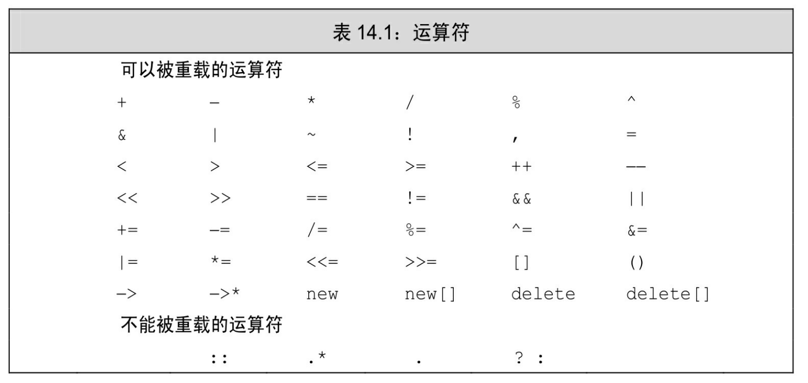

[总目录](<../目录.md>) · [本章目录](<01 章节导读.md>) · [上一篇](<../第14章 重载运算与类型转换/01 章节导读.md>) · [下一篇](<../第14章 重载运算与类型转换/14.2 输入和输出运算符.md>)

> 原 PDF 第 803–808 页。

<!-- PDF 第 803 页 -->

# **14.1** 基本概念

重载的运算符是具有特殊名字的函数:它们的名字由关键字 operator和其后要定义的运算符号共同组成。和其他函数一样,重载的运算符也包含返回类型、参数列表以及函数体。

重载运算符函数的参数数量与该运算符作用的运算对象数量一样多。一元运算符有一个参数,二元运算符有两个。对于二元运算符来说,左侧运算对象传递给第一个参数,而右侧运算对象传递给第二个参数。除了重载的函数调用运算符operator()之外,其他重载运算符不能含有默认实参(参见6.5.1节,第211页)。

如果一个运算符函数是成员函数,则它的第一个(左侧)运算对象绑定到隐式的this指针上(参见7.1.2节,第231页),因此,成员运算符函数的(显式)参数数量比运算符的运算对象总数少一个。


当一个重载的运算符是成员函数时,this绑定到左侧运算对象。成员运算符函数的 (显式)参数数量比运算对象的数量少一个。

对于一个运算符函数来说,它或者是类的成员,或者至少含有一个类类型的参数:

<!-- 代码原图: ../images/_page_802_Picture_109.png -->
```c++
// 错误：不能为 int 重定义内置的运算符
int operator+ (int,int);
```

这一约定意味着当运算符作用于内置类型的运算对象时,我们无法改变该运算符的含义。

我们可以重载大多数(但不是全部)运算符。表14.1指明了哪些运算符可以被重载,哪些不行。我们将在19.1.1节(第726页)介绍重载 new和delete的方法。

我们只能重载已有的运算符,而无权发明新的运算符号。例如,我们不能提供operator\*\*来执行幂操作。

<!-- PDF 第 804 页 -->

有四个符号(+、-、\*、&)既是一元运算符也是二元运算符,所有这些运算符都能被重载,从参数的数量我们可以推断到底定义的是哪种运算符。

对于一个重载的运算符来说,其优先级和结合律(参见4.1.2节,第 121页)与对应的内置运算符保持一致。不考虑运算对象类型的话,

<!-- 代码原图: ../images/_page_803_Picture_78.png -->
```c++
x == y + z;
```

永远等价于x == (y + z)。



直接调用一个重载的运算符函数

通常情况下,我们将运算符作用于类型正确的实参,从而以这种间接方式"调用"重载的运算符函数。然而,我们也能像调用普通函数一样直接调用运算符函数,先指定函数名字,然后传入数量正确、类型适当的实参:

<!-- 代码原图: ../images/_page_803_Picture_80.png -->
```c++
// 一个非成员运算符函数的等价调用
data1 + data2; // 普通的表达式
operator+ (data1, data2); // 等价的函数调用
```

这两次调用是等价的,它们都调用了非成员函数operator+,传入 data1作为第一个实参、传入data2作为第二个实参。

<!-- PDF 第 805 页 -->

我们像调用其他成员函数一样显式地调用成员运算符函数。具体做法是,首先指定运行函数的对象(或指针)的名字,然后使用点运算符 (或箭头运算符)访问希望调用的函数:

<!-- 代码原图: ../images/_page_804_Picture_110.png -->
```c++
data1 += data2; // 基于“调用”的表达式
data1.operator+=(data2); // 对成员运算符函数的等价调用
```

这两条语句都调用了成员函数operator+=,将this绑定到data1的地址、将data2作为实参传入了函数。

## 某些运算符不应该被重载

回忆之前介绍过的,某些运算符指定了运算对象求值的顺序。因为使用重载的运算符本质上是一次函数调用,所以这些关于运算对象求值顺序的规则无法应用到重载的运算符上。特别是,逻辑与运算符、逻辑或运算符(参见4.3节,第126页)和逗号运算符(参见4.10节,第140 页)的运算对象求值顺序规则无法保留下来。除此之外,&&和||运算符的重载版本也无法保留内置运算符的短路求值属性,两个运算对象总是会被求值。

因为上述运算符的重载版本无法保留求值顺序和/或短路求值属性,因此不建议重载它们。当代码使用了这些运算符的重载版本时,用户可能会突然发现他们一直习惯的求值规则不再适用了。

还有一个原因使得我们一般不重载逗号运算符和取地址运算符: C++语言已经定义了这两种运算符用于类类型对象时的特殊含义,这一点与大多数运算符都不相同。因为这两种运算符已经有了内置的含义, 所以一般来说它们不应该被重载,否则它们的行为将异于常态,从而导致类的用户无法适应。


通常情况下,不应该重载逗号、取地址、逻辑与和逻辑或运算符。

使用与内置类型一致的含义

当你开始设计一个类时,首先应该考虑的是这个类将提供哪些操作。在确定类需要哪些操作之后,才能思考到底应该把每个类操作设成普通函数还是重载的运算符。如果某些操作在逻辑上与运算符相关,则

<!-- PDF 第 806 页 -->

它们适合于定义成重载的运算符:

· 如果类执行IO操作,则定义移位运算符使其与内置类型的IO保持一致。

· 如果类的某个操作是检查相等性,则定义operator==;如果类有了 operator==,意味着它通常也应该有operator!=。

· 如果类包含一个内在的单序比较操作,则定义operator<;如果类有了operator<,则它也应该含有其他关系操作。

· 重载运算符的返回类型通常情况下应该与其内置版本的返回类型兼容:逻辑运算符和关系运算符应该返回bool,算术运算符应该返回一个类类型的值,赋值运算符和复合赋值运算符则应该返回左侧运算对象的一个引用。

## 提示:尽量明智地使用运算符重载

每个运算符在用于内置类型时都有比较明确的含义。以二元+运算符为例,它明显执行的是加法操作。因此,把二元+运算符映射到类类型的一个类似操作上可以极大地简化记忆。例如对于标准库类型string来说,我们就会使用+把一个string对象连接到另一个后面,很多编程语言都有类似的用法。

当在内置的运算符和我们自己的操作之间存在逻辑映射关系时,运算符重载的效果最好。此时,使用重载的运算符显然比另起一个名字更自然也更直观。不过,过分滥用运算符重载也会使我们的类变得难以理解。

在实际编程过程中,一般没有特别明显的滥用运算符重载的情况。例如,一般来说没有哪个程序员会定义operator+并让它执行减法操作。然而经常发生的一种情况是,程序员可能会强行扭曲了运算符的"常规"含义使得其适应某种给定的类型,这显然是我们不希望发生的。因此我们的建议是:只有当操作的含义对于用户来说清晰明了时才使用运算符。如果用户对运算符可能有几种不同的理解,则使用这样的运算符将产生二义性。

## 赋值和复合赋值运算符

赋值运算符的行为与复合版本的类似:赋值之后,左侧运算对象和右侧运算对象的值相等,并且运算符应该返回它左侧运算对象的一个引用。重载的赋值运算应该继承而非违背其内置版本的含义。

如果类含有算术运算符(参见4.2节,第124页)或者位运算符(参见4.8节,第136页),则最好也提供对应的复合赋值运算符。无须赘言,+=运算符的行为显然应该与其内置版本一致,即先执行+,再执行 =。

<!-- PDF 第 807 页 -->

选择作为成员或者非成员

当我们定义重载的运算符时,必须首先决定是将其声明为类的成员函数还是声明为一个普通的非成员函数。在某些时候我们别无选择,因为有的运算符必须作为成员;另一些情况下,运算符作为普通函数比作为成员更好。

下面的准则有助于我们在将运算符定义为成员函数还是普通的非成员函数做出抉择:

· 赋值(=)、下标([ ])、调用(( ))和成员访问箭头(->) 运算符必须是成员。

· 复合赋值运算符一般来说应该是成员,但并非必须,这一点与赋值运算符略有不同。

· 改变对象状态的运算符或者与给定类型密切相关的运算符,如递增、递减和解引用运算符,通常应该是成员。

· 具有对称性的运算符可能转换任意一端的运算对象,例如算术、 相等性、关系和位运算符等,因此它们通常应该是普通的非成员函数。

程序员希望能在含有混合类型的表达式中使用对称性运算符。例如,我们能求一个int和一个double的和,因为它们中的任意一个都可以是左侧运算对象或右侧运算对象,所以加法是对称的。如果我们想提供含有类对象的混合类型表达式,则运算符必须定义成非成员函数。

当我们把运算符定义成成员函数时,它的左侧运算对象必须是运算符所属类的一个对象。例如:

<!-- 代码原图: ../images/_page_806_Picture_138.png -->
```c++
string s = "world";
string t = s + "!"; // 正确：我们能把一个 const char*加到一个 string 对象中
string u = "hi" + s; // 如果+是 string 的成员，则产生错误
```

如果operator+是string类的成员,则上面的第一个加法等价于 s.operator+("!")。同样的,"hi"+s等价于"hi".operator+(s)。显然"hi"的类型是const char\*,这是一种内置类型,根本就没有成员函数。

因为string将+定义成了普通的非成员函数,所以"hi"+s等价于

<!-- PDF 第 808 页 -->

operator+("hi",s)。和任何其他函数调用一样,每个实参都能被转换成形参类型。唯一的要求是至少有一个运算对象是类类型,并且两个运算对象都能准确无误地转换成string。

## **14.1**节练习

练习**14.1**:在什么情况下重载的运算符与内置运算符有所区别?在什么情况下重载的运算符又与内置运算符一样?

练习**14.2**:为Sales\_data编写重载的输入、输出、加法和复合赋值运算符。

练习**14.3**:string和vector都定义了重载的==以比较各自的对象,假设 svec1和svec2是存放string的vector,确定在下面的表达式中分别使用了哪个版本的==?

<!-- 代码原图: ../images/_page_807_Picture_96.png -->
```c++
(a) "cobble" == "stone"
(b) svec1[0] == svec2[0]
(c) svec1 == svec2
(d) "svec1[0] == "stone"
```

练习**14.4**:如何确定下列运算符是否应该是类的成员?

<!-- 代码原图: ../images/_page_807_Picture_97.png -->
```c++
(a) %  (b) %=  (c) ++  (d) ->  (e) <<  (f) &&  (g) ==  (h) ()
```

练习**14.5**:在7.5.1节的练习7.40(第261页)中,编写了下列类中某一个的框架,请问在这个类中应该定义重载的运算符吗?如果是,请写出来。

<!-- 代码原图: ../images/_page_807_Picture_98.png -->
```c++
(a) Book (b) Date (c) Employee
(d) Vehicle (e) Object (f) Tree
```


