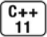
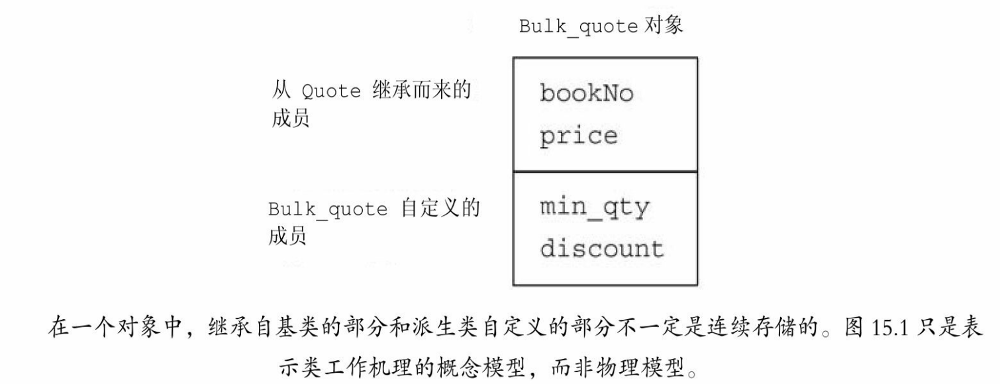
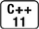

[总目录](<../目录.md>) · [本章目录](<01 章节导读.md>) · [上一篇](<../第15章 面向对象程序设计/15.1 OOP：概述.md>) · [下一篇](<../第15章 面向对象程序设计/15.3 虚函数.md>)

> 原 PDF 第 866–878 页。

<!-- PDF 第 866 页 -->

# **15.2** 定义基类和派生类

定义基类和派生类的方式在很多方面都与我们已知的定义其他类的方式类似,但是也有一些不同之处。本节将介绍在定义有继承关系的类时可能用到的基本特性。

## **15.2.1** 定义基类

我们首先完成Quote类的定义:

<!-- 代码原图: ../images/_page_865_Picture_55.png -->
```c++
class Quote {
public:
    Quote() = default;          // 关于=default 请参见 7.1.4 节（第 237 页）
    Quote(const std::string &book, double sales_price):
        bookNo(book), price(sales_price) { }
    std::string isbn() const { return bookNo; }
    // 返回给定数量的书籍的销售总额
    // 派生类负责改写并使用不同的折扣计算算法
    virtual double net_price(std::size_t n) const
        { return n * price; }
    virtual ~Quote() = default;    // 对析构函数进行动态绑定
private:
    std::string bookNo;          // 书籍的 ISBN 编号
protected:
    double price = 0.0;          // 代表普通状态下不打折的价格
};
```

对于上面这个类来说,新增的部分是在net\_price函数和析构函数之前增加的virtual关键字以及最后的protected访问说明符。我们将在15.7.1 节(第552页)详细介绍虚析构函数的知识,现在只需记住作为继承关系中根节点的类通常都会定义一个虚析构函数。


基类通常都应该定义一个虚析构函数,即使该函数不执行任何实际操作也是如

<!-- PDF 第 867 页 -->

此。

成员函数与继承

派生类可以继承其基类的成员,然而当遇到如net\_price这样与类型相关的操作时,派生类必须对其重新定义。换句话说,派生类需要对这些操作提供自己的新定义以覆盖(override)从基类继承而来的旧定义。

在C++语言中,基类必须将它的两种成员函数区分开来:一种是基类希望其派生类进行覆盖的函数;另一种是基类希望派生类直接继承而不要改变的函数。对于前者,基类通常将其定义为虚函数(virtual)。 当我们使用指针或引用调用虚函数时,该调用将被动态绑定。根据引用或指针所绑定的对象类型不同,该调用可能执行基类的版本,也可能执行某个派生类的版本。

基类通过在其成员函数的声明语句之前加上关键字virtual使得该函数执行动态绑定。任何构造函数之外的非静态函数(参见7.6节,第268 页)都可以是虚函数。关键字virtual只能出现在类内部的声明语句之前而不能用于类外部的函数定义。如果基类把一个函数声明成虚函数,则该函数在派生类中隐式地也是虚函数。我们将在15.3节(第536页)介绍更多关于虚函数的知识。

成员函数如果没被声明为虚函数,则其解析过程发生在编译时而非运行时。对于isbn成员来说这正是我们希望看到的结果。isbn函数的执行与派生类的细节无关,不管作用于Quote对象还是Bulk\_quote对象, isbn函数的行为都一样。在我们的继承层次关系中只有一个isbn函数, 因此也就不存在调用isbn()时到底执行哪个版本的疑问。

#### 访问控制与继承

派生类可以继承定义在基类中的成员,但是派生类的成员函数不一定有权访问从基类继承而来的成员。和其他使用基类的代码一样,派生类能访问公有成员,而不能访问私有成员。不过在某些时候基类中还有这样一种成员,基类希望它的派生类有权访问该成员,同时禁止其他用户访问。我们用受保护的(protected)访问运算符说明这样的成员。

我们的Quote类希望它的派生类定义各自的net\_price函数,因此派生类需要访问Quote的price成员。此时我们将price定义成受保护的。与之

<!-- PDF 第 868 页 -->

相反,派生类访问bookNo成员的方式与其他用户是一样的,都是通过调用isbn函数,因此bookNo被定义成私有的,即使是Quote派生出来的类也不能直接访问它。我们将在15.5节(第542页)介绍更多关于受保护成员的知识。

### **15.2.1**节练习

练习**15.1**:什么是虚成员?

练习**15.2**:protected访问说明符与private有何区别?

练习**15.3**:定义你自己的Quote类和print\_total函数。

## **15.2.2** 定义派生类

派生类必须通过使用类派生列表(class derivation list)明确指出它是从哪个(哪些)基类继承而来的。类派生列表的形式是:首先是一个冒号,后面紧跟以逗号分隔的基类列表,其中每个基类前面可以有以下三种访问说明符中的一个:public、protected或者private。

派生类必须将其继承而来的成员函数中需要覆盖的那些重新声明, 因此,我们的Bulk\_quote类必须包含一个net\_price成员:

<!-- 代码原图: ../images/_page_867_Picture_126.png -->
```c++
class Bulk_quote : public Quote {          // Bulk_quote 继承自 Quote
public:
    Bulk_quote() = default;
    Bulk_quote(const std::string&, double, std::size_t, double);
    // 覆盖基类的函数版本以实现基于大量购买的折扣政策
    double net_price(std::size_t) const override;
private:
    std::size_t min_qty = 0;             // 适用折扣政策的最低购买量
    double discount = 0.0;               // 以小数表示的折扣额
};
```

我们的Bulk\_quote类从它的基类Quote那里继承了isbn函数和 bookNo、price等数据成员。此外,它还定义了net\_price的新版本,同时拥有两个新增加的数据成员min\_qty和discount。这两个成员分别用于说明享受折扣所需购买的最低数量以及一旦该数量达到之后具体的折扣信

<!-- PDF 第 869 页 -->

息。

我们将在15.5节(第543页)详细介绍派生列表中用到的访问说明符。现在,我们只需知道访问说明符的作用是控制派生类从基类继承而来的成员是否对派生类的用户可见。

如果一个派生是公有的,则基类的公有成员也是派生类接口的组成部分。此外,我们能将公有派生类型的对象绑定到基类的引用或指针上。因为我们在派生列表中使用了public,所以Bulk\_quote的接口隐式地包含isbn函数,同时在任何需要Quote的引用或指针的地方我们都能使用 Bulk\_quote的对象。

大多数类都只继承自一个类,这种形式的继承被称作"单继承",它构成了本章的主题。关于派生列表中含有多于一个基类的情况将在18.3 节(第710页)中介绍。

#### 派生类中的虚函数

派生类经常(但不总是)覆盖它继承的虚函数。如果派生类没有覆盖其基类中的某个虚函数,则该虚函数的行为类似于其他的普通成员, 派生类会直接继承其在基类中的版本。



派生类可以在它覆盖的函数前使用virtual关键字,但不是非得这么做。我们将在15.3节(第538页)介绍其原因,C++11新标准允许派生类显式地注明它使用某个成员函数覆盖了它继承的虚函数。具体做法是在形参列表后面、或者在const成员函数(参见7.1.2节,第231页)的const 关键字后面、或者在引用成员函数(参见13.6.3节,第483页)的引用限定符后面添加一个关键字override。

### 派生类对象及派生类向基类的类型转换

一个派生类对象包含多个组成部分:一个含有派生类自己定义的 (非静态)成员的子对象,以及一个与该派生类继承的基类对应的子对象,如果有多个基类,那么这样的子对象也有多个。因此,一个 Bulk\_quote对象将包含四个数据元素:它从Quote继承而来的bookNo和 price数据成员,以及Bulk\_quote自己定义的min\_qty和discount成员。

C++标准并没有明确规定派生类的对象在内存中如何分布,但是我

<!-- PDF 第 870 页 -->

们可以认为Bulk\_quote的对象包含如图15.1所示的两部分。



图15.1:Bulk\_quote对象的概念结构

因为在派生类对象中含有与其基类对应的组成部分,所以我们能把派生类的对象当成基类对象来使用,而且我们也能将基类的指针或引用绑定到派生类对象中的基类部分上。

<!-- 代码原图: ../images/_page_869_Picture_65.png -->
```c++
Quote item; // 基类对象
Bulk_quote bulk; // 派生类对象
Quote *p = &item; // p指向Quote对象
p = &bulk; // p指向bulk的Quote部分
Quote &r = bulk; // r绑定到bulk的Quote部分
```

这种转换通常称为派生类到基类的(derived-to-base)类型转换。 和其他类型转换一样,编译器会隐式地执行派生类到基类的转换(参见 4.11节,第141页)。

这种隐式特性意味着我们可以把派生类对象或者派生类对象的引用用在需要基类引用的地方;同样的,我们也可以把派生类对象的指针用在需要基类指针的地方。


在派生类对象中含有与其基类对应的组成部分,这一事实是继承的关键所在。

### 派生类构造函数

尽管在派生类对象中含有从基类继承而来的成员,但是派生类并不

<!-- PDF 第 871 页 -->

能直接初始化这些成员。和其他创建了基类对象的代码一样,派生类也必须使用基类的构造函数来初始化它的基类部分。


每个类控制它自己的成员初始化过程。

派生类对象的基类部分与派生类对象自己的数据成员都是在构造函数的初始化阶段(参见7.5.1节,第258页)执行初始化操作的。类似于我们初始化成员的过程,派生类构造函数同样是通过构造函数初始化列表来将实参传递给基类构造函数的。例如,接受四个参数的Bulk\_quote 构造函数如下所示:

<!-- 代码原图: ../images/_page_870_Picture_100.png -->
```c++
Bulk_quote(const std::string& book, double p,
    std::size_t qty, double disc) :
    Quote(book, p), min_qty(qty), discount(disc) { }
// 与之前一致
};
```

该函数将它的前两个参数(分别表示ISBN和价格)传递给Quote的构造函数,由Quote的构造函数负责初始化Bulk\_quote的基类部分(即 bookNo成员和price成员)。当(空的)Quote构造函数体结束后,我们构建的对象的基类部分也就完成初始化了。接下来初始化由派生类直接定义的min\_qty成员和discount成员。最后运行Bulk\_quote构造函数的 (空的)函数体。

除非我们特别指出,否则派生类对象的基类部分会像数据成员一样执行默认初始化。如果想使用其他的基类构造函数,我们需要以类名加圆括号内的实参列表的形式为构造函数提供初始值。这些实参将帮助编译器决定到底应该选用哪个构造函数来初始化派生类对象的基类部分。


首先初始化基类的部分,然后按照声明的顺序依次初始化派生类的成员。

派生类使用基类的成员

派生类可以访问基类的公有成员和受保护成员:

<!-- PDF 第 872 页 -->

<!-- 代码原图: ../images/_page_871_Picture_89.png -->
```c++
// 如果达到了购买书籍的某个最低限量值，就可以享受折扣价格了
double Bulk_quote::net_price(size_t cnt) const
{
    if (cnt >= min_qty)
        return cnt * (1 - discount) * price;
    else
        return cnt * price;
}
```

该函数产生一个打折后的价格:如果给定的数量超过了min\_qty, 则将discount(一个小于1大于0的数)作用于price。

我们将在15.6节(第547页)进一步讨论作用域,目前只需要了解派生类的作用域嵌套在基类的作用域之内。因此,对于派生类的一个成员来说,它使用派生类成员(例如min\_qty和discount)的方式与使用基类成员(例如price)的方式没什么不同。

#### 关键概念:遵循基类的接口

必须明确一点:每个类负责定义各自的接口。要想与类的对象交互必须使用该类的接口,即使这个对象是派生类的基类部分也是如此。

因此,派生类对象不能直接初始化基类的成员。尽管从语法上来说我们可以在派生类构造函数体内给它的公有或受保护的基类成员赋值,但是最好不要这么做。和使用基类的其他场合一样,派生类应该遵循基类的接口,并且通过调用基类的构造函数来初始化那些从基类中继承而来的成员。

#### 继承与静态成员

如果基类定义了一个静态成员(参见7.6节,第268页),则在整个继承体系中只存在该成员的唯一定义。不论从基类中派生出来多少个派生类,对于每个静态成员来说都只存在唯一的实例。

<!-- 代码原图: ../images/_page_871_Picture_90.png -->
```c++
class Base {
public:
    static void statmem();
};

class Derived : public Base {
    void f(const Derived&);
};
```

静态成员遵循通用的访问控制规则,如果基类中的成员是private

<!-- PDF 第 873 页 -->

的,则派生类无权访问它。假设某静态成员是可访问的,则我们既能通过基类使用它也能通过派生类使用它:

<!-- 代码原图: ../images/_page_872_Picture_60.png -->
```c++
void Derived::f(const Derived &derived_obj)
{
    Base::statmem();                // 正确：Base 定义了 statmem
    Derived::statmem();              // 正确：Derived 继承了 statmem
    // 正确：派生类的对象能访问基类的静态成员
    derived_obj.statmem();          // 通过 Derived 对象访问
    statmem();                    // 通过 this 对象访问
}
```

#### 派生类的声明

派生类的声明与其他类差别不大(参见7.3.3节,第250页),声明中包含类名但是不包含它的派生列表:

<!-- 代码原图: ../images/_page_872_Picture_61.png -->
```c++
class Bulk_quote : public Quote; // 错误：派生列表不能出现在这里
class Bulk_quote; // 正确：声明派生类的正确方式
```

一条声明语句的目的是令程序知晓某个名字的存在以及该名字表示一个什么样的实体,如一个类、一个函数或一个变量等。派生列表以及与定义有关的其他细节必须与类的主体一起出现。

#### 被用作基类的类

如果我们想将某个类用作基类,则该类必须已经定义而非仅仅声明:

<!-- 代码原图: ../images/_page_872_Picture_62.png -->
```c++
class Quote; // 声明但未定义
// 错误：Quote 必须被定义
class Bulk_quote : public Quote { ... };
```

这一规定的原因显而易见:派生类中包含并且可以使用它从基类继承而来的成员,为了使用这些成员,派生类当然要知道它们是什么。因此该规定还有一层隐含的意思,即一个类不能派生它本身。

一个类是基类,同时它也可以是一个派生类:

<!-- PDF 第 874 页 -->

<!-- 代码原图: ../images/_page_873_Picture_95.png -->
```c++
class Base { /* ...*/ };
class D1: public Base { /* ...*/ };
class D2: public D1 { /* ...*/ };
```

在这个继承关系中,Base是D1的直接基类(direct base),同时是 D2的间接基类(indirect base)。直接基类出现在派生列表中,而间接基类由派生类通过其直接基类继承而来。

每个类都会继承直接基类的所有成员。对于一个最终的派生类来说,它会继承其直接基类的成员;该直接基类的成员又含有其基类的成员;依此类推直至继承链的顶端。因此,最终的派生类将包含它的直接基类的子对象以及每个间接基类的子对象。

防止继承的发生



有时我们会定义这样一种类,我们不希望其他类继承它,或者不想考虑它是否适合作为一个基类。为了实现这一目的,C++11新标准提供了一种防止继承发生的方法,即在类名后跟一个关键字final:

<!-- 代码原图: ../images/_page_873_Picture_97.png -->
```c++
class NoDerived final { /* */ }; // NoDerived 不能作为基类
class Base { /* */ };
// Last 是 final 的；我们不能继承 Last
class Last final : Base { /* */ }; // Last 不能作为基类
class Bad : NoDerived { /* */ }; // 错误：NoDerived 是 final 的
class Bad2 : Last { /* */ }; // 错误：Last 是 final 的
```

### **15.2.2**节练习

练习**15.4**:下面哪条声明语句是不正确的?请解释原因。

<!-- 代码原图: ../images/_page_873_Picture_98.png -->
```c++
class Base { ... };
(a) class Derived : public Derived { ... };
(b) class Derived : private Base { ... };
(c) class Derived : public Base;
```

练习**15.5**:定义你自己的Bulk\_quote类。

练习**15.6**:将Quote和Bulk\_quote的对象传给15.2.1节(第529页)练习中的print\_total函数,检查该函数是否正确。

<!-- PDF 第 875 页 -->

练习**15.7**:定义一个类使其实现一种数量受限的折扣策略,具体策略是:当购买书籍的数量不超过一个给定的限量时享受折扣,如果购买量一旦超过了限量,则超出的部分将以原价销售。

## **15.2.3** 类型转换与继承


理解基类和派生类之间的类型转换是理解C++语言面向对象编程的关键所在。

通常情况下,如果我们想把引用或指针绑定到一个对象上,则引用或指针的类型应与对象的类型一致(参见2.3.1节,第46页和2.3.2节,第 47页),或者对象的类型含有一个可接受的const类型转换规则(参见 4.11.2节,第144页)。存在继承关系的类是一个重要的例外:我们可以将基类的指针或引用绑定到派生类对象上。例如,我们可以用Quote& 指向一个Bulk\_quote对象,也可以把一个Bulk\_quote对象的地址赋给一个Quote\*。

可以将基类的指针或引用绑定到派生类对象上有一层极为重要的含义:当使用基类的引用(或指针)时,实际上我们并不清楚该引用(或指针)所绑定对象的真实类型。该对象可能是基类的对象,也可能是派生类的对象。


和内置指针一样,智能指针类(参见12.1节,第400页)也支持派生类向基类的类型转换,这意味着我们可以将一个派生类对象的指针存储在一个基类的智能指针内。

### 静态类型与动态类型

当我们使用存在继承关系的类型时,必须将一个变量或其他表达式的静态类型(static type)与该表达式表示对象的动态类型(dynamic type)区分开来。表达式的静态类型在编译时总是已知的,它是变量声明时的类型或表达式生成的类型;动态类型则是变量或表达式表示的内存中的对象的类型。动态类型直到运行时才可知。

例如,当print\_total调用net\_price时(参见15.1节,第527页):

<!-- PDF 第 876 页 -->

<!-- 代码原图: ../images/_page_875_Picture_104.png -->
```c++
double ret = item.net_price(n);
```

我们知道item的静态类型是Quote&,它的动态类型则依赖于item绑定的实参,动态类型直到在运行时调用该函数时才会知道。如果我们传递一个Bulk\_quote对象给print\_total,则item的静态类型将与它的动态类型不一致。如前所述,item的静态类型是Quote&,而在此例中它的动态类型则是Bulk\_quote。

如果表达式既不是引用也不是指针,则它的动态类型永远与静态类型一致。例如,Quote类型的变量永远是一个Quote对象,我们无论如何都不能改变该变量对应的对象的类型。


基类的指针或引用的静态类型可能与其动态类型不一致,读者一定要理解其中的原因。

不存在从基类向派生类的隐式类型转换**……**

之所以存在派生类向基类的类型转换是因为每个派生类对象都包含一个基类部分,而基类的引用或指针可以绑定到该基类部分上。一个基类的对象既可以以独立的形式存在,也可以作为派生类对象的一部分存在。如果基类对象不是派生类对象的一部分,则它只含有基类定义的成员,而不含有派生类定义的成员。

因为一个基类的对象可能是派生类对象的一部分,也可能不是,所以不存在从基类向派生类的自动类型转换:

<!-- 代码原图: ../images/_page_875_Picture_106.png -->
```c++
Quote base;
Bulk_quote* bulkP = &base; // 错误：不能将基类转换成派生类
Bulk_quote& bulkRef = base; // 错误：不能将基类转换成派生类
```

如果上述赋值是合法的,则我们有可能会使用bulkP或bulkRef访问 base中本不存在的成员。

除此之外还有一种情况显得有点特别,即使一个基类指针或引用绑定在一个派生类对象上,我们也不能执行从基类向派生类的转换:

<!-- PDF 第 877 页 -->

<!-- 代码原图: ../images/_page_876_Picture_133.png -->
```c++
Bulk_quote bulk;
Quote *itemP = &bulk; // 正确：动态类型是 Bulk_quote
Bulk_quote *bulkP = itemP; // 错误：不能将基类转换成派生类
```

编译器在编译时无法确定某个特定的转换在运行时是否安全,这是因为编译器只能通过检查指针或引用的静态类型来推断该转换是否合法。如果在基类中含有一个或多个虚函数,我们可以使用 dynamic\_cast(参见19.2.1节,第730页)请求一个类型转换,该转换的安全检查将在运行时执行。同样,如果我们已知某个基类向派生类的转换是安全的,则我们可以使用static\_cast(参见4.11.3节,第144页)来强制覆盖掉编译器的检查工作。

### **……**在对象之间不存在类型转换

派生类向基类的自动类型转换只对指针或引用类型有效,在派生类类型和基类类型之间不存在这样的转换。很多时候,我们确实希望将派生类对象转换成它的基类类型,但是这种转换的实际发生过程往往与我们期望的有所差别。

请注意,当我们初始化或赋值一个类类型的对象时,实际上是在调用某个函数。当执行初始化时,我们调用构造函数(参见13.1.1节,第 440页和13.6.2节,第473页);而当执行赋值操作时,我们调用赋值运算符(参见13.1.2节,第443页和13.6.2节,第474页)。这些成员通常都包含一个参数,该参数的类型是类类型的const版本的引用。

因为这些成员接受引用作为参数,所以派生类向基类的转换允许我们给基类的拷贝/移动操作传递一个派生类的对象。这些操作不是虚函数。当我们给基类的构造函数传递一个派生类对象时,实际运行的构造函数是基类中定义的那个,显然该构造函数只能处理基类自己的成员。 类似的,如果我们将一个派生类对象赋值给一个基类对象,则实际运行的赋值运算符也是基类中定义的那个,该运算符同样只能处理基类自己的成员。

例如,我们的书店类使用了合成版本的拷贝和赋值操作(参见 13.1.1节,第440页和13.1.2节,第444页)。关于拷贝控制与继承的知识将在15.7.2节(第552页)做更详细的介绍,现在我们只需要知道合成版本会像其他类一样逐成员地执行拷贝或赋值操作:

<!-- PDF 第 878 页 -->

<!-- 代码原图: ../images/_page_877_Picture_151.png -->
```c++
Bulk_quote bulk; // 派生类对象
Quote item(bulk); // 使用 Quote::Quote(const Quote&)构造函数
item = bulk; // 调用 Quote::operator=(const Quote&)
```

当构造item时,运行Quote的拷贝构造函数。该函数只能处理 bookNo和price两个成员,它负责拷贝bulk中Quote部分的成员,同时忽略掉bulk中Bulk\_quote部分的成员。类似的,对于将bulk赋值给item的操作来说,只有bulk中Quote部分的成员被赋值给item。

因为在上述过程中会忽略Bulk\_quote部分,所以我们可以说bulk的 Bulk\_quote部分被切掉(sliced down)了。


当我们用一个派生类对象为一个基类对象初始化或赋值时,只有该派生类对象中的基类部分会被拷贝、移动或赋值,它的派生类部分将被忽略掉。

### **15.2.3**节练习

练习**15.8**:给出静态类型和动态类型的定义。

练习**15.9**:在什么情况下表达式的静态类型可能与动态类型不同?请给出三个静态类型与动态类型不同的例子。

练习**15.10**:回忆我们在8.1节(第279页)进行的讨论,解释第284页中将ifstream传递给Sales\_data的read函数的程序是如何工作的。

关键概念:存在继承关系的类型之间的转换规则

要想理解在具有继承关系的类之间发生的类型转换,有三点非常重要:

· 从派生类向基类的类型转换只对指针或引用类型有效。 · 基类向派生类不存在隐式类型转换。

· 和任何其他成员一样,派生类向基类的类型转换也可能会由于访问受限而变得不可行。我们将在15.5节(第544页)详细介绍可访问性的问题。

尽管自动类型转换只对指针或引用类型有效,但是继承体系中的大多数类仍然 (显式或隐式地)定义了拷贝控制成员(参见第13章)。因此,我们通常能够将一个派生类对象拷贝、移动或赋值给一个基类对象。不过需要注意的是,这种操作只处理派生类对象的基类部分。


