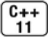

[总目录](<../目录.md>) · [本章目录](<01 章节导读.md>) · [上一篇](<../第15章 面向对象程序设计/15.2 定义基类和派生类.md>) · [下一篇](<../第15章 面向对象程序设计/15.4 抽象基类.md>)

> 原 PDF 第 879–884 页。

<!-- PDF 第 879 页 -->

# **15.3** 虚函数

如前所述,在C++语言中,当我们使用基类的引用或指针调用一个虚成员函数时会执行动态绑定(参见15.1节,第527页)。因为我们直到运行时才能知道到底调用了哪个版本的虚函数,所以所有虚函数都必须有定义。通常情况下,如果我们不使用某个函数,则无须为该函数提供定义(参见6.1.2节,第186页)。但是我们必须为每一个虚函数都提供定义,而不管它是否被用到了,这是因为连编译器也无法确定到底会使用哪个虚函数。

#### 对虚函数的调用可能在运行时才被解析

当某个虚函数通过指针或引用调用时,编译器产生的代码直到运行时才能确定应该调用哪个版本的函数。被调用的函数是与绑定到指针或引用上的对象的动态类型相匹配的那一个。

举个例子,考虑15.1节(第527页)的print\_total函数,该函数通过其名为item的参数来进一步调用net\_price,其中item的类型是Quote&。 因为item是引用而且net\_price是虚函数,所以我们到底调用net\_price的哪个版本完全依赖于运行时绑定到item的实参的实际(动态)类型:

<!-- 代码原图: ../images/_page_878_Picture_126.png -->
```c++
Quote base("0-201-82470-1", 50);
print_total(cout, base, 10); // 调用 Quote::net_price
Bulk_quote derived("0-201-82470-1", 50, 5, .19);
```

<!-- 代码原图: ../images/_page_878_Picture_127.png -->
```c++
print_total(cout, derived, 10); // 调用 Bulk_quote::net_price
```

在第一条调用语句中,item绑定到Quote类型的对象上,因此当 print\_total调用net\_price时,运行在Quote中定义的版本。在第二条调用语句中,item绑定到Bulk\_quote类型的对象上,因此print\_total调用 Bulk\_quote定义的net\_price。

必须要搞清楚的一点是,动态绑定只有当我们通过指针或引用调用虚函数时才会发生。

<!-- PDF 第 880 页 -->

<!-- 代码原图: ../images/_page_879_Picture_132.png -->
```c++
base = derived; // 把 derived 的 Quote 部分拷贝给 base
base.net_price(20); // 调用 Quote::net_price
```

当我们通过一个具有普通类型(非引用非指针)的表达式调用虚函数时,在编译时就会将调用的版本确定下来。例如,如果我们使用base 调用net\_price,则应该运行net\_price的哪个版本是显而易见的。我们可以改变base表示的对象的值(即内容),但是不会改变该对象的类型。 因此,在编译时该调用就会被解析成Quote的net\_price。

### 关键概念:**C++**的多态性

OOP的核心思想是多态性(polymorphism)。多态性这个词源自希腊语,其含义是"多种形式"。我们把具有继承关系的多个类型称为多态类型,因为我们能使用这些类型的"多种形式"而无须在意它们的差异。引用或指针的静态类型与动态类型不同这一事实正是C++语言支持多态性的根本所在。

当我们使用基类的引用或指针调用基类中定义的一个函数时,我们并不知道该函数真正作用的对象是什么类型,因为它可能是一个基类的对象也可能是一个派生类的对象。如果该函数是虚函数,则直到运行时才会决定到底执行哪个版本,判断的依据是引用或指针所绑定的对象的真实类型。

另一方面,对非虚函数的调用在编译时进行绑定。类似的,通过对象进行的函数 (虚函数或非虚函数)调用也在编译时绑定。对象的类型是确定不变的,我们无论如何都不可能令对象的动态类型与静态类型不一致。因此,通过对象进行的函数调用将在编译时绑定到该对象所属类中的函数版本上。


当且仅当对通过指针或引用调用虚函数时,才会在运行时解析该调用,也只有在这种情况下对象的动态类型才有可能与静态类型不同。

#### 派生类中的虚函数

当我们在派生类中覆盖了某个虚函数时,可以再一次使用virtual关键字指出该函数的性质。然而这么做并非必须,因为一旦某个函数被声明成虚函数,则在所有派生类中它都是虚函数。

一个派生类的函数如果覆盖了某个继承而来的虚函数,则它的形参类型必须与被它覆盖的基类函数完全一致。

同样,派生类中虚函数的返回类型也必须与基类函数匹配。该规则存在一个例外,当类的虚函数返回类型是类本身的指针或引用时,上述规则无效。也就是说,如果D由B派生得到,则基类的虚函数可以返回B

<!-- PDF 第 881 页 -->

\*而派生类的对应函数可以返回D\*,只不过这样的返回类型要求从D 到B的类型转换是可访问的。15.5节(第544页)将介绍如何确定一个基类的可访问性,在15.8.1节(第561页)中我们将看到这种虚函数的一个实际例子。


基类中的虚函数在派生类中隐含地也是一个虚函数。当派生类覆盖了某个虚函数时,该函数在基类中的形参必须与派生类中的形参严格匹配。

### **final**和**override**说明符

如我们将要在15.6节(第550页)介绍的,派生类如果定义了一个函数与基类中虚函数的名字相同但是形参列表不同,这仍然是合法的行为。编译器将认为新定义的这个函数与基类中原有的函数是相互独立的。这时,派生类的函数并没有覆盖掉基类中的版本。就实际的编程习惯而言,这种声明往往意味着发生了错误,因为我们可能原本希望派生类能覆盖掉基类中的虚函数,但是一不小心把形参列表弄错了。



要想调试并发现这样的错误显然非常困难。在C++11新标准中我们可以使用override关键字来说明派生类中的虚函数。这么做的好处是在使得程序员的意图更加清晰的同时让编译器可以为我们发现一些错误, 后者在编程实践中显得更加重要。如果我们使用override标记了某个函数,但该函数并没有覆盖已存在的虚函数,此时编译器将报错:

<!-- 代码原图: ../images/_page_880_Picture_100.png -->
```c++
struct B {
    virtual void f1(int) const;
    virtual void f2();
    void f3();
};

struct D1 : B {
    void f1(int) const override;          // 正确：f1 与基类中的 f1 匹配
    void f2(int) override;              // 错误：B 没有形如 f2(int)的函数
    void f3() override;                  // 错误：f3 不是虚函数
    void f4() override;                  // 错误：B 没有名为 f4 的函数
};
```

在D1中,f1的override说明符是正确的,因为基类和派生类中的f1

<!-- PDF 第 882 页 -->

都是const成员,并且它们都接受一个int返回void,所以D1中的f1正确地覆盖了它从B中继承而来的虚函数。

D1中f2的声明与B中f2的声明不匹配,显然B中定义的f2不接受任何参数而D1的f2接受一个int。因为这两个声明不匹配,所以D1的f2不能覆盖B的f2,它是一个新函数,仅仅是名字恰好与原来的函数一样而已。 因为我们使用override所表达的意思是我们希望能覆盖基类中的虚函数而实际上并未做到,所以编译器会报错。

因为只有虚函数才能被覆盖,所以编译器会拒绝D1的f3。该函数不是B中的虚函数,因此它不能被覆盖。类似的,f4的声明也会发生错误,因为B中根本就没有名为f4的函数。

我们还能把某个函数指定为final,如果我们已经把函数定义成final 了,则之后任何尝试覆盖该函数的操作都将引发错误:

<!-- 代码原图: ../images/_page_881_Picture_141.png -->
```c++
struct D2 : B {
    // 从 B 继承 f2()和 f3(), 覆盖 f1(int)
    void f1(int) const final;    // 不允许后续的其他类覆盖 f1(int)
};

struct D3 : D2 {
    void f2();                        // 正确：覆盖从间接基类 B 继承而来的 f2
    void f1(int) const;              // 错误：D2 已经将 f2 声明成 final
};
```

final和override说明符出现在形参列表(包括任何const或引用修饰符)以及尾置返回类型(参见6.3.3节,第206页)之后。

### 虚函数与默认实参

和其他函数一样,虚函数也可以拥有默认实参(参见6.5.1节,第 211页)。如果某次函数调用使用了默认实参,则该实参值由本次调用的静态类型决定。

换句话说,如果我们通过基类的引用或指针调用函数,则使用基类中定义的默认实参,即使实际运行的是派生类中的函数版本也是如此。 此时,传入派生类函数的将是基类函数定义的默认实参。如果派生类函数依赖不同的实参,则程序结果将与我们的预期不符。

<!-- PDF 第 883 页 -->


如果虚函数使用默认实参,则基类和派生类中定义的默认实参最好一致。

#### 回避虚函数的机制

在某些情况下,我们希望对虚函数的调用不要进行动态绑定,而是强迫其执行虚函数的某个特定版本。使用作用域运算符可以实现这一目的,例如下面的代码:

<!-- 代码原图: ../images/_page_882_Picture_101.png -->
```c++
// 强行调用基类中定义的函数版本而不管 baseP的动态类型到底是什么 double undiscounted = baseP->Quote::net_price(42);
```

该代码强行调用Quote的net\_price函数,而不管baseP实际指向的对象类型到底是什么。该调用将在编译时完成解析。


通常情况下,只有成员函数(或友元)中的代码才需要使用作用域运算符来回避虚函数的机制。

什么时候我们需要回避虚函数的默认机制呢?通常是当一个派生类的虚函数调用它覆盖的基类的虚函数版本时。在此情况下,基类的版本通常完成继承层次中所有类型都要做的共同任务,而派生类中定义的版本需要执行一些与派生类本身密切相关的操作。


如果一个派生类虚函数需要调用它的基类版本,但是没有使用作用域运算符,则在运行时该调用将被解析为对派生类版本自身的调用,从而导致无限递归。

### **15.3**节练习

练习**15.11**:为你的Quote类体系添加一个名为debug的虚函数,令其分别显示每个类的数据成员。

练习**15.12**:有必要将一个成员函数同时声明成override和final吗?为什么?

练习**15.13**:给定下面的类,解释每个print函数的机理:

<!-- PDF 第 884 页 -->

<!-- 代码原图: ../images/_page_883_Picture_14.png -->
```c++
class base {
public:
    string name() { return basename; }
    virtual void print(ostream &os) { os << basename; }
private:
```

<!-- 代码原图: ../images/_page_883_Picture_15.png -->
```c++
    string basename;
};

class derived : public base {
public:
    void print(ostream &os) { print(os); os << " " << i; }

private:
    int i;
};
```

在上述代码中存在问题吗?如果有,你该如何修改它?

练习**15.14**:给定上一题中的类以及下面这些对象,说明在运行时调用哪个函数:

<!-- 代码原图: ../images/_page_883_Picture_16.png -->
```c++
base bobj;     base *bp1 = &bobj;     base &br1 = bobj;
derived dobj;  base *bp2 = &dobj;     base &br2 = dobj;
(a) bobj.print();  (b) dobj.print();  (c) bp1->name();
(d) bp2->name();   (e) br1.print();   (f) br2.print();
```


