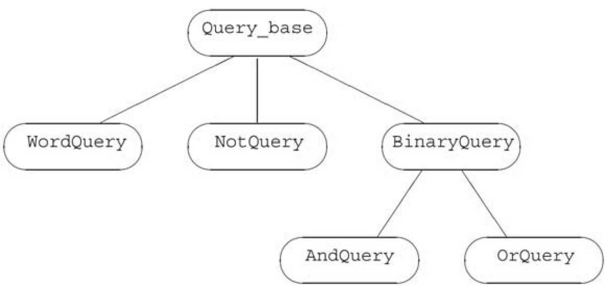
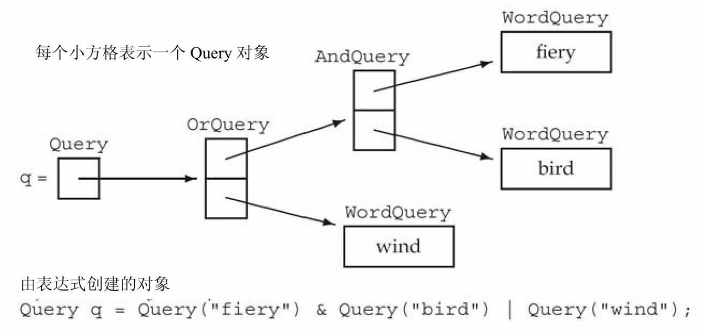
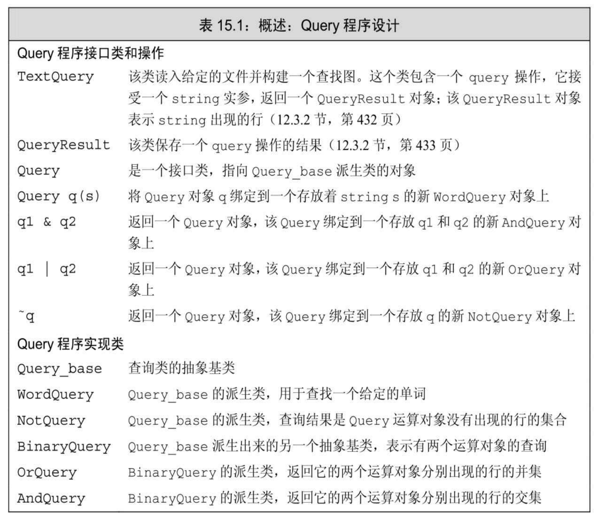

[总目录](<../目录.md>) · [本章目录](<01 章节导读.md>) · [上一篇](<../第15章 面向对象程序设计/15.8 容器与继承.md>) · [下一篇](<../第15章 面向对象程序设计/小结.md>)

> 原 PDF 第 921–939 页。

<!-- PDF 第 921 页 -->

# **15.9** 文本查询程序再探

接下来,我们扩展12.3节(第430页)的文本查询程序,用它作为说明继承的最后一个例子。在上一版的程序中,我们可以查询在文件中某个指定单词的出现情况。我们将在本节扩展该程序使其支持更多更复杂的查询操作。在后面的例子中,我们将针对下面这个小故事展开查询:

**Alice Emma has long flowing red hair.**

**Her Daddy says when the wind blows**

**through her hair,it looks almost alive,**

**like a fiery bird in flight.**

**A beautiful fiery bird,he tells her,**

**magical but untamed.**

**"Daddy,shush,there is no such thing, "**

**she tells him,at the same time wanting**

**him to tell her more.**

**Shyly,she asks, "I mean,Daddy,is there?"**

我们的系统将支持如下查询形式。

· 单词查询,用于得到匹配某个给定string的所有行:

**Executing Query for: Daddy**

**Daddy occurs 3 times**

**(line 2) Her Daddy says when the wind blows**

**(line 7) "Daddy,shush,there is no such thing, "**

**(line 10) Shyly,she asks, "I mean,Daddy,is there?"**

· 逻辑非查询,使用~运算符得到不匹配查询条件的所有行:

<!-- PDF 第 922 页 -->

**Executing Query for:** ~**(Alice)**

~**(Alice) occurs 9 times**

**(line 2) Her Daddy says when the wind blows**

**(line 3) through her hair,it looks almost alive,**

**(line 4) like a fiery bird in flight.**

**...**

· 逻辑或查询,使用 | 运算符返回匹配两个条件中任意一个的行:

**Executing Query for: (hair | Alice)**

**(hair | Alice) occurs 2 times**

**(line 1) Alice Emma has long flowing red hair.**

**(line 3) through her hair,it looks almost alive,**

· 逻辑与查询,使用&运算符返回匹配全部两个条件的行:

**Executing query for: (hair &Alice)**

**(hair &Alice) occurs 1 time**

**(line 1) Alice Emma has long flowing red hair.**

此外,我们还希望能够混合使用这些运算符,比如:

### **fiery &bird | wind**

在类似这样的例子中,我们将使用C++通用的优先级规则(参见 4.1.2节,第121页)对复杂表达式求值。因此,这条查询语句所得行应该是如下二者之一:在该行中或者fiery和bird同时出现,或者出现了 wind:

**Executing Query for: ((fiery &bird) | wind)**

**((fiery &bird) | wind) occurs 3 times**

**(line 2) Her Daddy says when the wind blows**

**(line 4) like a fiery bird in flight.**

<!-- PDF 第 923 页 -->

### **(line 5) A beautiful fiery bird,he tells her,**

在输出内容中首先是那条查询语句,我们使用圆括号来表示查询被解释和执行的次序。与之前实现的版本一样,接下来系统将按照查询结果中行号的升序显示结果并且每一行只显示一次。

# **15.9.1** 面向对象的解决方案

我们可能会认为使用12.3.2节(第432页)的TextQuery类来表示单词查询,然后从该类中派生出其他查询是一种可行的方案。

然而,这样的设计实际上存在缺陷。为了理解其中的原因,我们不妨考虑逻辑非查询。单词查询查找一个指定的单词,为了让逻辑非查询按照单词查询的方式执行,我们将不得不定义逻辑非查询所要查找的单词。但是在一般情况下,我们无法得到这样的单词。相反,一个逻辑非查询中含有一个结果值需要取反的查询语句(单词查询或任何其他查询);类似的,一个逻辑与查询和一个逻辑或查询各包含两个结果值需要合并的查询语句。

由上述观察结果可知,我们应该将几种不同的查询建模成相互独立的类,这些类共享一个公共基类:

<!-- 代码原图: ../images/_page_922_Picture_131.png -->
```c++
WordQuery // Daddy
NotQuery // ~Alice
OrQuery // hair | Alice
AndQuery // hair & Alice
```

这些类将只包含两个操作:

· eval,接受一个TextQuery对象并返回一个QueryResult,eval函数使用给定的TextQuery对象查找与之匹配的行。

· rep,返回基础查询的string表示形式,eval函数使用rep创建一个表示匹配结果的QueryResult,输出运算符使用rep打印查询表达式。

关键概念:继承与组合

继承体系的设计本身是一个非常复杂的问题,已经超出了本书的范围。然而,有一条设计准则非常重要也非常基础,每个程序员都应该熟悉它。

<!-- PDF 第 924 页 -->

当我们令一个类公有地继承另一个类时,派生类应当反映与基类的"是一种(Is A)"关系。在设计良好的类体系当中,公有派生类的对象应该可以用在任何需要基类对象的地方。

类型之间的另一种常见关系是"有一个(Has A)"关系,具有这种关系的类暗含成员的意思。

在我们的书店示例中,基类表示的是按规定价格销售的书籍的报价。

Bulk\_quote"是一种"报价结果,只不过它使用的价格策略不同。我们的书店类都"有一个"价格成员和ISBN成员。

### 抽象基类

如我们所知,在这四种查询之间并不存在彼此的继承关系,从概念上来说它们互为兄弟。因为所有这些类都共享同一个接口,所以我们需要定义一个抽象基类(参见15.4节,第541页)来表示该接口。我们将所需的抽象基类命名为Query\_base,以此来表示它的角色是整个查询继承体系的根节点。

我们的Query\_base类将把eval和rep定义成纯虚函数(参见15.4节, 第541页),其他代表某种特定查询类型的类必须覆盖这两个函数。我们将从Query\_base直接派生出WordQuery和NotQuery。AndQuery和 OrQuery都具有系统中其他类所不具备的一个特殊属性:它们各自包含两个运算对象。为了对这种属性建模,我们定义另外一个名为 BinaryQuery的抽象基类,该抽象基类用于表示含有两个运算对象的查询。AndQuery和OrQuery继承自BinaryQuery,而BinaryQuery继承自 Query\_base。由这些分析我们将得到如图15.2所示的类设计结果:



图15.2:Query\_base继承体系

将层次关系隐藏于接口类中

<!-- PDF 第 925 页 -->

我们的程序将致力于计算查询结果,而非仅仅构建查询的体系。为了使程序能正常运行,我们必须首先创建查询命令,最简单的办法是编写C++表达式。例如,可以编写下面的代码来生成之前描述的复合查询:

<!-- 代码原图: ../images/_page_924_Picture_125.png -->
```c++
Query q = Query("fiery") & Query("bird") | Query("wind");
```

如上所述,其隐含的意思是用户层代码将不会直接使用这些继承的类;相反,我们将定义一个名为Query的接口类,由它负责隐藏整个继承体系。Query类将保存一个Query\_base指针,该指针绑定到Query\_base 的派生类对象上。Query类与Query\_base类提供的操作是相同的:eval用于求查询的结果,rep用于生成查询的string版本,同时Query也会定义一个重载的输出运算符用于显示查询。

用户将通过Query对象的操作间接地创建并处理Query\_base对象。 我们定义Query对象的三个重载运算符以及一个接受string参数的Query 构造函数,这些函数动态分配一个新的Query\_base派生类的对象:

· &运算符生成一个绑定到新的AndQuery对象上的Query对象; · |运算符生成一个绑定到新的OrQuery对象上的Query对象; · ~运算符生成一个绑定到新的NotQuery对象上的Query对象; · 接受string参数的Query构造函数生成一个新的WordQuery对象。



图15.3:使用Query表达式创建的对象

<!-- PDF 第 926 页 -->

理解这些类的工作机理

在这个应用程序中,很大一部分工作是构建代表用户查询的对象, 对于读者来说认识到这一点非常重要。例如,像上面这样的表达式将生成如图15.3所示的一系列相关对象的集合。

一旦对象树构建完成后,对某一条查询语句的求值(或生成表示形式的)过程基本上就转换为沿着箭头方向依次对每个对象求值(或显示)的过程(由编译器为我们组织管理)。例如,如果我们对q(即树的根节点)调用eval函数,则该调用语句将令q所指的OrQuery对象eval 它自己。对该OrQuery求值实际上是对它的两个运算对象执行eval操作:一个运算对象是AndQuery,另一个是查找单词wind的WordQuery。 接下来,对AndQuery求值转化为对它的两个WordQuery求值,分别生成单词fiery和bird的查询结果。

对于面向对象编程的新手来说,要想理解一个程序,最困难的部分往往是理解程序的设计思路。一旦你掌握了程序的设计思路,接下来的实现也就水到渠成了。为了帮助读者理解程序设计的过程,我们在表 15.1中整理了之前那个例子用到的类,并对其进行了简要的描述。

<!-- PDF 第 927 页 -->



### **15.9.1**节练习

练习**15.31**:已知s1、s2、s3和s4都是string,判断下面的表达式分别创建了什么样的对象:

<!-- 代码原图: ../images/_page_926_Picture_43.png -->
```c++
(a) Query(s1) | Query(s2) & ~ Query(s3);
(b) Query(s1) | (Query(s2) & ~ Query(s3));
(c) (Query(s1) & (Query(s2)) | (Query(s3) & Query(s4)));
```

## **15.9.2 Query\_base**类和**Query**类

下面我们开始程序的实现过程,首先定义Query\_base类:

<!-- PDF 第 928 页 -->

<!-- 代码原图: ../images/_page_927_Picture_141.png -->
```c++
// 这是一个抽象基类，具体的查询类型从中派生，所有成员都是 private 的
class Query_base {
    friend class Query;
protected:
    using line_no = TextQuery::line_no;    // 用于 eval 函数
    virtual ~Query_base() = default;
private:
    // eval 返回与当前 Query 匹配的 QueryResult
    virtual QueryResult eval(const TextQuery&) const = 0;
    // rep 是表示查询的一个 string
    virtual std::string rep() const = 0;
};
```

eval和rep都是纯虚函数,因此Query\_base是一个抽象基类(参见 15.4节,第541页)。因为我们不希望用户或者派生类直接使用 Query\_base,所以它没有public成员。所有对Query\_base的使用都需要通过Query对象,因为Query需要调用Query\_base的虚函数,所以我们将 Query声明成Query\_base的友元。

受保护的成员line\_no将在eval函数内部使用。类似的,析构函数也是受保护的,因为它将(隐式地)在派生类析构函数中使用。

### **Query**类

Query类对外提供接口,同时隐藏了Query\_base的继承体系。每个 Query对象都含有一个指向Query\_base对象的shared\_ptr。因为Query是 Query\_base的唯一接口,所以Query必须定义自己的eval和rep版本。

接受一个string参数的Query构造函数将创建一个新的WordQuery对象,然后将它的shared\_prt成员绑定到这个新创建的对象上。&、|和~运算符分别创建AndQuery、OrQuery和NotQuery对象,这些运算符将返回一个绑定到新创建的对象上的Query对象。为了支持这些运算符,Query 还需要另外一个构造函数,它接受指向Query\_base的shared\_ptr并且存储给定的指针。我们将这个构造函数声明为私有的,原因是我们不希望一般的用户代码能随便定义Query\_base对象。因为这个构造函数是私有的,所以我们需要将三个运算符声明为友元。

在形成了上述设计思路后,Query类本身就比较简单了:

<!-- PDF 第 929 页 -->

<!-- 代码原图: ../images/_page_928_Picture_62.png -->
```c++
// 这是一个管理 Query_base 继承体系的接口类
class Query {
    // 这些运算符需要访问接受 shared_ptr 的构造函数，而该函数是私有的
    friend Query operator~(const Query &);
    friend Query operator|(const Query&, const Query&);
    friend Query operator&(const Query&, const Query&);
public:
    Query(const std::string&);          // 构建一个新的 WordQuery
    // 接口函数：调用对应的 Query_base 操作
    QueryResult eval(const TextQuery &t) const
        { return q->eval(t); }
    std::string rep() const { return q->rep(); }
}
```

<!-- 代码原图: ../images/_page_928_Picture_63.png -->
```c++
private:
    Query(std::shared_ptr<Query_base> query): q(query) { }
    std::shared_ptr<Query_base> q;
};
```

我们首先将创建Query对象的运算符声明为友元,之所以这么做是因为这些运算符需要访问那个私有构造函数。

在Query的公有接口部分,我们声明了接受string的构造函数,不过没有对其进行定义。因为这个构造函数将要创建一个WordQuery对象, 所以我们应该首先定义WordQuery类,随后才能定义接受string的Query 构造函数。

另外两个公有成员是Query\_base的接口。其中,Query操作使用它的Query\_base指针来调用各自的Query\_base虚函数。实际调用哪个函数版本将由q所指的对象类型决定,并且直到运行时才能最终确定下来。

### **Query**的输出运算符

输出运算符可以很好地解释我们的整个查询系统是如何工作的:

<!-- PDF 第 930 页 -->

<!-- 代码原图: ../images/_page_929_Picture_135.png -->
```c++
std::ostream &
operator<<(std::ostream &os, const Query &query)
{
    // Query::rep 通过它的 Query_base 指针对 rep()进行了虚调用
    return os << query.rep();
}
```

当我们打印一个Query时,输出运算符调用Query类的公有rep成员。运算符函数通过指针成员虚调用当前Query所指对象的rep成员。也就是说,当我们编写如下代码时:

<!-- 代码原图: ../images/_page_929_Picture_136.png -->
```c++
Query andq = Query(sought1) & Query(sought2);
cout << andq << endl;
```

输出运算符将调用andq的Query::rep,而Query::rep通过它的 Query\_base指针虚调用Query\_base版本的rep函数。因为andq指向的是一个AndQuery对象,所以本次的函数调用将运行AndQuery::rep。

### **15.9.2**节练习

练习**15.32**:当一个Query类型的对象被拷贝、移动、赋值或销毁时,将分别发生什么?

练习**15.33**:当一个Query\_base类型的对象被拷贝、移动、赋值或销毁时,将分别发生什么?

# **15.9.3** 派生类

对于Query\_base的派生类来说,最有趣的部分是这些派生类如何表示一个真实的查询。其中WordQuery类最直接,它的任务就是保存要查找的单词。

其他类分别操作一个或两个运算对象。NotQuery有一个运算对象, AndQuery和OrQuery有两个。在这些类当中,运算对象可以是 Query\_base的任意一个派生类的对象:一个NotQuery对象可以被用在 WordQuery、AndQuery、OrQuery或另一个NotQuery中。为了支持这种灵活性,运算对象必须以Query\_base指针的形式存储,这样我们就能把

<!-- PDF 第 931 页 -->

该指针绑定到任何我们需要的具体类上。

然而,实际上我们的类并不存储Query\_base指针,而是直接使用一个Query对象。就像用户代码可以通过接口类得到简化一样,我们也可以使用接口类来简化我们自己的类。

至此我们已经清楚了所有类的设计思路,接下来依次实现它们。

### **WordQuery**类

一个WordQuery查找一个给定的string,它是在给定的TextQuery对象上实际执行查询的唯一一个操作:

<!-- 代码原图: ../images/_page_930_Picture_124.png -->
```c++
class WordQuery: public Query_base {
    friend class Query;                        // Query 使用 WordQuery 构造函数
    WordQuery(const std::string &s): query_word(s) { }
    // 具体的类：WordQuery 将定义所有继承而来的纯虚函数
    QueryResult eval(const TextQuery &t) const
        { return t.query(query_word); }
    std::string rep() const { return query_word; }
    std::string query_word;                    // 要查找的单词
};
```

和Query\_base一样,WordQuery没有公有成员。同时,Query必须作为WordQuery的友元,这样Query才能访问WordQuery的构造函数。

每个表示具体查询的类都必须定义继承而来的纯虚函数eval和rep。 我们在WordQuery类的内部定义这两个操作:eval调用其TextQuery参数的query成员,由query成员在文件中实际进行查找;rep返回这个 WordQuery表示的string(即query\_word)。

定义了WordQuery类之后,我们就能定义接受string的Query构造函数了:

<!-- 代码原图: ../images/_page_930_Picture_125.png -->
```c++
inline
Query::Query(const std::string &s): q(new WordQuery(s)) { }
```

这个构造函数分配一个WordQuery,然后令其指针成员指向新分配的对象。

**NotQuery**类及**~**运算符

<!-- PDF 第 932 页 -->

~运算符生成一个NotQuery,其中保存着一个需要对其取反的 Query:

<!-- 代码原图: ../images/_page_931_Picture_102.png -->
```c++
class NotQuery: public Query_base {
    friend Query operator~(const Query &);
    NotQuery(const Query &q): query(q) { }
    // 具体的类：NotQuery将定义所有继承而来的纯虚函数
    std::string rep() const {return "~(" + query.rep() + ")";}
    QueryResult eval(const TextQuery&) const;
    Query query;
};

inline Query operator~(const Query &operand)
{
    return std::shared_ptr<Query_base>(new NotQuery(operand));
}
```

因为NotQuery的所有成员都是私有的,所以我们一开始就要把~运算符设定为友元。为了rep一个NotQuery,我们需要将~符号与基础的 Query连接在一起。我们在输出的结果中加上适当的括号,这样读者就可以清楚地知道查询的优先级了。

值得注意的是,在NotQuery自己的rep成员中对rep的调用最终执行的是一个虚调用:query.rep()是对Query类rep成员的非虚调用,接着 Query::rep将调用q->rep(),这是一个通过Query\_base指针进行的虚调用。

~运算符动态分配一个新的NotQuery对象,其return语句隐式地使用接受一个shared\_ptr<Query\_base>的Query构造函数。也就是说,return语句等价于:

<!-- 代码原图: ../images/_page_931_Picture_103.png -->
```c++
// 分配一个新的 NotQuery 对象
// 将所得的 NotQuery 指针绑定到一个 shared_ptr<Query_base>
shared_ptr<Query_base> tmp(new NotQuery(expr));
return Query(tmp); // 使用接受一个 shared_ptr 的 Query 构造函数
```

eval成员比较复杂,因此我们将在类的外部实现它,15.9.4节(第 573页)将专门介绍如何定义eval函数。

<!-- PDF 第 933 页 -->

### **BinaryQuery**类

BinaryQuery类也是一个抽象基类,它保存操作两个运算对象的查询类型所需的数据:

<!-- 代码原图: ../images/_page_932_Picture_81.png -->
```c++
class BinaryQuery: public Query_base {
protected:

    BinaryQuery(const Query &l, const Query &r, std::string s):
        lhs(l), rhs(r), opSym(s) { }

    // 抽象类：BinaryQuery 不定义 eval

    std::string rep() const { return "(" + lhs.rep() + " "
                                 + opSym + " "
                                 + rhs.rep() + ")"; }

    Query lhs, rhs;             // 左侧和右侧运算对象

    std::string opSym;         // 运算符的名字

};
```

BinaryQuery中的数据是两个运算对象及相应的运算符符号,构造函数负责接受两个运算对象和一个运算符符号,然后将它们存储在对应的数据成员中。

要想rep一个BinaryQuery,我们需要生成一个带括号的表达式。表达式的内容依次包括左侧运算对象、运算符以及右侧运算对象。就像我们显示NotQuery的方法一样,对rep的调用最终是对lhs和rhs所指 Query\_base对象的rep函数进行虚调用。


BinaryQuery不定义eval,而是继承了该纯虚函数。因此,BinaryQuery也是一个抽象基类,我们不能创建BinaryQuery类型的对象。

**AndQuery**类、**OrQuery**类及相应的运算符

AndQuery类和OrQuery类以及它们的运算符都非常相似:

<!-- PDF 第 934 页 -->

<!-- 代码原图: ../images/_page_933_Picture_85.png -->
```c++
class AndQuery: public BinaryQuery {
    friend Query operator&(const Query&, const Query&);
    AndQuery(const Query &left, const Query &right):
        BinaryQuery(left, right, "&") { }
    // 具体的类：AndQuery 继承了 rep 并且定义了其他纯虚函数
    QueryResult eval(const TextQuery&) const;
```

<!-- 代码原图: ../images/_page_933_Picture_86.png -->
```c++
};
inline Query operator&(const Query &lhs, const Query &rhs)
{
    return std::shared_ptr<Query_base>(new AndQuery(lhs, rhs));
}

class OrQuery: public BinaryQuery {
    friend Query operator|(const Query&, const Query&);
    OrQuery(const Query &left, const Query &right):
        BinaryQuery(left, right, "|") { }
    QueryResult eval(const TextQuery&) const;
};

inline Query operator|(const Query &lhs, const Query &rhs)
{
    return std::shared_ptr<Query_base>(new OrQuery(lhs, rhs));
}
```

这两个类将各自的运算符定义成友元,并且各自定义了一个构造函数通过运算符创建BinaryQuery基类部分。它们继承BinaryQuery的rep函数,但是覆盖了eval函数。

和~运算符一样,&和|运算符也返回一个绑定到新分配对象上的 shared\_ptr。在这些运算符中,return语句负责将shared\_ptr转换成 Query。

### **15.9.3**节练习

练习**15.34**:针对图15.3(第565页)构建的表达式:

- (a) 列举出在处理表达式的过程中执行的所有构造函数。
- (b) 列举出cout<<q所调用的rep。
- (c) 列举出q.eval()所调用的eval。

<!-- PDF 第 935 页 -->

练习**15.35**:实现Query类和Query\_base类,其中需要定义rep而无须定义 eval。

练习**15.36**:在构造函数和rep成员中添加打印语句,运行你的代码以检验你对本节第一个练习中(a)、(b)两小题的回答是否正确。

练习**15.37**:如果在派生类中含有shared\_ptr<Query\_base>类型的成员而非Query类型的成员,则你的类需要做出怎样的改变?

练习**15.38**:下面的声明合法吗?如果不合法,请解释原因;如果合法,请指出该声明的含义。

<!-- 代码原图: ../images/_page_934_Picture_166.png -->
```c++
BinaryQuery a = Query("fiery") & Query("bird");
AndQuery b = Query("fiery") & Query("bird");
OrQuery c = Query("fiery") & Query("bird");
```

# **15.9.4 eval**函数

eval函数是我们这个查询系统的核心。每个eval函数作用于各自的运算对象,同时遵循的内在逻辑也有所区别:OrQuery的eval操作返回两个运算对象查询结果的并集,而AndQuery返回交集。与它们相比, NotQuery的eval函数更加复杂一些:它需要返回运算对象没有出现的文本行。

为了支持上述eval函数的处理,我们需要使用QueryResult,在它当中定义了12.3.2节练习(第435页)添加的成员。假设QueryResult包含 begin和end成员,它们允许我们在QueryResult保存的行号set中进行迭代;另外假设QueryResult还包含一个名为get\_file的成员,它返回一个指向待查询文件的shared\_ptr。


我们的Query类使用了12.3.2节练习(第435页)为QueryResult定义的成员。

### **OrQuery::eval**

一个OrQuery表示的是它的两个运算对象结果的并集,对于每个运算对象来说,我们通过调用eval得到它的查询结果。因为这些运算对象的类型是Query,所以调用eval也就是调用Query::eval,而后者实际

<!-- PDF 第 936 页 -->

上是对潜在的Query\_base对象的eval进行虚调用。每次调用完成后,得到的结果是一个QueryResult,它表示运算对象出现的行号。我们把这些行号组织在一个新set中:

<!-- 代码原图: ../images/_page_935_Picture_125.png -->
```c++
// 返回运算对象查询结果 set 的并集
QueryResult
OrQuery::eval(const TextQuery& text) const
{
    // 通过 Query 成员 lhs 和 rhs 进行的虚调用
    // 调用 eval 返回每个运算对象的 QueryResult
    auto right = rhs.eval(text), left = lhs.eval(text);
    // 将左侧运算对象的行号拷贝到结果 set 中
    auto ret_lines =
        make_shared<set<line_no>>(left.begin(), left.end());
    // 插入右侧运算对象所得的行号
    ret_lines->insert(right.begin(), right.end());
    // 返回一个新的 QueryResult，它表示 lhs 和 rhs 的并集
    return QueryResult(rep(), ret_lines, left.get_file());
}
```

我们使用接受一对迭代器的set构造函数初始化ret\_lines。一个 QueryResult的begin和end成员返回行号set的迭代器,因此,创建 ret\_lines的过程实际上是拷贝了left集合的元素。接下来对ret\_lines调用 insert,并将right的元素插入进来。调用结束后,ret\_lines将包含在left或 right中出现过的所有行号。

eval函数在最后构建并返回一个表示混合查询匹配的QueryResult。 QueryResult的构造函数(参见12.3.2节,第434页)接受三个实参:一个表示查询的string、一个指向匹配行号set的shared\_ptr和一个指向输入文件vector的shared\_ptr。我们调用rep生成所需的string,调用get\_file获取指向文件的shared\_ptr。因为left和right指向的是同一个文件,所以使用哪个执行get\_file函数并不重要。

### **AndQuery::eval**

AndQuery的eval和OrQuery很类似,唯一的区别是它调用了一个标准库算法来求得两个查询结果中共有的行:

<!-- PDF 第 937 页 -->

<!-- 代码原图: ../images/_page_936_Picture_75.png -->
```c++
// 返回运算对象查询结果 set 的交集
QueryResult
AndQuery::eval(const TextQuery& text) const
{
}
```

<!-- 代码原图: ../images/_page_936_Picture_76.png -->
```c++
// 通过 Query 运算对象进行的虚调用，以获得运算对象的查询结果 set
auto left = lhs.eval(text), right = rhs.eval(text);
// 保存 left 和 right 交集的 set
auto ret_lines = make_shared<set<line_no>>();
// 将两个范围的交集写入一个目的迭代器中
// 本次调用的目的迭代器向 ret 添加元素
set_intersection(left.begin(), left.end(),
    right.begin(), right.end(),
    inserter(*ret_lines, ret_lines->begin()));
return QueryResult(rep(), ret_lines, left.get_file());
}
```

其中我们使用标准库算法set\_intersection来合并两个set,关于 set\_intersection在附录A.2.8(第779页)中有详细的描述。

set\_intersection算法接受五个迭代器。它使用前四个迭代器表示两个输入序列(参见10.5.2节,第368页),最后一个实参表示目的位置。 该算法将两个输入序列中共同出现的元素写入到目的位置中。

在上述调用中我们传入一个插入迭代器(参见10.4.1节,第357页) 作为目的位置。当set\_intersection向这个迭代器写入内容时,实际上是向ret\_lines插入一个新元素。

和OrQuery的eval函数一样,AndQuery的eval函数也在最后构建并返回一个表示混合查询匹配的QueryResult。

#### **NotQuery::eval**

NotQuery查找运算对象没有出现的文本行:

<!-- PDF 第 938 页 -->

<!-- 代码原图: ../images/_page_937_Picture_84.png -->
```c++
// 返回运算对象的结果 set 中不存在的行
QueryResult
NotQuery::eval(const TextQuery& text) const
{
    // 通过 Query 运算对象对 eval 进行虚调用
    auto result = query.eval(text);
    // 开始时结果 set 为空
    auto ret_lines = make_shared<set<line_no>>();
    // 我们必须在运算对象出现的所有行中进行迭代
    auto beg = result.begin(), end = result.end();
    // 对于输入文件的每一行，如果该行不在 result 当中，则将其添加到 ret_lines
    auto sz = result.get_file()->size();
    for (size_t n = 0; n != sz; ++n) {
        // 如果我们还没有处理完 result 的所有行
        // 检查当前行是否存在
        if (beg == end || *beg != n)
            ret_lines->insert(n);    // 如果不在 result 当中，添加这一行
        else if (beg != end)
            ++beg;             // 否则继续获取 result 的下一行（如果有的话）
    }
    return QueryResult(rep(), ret_lines, result.get_file());
}
```

和其他eval函数一样,我们首先对当前的运算对象调用eval,所得的结果QueryResult中包含的是运算对象出现的行号,但我们想要的是运算对象未出现的行号。也就是说,我们需要的是存在于文件中,但是不在result中的行。

要想得到最终的结果,我们需要遍历不超过输出文件大小的所有整数,并将所有不在result中的行号放入到ret\_lines中。我们使用beg和end 分别表示result的第一个元素和最后一个元素的下一位置。因为遍历的对象是一个set,所以当遍历结束后获得的行号将按照升序排列。

循环体负责检查当前的编号是否在result当中。如果不在,将这个数字添加到ret\_lines中;如果该数字属于result,则我们递增result的迭代器beg。

一旦处理完所有行号,就返回包含ret\_lines的一个QueryResult对象;和之前版本的eval类似,该QueryResult对象还包含rep和get\_file的运 

<!-- PDF 第 939 页 -->

行结果。

**15.9.4**节练习

练习**15.39**:实现Query类和Query\_base类,求图15.3(第565页)中表达式的值并打印相关信息,验证你的程序是否正确。

练习**15.40**:在OrQuery的eval函数中,如果rhs成员返回的是空集将发生什么?如果lhs是空集呢?如果lhs和rhs都是空集又将发生什么?

练习**15.41**:重新实现你的类,这次使用指向Query\_base的内置指针而非 shared\_ptr。请注意,做出上述改动后你的类将不能再使用合成的拷贝控制成员。

练习**15.42**:从下面的几种改进中选择一种,设计并实现它:

(a) 按句子查询并打印单词,而不再是按行打印。

(b) 引入一个历史系统,用户可以按编号查阅之前的某个查询, 并可以在其中增加内容或者将其与其他查询组合。

(c) 允许用户对结果做出限制,比如从给定范围的行中挑出匹配的进行显示。


