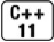
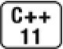
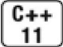

[总目录](<../目录.md>) · [本章目录](<01 章节导读.md>) · [上一篇](<../第16章 模板与泛型编程/01 章节导读.md>) · [下一篇](<../第16章 模板与泛型编程/16.2 模板实参推断.md>)

> 原 PDF 第 946–981 页。

<!-- PDF 第 946 页 -->

# **16.1** 定义模板

假定我们希望编写一个函数来比较两个值,并指出第一个值是小于、等于还是大于第二个值。在实际中,我们可能想要定义多个函数, 每个函数比较一种给定类型的值。我们的初次尝试可能定义多个重载函数:

<!-- 代码原图: ../images/_page_945_Picture_63.png -->
```c++
// 如果两个值相等，返回 0，如果 v1 小返回-1，如果 v2 小返回 1
int compare(const string &v1, const string &v2)
{
    if (v1 < v2) return -1;
    if (v2 < v1) return 1;
    return 0;
}
int compare(const double &v1, const double &v2)
{
    if (v1 < v2) return -1;
    if (v2 < v1) return 1;
    return 0;
}
```

这两个函数几乎是相同的,唯一的差异是参数的类型,函数体则完全一样。

如果对每种希望比较的类型都不得不重复定义完全一样的函数体, 是非常烦琐且容易出错的。更麻烦的是,在编写程序的时候,我们就要确定可能要compare的所有类型。如果希望能在用户提供的类型上使用此函数,这种策略就失效了。

## **16.1.1** 函数模板

我们可以定义一个通用的函数模板(function template),而不是为每个类型都定义一个新函数。一个函数模板就是一个公式,可用来生成针对特定类型的函数版本。compare的模板版本可能像下面这样:

<!-- PDF 第 947 页 -->

<!-- 代码原图: ../images/_page_946_Picture_108.png -->
```c++
template <typename T>
int compare(const T &v1, const T &v2)
{
    if (v1 < v2) return -1;
    if (v2 < v1) return 1;
    return 0;
}
```

模板定义以关键字template开始,后跟一个模板参数列表(template parameter list),这是一个逗号分隔的一个或多个模板参数(template parameter)的列表,用小于号(<)和大于号(>)包围起来。


在模板定义中,模板参数列表不能为空。

模板参数列表的作用很像函数参数列表。函数参数列表定义了若干特定类型的局部变量,但并未指出如何初始化它们。在运行时,调用者提供实参来初始化形参。

类似的,模板参数表示在类或函数定义中用到的类型或值。当使用模板时,我们(隐式地或显式地)指定模板实参(template argument),将其绑定到模板参数上。

我们的compare函数声明了一个名为T的类型参数。在compare中, 我们用名字T表示一个类型。而T表示的实际类型则在编译时根据 compare的使用情况来确定。

#### 实例化函数模板

当我们调用一个函数模板时,编译器(通常)用函数实参来为我们推断模板实参。即,当我们调用compare时,编译器使用实参的类型来确定绑定到模板参数T的类型。例如,在下面的调用中:

<!-- 代码原图: ../images/_page_946_Picture_110.png -->
```c++
cout << compare(1, 0) << endl; // T为int
```

实参类型是int。编译器会推断出模板实参为int,并将它绑定到模板参数T。

编译器用推断出的模板参数来为我们实例化(instantiate)一个特定

<!-- PDF 第 948 页 -->

版本的函数。当编译器实例化一个模板时,它使用实际的模板实参代替对应的模板参数来创建出模板的一个新"实例"。例如,给定下面的调用:

<!-- 代码原图: ../images/_page_947_Picture_73.png -->
```c++
// 实例化出 int compare(const int&，const int&)
cout << compare(1, 0) << endl; // T为 int
// 实例化出 int compare(const vector<int>&，const vector<int>&)
vector<int> vec1{1, 2, 3}, vec2{4, 5, 6};
cout << compare(vec1, vec2) << endl; // T为 vector<int>
```

编译器会实例化出两个不同版本的compare。对于第一个调用,编译器会编写并编译一个compare版本,其中T被替换为int:

<!-- 代码原图: ../images/_page_947_Picture_74.png -->
```c++
int compare(const int &v1, const int &v2)
{
    if (v1 < v2) return -1;
    if (v2 < v1) return 1;
    return 0;
}
```

对于第二个调用,编译器会生成另一个compare版本,其中T被替换为vector<int>。这些编译器生成的版本通常被称为模板的实例 (instantiation)。

#### 模板类型参数

我们的compare函数有一个模板类型参数(type parameter)。一般来说,我们可以将类型参数看作类型说明符,就像内置类型或类类型说明符一样使用。特别是,类型参数可以用来指定返回类型或函数的参数类型,以及在函数体内用于变量声明或类型转换:

<!-- 代码原图: ../images/_page_947_Picture_75.png -->
```c++
// 正确：返回类型和参数类型相同
template <typename T> T foo(T* p)
{
    T tmp = *p; // tmp的类型将是指针 p 指向的类型
    //...
    return tmp;
}
```

<!-- PDF 第 949 页 -->

### 类型参数前必须使用关键字class或typename:

<!-- 代码原图: ../images/_page_948_Picture_104.png -->
```c++
// 错误：U之前必须加上class或typename
template <typename T, U> T calc(const T&, const U&);
```

在模板参数列表中,这两个关键字的含义相同,可以互换使用。一个模板参数列表中可以同时使用这两个关键字:

<!-- 代码原图: ../images/_page_948_Picture_105.png -->
```c++
// 正确：在模板参数列表中，typename 和 class没有什么不同
template <typename T, class U> calc (const T&, const U&);
```

看起来用关键字typename来指定模板类型参数比用class更为直观。 毕竟,我们可以用内置(非类)类型作为模板类型实参。而且, typename更清楚地指出随后的名字是一个类型名。但是,typename是在模板已经广泛使用之后才引入C++语言的,某些程序员仍然只用class。

#### 非类型模板参数

除了定义类型参数,还可以在模板中定义非类型参数(nontype parameter)。一个非类型参数表示一个值而非一个类型。我们通过一个特定的类型名而非关键字class或typename来指定非类型参数。

当一个模板被实例化时,非类型参数被一个用户提供的或编译器推断出的值所代替。这些值必须是常量表达式(参见2.4.4节,第58页), 从而允许编译器在编译时实例化模板。

例如,我们可以编写一个compare版本处理字符串字面常量。这种字面常量是const char的数组。由于不能拷贝一个数组,所以我们将自己的参数定义为数组的引用(参见6.2.4节,第195页)。由于我们希望能比较不同长度的字符串字面常量,因此为模板定义了两个非类型的参数。第一个模板参数表示第一个数组的长度,第二个参数表示第二个数组的长度:

<!-- 代码原图: ../images/_page_948_Picture_106.png -->
```c++
template<unsigned N, unsigned M>
int compare(const char (&p1)[N], const char (&p2)[M])
{
    return strcmp(p1, p2);
}
```

<!-- PDF 第 950 页 -->

当我们调用这个版本的compare时:

<!-- 代码原图: ../images/_page_949_Picture_100.png -->
```c++
compare("hi", "mom")
```

编译器会使用字面常量的大小来代替N和M,从而实例化模板。记住,编译器会在一个字符串字面常量的末尾插入一个空字符作为终结符 (参见2.1.3节,第36页),因此编译器会实例化出如下版本:

<!-- 代码原图: ../images/_page_949_Picture_101.png -->
```c++
int compare(const char (&p1)[3], const char (&p2)[4])
```

一个非类型参数可以是一个整型,或者是一个指向对象或函数类型的指针或(左值)引用。绑定到非类型整型参数的实参必须是一个常量表达式。绑定到指针或引用非类型参数的实参必须具有静态的生存期 (参见第12章,第400页)。我们不能用一个普通(非static)局部变量或动态对象作为指针或引用非类型模板参数的实参。指针参数也可以用 nullptr或一个值为0的常量表达式来实例化。

在模板定义内,模板非类型参数是一个常量值。在需要常量表达式的地方,可以使用非类型参数,例如,指定数组大小。


非类型模板参数的模板实参必须是常量表达式。

### **inline**和**constexpr**的函数模板

函数模板可以声明为inline或constexpr的,如同非模板函数一样。 inline或constexpr说明符放在模板参数列表之后,返回类型之前:

<!-- 代码原图: ../images/_page_949_Picture_103.png -->
```c++
// 正确：inline 说明符跟在模板参数列表之后
template <typename T> inline T min(const T&, const T&);
// 错误：inline 说明符的位置不正确
inline template <typename T> T min(const T&, const T&);
```

#### 编写类型无关的代码

我们最初的compare函数虽然简单,但它说明了编写泛型代码的两个重要原则:

<!-- PDF 第 951 页 -->

· 模板中的函数参数是const的引用。

· 函数体中的条件判断仅使用<比较运算。

通过将函数参数设定为const的引用,我们保证了函数可以用于不能拷贝的类型。大多数类型,包括内置类型和我们已经用过的标准库类型 (除unique\_ptr和IO类型之外),都是允许拷贝的。但是,不允许拷贝的类类型也是存在的。通过将参数设定为const的引用,保证了这些类型可以用我们的compare函数来处理。而且,如果compare用于处理大对象,这种设计策略还能使函数运行得更快。

你可能认为既使用<运算符又使用>运算符来进行比较操作会更为自然:

<!-- 代码原图: ../images/_page_950_Picture_104.png -->
```c++
// 期望的比较操作
if (v1 < v2) return -1;
if (v1 > v2) return 1;
return 0;
```

但是,如果编写代码时只使用<运算符,我们就降低了compare函数对要处理的类型的要求。这些类型必须支持<,但不必同时支持>。

实际上,如果我们真的关心类型无关和可移植性,可能需要用 less(参见14.8.2节,第510页)来定义我们的函数:

<!-- 代码原图: ../images/_page_950_Picture_105.png -->
```c++
// 即使用于指针也正确的 compare 版本；参见 14.8.2 节（第 510 页）
template <typename T> int compare(const T &v1, const T &v2)
{
    if (less<T>()(v1, v2)) return -1;
    if (less<T>()(v2, v1)) return 1;
    return 0;
}
```

原始版本存在的问题是,如果用户调用它比较两个指针,且两个指针未指向相同的数组,则代码的行为是未定义的(据查阅资料, less<T>的默认实现用的就是<,所以这其实并未起到让这种比较有一个良好定义的作用——译者注)。


<!-- PDF 第 952 页 -->

模板程序应该尽量减少对实参类型的要求。

#### 模板编译

当编译器遇到一个模板定义时,它并不生成代码。只有当我们实例化出模板的一个特定版本时,编译器才会生成代码。当我们使用(而不是定义)模板时,编译器才生成代码,这一特性影响了我们如何组织代码以及错误何时被检测到。

通常,当我们调用一个函数时,编译器只需要掌握函数的声明。类似的,当我们使用一个类类型的对象时,类定义必须是可用的,但成员函数的定义不必已经出现。因此,我们将类定义和函数声明放在头文件中,而普通函数和类的成员函数的定义放在源文件中。

模板则不同:为了生成一个实例化版本,编译器需要掌握函数模板或类模板成员函数的定义。因此,与非模板代码不同,模板的头文件通常既包括声明也包括定义。


函数模板和类模板成员函数的定义通常放在头文件中。

### 关键概念:模板和头文件

模板包含两种名字:

· 那些不依赖于模板参数的名字 · 那些依赖于模板参数的名字

当使用模板时,所有不依赖于模板参数的名字都必须是可见的,这是由模板的提供者来保证的。而且,模板的提供者必须保证,当模板被实例化时,模板的定义,包括类模板的成员的定义,也必须是可见的。

用来实例化模板的所有函数、类型以及与类型关联的运算符的声明都必须是可见的,这是由模板的用户来保证的。

通过组织良好的程序结构,恰当使用头文件,这些要求都很容易满足。模板的设计者应该提供一个头文件,包含模板定义以及在类模板或成员定义中用到的所有名字的声明。模板的用户必须包含模板的头文件,以及用来实例化模板的任何类型的头文件。

### 大多数编译错误在实例化期间报告

模板直到实例化时才会生成代码,这一特性影响了我们何时才会获知模板内代码的编译错误。通常,编译器会在三个阶段报告错误。

<!-- PDF 第 953 页 -->

第一个阶段是编译模板本身时。在这个阶段,编译器通常不会发现很多错误。编译器可以检查语法错误,例如忘记分号或者变量名拼错等,但也就这么多了。

第二个阶段是编译器遇到模板使用时。在此阶段,编译器仍然没有很多可检查的。对于函数模板调用,编译器通常会检查实参数目是否正确。它还能检查参数类型是否匹配。对于类模板,编译器可以检查用户是否提供了正确数目的模板实参,但也仅限于此了。

第三个阶段是模板实例化时,只有这个阶段才能发现类型相关的错误。依赖于编译器如何管理实例化,这类错误可能在链接时才报告。

当我们编写模板时,代码不能是针对特定类型的,但模板代码通常对其所使用的类型有一些假设。例如,我们最初的compare函数中的代码就假定实参类型定义了<运算符。

<!-- 代码原图: ../images/_page_952_Picture_105.png -->
```c++
if(v1 < v2)return -1; // 要求类型 T的对象支持<操作
if(v2 < v1)return 1; // 要求类型 T的对象支持<操作
```

<!-- 代码原图: ../images/_page_952_Picture_106.png -->
```c++
return 0; // 返回 int；不依赖于 T
```

当编译器处理此模板时,它不能验证if语句中的条件是否合法。如果传递给compare的实参定义了<运算符,则代码就是正确的,否则就是错误的。例如,

<!-- 代码原图: ../images/_page_952_Picture_107.png -->
```c++
Sales_data data1, data2;
cout << compare(data1, data2) << endl; // 错误：Sales_data 未定义<
```

此调用实例化了compare的一个版本,将T替换为Sales\_data。if条件试图对Sales\_data对象使用<运算符,但Sales\_data并未定义此运算符。此实例化生成了一个无法编译通过的函数版本。但是,这样的错误直至编译器在类型Sales\_data上实例化compare时才会被发现。


保证传递给模板的实参支持模板所要求的操作,以及这些操作在模板中能正确工作,是调用者的责任。

**16.1.1**节练习

<!-- PDF 第 954 页 -->

练习**16.1**:给出实例化的定义。

练习**16.2**:编写并测试你自己版本的compare函数。

练习**16.3**:对两个Sales\_data对象调用你的compare函数,观察编译器在实例化过程中如何处理错误。

练习**16.4**:编写行为类似标准库find算法的模板。函数需要两个模板类型参数,一个表示函数的迭代器参数,另一个表示值的类型。使用你的函数在一个vector<int>和一个list<string>中查找给定值。

练习**16.5**:为6.2.4节(第195页)中的print函数编写模板版本,它接受一个数组的引用,能处理任意大小、任意元素类型的数组。

练习**16.6**:你认为接受一个数组实参的标准库函数begin和end是如何工作的?定义你自己版本的begin和end。

练习**16.7**:编写一个constexpr模板,返回给定数组的大小。

练习**16.8**:在第97页的"关键概念"中,我们注意到,C++程序员喜欢使用!=而不喜欢<。解释这个习惯的原因。

# **16.1.2** 类模板

类模板(class template)是用来生成类的蓝图的。与函数模板的不同之处是,编译器不能为类模板推断模板参数类型。如我们已经多次看到的,为了使用类模板,我们必须在模板名后的尖括号中提供额外信息 (参见3.3节,第87页)——用来代替模板参数的模板实参列表。

### 定义类模板

作为一个例子,我们将实现StrBlob(参见12.1.1节,第405页)的模板版本。我们将此模板命名为Blob,意指它不再针对string。类似 StrBlob,我们的模板会提供对元素的共享(且核查过的)访问能力。与类不同,我们的模板可以用于更多类型的元素。与标准库容器相同,当使用Blob时,用户需要指出元素类型。

类似函数模板,类模板以关键字template开始,后跟模板参数列表。在类模板(及其成员)的定义中,我们将模板参数当作替身,代替 

<!-- PDF 第 955 页 -->

使用模板时用户需要提供的类型或值:

<!-- 代码原图: ../images/_page_954_Picture_73.png -->
```c++
template <typename T> class Blob {
public:
    typedef T value_type;
    typedef typename std::vector<T>::size_type size_type;
    // 构造函数
    Blob();
    Blob(std::initializer_list<T> il);
    // Blob 中的元素数目
    size_type size() const { return data->size(); }
    bool empty() const { return data->empty(); }
    // 添加和删除元素
    void push_back(const T &t) {data->push_back(t);}
    // 移动版本，参见 13.6.3 节（第 484 页）
    void push_back(T &&t) { data->push_back(std::move(t)); }
    void pop_back();
    // 元素访问
    T& back();
    T& operator[](size_type i); // 在 14.5 节(第 501 页)中定义
private:
    std::shared_ptr<std::vector<T>> data;
    // 若 data[i]无效，则抛出 msg
    void check(size_type i, const std::string &msg) const;
};
```

我们的Blob模板有一个名为T的模板类型参数,用来表示Blob保存的元素的类型。例如,我们将元素访问操作的返回类型定义为T&。当用户实例化Blob时,T就会被替换为特定的模板实参类型。

除了模板参数列表和使用T代替string之外,此类模板的定义与 12.1.1节(第405页)中定义的类版本及12.1.6节(第422页)和第13章、 第14章中更新的版本是一样的。

#### 实例化类模板

我们已经多次见到,当使用一个类模板时,我们必须提供额外信息。我们现在知道这些额外信息是显式模板实参(explicit template argument)列表,它们被绑定到模板参数。编译器使用这些模板实参来实例化出特定的类。

<!-- PDF 第 956 页 -->

例如,为了用我们的Blob模板定义一个类型,必须提供元素类型:

<!-- 代码原图: ../images/_page_955_Picture_83.png -->
```c++
Blob<int> ia; // 空 Blob<int>
Blob<int> ia2 = {0,1,2,3,4}; // 有5个元素的 Blob<int>
```

ia和ia2使用相同的特定类型版本的Blob(即Blob<int>)。从这两个定义,编译器会实例化出一个与下面定义等价的类:

<!-- 代码原图: ../images/_page_955_Picture_84.png -->
```c++
template <> class Blob<int> {
    typedef typename std::vector<int>::size_type size_type;
    Blob();
    Blob(std::initializer_list<int> il);
    //...
    int& operator[](size_type i);
```

<!-- 代码原图: ../images/_page_955_Picture_85.png -->
```c++
private:
    std::shared_ptr<std::vector<int>> data;
    void check(size_type i, const std::string &msg) const;
};
```

当编译器从我们的Blob模板实例化出一个类时,它会重写Blob模板,将模板参数T的每个实例替换为给定的模板实参,在本例中是int。

对我们指定的每一种元素类型,编译器都生成一个不同的类:

<!-- 代码原图: ../images/_page_955_Picture_86.png -->
```c++
// 下面的定义实例化出两个不同的 Blob 类型
Blob<string> names; // 保存 string 的 Blob
Blob<double> prices; // 不同的元素类型
```

这两个定义会实例化出两个不同的类。names的定义创建了一个 Blob类,每个T都被替换为string。prices的定义生成了另一个Blob类,T 被替换为double。


一个类模板的每个实例都形成一个独立的类。类型Blob<string>与任何其他Blob类型都没有关联,也不会对任何其他Blob类型的成员有特殊访问权限。

在模板作用域中引用模板类型

<!-- PDF 第 957 页 -->

为了阅读模板类代码,应该记住类模板的名字不是一个类型名(参见3.3节,第87页)。类模板用来实例化类型,而一个实例化的类型总是包含模板参数的。

可能令人迷惑的是,一个类模板中的代码如果使用了另外一个模板,通常不将一个实际类型(或值)的名字用作其模板实参。相反的, 我们通常将模板自己的参数当作被使用模板的实参。例如,我们的data 成员使用了两个模板,vector和shared\_ptr。我们知道,无论何时使用模板都必须提供模板实参。在本例中,我们提供的模板实参就是Blob的模板参数。因此,data的定义如下:

<!-- 代码原图: ../images/_page_956_Picture_127.png -->
```c++
std::shared_ptr<std::vector<T>> data;
```

它使用了Blob的类型参数来声明data是一个shared\_ptr的实例,此 shared\_ptr指向一个保存类型为T的对象的vector实例。当我们实例化一个特定类型的Blob,例如Blob<string>时,data会成为:

<!-- 代码原图: ../images/_page_956_Picture_128.png -->
```c++
shared_ptr<vector<string>>
```

如果我们实例化Blob<int>,则data会成为shared\_ptr<vector<int>>, 依此类推。

#### 类模板的成员函数

与其他任何类相同,我们既可以在类模板内部,也可以在类模板外部为其定义成员函数,且定义在类模板内的成员函数被隐式声明为内联函数。

类模板的成员函数本身是一个普通函数。但是,类模板的每个实例都有其自己版本的成员函数。因此,类模板的成员函数具有和模板相同的模板参数。因而,定义在类模板之外的成员函数就必须以关键字 template开始,后接类模板参数列表。

与往常一样,当我们在类外定义一个成员时,必须说明成员属于哪个类。而且,从一个模板生成的类的名字中必须包含其模板实参。当我们定义一个成员函数时,模板实参与模板形参相同。即,对于StrBlob的一个给定的成员函数

<!-- PDF 第 958 页 -->

<!-- 代码原图: ../images/_page_957_Picture_49.png -->
```c++
ret-type StrBlob::member-name(parm-list)
```

对应的Blob的成员应该是这样的:

<!-- 代码原图: ../images/_page_957_Picture_50.png -->
```c++
template <typename T>
ret-type Blob<T>::member-name(parm-list)
```

**check**和元素访问成员

我们首先定义check成员,它检查一个给定的索引:

<!-- 代码原图: ../images/_page_957_Picture_51.png -->
```c++
template <typename T>
void Blob<T>::check(size_type i, const std::string &msg) const
{
    if (i >= data->size())
        throw std::out_of_range(msg);
}
```

除了类名中的不同之处以及使用了模板参数列表外,此函数与原 StrBlob类的check成员完全一样。

下标运算符和back函数用模板参数指出返回类型,其他未变:

<!-- 代码原图: ../images/_page_957_Picture_52.png -->
```c++
template <typename T>
T& Blob<T>::back()
{
    check(0, "back on empty Blob");
    return data->back();
}

template <typename T>
T& Blob<T>::operator[](size_type i)
{
    // 如果 i 太大，check 会抛出异常，阻止访问一个不存在的元素
    check(i, "subscript out of range");
    return (*data)[i];
}
```

在原StrBlob类中,这些运算符返回string&。而模板版本则返回一个引用,指向用来实例化Blob的类型。

<!-- PDF 第 959 页 -->

pop\_back函数与原StrBlob的成员几乎相同:

<!-- 代码原图: ../images/_page_958_Picture_106.png -->
```c++
template <typename T> void Blob<T>::pop_back()
{
    check(0, "pop_back on empty Blob");
    data->pop_back();
}
```

在原StrBlob类中,下标运算符和back成员都对const对象进行了重载。我们将这些成员及front成员的定义留作练习。

### **Blob**构造函数

与其他任何定义在类模板外的成员一样,构造函数的定义要以模板参数开始:

<!-- 代码原图: ../images/_page_958_Picture_107.png -->
```c++
template <typename T>
Blob<T>::Blob(): data(std::make_shared<std::vector<T>>()) { }
```

这段代码在作用域Blob<T>中定义了名为Blob的成员函数。类似 StrBlob的默认构造函数(参见12.1.1节,第405页),此构造函数分配一个空vector,并将指向vector的指针保存在data中。如前所述,我们将类模板自己的类型参数作为vector的模板实参来分配vector。

类似的,接受一个initializer\_list参数的构造函数将其类型参数T作为 initializer\_list参数的元素类型:

<!-- 代码原图: ../images/_page_958_Picture_108.png -->
```c++
template <typename T>
Blob<T>::Blob(std::initializer_list<T> il):
    data(std::make_shared<std::vector<T>>(il)) { }
```

类似默认构造函数,此构造函数分配一个新的vector。在本例中, 我们用参数il来初始化此vector。

为了使用这个构造函数,我们必须传递给它一个initializer\_list,其中的元素必须与Blob的元素类型兼容:

<!-- 代码原图: ../images/_page_958_Picture_109.png -->
```c++
Blob<string> articles = {"a", "an", "the"};
```

<!-- PDF 第 960 页 -->

这条语句中,构造函数的参数类型为initializer\_list<string>。列表中的每个字符串字面常量隐式地转换为一个string。

#### 类模板成员函数的实例化

默认情况下,一个类模板的成员函数只有当程序用到它时才进行实例化。例如,下面代码

<!-- 代码原图: ../images/_page_959_Picture_72.png -->
```c++
// 实例化 Blob<int>和接受 initializer_list<int>的构造函数
Blob<int> squares = {0,1,2,3,4,5,6,7,8,9};
// 实例化 Blob<int>::size() const
for (size_t i = 0; i != squares.size(); ++i)
    squares[i] = i*i; // 实例化 Blob<int>::operator[](size_t)
```

实例化了Blob<int>类和它的三个成员函数:operator[]、size和接受 initializer\_list<int>的构造函数。

如果一个成员函数没有被使用,则它不会被实例化。成员函数只有在被用到时才进行实例化,这一特性使得即使某种类型不能完全符合模板操作的要求(参见9.2节,第294页),我们仍然能用该类型实例化类。


默认情况下,对于一个实例化了的类模板,其成员只有在使用时才被实例化。

#### 在类代码内简化模板类名的使用

当我们使用一个类模板类型时必须提供模板实参,但这一规则有一个例外。在类模板自己的作用域中,我们可以直接使用模板名而不提供实参:

<!-- PDF 第 961 页 -->

<!-- 代码原图: ../images/_page_960_Picture_35.png -->
```c++
// 若试图访问一个不存在的元素，BlobPtr 抛出一个异常
template <typename T> class BlobPtr {
public:
    BlobPtr(): curr(0) { }
    BlobPtr(Blob<T> &a, size_t sz = 0):
        wptr(a.data), curr(sz) { }
    T& operator*() const
    { auto p = check(curr, "dereference past end");
        return (*p)[curr]; // (*p)为本对象指向的 vector
```

<!-- 代码原图: ../images/_page_960_Picture_36.png -->
```c++
}
// 递增和递减
BlobPtr& operator++(); // 前置运算符
BlobPtr& operator--();
private:
// 若检查成功，check 返回一个指向 vector 的 shared_ptr
std::shared_ptr<std::vector<T>>
    check(std::size_t, const std::string&) const;
// 保存一个 weak_ptr，表示底层 vector 可能被销毁
std::weak_ptr<std::vector<T>> wptr;
std::size_t curr; // 数组中的当前位置
};
```

细心的读者可能已经注意到,BlobPtr的前置递增和递减成员返回 BlobPtr&,而不是BlobPtr<T>&。当我们处于一个类模板的作用域中时,编译器处理模板自身引用时就好像我们已经提供了与模板参数匹配的实参一样。即,就好像我们这样编写代码一样:

<!-- 代码原图: ../images/_page_960_Picture_37.png -->
```c++
BlobPtr<T>& operator++();

BlobPtr<T>& operator--();
```

在类模板外使用类模板名

当我们在类模板外定义其成员时,必须记住,我们并不在类的作用域中,直到遇到类名才表示进入类的作用域(参见7.4节,第253页):

<!-- PDF 第 962 页 -->

<!-- 代码原图: ../images/_page_961_Picture_85.png -->
```c++
// 后置：递增/递减对象但返回原值
template <typename T>
BlobPtr<T> BlobPtr<T>::operator++(int)
{
    // 此处无须检查；调用前置递增时会进行检查
    BlobPtr ret = *this; // 保存当前值
    ++*this;     // 推进一个元素；前置++检查递增是否合法
    return ret; // 返回保存的状态
}
```

由于返回类型位于类的作用域之外,我们必须指出返回类型是一个实例化的BlobPtr,它所用类型与类实例化所用类型一致。在函数体内, 我们已经进入类的作用域,因此在定义ret时无须重复模板实参。如果不提供模板实参,则编译器将假定我们使用的类型与成员实例化所用类型一致。因此,ret的定义与如下代码等价:

<!-- 代码原图: ../images/_page_961_Picture_86.png -->
```c++
BlobPtr<T> ret = *this;
```


在一个类模板的作用域内,我们可以直接使用模板名而不必指定模板实参。

### 类模板和友元

当一个类包含一个友元声明(参见7.2.1节,第241页)时,类与友元各自是否是模板是相互无关的。如果一个类模板包含一个非模板友元,则友元被授权可以访问所有模板实例。如果友元自身是模板,类可以授权给所有友元模板实例,也可以只授权给特定实例。

### 一对一友好关系

类模板与另一个(类或函数)模板间友好关系的最常见的形式是建立对应实例及其友元间的友好关系。例如,我们的Blob类应该将BlobPtr 类和一个模板版本的Blob相等运算符(最初是在14.3.1节(第498页)练习中为StrBlob定义的)定义为友元。

为了引用(类或函数)模板的一个特定实例,我们必须首先声明模板自身。一个模板声明包括模板参数列表:

<!-- PDF 第 963 页 -->

<!-- 代码原图: ../images/_page_962_Picture_66.png -->
```c++
// 前置声明，在 Blob 中声明友元所需要的

template <typename> class BlobPtr;
template <typename> class Blob; // 运算符==中的参数所需要的

template <typename T>
    bool operator==(const Blob<T>&, const Blob<T>&);

template <typename T> class Blob {
    // 每个 Blob 实例将访问权限授予用相同类型实例化的 BlobPtr 和相等运算符
    friend class BlobPtr<T>;
    friend bool operator==<T>
        (const Blob<T>&, const Blob<T>&);
    // 其他成员定义，与 12.1.1（第 405 页）相同
};
```

我们首先将Blob、BlobPtr和operator==声明为模板。这些声明是 operator==函数的参数声明以及Blob中的友元声明所需要的。

友元的声明用Blob的模板形参作为它们自己的模板实参。因此,友好关系被限定在用相同类型实例化的Blob与BlobPtr相等运算符之间:

<!-- 代码原图: ../images/_page_962_Picture_67.png -->
```c++
Blob<char> ca; // BlobPtr<char>和 operator==<char>都是本对象的友元
Blob<int> ia; // BlobPtr<int>和 operator==<int>都是本对象的友元
```

BlobPtr<char>的成员可以访问ca(或任何其他Blob<char>对象)的非public部分,但ca对ia(或任何其他Blob<int>对象)或Blob的任何其他实例都没有特殊访问权限。

通用和特定的模板友好关系

一个类也可以将另一个模板的每个实例都声明为自己的友元,或者限定特定的实例为友元:

<!-- PDF 第 964 页 -->

<!-- 代码原图: ../images/_page_963_Picture_61.png -->
```c++
// 前置声明，在将模板的一个特定实例声明为友元时要用到
template <typename T> class Pal;
class C { // C是一个普通的非模板类
    friend class Pal<C>; // 用类 C实例化的 Pal 是 C的一个友元
    // Pal2的所有实例都是 C的友元；这种情况无须前置声明
    template <typename T> friend class Pal2;
};
template <typename T> class C2 { // C2本身是一个类模板
    // C2的每个实例将相同实例化的 Pal 声明为友元
    friend class Pal<T>; // Pal的模板声明必须在作用域之内
    // Pal2的所有实例都是 C2的每个实例的友元，不需要前置声明
    template <typename X> friend class Pal2;
    // Pal3是一个非模板类，它是 C2所有实例的友元
    friend class Pal3; // 不需要 Pal3的前置声明
};
```

为了让所有实例成为友元,友元声明中必须使用与类模板本身不同的模板参数。

令模板自己的类型参数成为友元



在新标准中,我们可以将模板类型参数声明为友元:

<!-- 代码原图: ../images/_page_963_Picture_63.png -->
```c++
template <typename Type> class Bar {
friend Type; // 将访问权限授予用来实例化 Bar 的类型
    //...
};
```

此处我们将用来实例化Bar的类型声明为友元。因此,对于某个类型名Foo,Foo将成为Bar<Foo>的友元,Sales\_data将成为 Bar<Sales\_data>的友元,依此类推。

值得注意的是,虽然友元通常来说应该是一个类或是一个函数,但我们完全可以用一个内置类型来实例化Bar。这种与内置类型的友好关系是允许的,以便我们能用内置类型来实例化Bar这样的类。

模板类型别名

类模板的一个实例定义了一个类类型,与任何其他类类型一样,我

<!-- PDF 第 965 页 -->

们可以定义一个typedef(参见2.5.1节,第60页)来引用实例化的类:

<!-- 代码原图: ../images/_page_964_Picture_109.png -->
```c++
typedef Blob<string> StrBlob;
```

这条typedef语句允许我们运行在12.1.1节(第405页)中编写的代码,而使用的却是用string实例化的模板版本的Blob。由于模板不是一个类型,我们不能定义一个typedef引用一个模板。即,无法定义一个 typedef引用Blob<T>。


但是,新标准允许我们为类模板定义一个类型别名:

<!-- 代码原图: ../images/_page_964_Picture_111.png -->
```c++
template<typename T> using twin = pair<T, T>;
twin<string> authors; // authors 是一个 pair<string, string>
```

在这段代码中,我们将twin定义为成员类型相同的pair的别名。这样,twin的用户只需指定一次类型。

一个模板类型别名是一族类的别名:

<!-- 代码原图: ../images/_page_964_Picture_112.png -->
```c++
twin<int> win_loss; // win_loss 是一个 pair<int, int>
twin<double> area; // area 是一个 pair<double, double>
```

就像使用类模板一样,当我们使用twin时,需要指出希望使用哪种特定类型的twin。

当我们定义一个模板类型别名时,可以固定一个或多个模板参数:

<!-- 代码原图: ../images/_page_964_Picture_113.png -->
```c++
template <typename T> using partNo = pair<T, unsigned>;
partNo<string> books; // books 是一个 pair<string, unsigned>
partNo<Vehicle> cars; // cars 是一个 pair<Vehicle, unsigned>
partNo<Student> kids; // kids 是一个 pair<Student, unsigned>
```

这段代码中我们将partNo定义为一族类型的别名,这族类型是 second成员为unsigned的pair。partNo的用户需要指出pair的first成员的类型,但不能指定second成员的类型。

类模板的**static**成员

<!-- PDF 第 966 页 -->

与任何其他类相同,类模板可以声明static成员(参见7.6节,第269 页):

<!-- 代码原图: ../images/_page_965_Picture_104.png -->
```c++
template <typename T> class Foo {
public:
```

<!-- 代码原图: ../images/_page_965_Picture_105.png -->
```c++
    static std::size_t count() { return ctr; }
    // 其他接口成员

private:

    static std::size_t ctr;
    // 其他实现成员

};
```

在这段代码中,Foo是一个类模板,它有一个名为count的public static成员函数和一个名为ctr的private static数据成员。每个Foo的实例都有其自己的static成员实例。即,对任意给定类型X,都有一个 Foo<X>::ctr和一个Foo<X>::count成员。所有Foo<X>类型的对象共享相同的ctr对象和count函数。例如,

<!-- 代码原图: ../images/_page_965_Picture_106.png -->
```c++
// 实例化 static 成员 Foo<string>::ctr 和 Foo<string>::count
Foo<string> fs;
// 所有三个对象共享相同的 Foo<int>::ctr 和 Foo<int>::count 成员
Foo<int> fi, fi2, fi3;
```

与任何其他static数据成员相同,模板类的每个static数据成员必须有且仅有一个定义。但是,类模板的每个实例都有一个独有的static对象。因此,与定义模板的成员函数类似,我们将static数据成员也定义为模板:

<!-- 代码原图: ../images/_page_965_Picture_107.png -->
```c++
template <typename T>
size_t Foo<T>::ctr = 0; // 定义并初始化 ctr
```

与类模板的其他任何成员类似,定义的开始部分是模板参数列表, 随后是我们定义的成员的类型和名字。与往常一样,成员名包括成员的类名,对于从模板生成的类来说,类名包括模板实参。因此,当使用一个特定的模板实参类型实例化Foo时,将会为该类类型实例化一个独立的ctr,并将其初始化为0。

<!-- PDF 第 967 页 -->

与非模板类的静态成员相同,我们可以通过类类型对象来访问一个类模板的static成员,也可以使用作用域运算符直接访问成员。当然,为了通过类来直接访问static成员,我们必须引用一个特定的实例:

<!-- 代码原图: ../images/_page_966_Picture_95.png -->
```c++
Foo<int> fi; // 实例化 Foo<int>类和 static 数据成员 ctr
auto ct = Foo<int>::count(); // 实例化 Foo<int>::count
ct = fi.count(); // 使用 Foo<int>::count
ct = Foo::count(); // 错误：使用哪个模板实例的 count?
```

类似任何其他成员函数,一个static成员函数只有在使用时才会实例化。

**16.1.2**节练习

练习**16.9**:什么是函数模板?什么是类模板?

练习**16.10**:当一个类模板被实例化时,会发生什么?

练习**16.11**:下面List的定义是错误的。应如何修正它?

<!-- 代码原图: ../images/_page_966_Picture_96.png -->
```c++
template <typename elemType> class ListItem;
template <typename elemType> class List {
public:
    List<elemType>();
    List<elemType>(const List<elemType> &);
    List<elemType>& operator=(const List<elemType> &);
    ~List();
```

<!-- 代码原图: ../images/_page_966_Picture_97.png -->
```c++
    void insert(ListItem *ptr, elemType value);
private:
    ListItem *front, *end;
};
```

练习**16.12**:编写你自己版本的Blob和BlobPtr模板,包含书中未定义的多个const成员。

练习**16.13**:解释你为BlobPtr的相等和关系运算符选择哪种类型的友好关系?

练习**16.14**:编写Screen类模板,用非类型参数定义Screen的高和宽。

练习**16.15**:为你的Screen模板实现输入和输出运算符。Screen类需要哪

<!-- PDF 第 968 页 -->

些友元(如果需要的话)来令输入和输出运算符正确工作?解释每个友元声明(如果有的话)为什么是必要的。

练习**16.16**:将StrVec类(参见13.5节,第465页)重写为模板,命名为 Vec。

## **16.1.3** 模板参数

类似函数参数的名字,一个模板参数的名字也没有什么内在含义。 我们通常将类型参数命名为T,但实际上我们可以使用任何名字:

<!-- 代码原图: ../images/_page_967_Picture_88.png -->
```c++
template <typename Foo> Foo calc(const Foo& a, const Foo& b)
{
    Foo tmp = a; // tmp 的类型与参数和返回类型一样
    //....
    return tmp; // 返回类型和参数类型一样
}
```

## 模板参数与作用域

模板参数遵循普通的作用域规则。一个模板参数名的可用范围是在其声明之后,至模板声明或定义结束之前。与任何其他名字一样,模板参数会隐藏外层作用域中声明的相同名字。但是,与大多数其他上下文不同,在模板内不能重用模板参数名:

<!-- 代码原图: ../images/_page_967_Picture_89.png -->
```c++
typedef double A;
template <typename A, typename B> void f(A a, B b)
{
    A tmp = a;    // tmp的类型为模板参数A的类型，而非 double
    double B;     // 错误：重声明模板参数B
}
```

正常的名字隐藏规则决定了A的typedef被类型参数A隐藏。因此, tmp不是一个double,其类型是使用f时绑定到类型参数A的类型。由于我们不能重用模板参数名,声明名字为B的变量是错误的。

由于参数名不能重用,所以一个模板参数名在一个特定模板参数列表中只能出现一次:

<!-- PDF 第 969 页 -->

<!-- 代码原图: ../images/_page_968_Picture_95.png -->
```c++
// 错误：非法重用模板参数名 V
template <typename V, typename V> //...
```

### 模板声明

模板声明必须包含模板参数:

<!-- 代码原图: ../images/_page_968_Picture_96.png -->
```c++
// 声明但不定义 compare 和 Blob
template <typename T> int compare(const T&, const T&);
template <typename T> class Blob;
```

与函数参数相同,声明中的模板参数的名字不必与定义中相同:

<!-- 代码原图: ../images/_page_968_Picture_97.png -->
```c++
// 3个 calc 都指向相同的函数模板
template <typename T> T calc(const T&, const T&); // 声明
template <typename U> U calc(const U&, const U&); // 声明
// 模板的定义
template <typename Type>
Type calc(const Type& a, const Type& b) { /* ... */ }
```

当然,一个给定模板的每个声明和定义必须有相同数量和种类 (即,类型或非类型)的参数。


一个特定文件所需要的所有模板的声明通常一起放置在文件开始位置,出现于任何使用这些模板的代码之前,原因我们将在16.3节(第617页)中解释。

## 使用类的类型成员

回忆一下,我们用作用域运算符(::)来访问static成员和类型成员(参见7.4节,第253页和7.6节,第269页)。在普通(非模板)代码中,编译器掌握类的定义。因此,它知道通过作用域运算符访问的名字是类型还是static成员。例如,如果我们写下string::size\_type,编译器有string的定义,从而知道size\_type是一个类型。

但对于模板代码就存在困难。例如,假定T是一个模板类型参数, 当编译器遇到类似T::mem这样的代码时,它不会知道mem是一个类型成员还是一个static数据成员,直至实例化时才会知道。但是,为了处 

<!-- PDF 第 970 页 -->

理模板,编译器必须知道名字是否表示一个类型。例如,假定T是一个类型参数的名字,当编译器遇到如下形式的语句时:

<!-- 代码原图: ../images/_page_969_Picture_102.png -->
```c++
T::size_type * p;
```

它需要知道我们是正在定义一个名为p的变量还是将一个名为 size\_type的static数据成员与名为p的变量相乘。

默认情况下,C++语言假定通过作用域运算符访问的名字不是类型。因此,如果我们希望使用一个模板类型参数的类型成员,就必须显式告诉编译器该名字是一个类型。我们通过使用关键字typename来实现这一点:

<!-- 代码原图: ../images/_page_969_Picture_103.png -->
```c++
template <typename T>
typename T::value_type top(const T& c)
{
    if (!c.empty())
        return c.back();
    else
        return typename T::value_type();
}
```

我们的top函数期待一个容器类型的实参,它使用typename指明其返回类型并在c中没有元素时生成一个值初始化的元素(参见7.5.3节,第 262页)返回给调用者。


当我们希望通知编译器一个名字表示类型时,必须使用关键字typename,而不能使用class。

默认模板实参



就像我们能为函数参数提供默认实参一样(参见6.5.1节,第211 页),我们也可以提供默认模板实参(default template argument)。在新标准中,我们可以为函数和类模板提供默认实参。而更早的C++标准只允许为类模板提供默认实参。

<!-- PDF 第 971 页 -->

例如,我们重写compare,默认使用标准库的less函数对象模板(参见14.8.2节,第509页):

<!-- 代码原图: ../images/_page_970_Picture_117.png -->
```c++
// compare 有一个默认模板实参 less<T>和一个默认函数实参 F()
template <typename T, typename F = less<T>>
int compare(const T &v1, const T &v2, F f = F())
{
    if (f(v1, v2)) return -1;
    if (f(v2, v1)) return 1;
    return 0;
}
```

在这段代码中,我们为模板添加了第二个类型参数,名为F,表示可调用对象(参见10.3.2节,第346页)的类型;并定义了一个新的函数参数f,绑定到一个可调用对象上。

我们为此模板参数提供了默认实参,并为其对应的函数参数也提供了默认实参。默认模板实参指出compare将使用标准库的less函数对象类,它是使用与compare一样的类型参数实例化的。默认函数实参指出f 将是类型F的一个默认初始化的对象。

当用户调用这个版本的compare时,可以提供自己的比较操作,但这并不是必需的:

<!-- 代码原图: ../images/_page_970_Picture_118.png -->
```c++
bool i = compare(0, 42); // 使用 less; i 为-1
// 结果依赖于 item1 和 item2 中的 isbn
Sales_data item1(cin), item2(cin);
bool j = compare(item1, item2, compareIsbn);
```

第一个调用使用默认函数实参,即,类型less<T>的一个默认初始化对象。在此调用中,T为int,因此可调用对象的类型为less<int>。 compare的这个实例化版本将使用less<int>进行比较操作。

在第二个调用中,我们传递给compare三个实参:compareIsbn(参见11.2.2节,第379页)和两个Sales\_data类型的对象。当传递给compare 三个实参时,第三个实参的类型必须是一个可调用对象,该可调用对象的返回类型必须能转换为bool值,且接受的实参类型必须与compare的前两个实参的类型兼容。与往常一样,模板参数的类型从它们对应的函

<!-- PDF 第 972 页 -->

数实参推断而来。在此调用中,T的类型被推断为Sales\_data,F被推断为compareIsbn的类型。

与函数默认实参一样,对于一个模板参数,只有当它右侧的所有参数都有默认实参时,它才可以有默认实参。

## 模板默认实参与类模板

无论何时使用一个类模板,我们都必须在模板名之后接上尖括号。 尖括号指出类必须从一个模板实例化而来。特别是,如果一个类模板为其所有模板参数都提供了默认实参,且我们希望使用这些默认实参,就必须在模板名之后跟一个空尖括号对:

<!-- 代码原图: ../images/_page_971_Picture_96.png -->
```c++
template <class T = int> class Numbers { // T默认为 int
public:
    Numbers(T v = 0): val(v) { }
```

<!-- 代码原图: ../images/_page_971_Picture_97.png -->
```c++
// 对数值的各种操作
private:
    T val;
};

Numbers<long double> lots_of_precision;
Numbers<> average_precision; // 空<>表示我们希望使用默认类型
```

此例中我们实例化了两个Numbers版本:average\_precision是用int代替T实例化得到的;lots\_of\_precision是用long double代替T实例化而得到的。

## **16.1.3**节练习

练习**16.17**:声明为typename的类型参数和声明为class的类型参数有什么不同(如果有的话)?什么时候必须使用typename?

练习**16.18**:解释下面每个函数模板声明并指出它们是否非法。更正你发现的每个错误。

<!-- PDF 第 973 页 -->

<!-- 代码原图: ../images/_page_972_Picture_80.png -->
```c++
(a) template <typename T, U, typename V> void f1(T, U, V);
(b) template <typename T> T f2(int &T);
(c) inline template <typename T> T foo(T, unsigned int*);
(d) template <typename T> f4(T, T);
(e) typedef char Ctype;
    template <typename Ctype> Ctype f5(Ctype a);
```

练习**16.19**:编写函数,接受一个容器的引用,打印容器中的元素。使用容器的size\_type和size成员来控制打印元素的循环。

练习**16.20**:重写上一题的函数,使用begin和end返回的迭代器来控制循环。

## **16.1.4** 成员模板

一个类(无论是普通类还是类模板)可以包含本身是模板的成员函数。这种成员被称为成员模板(member template)。成员模板不能是虚函数。

普通(非模板)类的成员模板

作为普通类包含成员模板的例子,我们定义一个类,类似 unique\_ptr所使用的默认删除器类型(参见12.1.5节,第418页)。类似默认删除器,我们的类将包含一个重载的函数调用运算符(参见14.8 节,第506页),它接受一个指针并对此指针执行delete。与默认删除器不同,我们的类还将在删除器被执行时打印一条信息。由于希望删除器适用于任何类型,所以我们将调用运算符定义为一个模板:

<!-- PDF 第 974 页 -->

<!-- 代码原图: ../images/_page_973_Picture_65.png -->
```c++
// 函数对象类，对给定指针执行 delete
class DebugDelete {
public:
    DebugDelete(std::ostream &s = std::cerr): os(s) { }
    // 与任何函数模板相同，T 的类型由编译器推断
    template <typename T> void operator()(T *p) const
    { os << "deleting unique_ptr" << std::endl; delete p; }
private:
    std::ostream &os;
};
```

与任何其他模板相同,成员模板也是以模板参数列表开始的。每个 DebugDelete对象都有一个ostream成员,用于写入数据;还包含一个自身是模板的成员函数。我们可以用这个类代替delete:

<!-- 代码原图: ../images/_page_973_Picture_66.png -->
```c++
double* p = new double;
DebugDelete d; // 可像 delete 表达式一样使用的对象
d(p); // 调用 DebugDelete::operator()(double*), 释放 p
int* ip = new int;
// 在一个临时 DebugDelete 对象上调用 operator()(int*)
DebugDelete()(ip);
```

由于调用一个DebugDelete对象会delete其给定的指针,我们也可以将DebugDelete用作unique\_ptr的删除器。为了重载unique\_ptr的删除器, 我们在尖括号内给出删除器类型,并提供一个这种类型的对象给 unique\_ptr的构造函数(参见12.1.5节,第418页):

<!-- 代码原图: ../images/_page_973_Picture_67.png -->
```c++
// 销毁 p 指向的对象
// 实例化 DebugDelete::operator()<int>(int *)
unique_ptr<int, DebugDelete> p(new int, DebugDelete());
// 销毁 sp 指向的对象
// 实例化 DebugDelete::operator()<string>(string*)
unique_ptr<string, DebugDelete> sp(new string, DebugDelete());
```

在本例中,我们声明p的删除器的类型为DebugDelete,并在p的构造函数中提供了该类型的一个未命名对象。

unique\_ptr的析构函数会调用DebugDelete的调用运算符。因此,无

<!-- PDF 第 975 页 -->

论何时unique\_ptr的析构函数实例化时,DebugDelete的调用运算符都会实例化:因此,上述定义会这样实例化.

<!-- 代码原图: ../images/_page_974_Picture_71.png -->
```c++
// DebugDelete的成员模板实例化样例
void DebugDelete::operator()(int *p) const { delete p; }
void DebugDelete::operator()(string *p) const { delete p; }
```

类模板的成员模板

对于类模板,我们也可以为其定义成员模板。在此情况下,类和成员各自有自己的、独立的模板参数。

例如,我们将为Blob类定义一个构造函数,它接受两个迭代器,表示要拷贝的元素范围。由于我们希望支持不同类型序列的迭代器,因此将构造函数定义为模板:

<!-- 代码原图: ../images/_page_974_Picture_72.png -->
```c++
template <typename T> class Blob {
    template <typename It> Blob(It b, It e);
    //...
};
```

此构造函数有自己的模板类型参数It,作为它的两个函数参数的类型。

与类模板的普通函数成员不同,成员模板是函数模板。当我们在类模板外定义一个成员模板时,必须同时为类模板和成员模板提供模板参数列表。类模板的参数列表在前,后跟成员自己的模板参数列表:

<!-- 代码原图: ../images/_page_974_Picture_73.png -->
```c++
template <typename T>    // 类的类型参数
template <typename It>    // 构造函数的类型参数
Blob<T>::Blob(It b, It e):
```

<!-- 代码原图: ../images/_page_974_Picture_74.png -->
```c++
data(std::make_shared<std::vector<T>>(b, e)) { }
```

在此例中,我们定义了一个类模板的成员,类模板有一个模板类型参数,命名为T。而成员自身是一个函数模板,它有一个名为It的类型参数。

<!-- PDF 第 976 页 -->

实例化与成员模板

为了实例化一个类模板的成员模板,我们必须同时提供类和函数模板的实参。与往常一样,我们在哪个对象上调用成员模板,编译器就根据该对象的类型来推断类模板参数的实参。与普通函数模板相同,编译器通常根据传递给成员模板的函数实参来推断它的模板实参(参见 16.1.1节,第579页):

<!-- 代码原图: ../images/_page_975_Picture_137.png -->
```c++
int ia[] = {0,1,2,3,4,5,6,7,8,9};
vector<long> vi = {0,1,2,3,4,5,6,7,8,9};
list<const char*> w = {"now", "is", "the", "time"};
// 实例化 Blob<int>类及其接受两个 int* 参数的构造函数
Blob<int> a1(begin(ia), end(ia));
// 实例化 Blob<int>类的接受两个 vector<long>::iterator 的构造函数
Blob<int> a2(vi.begin(), vi.end());
// 实例化 Blob<string>及其接受两个 list<const char*>::iterator 参数的构造函数
Blob<string> a3(w.begin(), w.end());
```

当我们定义a1时,显式地指出编译器应该实例化一个int版本的 Blob。构造函数自己的类型参数则通过begin(ia)和end(ia)的类型来推断,结果为int\*。因此,a1的定义实例化了如下版本:

<!-- 代码原图: ../images/_page_975_Picture_138.png -->
```c++
Blob<int>::Blob(int*,int*);
```

a2的定义使用了已经实例化了的Blob<int>类,并用 vector<short>::iterator替换It来实例化构造函数。a3的定义(显式地) 实例化了一个string版本的Blob,并(隐式地)实例化了该类的成员模板构造函数,其模板参数被绑定到list<const char\*>。

**16.1.4**节练习

练习**16.21**:编写你自己的DebugDelete版本。

练习**16.22**:修改12.3节(第430页)中你的TextQuery程序,令shared\_ptr 成员使用DebugDelete作为它们的删除器(参见12.1.4节,第415页)。

练习**16.23**:预测在你的查询主程序中何时会执行调用运算符。如果你的预测和实际不符,确认你理解了原因。

练习**16.24**:为你的Blob模板添加一个构造函数,它接受两个迭代器。

<!-- PDF 第 977 页 -->

## **16.1.5** 控制实例化



当模板被使用时才会进行实例化(参见16.1.1节,第582页)这一特性意味着,相同的实例可能出现在多个对象文件中。当两个或多个独立编译的源文件使用了相同的模板,并提供了相同的模板参数时,每个文件中就都会有该模板的一个实例。

在大系统中,在多个文件中实例化相同模板的额外开销可能非常严重。在新标准中,我们可以通过显式实例化(explicit instantiation)来避免这种开销。一个显式实例化有如下形式:

<!-- 代码原图: ../images/_page_976_Picture_77.png -->
```c++
extern template declaration; //实例化声明
template declaration; //实例化定义
```

*declaration*是一个类或函数声明,其中所有模板参数已被替换为模板实参。例如,

<!-- 代码原图: ../images/_page_976_Picture_78.png -->
```c++
// 实例化声明与定义
extern template class Blob<string>; // 声明
template int compare(const int&, const int&); // 定义
```

当编译器遇到extern模板声明时,它不会在本文件中生成实例化代码。将一个实例化声明为extern就表示承诺在程序其他位置有该实例化的一个非extern声明(定义)。对于一个给定的实例化版本,可能有多个extern声明,但必须只有一个定义。

由于编译器在使用一个模板时自动对其实例化,因此extern声明必须出现在任何使用此实例化版本的代码之前:

<!-- PDF 第 978 页 -->

<!-- 代码原图: ../images/_page_977_Picture_72.png -->
```c++
// Application.cc
// 这些模板类型必须在程序其他位置进行实例化
extern template class Blob<string>;
extern template int compare(const int&, const int&);
Blob<string> sa1, sa2; // 实例化会出现在其他位置
// Blob<int>及其接受 initializer_list 的构造函数在本文件中实例化
Blob<int> a1 = {0,1,2,3,4,5,6,7,8,9};
Blob<int> a2(a1); // 拷贝构造函数在本文件中实例化
int i = compare(a1[0], a2[0]); // 实例化出现在其他位置
```

文件Application.o将包含Blob<int>的实例及其接受initializer\_list参数的构造函数和拷贝构造函数的实例。而compare<int>函数和Blob<string> 类将不在本文件中进行实例化。这些模板的定义必须出现在程序的其他文件中:

<!-- 代码原图: ../images/_page_977_Picture_73.png -->
```c++
// templateBuild.cc
// 实例化文件必须为每个在其他文件中声明为 extern 的类型和函数提供一个（非 extern）
// 的定义
template int compare(const int&, const int&);
template class Blob<string>;// 实例化类模板的所有成员
```

当编译器遇到一个实例化定义(与声明相对)时,它为其生成代码。因此,文件templateBuild.o将会包含compare的int实例化版本的定义和Blob<string>类的定义。当我们编译此应用程序时,必须将 templateBuild.o和Application.o链接到一起。


对每个实例化声明,在程序中某个位置必须有其显式的实例化定义。

### 实例化定义会实例化所有成员

一个类模板的实例化定义会实例化该模板的所有成员,包括内联的成员函数。当编译器遇到一个实例化定义时,它不了解程序使用哪些成员函数。因此,与处理类模板的普通实例化不同,编译器会实例化该类的所有成员。即使我们不使用某个成员,它也会被实例化。因此,我们用来显式实例化一个类模板的类型,必须能用于模板的所有成员。

<!-- PDF 第 979 页 -->


在一个类模板的实例化定义中,所用类型必须能用于模板的所有成员函数。

### **16.1.5**节练习

练习**16.25**:解释下面这些声明的含义:

<!-- 代码原图: ../images/_page_978_Picture_75.png -->
```c++
extern template class vector<string>;
template class vector<Sales_data>;
```

练习**16.26**:假设NoDefault是一个没有默认构造函数的类,我们可以显式实例化vector<NoDefault>吗?如果不可以,解释为什么。

练习**16.27**:对下面每条带标签的语句,解释发生了什么样的实例化 (如果有的话)。如果一个模板被实例化,解释为什么;如果未实例化,解释为什么没有。

<!-- 代码原图: ../images/_page_978_Picture_76.png -->
```c++
template <typename T> class Stack { };
void f1(Stack<char>);                        // (a)
class Exercise {
    Stack<double> &rsd;                      // (b)
    Stack<int> si;                          // (c)
};
int main() {
    Stack<char> *sc;                          // (d)
    f1(*sc);                               // (e)
    int iObj = sizeof(Stack< string >);     // (f)
}
```

## **16.1.6** 效率与灵活性

对模板设计者所面对的设计选择,标准库智能指针类型(参见12.1 节,第400页)给出了一个很好的展示。

shared\_ptr和unique\_ptr之间的明显不同是它们管理所保存的指针的策略——前者给予我们共享指针所有权的能力;后者则独占指针。这一差异对两个类的功能来说是至关重要的。

<!-- PDF 第 980 页 -->

这两个类的另一个差异是它们允许用户重载默认删除器的方式。我们可以很容易地重载一个shared\_ptr的删除器,只要在创建或reset指针时传递给它一个可调用对象即可。与之相反,删除器的类型是一个 unique\_ptr对象的类型的一部分。用户必须在定义unique\_ptr时以显式模板实参的形式提供删除器的类型。因此,对于unique\_ptr的用户来说, 提供自己的删除器就更为复杂。

如何处理删除器的差异实际上就是这两个类功能的差异。但是,如我们将要看到的,这一实现策略上的差异可能对性能有重要影响。

## 在运行时绑定删除器

虽然我们不知道标准库类型是如何实现的,但可以推断出, shared\_ptr必须能直接访问其删除器。即,删除器必须保存为一个指针或一个封装了指针的类(如function,参见14.8.3节,第512页)。

我们可以确定shared\_ptr不是将删除器直接保存为一个成员,因为删除器的类型直到运行时才会知道。实际上,在一个shared\_ptr的生存期中,我们可以随时改变其删除器的类型。我们可以使用一种类型的删除器构造一个shared\_ptr,随后使用reset赋予此shared\_ptr另一种类型的删除器。通常,类成员的类型在运行时是不能改变的。因此,不能直接保存删除器。

为了考察删除器是如何正确工作的,让我们假定shared\_ptr将它管理的指针保存在一个成员p中,且删除器是通过一个名为del的成员来访问的。则shared\_ptr的析构函数必须包含类似下面这样的语句:

<!-- 代码原图: ../images/_page_979_Picture_138.png -->
```c++
// del的值只有在运行时才知道；通过一个指针来调用它 del ? del(p) : delete p; // del(p)需要运行时跳转到 del 的地址
```

由于删除器是间接保存的,调用del(p)需要一次运行时的跳转操作,转到del中保存的地址来执行对应的代码。

## 在编译时绑定删除器

现在,让我们来考察unique\_ptr可能的工作方式。在这个类中,删除器的类型是类类型的一部分。即,unique\_ptr有两个模板参数,一个表示它所管理的指针,另一个表示删除器的类型。由于删除器的类型是 unique\_ptr类型的一部分,因此删除器成员的类型在编译时是知道的,

<!-- PDF 第 981 页 -->

从而删除器可以直接保存在unique\_ptr对象中。

unique\_ptr的析构函数与shared\_ptr的析构函数类似,也是对其保存的指针调用用户提供的删除器或执行delete:

<!-- 代码原图: ../images/_page_980_Picture_113.png -->
```c++
// del 在编译时绑定；直接调用实例化的删除器 del(p)；// 无运行时额外开销
```

del的类型或者是默认删除器类型,或者是用户提供的类型。到底是哪种情况没有关系,应该执行的代码在编译时肯定会知道。实际上, 如果删除器是类似DebugDelete(参见16.1.4节,第595页)之类的东西,这个调用甚至可能被编译为内联形式。

通过在编译时绑定删除器,unique\_ptr避免了间接调用删除器的运行时开销。通过在运行时绑定删除器,shared\_ptr使用户重载删除器更为方便。

**16.1.6**节练习

练习**16.28**:编写你自己版本的shared\_ptr和unique\_ptr。

练习**16.29**:修改你的Blob类,用你自己的shared\_ptr代替标准库中的版本。

练习**16.30**:重新运行你的一些程序,验证你的shared\_ptr类和修改后的 Blob类。(注意:实现weak\_ptr类型超出了本书范围,因此你不能将 BlobPtr类与你修改后的Blob一起使用。)

练习**16.31**:如果我们将DebugDelete与unique\_ptr一起使用,解释编译器将删除器处理为内联形式的可能方式。


