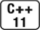
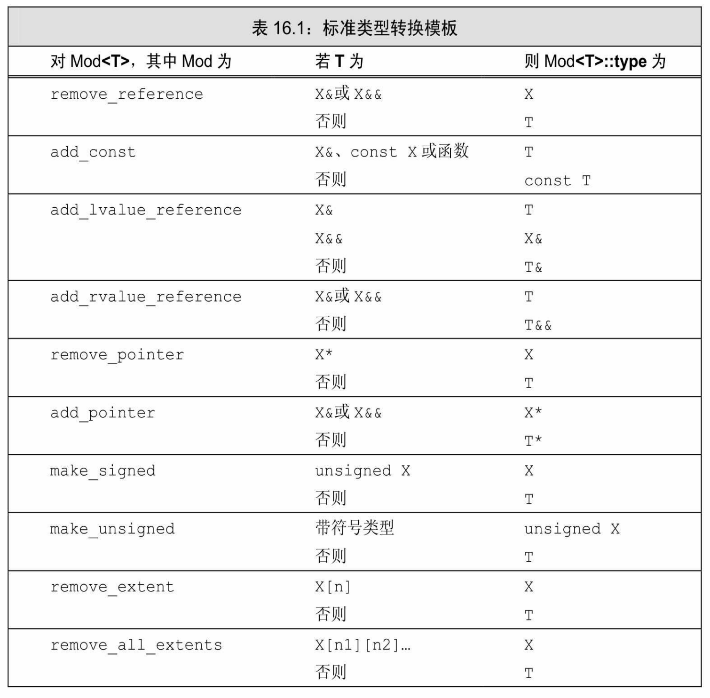

[总目录](<../目录.md>) · [本章目录](<01 章节导读.md>) · [上一篇](<../第16章 模板与泛型编程/16.1 定义模板.md>) · [下一篇](<../第16章 模板与泛型编程/16.3 重载与模板.md>)

> 原 PDF 第 982–1004 页。

<!-- PDF 第 982 页 -->

# **16.2** 模板实参推断

我们已经看到,对于函数模板,编译器利用调用中的函数实参来确定其模板参数。从函数实参来确定模板实参的过程被称为模板实参推断 (template argument deduction)。在模板实参推断过程中,编译器使用函数调用中的实参类型来寻找模板实参,用这些模板实参生成的函数版本与给定的函数调用最为匹配。

## **16.2.1** 类型转换与模板类型参数

与非模板函数一样,我们在一次调用中传递给函数模板的实参被用来初始化函数的形参。如果一个函数形参的类型使用了模板类型参数, 那么它采用特殊的初始化规则。只有很有限的几种类型转换会自动地应用于这些实参。编译器通常不是对实参进行类型转换,而是生成一个新的模板实例。

与往常一样,顶层const(参见2.4.3节,第57页)无论是在形参中还是在实参中,都会被忽略。在其他类型转换中,能在调用中应用于函数模板的包括如下两项。

· const转换:可以将一个非const对象的引用(或指针)传递给一个 const的引用(或指针)形参(参见4.11.2节,第144页)。

· 数组或函数指针转换:如果函数形参不是引用类型,则可以对数组或函数类型的实参应用正常的指针转换。一个数组实参可以转换为一个指向其首元素的指针。类似的,一个函数实参可以转换为一个该函数类型的指针(参见4.11.2节,第143页)。

其他类型转换,如算术转换(参见4.11.1节,第142页)、派生类向基类的转换(参见15.2.2节,第530页)以及用户定义的转换(参见7.5.4 节,第263页和14.9节,第514页),都不能应用于函数模板。

作为一个例子,考虑对函数fobj和fref的调用。fobj函数拷贝它的参数,而fref的参数是引用类型:

<!-- PDF 第 983 页 -->

<!-- 代码原图: ../images/_page_982_Picture_104.png -->
```c++
template <typename T> T fobj(T, T); // 实参被拷贝
template <typename T> T fref(const T&, const T&); // 引用
string s1("a value");
const string s2("another value");
fobj(s1, s2);    // 调用 fobj(string, string); const 被忽略
fref(s1, s2);    // 调用 fref(const string&, const string&)
    // 将 s1 转换为 const 是允许的
int a[10], b[42];
fobj(a, b);    // 调用 f(int*, int*)
fref(a, b);    // 错误：数组类型不匹配
```

在第一对调用中,我们传递了一个string和一个const string。虽然这些类型不严格匹配,但两个调用都是合法的。在fobj调用中,实参被拷贝,因此原对象是否是const没有关系。在fref调用中,参数类型是const 的引用。对于一个引用参数来说,转换为const是允许的,因此这个调用也是合法的。

在下一对调用中,我们传递了数组实参,两个数组大小不同,因此是不同类型。在fobj调用中,数组大小不同无关紧要。两个数组都被转换为指针。fobj中的模板类型为int\*。但是,fref调用是不合法的。如果形参是一个引用,则数组不会转换为指针(参见6.2.4节,第195页)。a 和b的类型是不匹配的,因此调用是错误的。


将实参传递给带模板类型的函数形参时,能够自动应用的类型转换只有const转换及数组或函数到指针的转换。

使用相同模板参数类型的函数形参

一个模板类型参数可以用作多个函数形参的类型。由于只允许有限的几种类型转换,因此传递给这些形参的实参必须具有相同的类型。如果推断出的类型不匹配,则调用就是错误的。例如,我们的compare函数(参见16.1.1节,第578页)接受两个const T&参数,其实参必须是相同类型:

<!-- 代码原图: ../images/_page_982_Picture_106.png -->
```c++
long lng;
compare(lng,1024);//错误：不能实例化 compare(long，int)
```

<!-- PDF 第 984 页 -->

此调用是错误的,因为传递给compare的实参类型不同。从第一个函数实参推断出的模板实参为long,从第二个函数实参推断出的模板实参为int。这些类型不匹配,因此模板实参推断失败。

如果希望允许对函数实参进行正常的类型转换,我们可以将函数模板定义为两个类型参数:

<!-- 代码原图: ../images/_page_983_Picture_71.png -->
```c++
// 实参类型可以不同，但必须兼容
template <typename A, typename B>
int flexibleCompare(const A& v1, const B& v2)
{
    if (v1 < v2) return -1;
    if (v2 < v1) return 1;
    return 0;
}
```

现在用户可以提供不同类型的实参了:

<!-- 代码原图: ../images/_page_983_Picture_72.png -->
```c++
long lng;
flexibleCompare(lng, 1024); // 正确：调用 flexibleCompare(long, int)
```

当然,必须定义了能比较这些类型的值的<运算符。

正常类型转换应用于普通函数实参

函数模板可以有用普通类型定义的参数,即,不涉及模板类型参数的类型。这种函数实参不进行特殊处理;它们正常转换为对应形参的类型(参见6.1节,第183页)。例如,考虑下面的模板:

<!-- 代码原图: ../images/_page_983_Picture_73.png -->
```c++
template <typename T> ostream &print(ostream &os, const T &obj)
{
    return os << obj;
}
```

第一个函数参数是一个已知类型ostream&。第二个参数obj则是模板参数类型。由于os的类型是固定的,因此当调用print时,传递给它的实参会进行正常的类型转换:

<!-- PDF 第 985 页 -->

<!-- 代码原图: ../images/_page_984_Picture_90.png -->
```c++
print(cout,42); // 实例化 print(ostream&，int)
ofstream f("output");
print(f,10);    // 使用 print(ostream&，int); 将 f 转换为 ostream&
```

在第一个调用中,第一个实参的类型严格匹配第一个参数的类型。 此调用会实例化接受一个ostream&和一个int的print版本。在第二个调用中,第一个实参是一个ofstream,它可以转换为ostream&(参见8.2.1 节,第284页)。由于此参数的类型不依赖于模板参数,因此编译器会将f隐式转换为ostream&。


如果函数参数类型不是模板参数,则对实参进行正常的类型转换。

### **16.2.1**节练习

练习**16.32**:在模板实参推断过程中发生了什么?

练习**16.33**:指出在模板实参推断过程中允许对函数实参进行的两种类型转换。

练习**16.34**:对下面的代码解释每个调用是否合法。如果合法,T的类型是什么?如果不合法,为什么?

<!-- 代码原图: ../images/_page_984_Picture_92.png -->
```c++
template <class T> int compare(const T&, const T&);
(a) compare("hi", "world"); (b) compare("bye", "dad");
```

练习**16.35**:下面调用中哪些是错误的(如果有的话)?如果调用合法,T的类型是什么?如果调用不合法,问题何在?

<!-- 代码原图: ../images/_page_984_Picture_93.png -->
```c++
template <typename T> T calc(T, int);
template <typename T> T fcn(T, T);
double d; float f; char c;
(a) calc(c, 'c'); (b) calc(d, f);
(c) fcn(c, 'c'); (d) fcn(d, f);
```

练习**16.36**:进行下面的调用会发生什么:

<!-- PDF 第 986 页 -->

<!-- 代码原图: ../images/_page_985_Picture_85.png -->
```c++
template <typename T> f1(T, T);
template <typename T1, typename T2) f2(T1, T2);
int i = 0, j = 42, *p1 = &i, *p2 = &j;
const int *cp1 = &i, *cp2 = &j;
(a) f1(p1, p2); (b) f2(p1, p2); (c) f1(cp1, cp2);
(d) f2(cp1, cp2); (e) f1(p1, cp1); (e) f2(p1, cp1);
```

## **16.2.2** 函数模板显式实参

在某些情况下,编译器无法推断出模板实参的类型。其他一些情况下,我们希望允许用户控制模板实例化。当函数返回类型与参数列表中任何类型都不相同时,这两种情况最常出现。

## 指定显式模板实参

作为一个允许用户指定使用类型的例子,我们将定义一个名为sum 的函数模板,它接受两个不同类型的参数。我们希望允许用户指定结果的类型。这样,用户就可以选择合适的精度。

我们可以定义表示返回类型的第三个模板参数,从而允许用户控制返回类型:

<!-- 代码原图: ../images/_page_985_Picture_86.png -->
```c++
// 编译器无法推断 T1，它未出现在函数参数列表中
template <typename T1, typename T2, typename T3>
T1 sum(T2, T3);
```

在本例中,没有任何函数实参的类型可用来推断T1的类型。每次调用sum时调用者都必须为T1提供一个显式模板实参(explicit template argument)。

我们提供显式模板实参的方式与定义类模板实例的方式相同。显式模板实参在尖括号中给出,位于函数名之后,实参列表之前:

<!-- 代码原图: ../images/_page_985_Picture_87.png -->
```c++
// T1是显式指定的，T2和T3是从函数实参类型推断而来的
auto val3 = sum<long long>(i, lng); // long long sum(int, long)
```

此调用显式指定T1的类型。而T2和T3的类型则由编译器从i和lng的类型推断出来。

<!-- PDF 第 987 页 -->

显式模板实参按由左至右的顺序与对应的模板参数匹配;第一个模板实参与第一个模板参数匹配,第二个实参与第二个参数匹配,依此类推。只有尾部(最右)参数的显式模板实参才可以忽略,而且前提是它们可以从函数参数推断出来。如果我们的sum函数按照如下形式编写:

<!-- 代码原图: ../images/_page_986_Picture_96.png -->
```c++
// 糟糕的设计：用户必须指定所有三个模板参数
template <typename T1, typename T2, typename T3>
T3 alternative_sum(T2, T1);
```

则我们总是必须为所有三个形参指定实参:

<!-- 代码原图: ../images/_page_986_Picture_97.png -->
```c++
// 错误：不能推断前几个模板参数
auto val3 = alternative_sum<long long>(i, lng);
// 正确：显式指定了所有三个参数
auto val2 = alternative_sum<long long, int, long>(i, lng);
```

正常类型转换应用于显式指定的实参

对于用普通类型定义的函数参数,允许进行正常的类型转换(参见 16.2.1节,第602页),出于同样的原因,对于模板类型参数已经显式指定了的函数实参,也进行正常的类型转换:

<!-- 代码原图: ../images/_page_986_Picture_98.png -->
```c++
long lng;
compare(lng,1024); // 错误：模板参数不匹配
compare<long>(lng,1024); // 正确：实例化 compare(long，long)
compare<int>(lng,1024); // 正确：实例化 compare(int，int)
```

如我们所见,第一个调用是错误的,因为传递给compare的实参必须具有相同的类型。如果我们显式指定模板类型参数,就可以进行正常类型转换了。因此,调用compare<long>等价于调用一个接受两个const long&参数的函数。int类型的参数被自动转化为long。在第三个调用中,T被显式指定为int,因此lng被转换为int。

## **16.2.2**节练习

练习**16.37**:标准库max函数有两个参数,它返回实参中的较大者。此函数有一个模板类型参数。你能在调用max时传递给它一个int和一个 double吗?如果可以,如何做?如果不可以,为什么?

<!-- PDF 第 988 页 -->

练习**16.38**:当我们调用make\_share(参见12.1.1节,第401页)时,必须提供一个显式模板实参。解释为什么需要显式模板实参以及它是如何使用的。

练习**16.39**:对16.1.1节(第578页)中的原始版本的compare函数,使用一个显式模板实参,使得可以向函数传递两个字符串字面常量。

## **16.2.3** 尾置返回类型与类型转换

当我们希望用户确定返回类型时,用显式模板实参表示模板函数的返回类型是很有效的。但在其他情况下,要求显式指定模板实参会给用户增添额外负担,而且不会带来什么好处。例如,我们可能希望编写一个函数,接受表示序列的一对迭代器和返回序列中一个元素的引用:

<!-- 代码原图: ../images/_page_987_Picture_88.png -->
```c++
template <typename It>
??? &fcn(It beg, It end)
{
    // 处理序列
    return *beg; // 返回序列中一个元素的引用
}
```

我们并不知道返回结果的准确类型,但知道所需类型是所处理的序列的元素类型:

<!-- 代码原图: ../images/_page_987_Picture_89.png -->
```c++
vector<int> vi = {1,2,3,4,5};
Blob<string> ca = { "hi", "bye" };
auto &i = fcn(vi.begin(), vi.end()); // fcn 应该返回 int&
auto &s = fcn(ca.begin(), ca.end()); // fcn 应该返回 string&
```



此例中,我们知道函数应该返回\*beg,而且知道我们可以用 decltype(\*beg)来获取此表达式的类型。但是,在编译器遇到函数的参数列表之前,beg都是不存在的。为了定义此函数,我们必须使用尾置返回类型(参见6.3.3节,第206页)。由于尾置返回出现在参数列表之后,它可以使用函数的参数:

<!-- PDF 第 989 页 -->

<!-- 代码原图: ../images/_page_988_Picture_140.png -->
```c++
// 尾置返回允许我们在参数列表之后声明返回类型
template <typename It>
auto fcn(It beg, It end) -> decltype(*beg)
{
    // 处理序列
    return *beg; // 返回序列中一个元素的引用
}
```

此例中我们通知编译器fcn的返回类型与解引用beg参数的结果类型相同。解引用运算符返回一个左值(参见4.1.1节,第121页),因此通过decltype推断的类型为beg表示的元素的类型的引用。因此,如果对一个string序列调用fcn,返回类型将是string&。如果是int序列,则返回类型是int&。

## 进行类型转换的标准库模板类

有时我们无法直接获得所需要的类型。例如,我们可能希望编写一个类似fcn的函数,但返回一个元素的值(参见6.3.2节,第201页)而非引用。

在编写这个函数的过程中,我们面临一个问题:对于传递的参数的类型,我们几乎一无所知。在此函数中,我们知道唯一可以使用的操作是迭代器操作,而所有迭代器操作都不会生成元素,只能生成元素的引用。

为了获得元素类型,我们可以使用标准库的类型转换(type transformation)模板。这些模板定义在头文件type\_traits中。这个头文件中的类通常用于所谓的模板元程序设计,这一主题已超出本书的范围。 但是,类型转换模板在普通编程中也很有用。表16.1列出了这些模板, 我们将在16.5节(第624页)中看到它们是如何实现的。

在本例中,我们可以使用remove\_reference来获得元素类型。 remove\_reference模板有一个模板类型参数和一个名为type的(public) 类型成员。如果我们用一个引用类型实例化remove\_reference,则type将表示被引用的类型。例如,如果我们实例化remove\_reference<int&>,则 type成员将是int。类似的,如果我们实例化remove\_reference<string&>, 则type成员将是string,依此类推。更一般的,给定一个迭代器beg:

<!-- PDF 第 990 页 -->

<!-- 代码原图: ../images/_page_989_Picture_49.png -->
```c++
remove_reference<decltype(*beg)>::type
```

将获得beg引用的元素的类型:decltype(\*beg)返回元素类型的引用类型。remove\_reference::type脱去引用,剩下元素类型本身。

组合使用remove\_reference、尾置返回及decltype,我们就可以在函数中返回元素值的拷贝:

<!-- 代码原图: ../images/_page_989_Picture_50.png -->
```c++
// 为了使用模板参数的成员，必须用 typename，参见 16.1.3 节（第 593 页）
template <typename It>
auto fcn2(It beg, It end) ->
    typename remove_reference<decltype(*beg)>::type
{
    // 处理序列
    return *beg; // 返回序列中一个元素的拷贝
}
```

注意,type是一个类的成员,而该类依赖于一个模板参数。因此, 我们必须在返回类型的声明中使用typename来告知编译器,type表示一个类型(参见16.1.3节,第593页)

<!-- PDF 第 991 页 -->



表16.1中描述的每个类型转换模板的工作方式都与remove\_reference 类似。每个模板都有一个名为type的public成员,表示一个类型。此类型与模板自身的模板类型参数相关,其关系如模板名所示。如果不可能 (或者不必要)转换模板参数,则type成员就是模板参数类型本身。例如,如果T是一个指针类型,则remove\_pointer<T>::type是T指向的类型。如果T不是一个指针,则无须进行任何转换,从而type具有与T相同的类型。

## **16.2.3**节练习

练习**16.40**:下面的函数是否合法?如果不合法,为什么?如果合法,

<!-- PDF 第 992 页 -->

对可以传递的实参类型有什么限制(如果有的话)?返回类型是什么?

<!-- 代码原图: ../images/_page_991_Picture_96.png -->
```c++
template <typename It>
auto fcn3(It beg, It end) -> decltype(*beg + 0)
{
    // 处理序列
    return *beg; // 返回序列中一个元素的拷贝
}
```

练习**16.41**:编写一个新的sum版本,它的返回类型保证足够大,足以容纳加法结果。

## **16.2.4** 函数指针和实参推断

当我们用一个函数模板初始化一个函数指针或为一个函数指针赋值 (参见6.7节,第221页)时,编译器使用指针的类型来推断模板实参。

例如,假定我们有一个函数指针,它指向的函数返回int,接受两个参数,每个参数都是指向const int的引用。我们可以使用该指针指向 compare的一个实例:

<!-- 代码原图: ../images/_page_991_Picture_97.png -->
```c++
template <typename T> int compare(const T&, const T&);
// pf1 指向实例 int compare(const int&, const int&)
int (*pf1)(const int&, const int&) = compare;
```

pf1中参数的类型决定了T的模板实参的类型。在本例中,T的模板实参类型为int。指针pf1指向compare的int版本实例。如果不能从函数指针类型确定模板实参,则产生错误:

<!-- 代码原图: ../images/_page_991_Picture_98.png -->
```c++
// func的重载版本；每个版本接受一个不同的函数指针类型
void func(int(*)(const string&,const string&));
void func(int(*)(const int&,const int&));
func(compare); // 错误：使用 compare 的哪个实例？
```

这段代码的问题在于,通过func的参数类型无法确定模板实参的唯一类型。对func的调用既可以实例化接受int的compare版本,也可以实例化接受string的版本。由于不能确定func的实参的唯一实例化版本,此

<!-- PDF 第 993 页 -->

调用将编译失败。

我们可以通过使用显式模板实参来消除func调用的歧义:

<!-- 代码原图: ../images/_page_992_Picture_91.png -->
```c++
// 正确：显式指出实例化哪个 compare 版本
func(compare<int>); // 传递 compare(const int&, const int&)
```

此表达式调用的func版本接受一个函数指针,该指针指向的函数接受两个const int&参数。


当参数是一个函数模板实例的地址时,程序上下文必须满足:对每个模板参数, 能唯一确定其类型或值。

## **16.2.5** 模板实参推断和引用

为了理解如何从函数调用进行类型推断,考虑下面的例子:

<!-- 代码原图: ../images/_page_992_Picture_93.png -->
```c++
template <typename T> void f(T &p);
```

其中函数参数p是一个模板类型参数T的引用,非常重要的是记住两点:编译器会应用正常的引用绑定规则;const是底层的,不是顶层的。

## 从左值引用函数参数推断类型

当一个函数参数是模板类型参数的一个普通(左值)引用时(即, 形如T&),绑定规则告诉我们,只能传递给它一个左值(如,一个变量或一个返回引用类型的表达式)。实参可以是const类型,也可以不是。如果实参是const的,则T将被推断为const类型:

<!-- 代码原图: ../images/_page_992_Picture_94.png -->
```c++
template <typename T> void f1(T&); // 实参必须是一个左值
// 对 f1 的调用使用实参所引用的类型作为模板参数类型
f1(i);    // i 是一个 int；模板参数类型 T 是 int
f1(ci);   // ci 是一个 const int；模板参数 T 是 const int
f1(5);    // 错误：传递给一个&参数的实参必须是一个左值
```

如果一个函数参数的类型是const T&,正常的绑定规则告诉我们可

<!-- PDF 第 994 页 -->

以传递给它任何类型的实参——一个对象(const或非const)、一个临时对象或是一个字面常量值。当函数参数本身是const时,T的类型推断的结果不会是一个const类型。const已经是函数参数类型的一部分;因此,它不会也是模板参数类型的一部分:

<!-- 代码原图: ../images/_page_993_Picture_137.png -->
```c++
template <typename T> void f2(const T&); // 可以接受一个右值
// f2 中的参数是 const &；实参中的 const 是无关的
// 在每个调用中，f2 的函数参数都被推断为 const int&
f2(i);    // i 是一个 int；模板参数 T 是 int
f2(ci);   // ci 是一个 const int，但模板参数 T 是 int
f2(5);   // 一个 const &参数可以绑定到一个右值；T 是 int
```

## 从右值引用函数参数推断类型

当一个函数参数是一个右值引用(参见13.6.1节,第471页)(即, 形如T&&)时,正常绑定规则告诉我们可以传递给它一个右值。当我们这样做时,类型推断过程类似普通左值引用函数参数的推断过程。推断出的T的类型是该右值实参的类型:

<!-- 代码原图: ../images/_page_993_Picture_138.png -->
```c++
template <typename T> void f3(T&&);
f3(42); // 实参是一个 int 类型的右值；模板参数 T 是 int
```

### 引用折叠和右值引用参数

假定i是一个int对象,我们可能认为像f3(i)这样的调用是不合法的。毕竟,i是一个左值,而通常我们不能将一个右值引用绑定到一个左值上。但是,C++语言在正常绑定规则之外定义了两个例外规则,允许这种绑定。这两个例外规则是move这种标准库设施正确工作的基础。

第一个例外规则影响右值引用参数的推断如何进行。当我们将一个左值(如i)传递给函数的右值引用参数,且此右值引用指向模板类型参数(如T&&)时,编译器推断模板类型参数为实参的左值引用类型。 因此,当我们调用f3(i)时,编译器推断T的类型为int&,而非int。

T被推断为int&看起来好像意味着f3的函数参数应该是一个类型int& 的右值引用。通常,我们不能(直接)定义一个引用的引用(参见2.3.1 节,第46页)。但是,通过类型别名(参见2.5.1节,第60页)或通过模

<!-- PDF 第 995 页 -->

板类型参数间接定义是可以的。


在这种情况下,我们可以使用第二个例外绑定规则:如果我们间接创建一个引用的引用,则这些引用形成了"折叠"。在所有情况下(除了一个例外),引用会折叠成一个普通的左值引用类型。在新标准中,折叠规则扩展到右值引用。只在一种特殊情况下引用会折叠成右值引用: 右值引用的右值引用。即,对于一个给定类型X:

· X&&、X&&&和X&&&都折叠成类型X&

· 类型X&&&&折叠成X&&


引用折叠只能应用于间接创建的引用的引用,如类型别名或模板参数。

如果将引用折叠规则和右值引用的特殊类型推断规则组合在一起, 则意味着我们可以对一个左值调用f3。当我们将一个左值传递给f3的 (右值引用)函数参数时,编译器推断T为一个左值引用类型:

<!-- 代码原图: ../images/_page_994_Picture_125.png -->
```c++
f3(i); // 实参是一个左值；模板参数 T是 int& f3(ci); // 实参是一个左值；模板参数 T是一个 const int&
```

当一个模板参数T被推断为引用类型时,折叠规则告诉我们函数参数T&&折叠为一个左值引用类型。例如,f3(i)的实例化结果可能像下面这样:

<!-- 代码原图: ../images/_page_994_Picture_126.png -->
```c++
// 无效代码，只是用于演示目的
void f3<int&>(int& &&); // 当 T是 int&时，函数参数为 int& &&
```

f3的函数参数是T&&且T是int&,因此T&&是int&&&,会折叠成 int&。因此,即使f3的函数参数形式是一个右值引用(即,T&&),此调用也会用一个左值引用类型(即,int&)实例化f3:

<!-- 代码原图: ../images/_page_994_Picture_127.png -->
```c++
void f3<int&>(int&); // 当 T是 int&时，函数参数折叠为 int&
```

这两个规则导致了两个重要结果:

<!-- PDF 第 996 页 -->

· 如果一个函数参数是一个指向模板类型参数的右值引用(如, T&&),则它可以被绑定到一个左值;且

· 如果实参是一个左值,则推断出的模板实参类型将是一个左值引用,且函数参数将被实例化为一个(普通)左值引用参数(T&)

另外值得注意的是,这两个规则暗示,我们可以将任意类型的实参传递给T&&类型的函数参数。对于这种类型的参数,(显然)可以传递给它右值,而如我们刚刚看到的,也可以传递给它左值。


如果一个函数参数是指向模板参数类型的右值引用(如,T&&),则可以传递给它任意类型的实参。如果将一个左值传递给这样的参数,则函数参数被实例化为一个普通的左值引用(T&)。

编写接受右值引用参数的模板函数

模板参数可以推断为一个引用类型,这一特性对模板内的代码可能有令人惊讶的影响:

<!-- 代码原图: ../images/_page_995_Picture_136.png -->
```c++
template <typename T> void f3(T&& val)
{
    T t = val; // 拷贝还是绑定一个引用?
```

<!-- 代码原图: ../images/_page_995_Picture_137.png -->
```c++
t = fcn(t); // 赋值只改变 t 还是既改变 t 又改变 val?
if (val == t) { /* ... */ } // 若 T 是引用类型，则一直为 true
}
```

当我们对一个右值调用f3时,例如字面常量42,T为int。在此情况下,局部变量t的类型为int,且通过拷贝参数val的值被初始化。当我们对t赋值时,参数val保持不变。

另一方面,当我们对一个左值i调用f3时,则T为int&。当我们定义并初始化局部变量t时,赋予它类型int&。因此,对t的初始化将其绑定到val。当我们对t赋值时,也同时改变了val的值。在f3的这个实例化版本中,if判断永远得到true。

当代码中涉及的类型可能是普通(非引用)类型,也可能是引用类型时,编写正确的代码就变得异常困难(虽然remove\_reference这样的

<!-- PDF 第 997 页 -->

类型转换类可能会有帮助(参见16.2.3节,第605页))。

在实际中,右值引用通常用于两种情况:模板转发其实参或模板被重载。我们将在16.2.7节(第612页)中介绍实参转发,在16.3节(第 614页)中介绍模板重载。

目前应该注意的是,使用右值引用的函数模板通常使用我们在 13.6.3节(第481页)中看到的方式来进行重载:

<!-- 代码原图: ../images/_page_996_Picture_148.png -->
```c++
template <typename T> void f(T&&); // 绑定到非 const 右值
template <typename T> void f(const T&); // 左值和 const 右值
```

与非模板函数一样,第一个版本将绑定到可修改的右值,而第二个版本将绑定到左值或const右值。

## **16.2.5**节练习

练习**16.42**:对下面每个调用,确定T和val的类型:

<!-- 代码原图: ../images/_page_996_Picture_149.png -->
```c++
template <typename T> void g(T&& val);
int i = 0; const int ci = i;
(a) g(i); (b) g(ci); (c) g(i * ci);
```

练习**16.43**:使用上一题定义的函数,如果我们调用g(i = ci),g的模板参数将是什么?

练习**16.44**:使用与第一题中相同的三个调用,如果g的函数参数声明为 T(而不是T&&),确定T的类型。如果g的函数参数是const T&呢?

练习**16.45**:给定下面的模板,如果我们对一个像42这样的字面常量调用g,解释会发生什么?如果我们对一个int类型的变量调用g呢?

<!-- 代码原图: ../images/_page_996_Picture_150.png -->
```c++
template <typename T> void g(T&& val) { vector<T> v; }
```

## **16.2.6** 理解**std**::**move**

标准库move函数(参见13.6.1节,第472页)是使用右值引用的模板的一个很好的例子。幸运的是,我们不必理解move所使用的模板机制也可以直接使用它。但是,研究move是如何工作的可以帮助我们巩

<!-- PDF 第 998 页 -->

固对模板的理解和使用。

在13.6.2节(第473页)中我们注意到,虽然不能直接将一个右值引用绑定到一个左值上,但可以用move获得一个绑定到左值上的右值引用。由于move本质上可以接受任何类型的实参,因此我们不会惊讶于它是一个函数模板。

**std**::**move**是如何定义的

标准库是这样定义move的:

<!-- 代码原图: ../images/_page_997_Picture_130.png -->
```c++
// 在返回类型和类型转换中也要用到 typename，参见 16.1.3 节（第 593 页）
// remove_reference 是在 16.2.3 节（第 605 页）中介绍的
template <typename T>
typename remove_reference<T>::type&& move(T&& t)
{
    // static_cast 是在 4.11.3 节（第 145 页）中介绍的
    return static_cast<typename remove_reference<T>::type&&>(t);
}
```

这段代码很短,但其中有些微妙之处。首先,move的函数参数 T&&是一个指向模板类型参数的右值引用。通过引用折叠,此参数可以与任何类型的实参匹配。特别是,我们既可以传递给move一个左值, 也可以传递给它一个右值:

<!-- 代码原图: ../images/_page_997_Picture_131.png -->
```c++
string s1("hi!"), s2;
s2 = std::move(string("bye!")); // 正确：从一个右值移动数据
s2 = std::move(s1); // 正确：但在赋值之后，s1的值是不确定的
```

### **std**::**move**是如何工作的

在第一个赋值中,传递给move的实参是string的构造函数的右值结果——string("bye!")。如我们已经见到过的,当向一个右值引用函数参数传递一个右值时,由实参推断出的类型为被引用的类型(参见 16.2.5节,第608页)。因此,在std::move(string("bye!"))中:

· 推断出的T的类型为string。 · 因此,remove\_reference用string进行实例化。 · remove\_reference<string>的type成员是string。

<!-- PDF 第 999 页 -->

· move的返回类型是string&&。 · move的函数参数t的类型为string&&。

因此,这个调用实例化move<string>,即函数

<!-- 代码原图: ../images/_page_998_Picture_169.png -->
```c++
string&& move(string &&t)
```

函数体返回static\_cast<string&&>(t)。t的类型已经是string&&, 于是类型转换什么都不做。因此,此调用的结果就是它所接受的右值引用。

现在考虑第二个赋值,它调用了std::move()。在此调用中, 传递给move的实参是一个左值。这样:

· 推断出的T的类型为string&(string的引用,而非普通string)。 · 因此,remove\_reference用string&进行实例化。 · remove\_reference<string&>的type成员是string。 · move的返回类型仍是string&&。 · move的函数参数t实例化为string&&&,会折叠为string&。

因此,这个调用实例化move<string&>,即

<!-- 代码原图: ../images/_page_998_Picture_170.png -->
```c++
string&& move(string &t)
```

这正是我们所寻求的——我们希望将一个右值引用绑定到一个左值。这个实例的函数体返回static\_cast<string&&>(t)。在此情况下,t 的类型为string&,cast将其转换为string&&。

# 从一个左值**static\_cast**到一个右值引用是允许的


通常情况下,static\_cast只能用于其他合法的类型转换(参见4.11.3 节,第145页)。但是,这里又有一条针对右值引用的特许规则:虽然不能隐式地将一个左值转换为右值引用,但我们可以用static\_cast显式地将一个左值转换为一个右值引用。

对于操作右值引用的代码来说,将一个右值引用绑定到一个左值的

<!-- PDF 第 1000 页 -->

特性允许它们截断左值。有时候,例如在我们的StrVec类的reallocate函数(参见13.6.1节,第469页)中,我们知道截断一个左值是安全的。一方面,通过允许进行这样的转换,C++语言认可了这种用法。但另一方面,通过强制使用static\_cast,C++语言试图阻止我们意外地进行这种转换。

最后,虽然我们可以直接编写这种类型转换代码,但使用标准库 move函数是容易得多的方式。而且,统一使用std::move使得我们在程序中查找潜在的截断左值的代码变得很容易。

## **16.2.6**节练习

练习**16.46**:解释下面的循环,它来自13.5节(第469页)中的 StrVec::reallocate:

<!-- 代码原图: ../images/_page_999_Picture_99.png -->
```c++
for (size_t i = 0; i != size(); ++i)
    alloc.construct(dest++, std::move(*elem++));
```

## **16.2.7** 转发

某些函数需要将其一个或多个实参连同类型不变地转发给其他函数。在此情况下,我们需要保持被转发实参的所有性质,包括实参类型是否是const的以及实参是左值还是右值。

作为一个例子,我们将编写一个函数,它接受一个可调用表达式和两个额外实参。我们的函数将调用给定的可调用对象,将两个额外参数逆序传递给它。下面是我们的翻转函数的初步模样:

<!-- 代码原图: ../images/_page_999_Picture_100.png -->
```c++
// 接受一个可调用对象和另外两个参数的模板
// 对“翻转”的参数调用给定的可调用对象
// flip1 是一个不完整的实现：顶层 const 和引用丢失了
template <typename F, typename T1, typename T2>
void flip1(F f, T1 t1, T2 t2)
{
    f(t2, t1);
}
```

这个函数一般情况下工作得很好,但当我们希望用它调用一个接受

<!-- PDF 第 1001 页 -->

引用参数的函数时就会出现问题:

<!-- 代码原图: ../images/_page_1000_Picture_117.png -->
```c++
void f(int v1, int &v2) // 注意 v2 是一个引用
{
    cout << v1 << " " << ++v2 << endl;
}
```

在这段代码中,f改变了绑定到v2的实参的值。但是,如果我们通过flip1调用f,f所做的改变就不会影响实参:

<!-- 代码原图: ../images/_page_1000_Picture_118.png -->
```c++
f(42,i); // f改变了实参 i
flip1(f,j,42); // 通过flip1调用f不会改变j
```

问题在于j被传递给flip1的参数t1。此参数是一个普通的、非引用的类型int,而非int&。因此,这个flip1调用会实例化为

<!-- 代码原图: ../images/_page_1000_Picture_119.png -->
```c++
void flip1(void(*fcn)(int, int&), int t1, int t2);
```

j的值被拷贝到t1中。f中的引用参数被绑定到t1,而非j,从而其改变不会影响j。

定义能保持类型信息的函数参数

为了通过翻转函数传递一个引用,我们需要重写函数,使其参数能保持给定实参的"左值性"。更进一步,可以想到我们也希望保持参数的 const属性。

通过将一个函数参数定义为一个指向模板类型参数的右值引用,我们可以保持其对应实参的所有类型信息。而使用引用参数(无论是左值还是右值)使得我们可以保持const属性,因为在引用类型中的const是底层的。如果我们将函数参数定义为T1&&和T2&&,通过引用折叠 (参见16.2.5节,第608页)就可以保持翻转实参的左值/右值属性(参见16.2.5节,第608页):

<!-- PDF 第 1002 页 -->

<!-- 代码原图: ../images/_page_1001_Picture_152.png -->
```c++
template <typename F, typename T1, typename T2>
void flip2(F f, T1 &&t1, T2 &&t2)
{
    f(t2, t1);
}
```

与较早的版本一样,如果我们调用flip2(f,j,42),将传递给参数t1一个左值j。但是,在flip2中,推断出的T1的类型为int&,这意味着 t1的类型会折叠为int&。由于是引用类型,t1被绑定到j上。当flip2调用f 时,f中的引用参数v2被绑定到t1,也就是被绑定到j。当f递增v2时,它也同时改变了j的值。


如果一个函数参数是指向模板类型参数的右值引用(如T&&),它对应的实参的 const属性和左值/右值属性将得到保持。

这个版本的flip2解决了一半问题。它对于接受一个左值引用的函数工作得很好,但不能用于接受右值引用参数的函数。例如:

<!-- 代码原图: ../images/_page_1001_Picture_154.png -->
```c++
void g(int &&i, int& j)
{
    cout << i << " " << j << endl;
}
```

如果我们试图通过flip2调用g,则参数t2将被传递给g的右值引用参数。即使我们传递一个右值给flip2:

<!-- 代码原图: ../images/_page_1001_Picture_155.png -->
```c++
flip2(g,i,42);// 错误：不能从一个左值实例化 int&&
```

传递给g的将是flip2中名为t2的参数。函数参数与其他任何变量一样,都是左值表达式(参见13.6.1节,第471页)。因此,flip2中对g的调用将传递给g的右值引用参数一个左值。

在调用中使用**std**::**forward**保持类型信息


我们可以使用一个名为forward的新标准库设施来传递flip2的参数, 它能保持原始实参的类型。类似move,forward定义在头文件utility中。

<!-- PDF 第 1003 页 -->

与move不同,forward必须通过显式模板实参来调用(参见16.2.2节,第 603页)。forward返回该显式实参类型的右值引用。即,forward<T>的返回类型是T&&。

通常情况下,我们使用forward传递那些定义为模板类型参数的右值引用的函数参数。通过其返回类型上的引用折叠,forward可以保持给定实参的左值/右值属性:

<!-- 代码原图: ../images/_page_1002_Picture_125.png -->
```c++
template <typename Type> intermediary(Type &&arg)
{
    finalFcn(std::forward<Type>(arg));
    // ...
}
```

本例中我们使用Type作为forward的显式模板实参类型,它是从arg 推断出来的。由于arg是一个模板类型参数的右值引用,Type将表示传递给arg的实参的所有类型信息。如果实参是一个右值,则Type是一个普通(非引用)类型,forward<Type>将返回Type&&。如果实参是一个左值,则通过引用折叠,Type本身是一个左值引用类型。在此情况下, 返回类型是一个指向左值引用类型的右值引用。再次对forward<Type> 的返回类型进行引用折叠,将返回一个左值引用类型。


当用于一个指向模板参数类型的右值引用函数参数(T&&)时, forward会保持实参类型的所有细节。

使用forward,我们可以再次重写翻转函数:

<!-- 代码原图: ../images/_page_1002_Picture_127.png -->
```c++
template <typename F, typename T1, typename T2>
void flip(F f, T1 &&t1, T2 &&t2)
{
    f(std::forward<T2>(t2), std::forward<T1>(t1));
}
```

如果我们调用flip(g,i,42),i将以int&类型传递给g,42将以 int&&类型传递给g。

<!-- PDF 第 1004 页 -->


与std::move相同,对std::forward不使用using声明是一个好主意。我们将在 18.2.3节(第706页)中解释原因。

### **16.2.7**节练习

练习**16.47**:编写你自己版本的翻转函数,通过调用接受左值和右值引用参数的函数来测试它。


