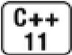
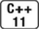
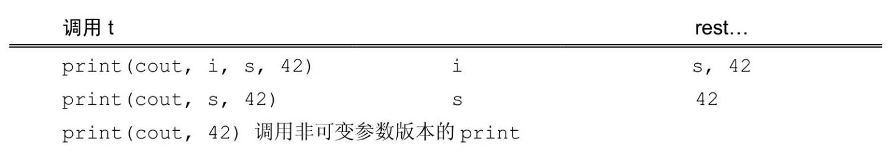

[总目录](<../目录.md>) · [本章目录](<01 章节导读.md>) · [上一篇](<../第16章 模板与泛型编程/16.3 重载与模板.md>) · [下一篇](<../第16章 模板与泛型编程/16.5 模板特例化.md>)

> 原 PDF 第 1012–1020 页。

<!-- PDF 第 1012 页 -->

# **16.4** 可变参数模板



一个可变参数模板(variadic template)就是一个接受可变数目参数的模板函数或模板类。可变数目的参数被称为参数包(parameter packet)。存在两种参数包:模板参数包(template parameter packet),表示零个或多个模板参数;函数参数包(function parameter packet),表示零个或多个函数参数。

我们用一个省略号来指出一个模板参数或函数参数表示一个包。在一个模板参数列表中,class…或typename…指出接下来的参数表示零个或多个类型的列表;一个类型名后面跟一个省略号表示零个或多个给定类型的非类型参数的列表。在函数参数列表中,如果一个参数的类型是一个模板参数包,则此参数也是一个函数参数包。例如:

<!-- 代码原图: ../images/_page_1011_Picture_98.png -->
```c++
// Args 是一个模板参数包；rest 是一个函数参数包
// Args 表示零个或多个模板类型参数
// rest 表示零个或多个函数参数
template <typename T, typename... Args>
void foo(const T &t, const Args& ... rest);
```

声明了foo是一个可变参数函数模板,它有一个名为T的类型参数, 和一个名为Args的模板参数包。这个包表示零个或多个额外的类型参数。foo的函数参数列表包含一个const &类型的参数,指向T的类型,还包含一个名为rest的函数参数包,此包表示零个或多个函数参数。

与往常一样,编译器从函数的实参推断模板参数类型。对于一个可变参数模板,编译器还会推断包中参数的数目。例如,给定下面的调用:

<!-- 代码原图: ../images/_page_1011_Picture_99.png -->
```c++
int i = 0; double d = 3.14; string s = "how now brown cow";
foo(i, s, 42, d); // 包中有三个参数
foo(s, 42, "hi"); // 包中有两个参数
foo(d, s); // 包中有一个参数
foo("hi"); // 空包
```

<!-- PDF 第 1013 页 -->

编译器会为foo实例化出四个不同的版本:

<!-- 代码原图: ../images/_page_1012_Picture_113.png -->
```c++
void foo(const int&, const string&, const int&, const double&);
void foo(const string&, const int&, const char[3]&);
void foo(const double&, const string&);
void foo(const char[3]&);
```

在每个实例中,T的类型都是从第一个实参的类型推断出来的。剩下的实参(如果有的话)提供函数额外实参的数目和类型。

**sizeof…**运算符



当我们需要知道包中有多少元素时,可以使用sizeof…运算符。类似sizeof(参见4.9节,第139页),sizeof…也返回一个常量表达式(参见2.4.4节,第58页),而且不会对其实参求值:

<!-- 代码原图: ../images/_page_1012_Picture_115.png -->
```c++
template<typename ... Args> void g(Args ... args) {
    cout << sizeof...(Args) << endl; // 类型参数的数目
    cout << sizeof...(args) << endl; // 函数参数的数目
}
```

### **16.4**节练习

练习**16.51**:调用本节中的每个foo,确定sizeof…(Args)和sizeof… (rest)分别返回什么。

练习**16.52**:编写一个程序验证上一题的答案。

## **16.4.1** 编写可变参数函数模板

如6.2.6节(第198页)所述,我们可以使用一个initializer\_list来定义一个可接受可变数目实参的函数。但是,所有实参必须具有相同的类型 (或它们的类型可以转换为同一个公共类型)。当我们既不知道想要处理的实参的数目也不知道它们的类型时,可变参数函数是很有用的。作为一个例子,我们将定义一个函数,它类似较早的error\_msg函数,差别仅在于新函数实参的类型也是可变的。我们首先定义一个名为print的函数,它在一个给定流上打印给定实参列表的内容。

<!-- PDF 第 1014 页 -->

可变参数函数通常是递归的(参见6.3.2节,第204页)。第一步调用处理包中的第一个实参,然后用剩余实参调用自身。我们的print函数也是这样的模式,每次递归调用将第二个实参打印到第一个实参表示的流中。为了终止递归,我们还需要定义一个非可变参数的print函数,它接受一个流和一个对象:

<!-- 代码原图: ../images/_page_1013_Picture_84.png -->
```c++
// 用来终止递归并打印最后一个元素的函数
// 此函数必须在可变参数版本的 print 定义之前声明
template<typename T>
ostream &print(ostream &os, const T &t)
{
    return os << t; // 包中最后一个元素之后不打印分隔符
}

// 包中除了最后一个元素之外的其他元素都会调用这个版本的 print
template <typename T, typename... Args>
ostream &print(ostream &os, const T &t, const Args&... rest)
{
    os << t << ",";             // 打印第一个实参
    return print(os, rest...);    // 递归调用，打印其他实参
}
```

第一个版本的print负责终止递归并打印初始调用中的最后一个实参。第二个版本的print是可变参数版本,它打印绑定到t的实参,并调用自身来打印函数参数包中的剩余值。

这段程序的关键部分是可变参数函数中对print的调用:

<!-- 代码原图: ../images/_page_1013_Picture_85.png -->
```c++
return print(os, rest...); //递归调用，打印其他实参
```

我们的可变参数版本的print函数接受三个参数:一个ostream&,一个const T&和一个参数包。而此调用只传递了两个实参。其结果是rest中的第一个实参被绑定到t,剩余实参形成下一个print调用的参数包。因此,在每个调用中,包中的第一个实参被移除,成为绑定到t的实参。 即,给定:

<!-- 代码原图: ../images/_page_1013_Picture_86.png -->
```c++
print(cout,i,s,42);//包中有两个参数
```

递归会执行如下:

<!-- PDF 第 1015 页 -->



前两个调用只能与可变参数版本的print匹配,非可变参数版本是不可行的,因为这两个调用分别传递四个和三个实参,而非可变参数print 只接受两个实参。

对于最后一次递归调用print(cout,42),两个print版本都是可行的。这个调用传递两个实参,第一个实参的类型为ostream&。因此,可变参数版本的print可以实例化为只接受两个参数:一个是ostream&参数,另一个是const T&参数。

对于最后一个调用,两个函数提供同样好的匹配。但是,非可变参数模板比可变参数模板更特例化,因此编译器选择非可变参数版本(参见16.3节,第615页)。


当定义可变参数版本的print时,非可变参数版本的声明必须在作用域中。否则, 可变参数版本会无限递归。

### **16.4.1**节练习

练习**16.53**:编写你自己版本的print函数,并打印一个、两个及五个实参来测试它,要打印的每个实参都应有不同的类型。

练习**16.54**:如果我们对一个没有<<运算符的类型调用print,会发生什么?

练习**16.55**:如果我们的可变参数版本print的定义之后声明非可变参数版本,解释可变参数的版本会如何执行。

## **16.4.2** 包扩展

对于一个参数包,除了获取其大小外,我们能对它做的唯一的事情就是扩展(expand)它。当扩展一个包时,我们还要提供用于每个扩展

<!-- PDF 第 1016 页 -->

元素的模式(pattern)。扩展一个包就是将它分解为构成的元素,对每个元素应用模式,获得扩展后的列表。我们通过在模式右边放一个省略号(…)来触发扩展操作。

例如,我们的print函数包含两个扩展:

<!-- 代码原图: ../images/_page_1015_Picture_89.png -->
```c++
template <typename T, typename... Args>
ostream &
print(ostream &os, const T &t, const Args&... rest)    // 扩展 Args
{
    os << t << ", ";
    return print(os, rest...);                        // 扩展 rest
}
```

第一个扩展操作扩展模板参数包,为print生成函数参数列表。第二个扩展操作出现在对print的调用中。此模式为print调用生成实参列表。

对Args的扩展中,编译器将模式const Arg&应用到模板参数包Args 中的每个元素。因此,此模式的扩展结果是一个逗号分隔的零个或多个类型的列表,每个类型都形如const type&。例如:

<!-- 代码原图: ../images/_page_1015_Picture_90.png -->
```c++
print(cout,i,s,42); // 包中有两个参数
```

最后两个实参的类型和模式一起确定了尾置参数的类型。此调用被实例化为:

<!-- 代码原图: ../images/_page_1015_Picture_91.png -->
```c++
ostream&
print(ostream&, const int&, const string&, const int&);
```

第二个扩展发生在对print的(递归)调用中。在此情况下,模式是函数参数包的名字(即rest)。此模式扩展出一个由包中元素组成的、 逗号分隔的列表。因此,这个调用等价于:

<!-- 代码原图: ../images/_page_1015_Picture_92.png -->
```c++
print(os, s, 42);
```

理解包扩展

print中的函数参数包扩展仅仅将包扩展为其构成元素,C++语言还

<!-- PDF 第 1017 页 -->

允许更复杂的扩展模式。例如,我们可以编写第二个可变参数函数,对其每个实参调用debug\_rep(参见16.3节,第615页),然后调用print打印结果string:

<!-- 代码原图: ../images/_page_1016_Picture_81.png -->
```c++
// 在 print 调用中对每个实参调用 debug_rep
template <typename... Args>
ostream &errorMsg(ostream &os, const Args&... rest)
{
    // print(os, debug_rep(a1), debug_rep(a2), ..., debug_rep(an)
    return print(os, debug_rep(rest)...);
}
```

这个print调用使用了模式debug\_reg(rest)。此模式表示我们希望对函数参数包rest中的每个元素调用debug\_rep。扩展结果将是一个逗号分隔的debug\_rep调用列表。即,下面调用:

<!-- 代码原图: ../images/_page_1016_Picture_82.png -->
```c++
errorMsg(cerr, fcnName, code.num(), otherData, "other", item);
```

### 就好像我们这样编写代码一样

<!-- 代码原图: ../images/_page_1016_Picture_83.png -->
```c++
print(cerr, debug_rep(fcnName), debug_rep(code.num()),
debug_rep(otherData), debug_rep("otherData"),
debug_rep(item));
```

与之相对,下面的模式会编译失败

<!-- 代码原图: ../images/_page_1016_Picture_84.png -->
```c++
// 将包传递给 debug_rep; print(os, debug_rep(a1, a2, ..., an))
print(os, debug_rep(rest...)); // 错误：此调用无匹配函数
```

这段代码的问题是我们在debug\_rep调用中扩展了rest,它等价于

<!-- 代码原图: ../images/_page_1016_Picture_85.png -->
```c++
print(cerr, debug_rep(fcnName, code.num(),
    otherData, "otherData", item));
```

在这个扩展中,我们试图用一个五个实参的列表来调用 debug\_rep,但并不存在与此调用匹配的debug\_rep版本。debug\_rep函数不是可变参数的,而且没有哪个debug\_rep版本接受五个参数。

<!-- PDF 第 1018 页 -->


扩展中的模式会独立地应用于包中的每个元素。

### **16.4.2**节练习

练习**16.56**:编写并测试可变参数版本的errorMsg。

练习**16.57**:比较你的可变参数版本的errorMsg和6.2.6节(第198页)中的error\_msg函数。两种方法的优点和缺点各是什么?

## **16.4.3** 转发参数包


在新标准下,我们可以组合使用可变参数模板与forward机制来编写函数,实现将其实参不变地传递给其他函数。作为例子,我们将为 StrVec类(参见13.5节,第465页)添加一个emplace\_back成员。标准库容器的emplace\_back成员是一个可变参数成员模板(参见16.1.4节,第 596页),它用其实参在容器管理的内存空间中直接构造一个元素。

我们为StrVec设计的emplace\_back版本也应该是可变参数的,因为 string有多个构造函数,参数各不相同。由于我们希望能使用string的移动构造函数,因此还需要保持传递给emplace\_back的实参的所有类型信息。

如我们所见,保持类型信息是一个两阶段的过程。首先,为了保持实参中的类型信息,必须将emplace\_back的函数参数定义为模板类型参数的右值引用(参见16.2.7节,第613页):

<!-- 代码原图: ../images/_page_1017_Picture_121.png -->
```c++
class StrVec {
public:
    template <class... Args> void emplace_back(Args&&...);
// 其他成员的定义，同13.5节（第465页）
};
```

模板参数包扩展中的模式是&&,意味着每个函数参数将是一个指向其对应实参的右值引用。

<!-- PDF 第 1019 页 -->

其次,当emplace\_back将这些实参传递给construct时,我们必须使用forward来保持实参的原始类型(参见16.2.7节,第614页):

<!-- 代码原图: ../images/_page_1018_Picture_97.png -->
```c++
template <class... Args>
inline
void StrVec::emplace_back(Args&&... args)
{
    chk_n_alloc(); // 如果需要的话重新分配 StrVec 内存空间
    alloc.construct(first_free++, std::forward<Args>(args)...);
}
```

emplace\_back的函数体调用了chk\_n\_alloc(参见13.5节,第465页) 来确保有足够的空间容纳一个新元素,然后调用了construct在first\_free 指向的位置中创建了一个元素。construct调用中的扩展为

<!-- 代码原图: ../images/_page_1018_Picture_98.png -->
```c++
std::forward<Args>(args)...
```

它既扩展了模板参数包Args,也扩展了函数参数包args。此模式生成如下形式的元素

<!-- 代码原图: ../images/_page_1018_Picture_99.png -->
```c++
std::forward<Ti>(t i)
```

其中*Ti*表示模板参数包中第*i*个元素的类型,*t <sup>i</sup>*表示函数参数包中第*i* 个元素。例如,假定svec是一个StrVec,如果我们调用

<!-- 代码原图: ../images/_page_1018_Picture_100.png -->
```c++
svec.emplace_back(10, 'c'); // 将 ccccccccc 添加为新的尾元素
```

construct调用中的模式会扩展出

<!-- 代码原图: ../images/_page_1018_Picture_101.png -->
```c++
std::forward<int>(10), std::forward<char>(c)
```

通过在此调用中使用forward,我们保证如果用一个右值调用 emplace\_back,则construct也会得到一个右值。例如,在下面的调用中:

<!-- 代码原图: ../images/_page_1018_Picture_102.png -->
```c++
svec.emplace_back(s1 + s2); // 使用移动构造函数
```

<!-- PDF 第 1020 页 -->

传递给emplace\_back的实参是一个右值,它将以如下形式传递给 construct

<!-- 代码原图: ../images/_page_1019_Picture_142.png -->
```c++
std::forward<string>(string("the end"))
```

forward<string>的结果类型是string&&,因此construct将得到一个右值引用实参。construct会继续将此实参传递给string的移动构造函数来创建新元素。

### 建议:转发和可变参数模板

可变参数函数通常将它们的参数转发给其他函数。这种函数通常具有与我们的 emplace\_back函数一样的形式:

<!-- 代码原图: ../images/_page_1019_Picture_143.png -->
```c++
// fun 有零个或多个参数，每个参数都是一个模板参数类型的右值引用
template<typename... Args>
void fun(Args&&... args) // 将 Args 扩展为一个右值引用的列表
{
    // work 的实参既扩展 Args 又扩展 args
    work(std::forward<Args>(args)...);
}
```

这里我们希望将fun的所有实参转发给另一个名为work的函数,假定由它完成函数的实际工作。类似emplace\_back中对construct的调用,work调用中的扩展既扩展了模板参数包也扩展了函数参数包。

由于fun的参数是右值引用,因此我们可以传递给它任意类型的实参;由于我们使用std::forward传递这些实参,因此它们的所有类型信息在调用work时都会得到保持。

### **16.4.3**节练习

练习**16.58**:为你的StrVec类及你为16.1.2节(第591页)练习中编写的 Vec类添加emplace\_back函数。

练习**16.59**:假定s是一个string,解释调用svec.emplace\_back(s)会发生什么。

练习**16.60**:解释make\_shared(参见12.1.1节,第401页)是如何工作的。

练习**16.61**:定义你自己版本的make\_shared。


