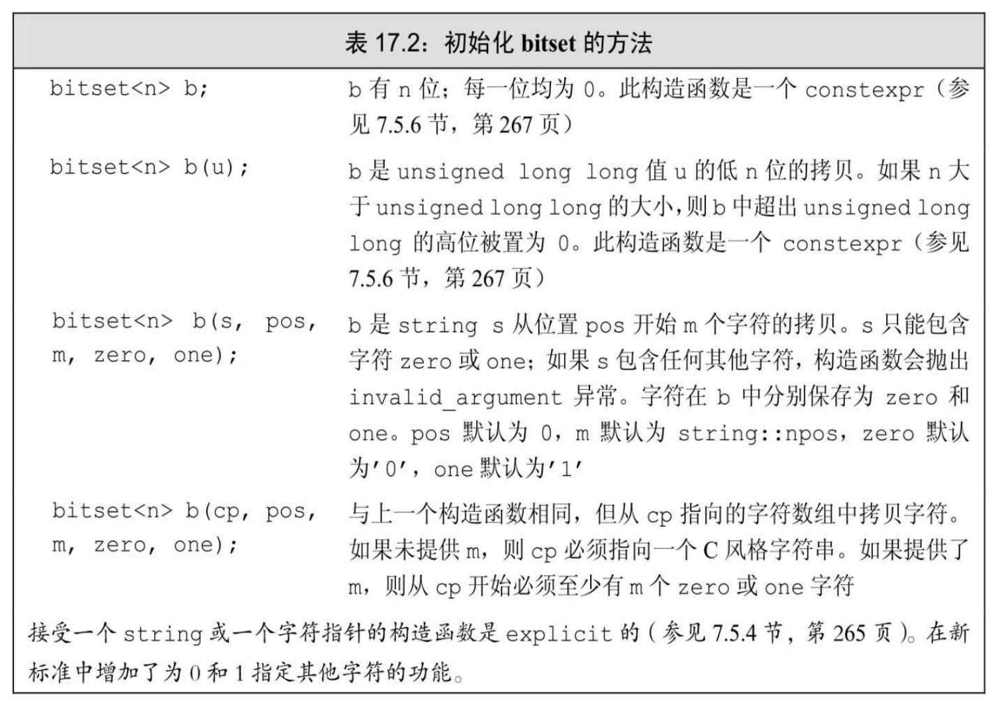
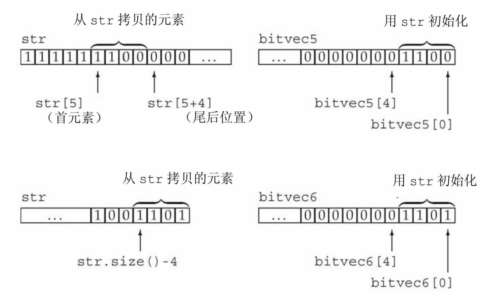
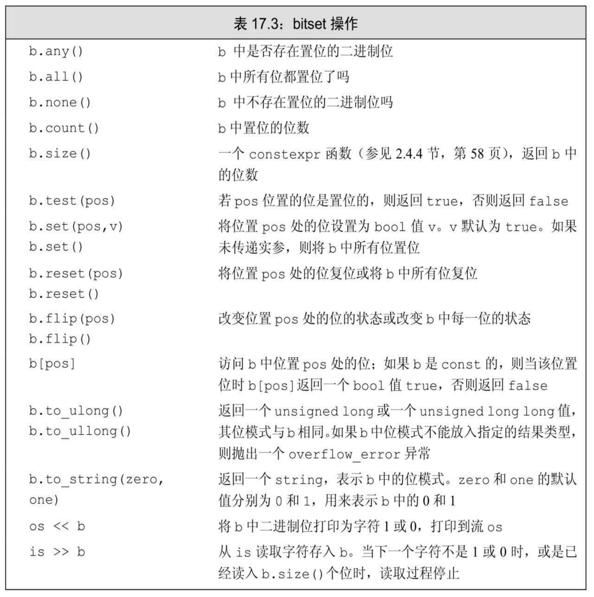
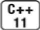

[总目录](<../目录.md>) · [本章目录](<01 章节导读.md>) · [上一篇](<../第17章 标准库特殊设施/17.1 tuple类型.md>) · [下一篇](<../第17章 标准库特殊设施/17.3 正则表达式.md>)

> 原 PDF 第 1045–1052 页。

<!-- PDF 第 1045 页 -->

## **17.2 bitset**类型

在4.8节(第135页)中我们介绍了将整型运算对象当作二进制位集合处理的一些内置运算符。标准库还定义了**bitset**类,使得位运算的使用更为容易,并且能够处理超过最长整型类型大小的位集合。bitset类定义在头文件bitset中。

## **17.2.1** 定义和初始化**bitset**

表17.2列出了bitset的构造函数。bitset类是一个类模板,它类似array 类,具有固定的大小(参见9.2.4节,第301页)。当我们定义一个bitset 时,需要声明它包含多少个二进制位:

<!-- 代码原图: ../images/_page_1044_Picture_109.png -->
```c++
bitset<32> bitvec(1U);// 32位；低位为1，其他位为0
```

大小必须是一个常量表达式(参见2.4.4节,第58页)。这条语句定义bitvec为一个包含32位的bitset。就像vector包含未命名的元素一样, bitset中的二进制位也是未命名的,我们通过位置来访问它们。二进制位的位置是从0开始编号的。因此,bitvec包含编号从0到31的32个二进制位。编号从0开始的二进制位被称为低位(low-order),编号到31结束的二进制位被称为高位(high-order)。

<!-- PDF 第 1046 页 -->



### 用**unsigned**值初始化**bitset**

当我们使用一个整型值来初始化bitset时,此值将被转换为unsigned long long类型并被当作位模式来处理。bitset中的二进制位将是此模式的一个副本。如果bitset的大小大于一个unsigned long long中的二进制位数,则剩余的高位被置为0。如果bitset的大小小于一个unsigned long long中的二进制位数,则只使用给定值中的低位,超出bitset大小的高位被丢弃:

<!-- 代码原图: ../images/_page_1045_Picture_69.png -->
```c++
// bitvec1 比初始值小；初始值中的高位被丢弃
bitset<13> bitvec1(0xbeef); // 二进制位序列为 1111011101111
// bitvec2 比初始值大；它的高位被置为 0
bitset<20> bitvec2(0xbeef); // 二进制位序列为 00001011111011101111
// 在 64 位机器中，long long 0ULL 是 64 个 0 比特，因此~0ULL 是 64 个 1
bitset<128> bitvec3(~0ULL); // 0~63 位为 1；63~127 位为 0
```

### 从一个**string**初始化**bitset**

我们可以从一个string或一个字符数组指针来初始化bitset。两种情

<!-- PDF 第 1047 页 -->

况下,字符都直接表示位模式。与往常一样,当我们使用字符串表示数时,字符串中下标最小的字符对应高位,反之亦然:

<!-- 代码原图: ../images/_page_1046_Picture_102.png -->
```c++
bitset<32> bitvec4("1100"); // 2、3两位为1，剩余两位为0
```

如果string包含的字符数比bitset少,则bitset的高位被置为0。


string的下标编号习惯与bitset恰好相反:string中下标最大的字符(最右字符)用来初始化bitset中的低位(下标为0的二进制位)。当你用一个string初始化一个bitset 时,要记住这个差别。

我们不必使用整个string来作为bitset的初始值,可以只用一个子串作为初始值:

<!-- 代码原图: ../images/_page_1046_Picture_104.png -->
```c++
string str("1111111000000011001101");
bitset<32> bitvec5(str, 5, 4); // 从 str[5]开始的四个二进制位，1100
bitset<32> bitvec6(str, str.size()-4); // 使用最后四个字符
```

此处,bitvec5用str中从str[5]开始的长度为4的子串进行初始化。与往常一样,子串的最右字符表示最低位。因此,bitvec5中第3位到第0位被设置为1100,剩余位被设置为0。传递给bitvec6的初始值是一个string 和一个开始位置,因此bitvec6用str中倒数第四个字符开始的子串进行初始化。bitvec6中剩余二进制位被初始化为0。下图说明了这两个初始化过程

<!-- PDF 第 1048 页 -->



### **17.2.1**节练习

练习**17.9**:解释下列每个bitset对象所包含的位模式:

<!-- 代码原图: ../images/_page_1047_Picture_48.png -->
```c++
(a) bitset<64> bitvec(32);
(b) bitset<32> bv(1010101);
(c) string bstr; cin >> bstr; bitset<8>bv(bstr);
```

## **17.2.2 bitset**操作

bitset操作(参见表17.3)定义了多种检测或设置一个或多个二进制位的方法。bitset类还支持我们在4.8节(第136页)中介绍过的位运算符。这些运算符用于bitset对象的含义与内置运算符用于unsigned运算对象相同。

<!-- PDF 第 1049 页 -->



count、size、all、any和none等几个操作都不接受参数,返回整个 bitset的状态。其他操作——set、reset和flip则改变bitset的状态。改变 bitset状态的成员函数都是重载的。对每个函数,不接受参数的版本对整个集合执行给定的操作;接受一个位置参数的版本则对指定位执行操作:

<!-- PDF 第 1050 页 -->

<!-- 代码原图: ../images/_page_1049_Picture_103.png -->
```c++
bitset<32> bitvec(1U); // 32位；低位为1，剩余位为0
bool is_set = bitvec.any(); // true，因为有1位置位
bool is_not_set = bitvec.none(); // false，因为有1位置位了
bool all_set = bitvec.all(); // false，因为只有1位置位
size_t onBits = bitvec.count(); // 返回1
size_t sz = bitvec.size(); // 返回32
bitvec.flip(); // 翻转bitvec中的所有位
bitvec.reset(); // 将所有位复位
bitvec.set(); // 将所有位置位
```



当bitset对象的一个或多个位置位(即,等于1)时,操作any返回 true。相反,当所有位复位时,none返回true。新标准引入了all操作,当所有位置位时返回true。操作count和size返回size\_t类型的值(参见3.5.2 节,第103页),分别表示对象中置位的位数或总位数。函数size是一个 constexpr函数,因此可以用在要求常量表达式的地方(参见2.4.4节,第 58页)。

成员flip、set、reset及test允许我们读写指定位置的位:

<!-- 代码原图: ../images/_page_1049_Picture_105.png -->
```c++
bitvec.flip(0); // 翻转第一位
bitvec.set(bitvec.size() - 1); // 置位最后一位
bitvec.set(0, 0); // 复位第一位
bitvec.reset(i); // 复位第 i 位
bitvec.test(0); // 返回 false，因为第一位是复位的
```

下标运算符对const属性进行了重载。const版本的下标运算符在指定位置位时返回true,否则返回false。非const版本返回bitset定义的一个特殊类型,它允许我们操纵指定位的值:

<!-- 代码原图: ../images/_page_1049_Picture_106.png -->
```c++
bitvec[0] = 0; // 将第一位复位
bitvec[31] = bitvec[0]; // 将最后一位设置为与第一位一样
bitvec[0].flip(); // 翻转第一位
~bitvec[0]; // 等价操作，也是翻转第一位
bool b = bitvec[0]; // 将 bitvec[0]的值转换为 bool 类型
```

### 提取**bitset**的值

to\_ulong和to\_ullong操作都返回一个值,保存了与bitset对象相同的

<!-- PDF 第 1051 页 -->

位模式。只有当bitset的大小小于等于对应的大小(to\_ulong为unsigned long,to\_ullong为unsigned long long)时,我们才能使用这两个操作:

<!-- 代码原图: ../images/_page_1050_Picture_122.png -->
```c++
unsigned long ulong = bitvec3.to_ulong();
cout << "ulong = " << ulong << endl;
```


如果bitset中的值不能放入给定类型中,则这两个操作会抛出一个overflow\_error异常(参见5.6节,第173页)。

#### **bitset**的**IO**运算符

输入运算符从一个输入流读取字符,保存到一个临时的string对象中。直到读取的字符数达到对应bitset的大小时,或是遇到不是1或0的字符时,或是遇到文件尾或输入错误时,读取过程才停止。随即用临时 string对象来初始化bitset(参见17.2.1节,第642页)。如果读取的字符数小于bitset的大小,则与往常一样,高位将被置为0。

输出运算符打印一个bitset对象中的位模式:

<!-- 代码原图: ../images/_page_1050_Picture_124.png -->
```c++
bitset<16> bits;
cin >> bits; // 从 cin 读取最多16个0或1
cout << "bits: " << bits << endl; // 打印刚刚读取的内容
```

### 使用**bitset**

为了说明如何使用bitset,我们重新实现4.8节(第137页)中的评分程序,用bitset代替unsigned long表示30个学生的测验结果——"通过/失败":

<!-- 代码原图: ../images/_page_1050_Picture_125.png -->
```c++
bool status;
// 使用位运算符的版本
unsigned long quizA = 0; // 此值被当作位集合使用
```

<!-- PDF 第 1052 页 -->

<!-- 代码原图: ../images/_page_1051_Picture_77.png -->
```c++
quizA |= 1UL << 27; // 指出第 27 个学生通过了测验
status = quizA & (1UL << 27); // 检查第 27 个学生是否通过了测验
quizA &= ~(1UL << 27); // 第 27 个学生未通过测验
// 使用标准库类 bitset 完成等价的工作
bitset<30> quizB; // 每个学生分配一位，所有位都被初始化为 0
quizB.set(27); // 指出第 27 个学生通过了测验
status = quizB[27]; // 检查第 27 个学生是否通过了测验
quizB.reset(27); // 第 27 个学生未通过测验
```

#### **17.2.2**节练习

练习**17.10**:使用序列1、2、3、5、8、13、21初始化一个bitset,将这些位置置位。对另一个bitset进行默认初始化,并编写一小段程序将其恰当的位置位。

练习**17.11**:定义一个数据结构,包含一个整型对象,记录一个包含10 个问题的真/假测验的解答。如果测验包含100道题,你需要对数据结构做出什么改变(如果需要的话)?

练习**17.12**:使用前一题中的数据结构,编写一个函数,它接受一个问题编号和一个表示真/假解答的值,函数根据这两个参数更新测验的解答。

练习**17.13**:编写一个整型对象,包含真/假测验的正确答案。使用它来为前两题中的数据结构生成测验成绩。


