[总目录](<../目录.md>) · [本章目录](<01 章节导读.md>) · [上一篇](<../第17章 标准库特殊设施/17.2 bitset类型.md>) · [下一篇](<../第17章 标准库特殊设施/17.4 随机数.md>)

> 原 PDF 第 1053–1074 页。

<!-- PDF 第 1053 页 -->

## **17.3** 正则表达式

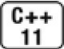

正则表达式(regular expression)是一种描述字符序列的方法,是一种极其强大的计算工具。但是,用于定义正则表达式的描述语言已经大大超出了本书的范围。因此,我们重点介绍如何使用C++正则表达式库(RE库),它是新标准库的一部分。RE库定义在头文件regex中,它包含多个组件,列于表17.4中。

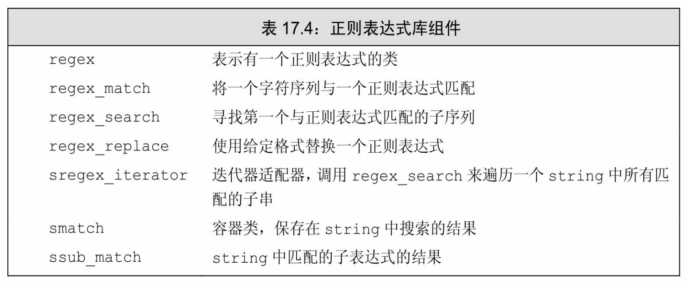


如果你还不熟悉正则表达式的使用,你应该浏览这一节,以获得正则表达式可以做什么的一些概念。

**regex**类表示一个正则表达式。除了初始化和赋值之外,regex还支持其他一些操作。表17.6(第647页)列出了regex支持的操作。

函数**regex\_match**和**regex\_search**确定一个给定字符序列与一个给定 regex是否匹配。如果整个输入序列与表达式匹配,则regex\_match函数返回true;如果输入序列中一个子串与表达式匹配,则regex\_search函数返回true。还有一个regex\_replace函数,我们将在17.3.4节(第657页)中介绍。

<!-- PDF 第 1054 页 -->

表17.5列出了regex的函数的参数。这些函数都返回bool值,且都被重载了:其中一个版本接受一个类型为**smatch**的附加参数。如果匹配成功,这些函数将成功匹配的相关信息保存在给定的smatch对象中。

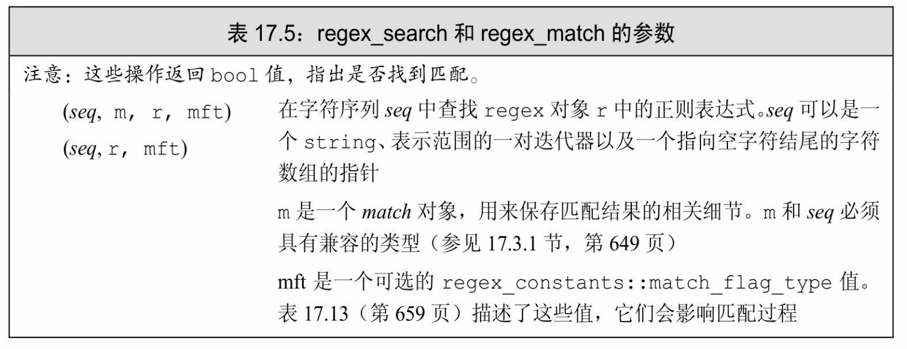

## **17.3.1** 使用正则表达式库

我们从一个非常简单的例子开始——查找违反众所周知的拼写规则"i除非在c之后,否则必须在e之前"的单词:

<!-- 代码原图: ../images/_page_1053_Picture_68.png -->
```c++
// 查找不在字符 c之后的字符串 ei
string pattern("[^c]ei");
// 我们需要包含 pattern 的整个单词
pattern = "[[[:alpha:]]]*" + pattern + "[[[:alpha:]]]*";
regex r(pattern);    // 构造一个用于查找模式的 regex
smatch results;    // 定义一个对象保存搜索结果
// 定义一个 string 保存与模式匹配和不匹配的文本
string test_str = "receipt freind theif receive";
// 用 r 在 test_str 中查找与 pattern 匹配的子串
if (regex_search(test_str, results, r))    // 如果有匹配子串
    cout << results.str() << endl;    // 打印匹配的单词
```

我们首先定义了一个string来保存希望查找的正则表达式。正则表达式[^c]表明我们希望匹配任意不是'c'的字符,而[^c]ei指出我们想要匹配这种字符后接ei的字符串。此模式描述的字符串恰好包含三个字符。 我们想要包含此模式的单词的完整内容。为了与整个单词匹配,我们还 

<!-- PDF 第 1055 页 -->

需要一个正则表达式与这个三字母模式之前和之后的字母匹配。

这个正则表达式包含零个或多个字母后接我们的三字母的模式,然后再接零个或多个额外的字母。默认情况下,regex使用的正则表达式语言是ECMAScript。在ECMAScript中,模式[[::alpha:]]匹配任意字母,符号+和\*分别表示我们希望"一个或多个"或"零个或多个"匹配。 因此[[::alpha:]]\*将匹配零个或多个字母。

将正则表达式存入pattern后,我们用它来初始化一个名为r的regex 对象。接下来我们定义了一个string,用来测试正则表达式。我们将 test\_str初始化为与模式匹配的单词(如"freind"和"thief")和不匹配的单词(如"recepit"和"receive")。我们还定义了一个名为results的smatch对象,它将被传递给regex\_search。如果找到匹配子串,results将会保存匹配位置的细节信息。

接下来我们调用了regex\_search。如果它找到匹配子串,就返回 true。我们用results的str成员来打印test\_str中与模式匹配的部分。函数 regex\_search在输入序列中只要找到一个匹配子串就会停止查找。因此,程序的输出将是

#### **freind**

17.3.2节(第650页)将会介绍如何查找输入序列中所有的匹配子串。

指定**regex**对象的选项

当我们定义一个regex或是对一个regex调用assign为其赋予新值时, 可以指定一些标志来影响regex如何操作。这些标志控制regex对象的处理过程。表17.6列出的最后6个标志指出编写正则表达式所用的语言。 对这6个标志,我们必须设置其中之一,且只能设置一个。默认情况下,ECMAScript标志被设置,从而regex会使用ECMA-262规范,这也是很多Web浏览器所使用的正则表达式语言。

<!-- PDF 第 1056 页 -->

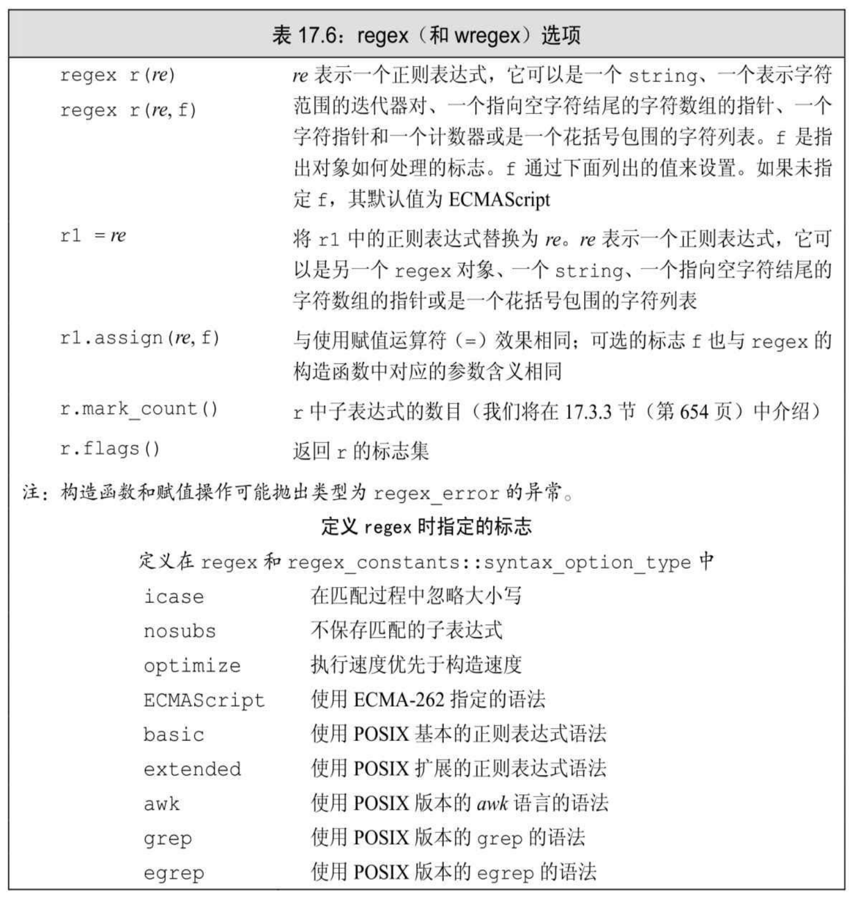

其他3个标志允许我们指定正则表达式处理过程中与语言无关的方面。例如,我们可以指出希望正则表达式以大小写无关的方式进行匹配。

作为一个例子,我们可以用icase标志查找具有特定扩展名的文件名。大多数操作系统都是按大小写无关的方式来识别扩展名的——可以将一个C++程序保存在.cc结尾的文件中,也可以保存在.Cc、.cC或是.CC结尾的文件中,效果是一样的。如下所示,我们可以编写一个正则表达式来识别上述任何一种扩展名以及其他普通文件扩展名:

<!-- PDF 第 1057 页 -->

<!-- 代码原图: ../images/_page_1056_Picture_135.png -->
```c++
// 一个或多个字母或数字字符后接一个'.'再接"cpp"或"cxx"或"cc"
regex r("[[[:alnum:]]+\\.(cpp|cxx|cc)$", regex::icase);
smatch results;
string filename;
while (cin >> filename)
    if (regex_search(filename, results, r))
        cout << results.str() << endl; // 打印匹配结果
```

此表达式将匹配这样的字符串:一个或多个字母或数字后接一个句点再接三个文件扩展名之一。这样,此正则表达式将会匹配指定的文件扩展名而不理会大小写。

就像C++语言中有特殊字符一样(参见2.1.3节,第36页),正则表达式语言通常也有特殊字符。例如,字符点(.)通常匹配任意字符。 与C++一样,我们可以在字符之前放置一个反斜线来去掉其特殊含义。 由于反斜线也是C++中的一个特殊字符,我们在字符串字面常量中必须连续使用两个反斜线来告诉C++我们想要一个普通反斜线字符。因此, 为了表示与句点字符匹配的正则表达式,必须写成\\.(第一个反斜线去掉C++语言中反斜线的特殊含义,即,正则表达式字符串为\.,第二个反斜线则表示在正则表达式中去掉.的特殊含义)。

### 指定或使用正则表达式时的错误

我们可以将正则表达式本身看作用一种简单程序设计语言编写的"程序"。这种语言不是由C++编译器解释的。正则表达式是在运行时,当一个regex对象被初始化或被赋予一个新模式时,才被"编译"的。 与任何其他程序设计语言一样,我们用这种语言编写的正则表达式也可能有错误。


需要意识到的非常重要的一点是,一个正则表达式的语法是否正确是在运行时解析的。

如果我们编写的正则表达式存在错误,则在运行时标准库会抛出一个类型为**regex\_error**的异常(参见5.6节,第173页)。类似标准异常类型,regex\_error有一个what操作来描述发生了什么错误(参见5.6.2节, 第175页)。regex\_error还有一个名为code的成员,用来返回某个错误类型对应的数值编码。code返回的值是由具体实现定义的。RE库能抛出的

<!-- PDF 第 1058 页 -->

标准错误如表17.7所示。

例如,我们可能在模式中意外遇到一个方括号:

<!-- 代码原图: ../images/_page_1057_Picture_54.png -->
```c++
try {
    // 错误：alnum 漏掉了右括号，构造函数会抛出异常
    regex r("[[[:alnum:]+\\.(cpp|cxx|cc)$", regex::icase);
} catch (regex_error e)
{ cout << e.what() << "\ncode: " << e.code() << endl; }
```

当这段程序在我们的系统上运行时,程序会生成:

**regex\_error(error\_brack):**

**The expression contained mismatched [ and ].**

**code: 4**

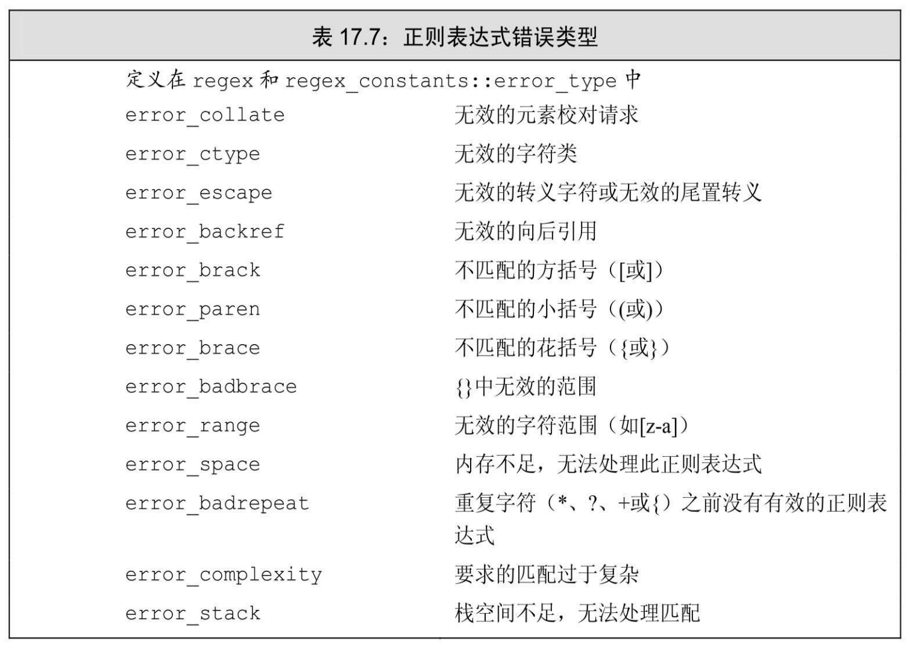

我们的编译器定义了code成员,返回表17.7列出的错误类型的编号,与往常一样,编号从0开始。

<!-- PDF 第 1059 页 -->

建议:避免创建不必要的正则表达式

如我们所见,一个正则表达式所表示的"程序"是在运行时而非编译时编译的。正则表达式的编译是一个非常慢的操作,特别是在你使用了扩展的正则表达式语法或是复杂的正则表达式时。因此,构造一个regex对象以及向一个已存在的regex赋予一个新的正则表达式可能是非常耗时的。为了最小化这种开销,你应该努力避免创建很多不必要的regex。特别是,如果你在一个循环中使用正则表达式,应该在循环外创建它, 而不是在每步迭代时都编译它。

正则表达式类和输入序列类型

我们可以搜索多种类型的输入序列。输入可以是普通char数据或 wchar\_t数据,字符可以保存在标准库string中或是char数组中(或是宽字符版本,wstring或wchar\_t数组中)。RE为这些不同的输入序列类型都定义了对应的类型。

例如,regex类保存类型char的正则表达式。标准库还定义了一个 wregex类保存类型wachar\_t,其操作与regex完全相同。两者唯一的差别是wregex的初始值必须使用wchar\_t而不是char。

匹配和迭代器类型(我们将在下面小节中介绍)更为特殊。这些类型的差异不仅在于字符类型,还在于序列是在标准库string中还是在数组中:smatch表示string类型的输入序列;cmatch表示字符数组序列; wsmatch表示宽字符串(wstring)输入;而wcmatch表示宽字符数组。

重点在于我们使用的RE库类型必须与输入序列类型匹配。表17.8指出了RE库类型与输入序列类型的对应关系。例如:

<!-- 代码原图: ../images/_page_1058_Picture_149.png -->
```c++
regex r("[[[:alnum:]]+\\.(cpp|cxx|cc)$", regex::icase);
smatch results; // 将匹配 string 输入序列，而不是 char*
if (regex_search("myfile.cc", results, r)) // 错误：输入为 char*
    cout << results.str() << endl;
```

这段代码会编译失败,因为match参数的类型与输入序列的类型不匹配。如果我们希望搜索一个字符数组,就必须使用cmatch对象:

<!-- 代码原图: ../images/_page_1058_Picture_150.png -->
```c++
cmatch results; // 将匹配字符数组输入序列
if (regex_search("myfile.cc", results, r))
    cout << results.str() << endl; // 打印当前匹配
```

本书程序一般会使用string输入序列和对应的string版本的RE库组

<!-- PDF 第 1060 页 -->

件。

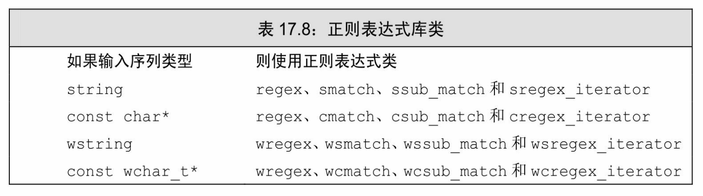

### **17.3.1**节练习

练习**17.14**:编写几个正则表达式,分别触发不同错误。运行你的程序,观察编译器对每个错误的输出。

练习**17.15**:编写程序,使用模式查找违反"i在e之前,除非在c之后"规则的单词。你的程序应该提示用户输入一个单词,然后指出此单词是否符合要求。用一些违反和未违反规则的单词测试你的程序。

练习**17.16**:如果前一题程序中的regex对象用"[^c]ei"进行初始化,将会发生什么?用此模式测试你的程序,检查你的答案是否正确。

## **17.3.2** 匹配与**Regex**迭代器类型

第646页中的程序查找违反"i在e之前,除非在c之后"规则的单词, 它只打印输入序列中第一个匹配的单词。我们可以使用**sregex\_iterator** 来获得所有匹配。regex迭代器是一种迭代器适配器(参见9.6节,第329 页),被绑定到一个输入序列和一个regex对象上。如表17.8所述,每种不同输入序列类型都有对应的特殊regex迭代器类型。迭代器操作如表 17.9所述。

<!-- PDF 第 1061 页 -->

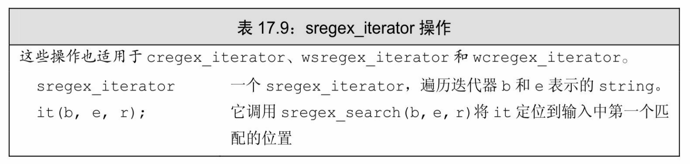

续表

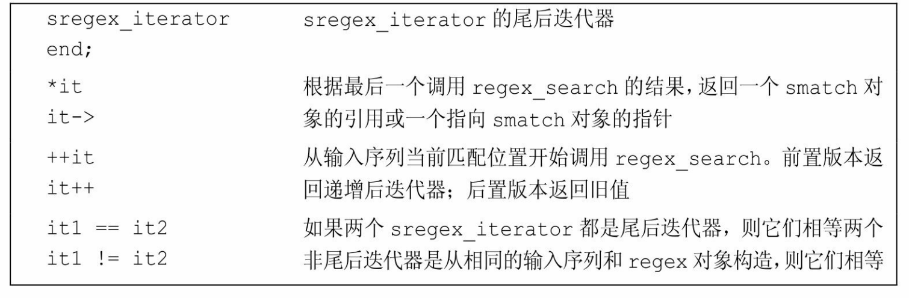

当我们将一个sregex\_iterator绑定到一个string和一个regex对象时, 迭代器自动定位到给定string中第一个匹配位置。即,sregex\_iterator构造函数对给定string和regex调用regex\_search。当我们解引用迭代器时, 会得到一个对应最近一次搜索结果的smatch对象。当我们递增迭代器时,它调用regex\_search在输入string中查找下一个匹配。

#### 使用**sregex\_iterator**

作为一个例子,我们将扩展之前的程序,在一个文本文件中查找所有违反"i在e之前,除非在c之后"规则的单词。我们假定名为file的string 保存了我们要搜索的输入文件的全部内容。这个版本的程序将使用与前一个版本一样的pattern,但会使用一个sregex\_iterator来进行搜索:

<!-- PDF 第 1062 页 -->

<!-- 代码原图: ../images/_page_1061_Picture_98.png -->
```c++
// 查找前一个字符不是 c 的字符串 ei
string pattern("[^c]ei");
// 我们想要包含 pattern 的单词的全部内容
pattern = "[[[:alpha:]]*" + pattern + "[[[:alpha:]]*";
regex r(pattern, regex::icase); // 在进行匹配时将忽略大小写
// 它将反复调用 regex_search 来寻找文件中的所有匹配
for (sregex_iterator it(file.begin(), file.end(), r), end_it;
    it != end_it; ++it)
    cout << it->str() << endl; // 匹配的单词
```

for循环遍历file中每个与r匹配的子串。for语句中的初始值定义了it 和end\_it。当我们定义it时,sregex\_iterator的构造函数调用regex\_search 将it定位到file中第一个与r匹配的位置。而end\_it是一个空 sregex\_iterator,起到尾后迭代器的作用。for语句中的递增运算通过 regex\_search来"推进"迭代器。当我们解引用迭代器时,会得到一个表示当前匹配结果的smatch对象。我们调用它的str成员来打印匹配的单词。

我们可以将此循环想象为不断从一个匹配位置跳到下一个匹配位置,如图17.1所示。

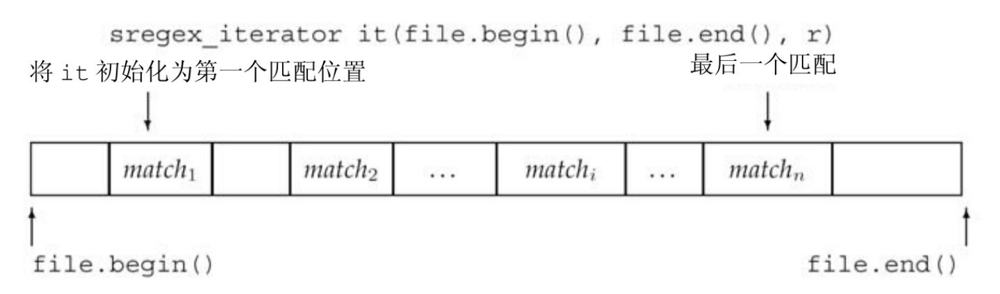

图17.1:使用sregex\_iterator

#### 使用匹配数据

如果我们对最初版本程序中的test\_str运行此循环,则输出将是

#### **freind**

#### **theif**

但是,仅获得与我们的正则表达式匹配的单词还不是那么有用。如果我们在一个更大的输入序列——例如,在本章英文版的文本上运行此

<!-- PDF 第 1063 页 -->

程序——可能希望看到匹配单词出现的上下文,如

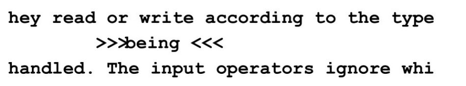

除了允许打印输入字符串中匹配的部分之外,匹配结果类还提供了有关匹配结果的更多细节信息。表17.10和表17.11列出了这些类型支持的操作。

我们将在下一节中介绍更多有关smatch和**ssub\_match**类型的内容。 目前,我们只需知道它们允许我们获得匹配的上下文即可。匹配类型有两个名为prefix和suffix的成员,分别返回表示输入序列中当前匹配之前和之后部分的ssub\_match对象。一个ssub\_match对象有两个名为str和 length的成员,分别返回匹配的string和该string的大小。我们可以用这些操作重写语法程序的循环。

<!-- 代码原图: ../images/_page_1062_Picture_77.png -->
```c++
// 循环头与之前一样
for (sregex_iterator it(file.begin(), file.end(), r), end_it;
    it != end_it; ++it) {
    auto pos = it->prefix().length();                // 前缀的大小
    pos = pos > 40 ? pos - 40 : 0;                // 我们想要最多 40 个字符
    cout << it->prefix().str().substr(pos)        // 前缀的最后一部分
        << "\n\t\t>>> " << it->str() << " <<\n" // 匹配的单词
        << it->suffix().str().substr(0, 40)        // 后缀的第一部分
        << endl;
}
```

循环本身的工作方式与前一个程序相同。改变的是循环内部,如图 17.2所示。

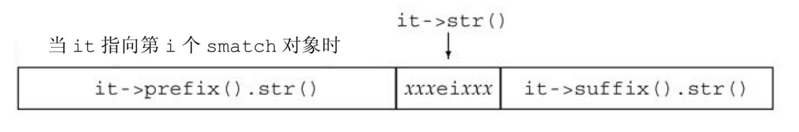

图17.2:smatch对象表示一个特定匹配

<!-- PDF 第 1064 页 -->

我们调用prefix,返回一个ssub\_match对象,表示file中当前匹配之前的部分。我们对此ssub\_match对象调用length,获得前缀部分的字符数目。接下来调整pos,使之指向前缀部分末尾向前40个字符的位置。 如果前缀部分的长度小于40个字符,我们将pos置为0,表示要打印整个前缀部分。我们用substr(参见9.5.1节,第321页)来打印指定位置到前缀部分末尾的内容。

打印了当前匹配之前的字符之后,我们接下来用特殊格式打印匹配的单词本身,使得它在输出中能突出显示出来。打印匹配单词之后,我们打印file中匹配部分之后的前(最多)40个字符。

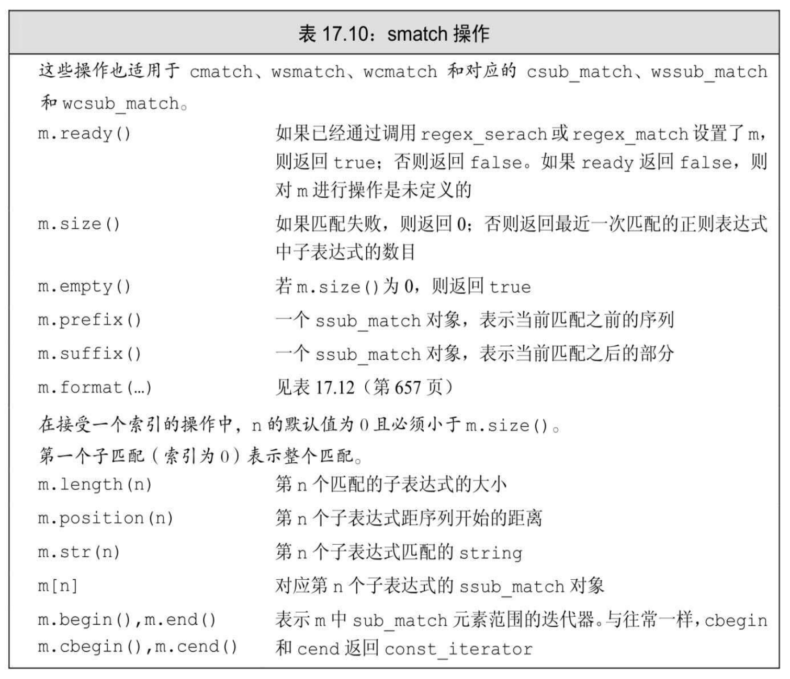

### **17.3.2**节练习

练习**17.17**:更新你的程序,令它查找输入序列中所有违反"ei"语法规则

<!-- PDF 第 1065 页 -->

的单词。

练习**17.18**:修改你的程序,忽略包含"ei"但并非拼写错误的单词, 如"albeit"和"neighbor"。

## **17.3.3** 使用子表达式

正则表达式中的模式通常包含一个或多个子表达式

(subexpression)。一个子表达式是模式的一部分,本身也具有意义。 正则表达式语法通常用括号表示子表达式。

例如,我们用来匹配C++文件的模式(参见17.3.1节,第646页)就是用括号来分组可能的文件扩展名。每当我们用括号分组多个可行选项时,同时也就声明了这些选项形成子表达式。我们可以重写扩展名表达式,以使得模式中点之前表示文件名的部分也形成子表达式,如下所示:

<!-- 代码原图: ../images/_page_1064_Picture_129.png -->
```c++
// r有两个子表达式：第一个是点之前表示文件名的部分，第二个表示文件扩展名
regex r("([[:alnum:]]+)\\.(cpp|cxx|cc)$", regex::icase);
```

现在我们的模式包含两个括号括起来的子表达式:

· ([[:alnum:]]+),匹配一个或多个字符的序列 · (cpp|cxx|cc),匹配文件扩展名

我们还可以重写17.3.1节(第646页)中的程序,通过修改输出语句使之只打印文件名。

<!-- 代码原图: ../images/_page_1064_Picture_130.png -->
```c++
if (regex_search(filename, results, r))
    cout << results.str(1) << endl; // 打印第一个子表达式
```

与最初的程序一样,我们还是调用regex\_search在名为filename的 string中查找模式r,并且传递smatch对象results来保存匹配结果。如果调用成功,我们打印结果。但是,在此版本中,我们打印的是str(1), 即,与第一个子表达式匹配的部分。

匹配对象除了提供匹配整体的相关信息外,还提供访问模式中每个

<!-- PDF 第 1066 页 -->

子表达式的能力。子匹配是按位置来访问的。第一个子匹配位置为0, 表示整个模式对应的匹配,随后是每个子表达式对应的匹配。因此,本例模式中第一个子表达式,即表示文件名的子表达式,其位置为1,而文件扩展名对应的子表达式位置为2。

例如,如果文件名为foo.cpp,则results.str(0)将保存foo.cpp; results.str(1)将保存foo;而results.str(2)将保存cpp。在此程序中, 我们想要点之前的那部分名字,即第一个子表达式,因此我们打印 results.str(1)。

### 子表达式用于数据验证

子表达式的一个常见用途是验证必须匹配特定格式的数据。例如, 美国的电话号码有十位数字,包含一个区号和一个七位的本地号码。区号通常放在括号里,但这并不是必需的。剩余七位数字可以用一个短横线、一个点或是一个空格分隔,但也可以完全不用分隔符。我们可能希望接受任何这种格式的数据而拒绝任何其他格式的数。我们将分两步来实现这一目标:首先,我们将用一个正则表达式找到可能是电话号码的序列,然后再调用一个函数来完成数据验证。

在编写电话号码模式之前,我们需要介绍一下ECMAScript正则表达式语言的一些特性:

· \{d}表示单个数字而\{d}{*n*}则表示一个*n*个数字的序列。(如,\ {d}{3}匹配三个数字的序列。)

· 在方括号中的字符集合表示匹配这些字符中任意一个。(如,[-.] 匹配一个短横线或一个点或一个空格。注意,点在括号中没有特殊含义。)

· 后接'?'的组件是可选的。(如,\{d}{3}[-.]?\{d}{4}匹配这样的序列:开始是三个数字,后接一个可选的短横线或点或空格,然后是四个数字。此模式可以匹配555-0132或555.0132或555 0132或5550132。)

· 类似C++,ECMAScript使用反斜线表示一个字符本身而不是其特殊含义。由于我们的模式包含括号,而括号是ECMAScript中的特殊字符,因此我们必须用\(和\)来表示括号是我们的模式的一部分而不是特殊字符。

<!-- PDF 第 1067 页 -->

由于反斜线是C++中的特殊字符,在模式中每次出现\的地方,我们都必须用一个额外的反斜线来告知C++我们需要一个反斜线字符而不是一个特殊符号。因此,我们用\\{d}{3}来表示正则表达式\{d}{3}。

为了验证电话号码,我们需要访问模式的组成部分。例如,我们希望验证区号部分的数字如果用了左括号,那么它是否也在区号后面用了右括号。即,我们不希望出现(908.555.1800这样的号码。

为了获得匹配的组成部分,我们需要在定义正则表达式时使用子表达式。每个子表达式用一对括号包围:

<!-- 代码原图: ../images/_page_1066_Picture_101.png -->
```c++
// 整个正则表达式包含七个子表达式：（ ddd ）分隔符 ddd 分隔符 dddd
// 子表达式1、3、4和6是可选的；2、5和7保存号码
"（\\()？(\\d{3})(\\))？([-.])？(\\d{3})([-.])？(\\d{4})";
```

由于我们的模式使用了括号,而且必须去除反斜线的特殊含义,因此这个模式很难读(也很难写!)。理解此模式的最简单的方法是逐个剥离(括号包围的)子表达式:

1.(\\()?表示区号部分可选的左括号 2.(\\d{3})表示区号 3.(\\))?表示区号部分可选的右括号 4.([-.])?表示区号部分可选的分隔符 5.(\\d{3})表示号码的下三位数字 6.([-.])?表示可选的分隔符 7.(\\d{4})表示号码的最后四位数字

下面的代码读取一个文件,并用此模式查找与完整的电话号码模式匹配的数据。它会调用一个名为valid的函数来检查号码格式是否合法:

<!-- PDF 第 1068 页 -->

<!-- 代码原图: ../images/_page_1067_Picture_48.png -->
```c++
string phone =
    "(\$()?(\d{3})(\$))?([-. ])?(\d{3})([-. ]?)(\d{4})";
regex r(phone); // regex 对象，用于查找我们的模式

smatch m;
string s;
// 从输入文件中读取每条记录

while (getline(cin, s)) {
    // 对每个匹配的电话号码

    for (sregex_iterator it(s.begin(), s.end(), r), end_it;
            it != end_it; ++it)
    // 检查号码的格式是否合法

    if (valid(*it))
        cout << "valid: " << it->str() << endl;

    else
        cout << "not valid: " << it->str() << endl;
}
```

#### 使用子匹配操作

我们将使用表17.11中描述的子匹配操作来编写valid函数。需要记住的重要一点是,我们的pattern有七个子表达式。与往常一样,每个 smatch对象会包含八个ssub\_match元素。位置[0]的元素表示整个匹配; 元素[1]…[7]表示每个对应的子表达式。

当调用valid时,我们知道已经有一个完整的匹配,但不知道每个可选的子表达式是否是匹配的一部分。如果一个子表达式是完整匹配的一部分,则其对应的ssub\_match对象的matched成员为true。

<!-- PDF 第 1069 页 -->

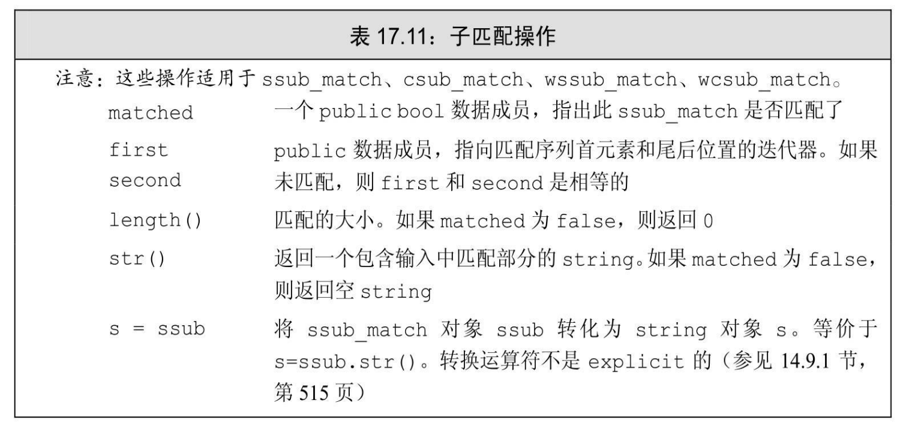

在一个合法的电话号码中,区号要么是完整括号包围的,要么完全没有括号。因此,valid要做什么工作依赖于号码是否以一个括号开始:

<!-- 代码原图: ../images/_page_1068_Picture_38.png -->
```c++
bool valid(const smatch& m)
{
    // 如果区号前有一个左括号
    if(m[1].matched)
        // 则区号后必须有一个右括号，之后紧跟剩余号码或一个空格
        return m[3].matched
            && (m[4].matched == 0 || m[4].str() == " ");
    else
        // 否则，区号后不能有右括号
        // 另两个组成部分间的分隔符必须匹配
        return !m[3].matched
            && m[4].str() == m[6].str();
}
```

我们首先检查第一个子表达式(即,左括号)是否匹配了。这个子表达式在m[1]中。如果匹配了,则号码是以左括号开始的。在此情况下,如果区号后的子表达式也匹配了(意味着区号后有右括号)则整个号码是合法的。而且,如果号码正确使用了括号,则下一个字符必须是一个空格或下一部分的第一个数字。

如果m[1]未匹配,(即,没有左括号),则区号后的子表达式也不应该匹配。如果它为空,则整个号码是合法的。

<!-- PDF 第 1070 页 -->

### **17.3.3**节练习

练习**17.19**:为什么可以不先检查m[4]是否匹配了就直接调用 m[4].str()?

练习**17.20**:编写你自己版本的验证电话号码的程序。

练习**17.21**:使用本节中定义的valid函数重写8.3.2节(第289页)中的电话号码程序。

练习**17.22**:重写你的电话号码程序,使之允许在号码的三个部分之间放置任意多个空白符。

练习**17.23**:编写查找邮政编码的正则表达式。一个美国邮政编码可以由五位或九位数字组成。前五位数字和后四位数字之间可以用一个短横线分隔。

## **17.3.4** 使用**regex\_replace**

正则表达式不仅用在我们希望查找一个给定序列的时候,还用在当我们想将找到的序列替换为另一个序列的时候。例如,我们可能希望将美国的电话号码转换为"ddd.ddd.dddd"的形式,即,区号和后面三位数字用一个点分隔。

当我们希望在输入序列中查找并替换一个正则表达式时,可以调用**regex\_replace**。表17.12描述了regex\_replace,类似搜索函数,它接受一个输入字符序列和一个regex对象,不同的是,它还接受一个描述我们想要的输出形式的字符串。

<!-- PDF 第 1071 页 -->

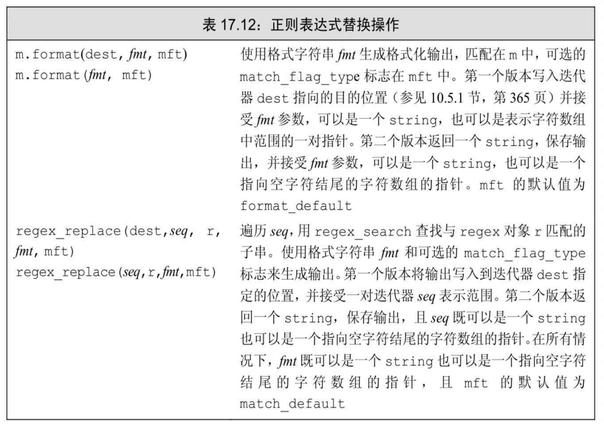

替换字符串由我们想要的字符组合与匹配的子串对应的子表达式而组成。在本例中,我们希望在替换字符串中使用第二个、第五个和第七个子表达式。而忽略第一个、第三个、第四个和第六个子表达式,因为这些子表达式用来形成号码的原格式而非新格式中的一部分。我们用一个符号\$后跟子表达式的索引号来表示一个特定的子表达式:

<!-- 代码原图: ../images/_page_1070_Picture_34.png -->
```c++
string fmt = "$2.$5.$7"; // 将号码格式改为 ddd.ddd.dddd
```

可以像下面这样使用我们的正则表达式模式和替换字符串:

<!-- 代码原图: ../images/_page_1070_Picture_35.png -->
```c++
regex r(phone); // 用来寻找模式的 regex 对象
string number = " (908) 555-1800";
cout << regex_replace(number, r, fmt) << endl;
```

此程序的输出为:

**908.555.1800**

<!-- PDF 第 1072 页 -->

只替换输入序列的一部分

正则表达式更有意思的一个用处是替换一个大文件中的电话号码。 例如,我们有一个保存人名及其电话号码的文件:

**morgan (201) 555-2368 862-555-0123**

**drew (973)555.0130**

**lee (609) 555-0132 2015550175 800.555-0000**

我们希望将数据转换为下面这样:

**morgan 201.555.2368 862.555.0123**

**drew 973.555.0130**

**lee 609.555.0132 201.555.0175 800.555.0000**

可以用下面的程序完成这种转换:

<!-- 代码原图: ../images/_page_1071_Picture_103.png -->
```c++
int main()
{
    string phone =
        "(\()?(\d{3})(\))?([-. ])?(\d{3})([-. ])?(\d{4})";
    regex r(phone); // 寻找模式所用的 regex 对象
    smatch m;
    string s;
    string fmt = "$2.$5.$7"; // 将号码格式改为 ddd.ddd.dddd
    // 从输入文件中读取每条记录
    while (getline(cin, s))
        cout << regex_replace(s, r, fmt) << endl;
    return 0;
}
```

我们读取每条记录,保存到s中,并将其传递给regex\_replace。此函数在输入序列中查找并转换所有匹配子串。

#### 用来控制匹配和格式的标志

就像标准库定义标志来指导如何处理正则表达式一样,标准库还定义了用来在替换过程中控制匹配或格式的标志。表17.13列出了这些值。这些标志可以传递给函数regex\_search或regex\_match或是类smatch

<!-- PDF 第 1073 页 -->

的format成员。

匹配和格式化标志的类型为match\_flag\_type。这些值都定义在名为 regex\_constants的命名空间中。类似用于bind的placeholders(参见10.3.4 节,第355页),regex\_constants也是定义在命名空间std中的命名空间。 为了使用regex\_constants中的名字,我们必须在名字前同时加上两个命名空间的限定符:

<!-- 代码原图: ../images/_page_1072_Picture_75.png -->
```c++
using std::regex_constants::format_no_copy;
```

此声明指出,如果代码中使用了format\_no\_copy,则表示我们想要使用命名空间std::constants中的这个名字。如下所示,我们也可以用另一种形式的using来代替上面的代码,我们将在18.2.2节(第702页)中介绍这种形式:

<!-- 代码原图: ../images/_page_1072_Picture_76.png -->
```c++
using namespace std::regex_constants;
```

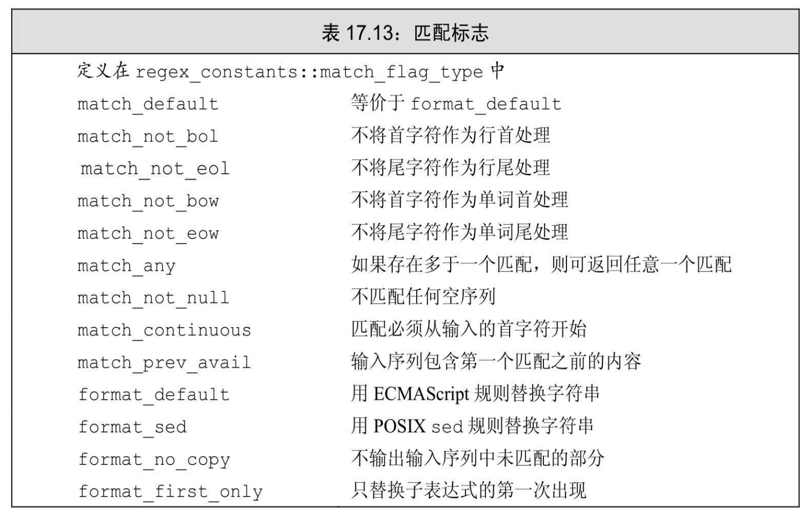

使用格式标志

默认情况下,regex\_replace输出整个输入序列。未与正则表达式匹

<!-- PDF 第 1074 页 -->

配的部分会原样输出;匹配的部分按格式字符串指定的格式输出。我们可以通过在regex\_replace调用中指定format\_no\_copy来改变这种默认行为:

<!-- 代码原图: ../images/_page_1073_Picture_74.png -->
```c++
// 只生成电话号码：使用新的格式字符串
string fmt2 = "$2.$5.$7 "; // 在最后一部分号码后放置空格作为分隔符
// 通知 regex_replace 只拷贝它替换的文本
cout << regex_replace(s, r, fmt2, format_no_copy) << endl;
```

给定相同的输入,此版本的程序生成

**201.555.2368 862.555.0123**

**973.555.0130**

**609.555.0132 201.555.0175 800.555.0000**

**17.3.4**节练习

练习**17.24**:编写你自己版本的重排电话号码格式的程序。

练习**17.25**:重写你的电话号码程序,使之只输出每个人的第一个电话号码。

练习**17.26**:重写你的电话号码程序,使之对多于一个电话号码的人只输出第二个和后续电话号码。

练习**17.27**:编写程序,将九位数字邮政编码的格式转换为ddddd-dddd。


