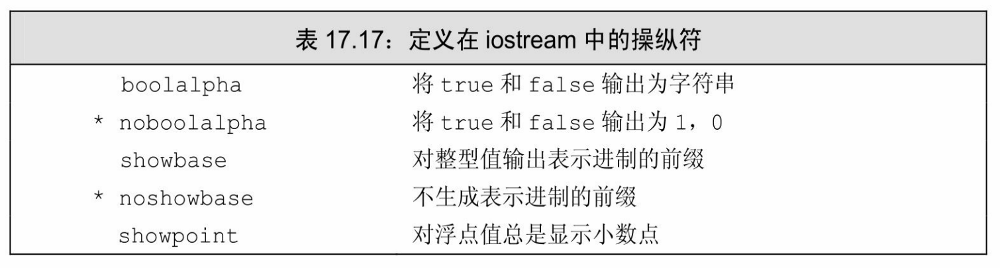
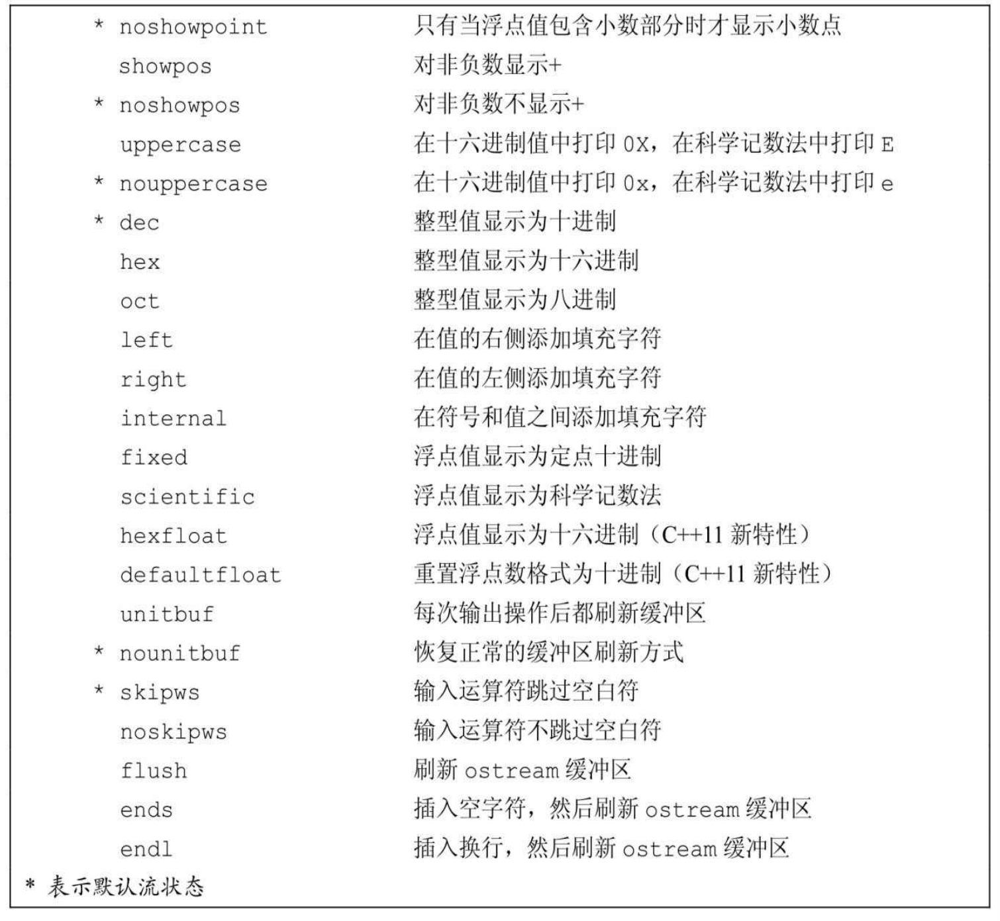
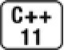
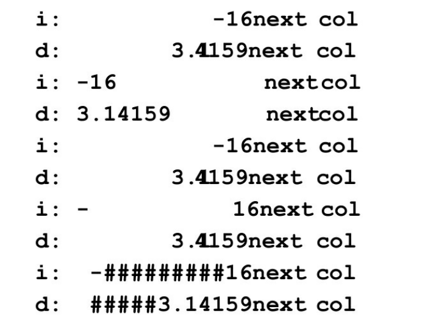
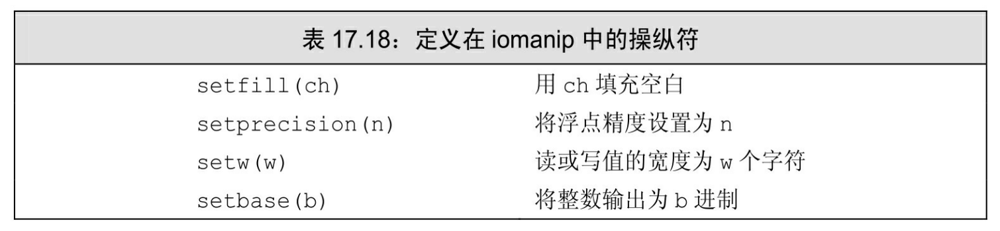
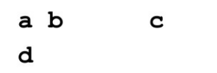
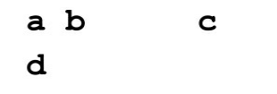
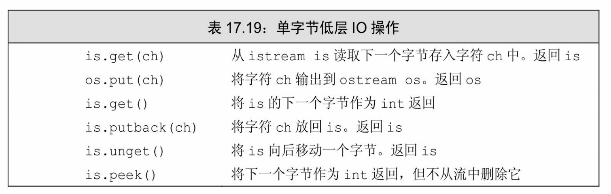
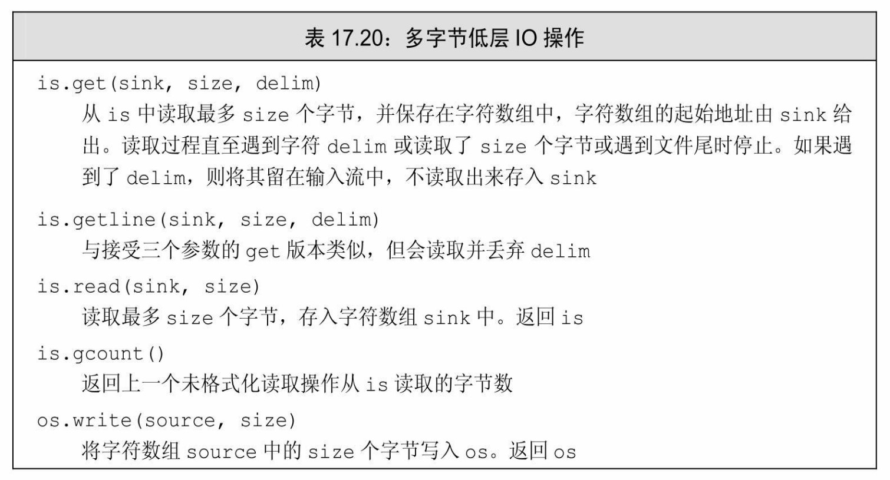
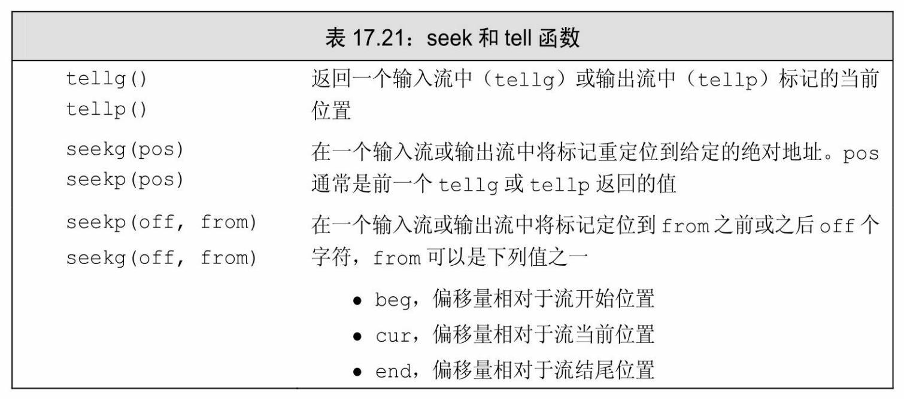

[总目录](<../目录.md>) · [本章目录](<01 章节导读.md>) · [上一篇](<../第17章 标准库特殊设施/17.4 随机数.md>) · [下一篇](<../第17章 标准库特殊设施/小结.md>)

> 原 PDF 第 1086–1106 页。

<!-- PDF 第 1086 页 -->

# **17.5 IO**库再探

在第8章中我们介绍了IO库的基本结构及其最常用的部分。在本节中,我们将介绍三个更特殊的IO库特性:格式控制、未格式化IO和随机访问。

## **17.5.1** 格式化输入与输出

除了条件状态外(参见8.1.2节,第279页),每个iostream对象还维护一个格式状态来控制IO如何格式化的细节。格式状态控制格式化的某些方面,如整型值是几进制、浮点值的精度、一个输出元素的宽度等。

标准库定义了一组操纵符(manipulator)(参见1.2节,第6页)来修改流的格式状态,如表17.7和表17.8所示。一个操纵符是一个函数或是一个对象,会影响流的状态,并能用作输入或输出运算符的运算对象。类似输入和输出运算符,操纵符也返回它所处理的流对象,因此我们可以在一条语句中组合操纵符和数据。

我们已经在程序中使用过一个操纵符——endl,我们将它"写"到输出流,就像它是一个值一样。但endl不是一个普通值,而是一个操作: 它输出一个换行符并刷新缓冲区。

### 很多操纵符改变格式状态

操纵符用于两大类输出控制:控制数值的输出形式以及控制补白的数量和位置。大多数改变格式状态的操纵符都是设置/复原成对的;一个操纵符用来将格式状态设置为一个新值,而另一个用来将其复原,恢复为正常的默认格式。


当操纵符改变流的格式状态时,通常改变后的状态对所有后续IO都生效。

当我们有一组IO操作希望使用相同的格式时,操纵符对格式状态的改变是持久的这一特性很有用。实际上,一些程序会利用操纵符的这一

<!-- PDF 第 1087 页 -->

特性对其所有输入或输出重置一个或多个格式规则的行为。在这种情况下,操纵符会改变流这一特性就是满足要求的了。

但是,很多程序(而且更重要的是,很多程序员)期望流的状态符合标准库正常的默认设置。在这些情况下,将流的状态置于一个非标准状态可能会导致错误。因此,通常最好在不再需要特殊格式时尽快将流恢复到默认状态。

### 控制布尔值的格式

操纵符改变对象的格式状态的一个例子是boolalpha操纵符。默认情况下,bool值打印为1或0。一个true值输出为整数1,而false输出为0。 我们可以通过对流使用boolalpha操纵符来覆盖这种格式:

<!-- 代码原图: ../images/_page_1086_Picture_143.png -->
```c++
cout << "default bool values: " << true << " " << false
<< "\nalpha bool values: " << boolalpha
<< true << " " << false << endl;
```

执行这段程序会得到下面的结果:

### **default bool values: 1 0**

#### **alpha bool values: true false**

一旦向cout"写入"了boolalpha,我们就改变了cout打印bool值的方式。后续打印bool值的操作都会打印true或false而非1或0。

为了取消cout格式状态的改变,我们使用noboolalpha:

<!-- 代码原图: ../images/_page_1086_Picture_144.png -->
```c++
bool bool_val = get_status();
cout << boolalpha     // 设置 cout 的内部状态
<< bool_val
<< noboolalpha;     // 将内部状态恢复为默认格式
```

本例中我们改变了bool值的格式,但只对bool\_val的输出有效。一旦完成此值的打印,我们立即将流恢复到初始状态。

### 指定整型值的进制

默认情况下,整型值的输入输出使用十进制。我们可以使用操纵符 hex、oct和dec将其改为十六进制、八进制或是改回十进制:

<!-- PDF 第 1088 页 -->

<!-- 代码原图: ../images/_page_1087_Picture_114.png -->
```c++
cout << "default: " << 20 << " " << 1024 << endl;
cout << "octal: " << oct << 20 << " " << 1024 << endl;
cout << "hex: " << hex << 20 << " " << 1024 << endl;
cout << "dec: " << dec << 20 << " " << 1024 << endl;
```

当编译并执行这段程序时,会得到如下输出:

**default: 20 1024**

**octal: 24 2000**

**hex: 14 400**

**decimal: 20 1024**

注意,类似boolalpha,这些操纵符也会改变格式状态。它们会影响下一个和随后所有的整型输出,直至另一个操纵符又改变了格式为止。


操纵符hex、oct和dec只影响整型运算对象,浮点值的表示形式不受影响。

在输出中指出进制

默认情况下,当我们打印出数值时,没有可见的线索指出使用的是几进制。例如,20是十进制的20还是16的八进制表示?当我们按十进制打印数值时,打印结果会符合我们的期望。如果需要打印八进制值或十六进制值,应该使用showbase操纵符。当对流应用showbase操纵符时, 会在输出结果中显示进制,它遵循与整型常量中指定进制相同的规范:

· 前导0x表示十六进制。 · 前导0表示八进制。 · 无前导字符串表示十进制。

我们可以使用showbase修改前一个程序:

<!-- PDF 第 1089 页 -->

<!-- 代码原图: ../images/_page_1088_Picture_122.png -->
```c++
cout << showbase; // 当打印整型值时显示进制
cout << "default: " << 20 << " " << 1024 << endl;
cout << "in octal: " << oct << 20 << " " << 1024 << endl;
cout << "in hex: " << hex << 20 << " " << 1024 << endl;
cout << "in decimal: " << dec << 20 << " " << 1024 << endl;
cout << noshowbase; // 恢复流状态
```

修改后的程序的输出会更清楚地表明底层值到底是什么:

**default: 20 1024**

**in octal: 024 02000**

**in hex: 0x14 0x400**

**in decimal: 20 1024**

操纵符noshowbase恢复cout的状态,从而不再显示整型值的进制。

默认情况下,十六进制值会以小写打印,前导字符也是小写的x。 我们可以通过使用uppercase操纵符来输出大写的X并将十六进制数字a-f 以大写输出:

<!-- 代码原图: ../images/_page_1088_Picture_123.png -->
```c++
cout << uppercase << showbase << hex
<< "printed in hexadecimal: " << 20 << " " << 1024
<< nouppercase << noshowbase << dec << endl;
```

这条语句生成如下输出:

**printed in hexadecimal: 0X14 0X400**

我们使用了操纵符nouppercase、noshowbase和dec来重置流的状态。

控制浮点数格式

我们可以控制浮点数输出三个种格式:

· 以多高精度(多少个数字)打印浮点值 · 数值是打印为十六进制、定点十进制还是科学记数法形式 · 对于没有小数部分的浮点值是否打印小数点

<!-- PDF 第 1090 页 -->

默认情况下,浮点值按六位数字精度打印;如果浮点值没有小数部分,则不打印小数点;根据浮点数的值选择打印成定点十进制或科学记数法形式。标准库会选择一种可读性更好的格式:非常大和非常小的值打印为科学记数法形式,其他值打印为定点十进制形式。

#### 指定打印精度

默认情况下,精度会控制打印的数字的总数。当打印时,浮点值按当前精度舍入而非截断。因此,如果当前精度为四位数字,则3.14159 将打印为3.142;如果精度为三位数字,则打印为3.14。

我们可以通过调用IO对象的precision成员或使用setprecision操纵符来改变精度。precision成员是重载的(参见6.4节,第206页)。一个版本接受一个int值,将精度设置为此值,并返回旧精度值。另一个版本不接受参数,返回当前精度值。setprecision操纵符接受一个参数,用来设置精度。


操纵符setprecision和其他接受参数的操纵符都定义在头文件iomanip中。

下面的程序展示了控制浮点值打印精度的不同方法:

<!-- 代码原图: ../images/_page_1089_Picture_98.png -->
```c++
// cout.precision 返回当前精度值
cout << "Precision: " << cout.precision()
    << ", Value: " << sqrt(2.0) << endl;
// cout.precision(12)将打印精度设置为12位数字
cout.precision(12);
cout << "Precision: " << cout.precision()
    << ", Value: " << sqrt(2.0) << endl;
// 另一种设置精度的方法是使用 setprecision 操纵符
cout << setprecision(3);
cout << "Precision: " << cout.precision()
    << ", Value: " << sqrt(2.0) << endl;
```

编译并执行这段程序,会得到如下输出:

**Precision: 6,Value: 1.41421**

**Precision: 12,Value: 1.41421356237**

<!-- PDF 第 1091 页 -->

#### **Precision: 3,Value: 1.41**

此程序调用标准库sqrt函数,它定义在头文件cmath中。sqrt函数是重载的,不同版本分别接受一个float、double或long double参数,返回实参的平方根。



续表

<!-- PDF 第 1092 页 -->



指定浮点数记数法


除非你需要控制浮点数的表示形式(如,按列打印数据或打印表示金额或百分比的数据),否则由标准库选择记数法是最好的方式。

通过使用恰当的操纵符,我们可以强制一个流使用科学记数法、定点十进制或是十六进制记数法。操纵符scientific改变流的状态来使用科学记数法。操纵符fixed改变流的状态来使用定点十进制。



在新标准库中,通过使用hexfloat也可以强制浮点数使用十六进制

<!-- PDF 第 1093 页 -->

格式。新标准库还提供另一个名为defaultfloat的操纵符,它将流恢复到默认状态——根据要打印的值选择记数法。

这些操纵符也会改变流的精度的默认含义。在执行scientific、fixed 或hexfloat后,精度值控制的是小数点后面的数字位数,而默认情况下精度值指定的是数字的总位数——既包括小数点之后的数字也包括小数点之前的数字。使用fixed或scientific令我们可以按列打印数值,因为小数点距小数部分的距离是固定的:

<!-- 代码原图: ../images/_page_1092_Picture_105.png -->
```c++
cout << "default format: " << 100 * sqrt(2.0) << '\n'
<< "scientific: " << scientific << 100 * sqrt(2.0) << '\n'
<< "fixed decimal: " << fixed << 100 * sqrt(2.0) << '\n'
<< "hexadecimal: " << hexfloat << 100 * sqrt(2.0) << '\n'
<< "use defaults: " << defaultfloat << 100 * sqrt(2.0)
```

<!-- 代码原图: ../images/_page_1092_Picture_106.png -->
```c++
<< "\n\n";
```

此程序会生成下面的输出:

**default format: 141.421**

**scientific: 1.414214e+002**

**fixed decimal: 141.421356**

**hexadecimal: 0x1.1ad7bcp+7**

**use defaults: 141.421**

默认情况下,十六进制数字和科学记数法中的e都打印成小写形式。我们可以用uppercase操纵符打印这些字母的大写形式。

#### 打印小数点

默认情况下,当一个浮点值的小数部分为0时,不显示小数点。 showpoint操纵符强制打印小数点:

<!-- 代码原图: ../images/_page_1092_Picture_107.png -->
```c++
cout << 10.0 << endl; // 打印10
cout << showpoint << 10.0 // 打印10.0000
<< noshowpoint << endl; // 恢复小数点的默认格式
```

<!-- PDF 第 1094 页 -->

操纵符noshowpoint恢复默认行为。下一个输出表达式将有默认行为,即,当浮点值的小数部分为0时不输出小数点。

#### 输出补白

当按列打印数据时,我们常常需要非常精细地控制数据格式。标准库提供了一些操纵符帮助我们完成所需的控制:

· setw指定下一个数字或字符串值的最小空间。 · left表示左对齐输出。 · right表示右对齐输出,右对齐是默认格式。 · internal控制负数的符号的位置,它左对齐符号,右对齐值,用空格填满所有中间空间。 · setfill允许指定一个字符代替默认的空格来补白输出。


setw类似endl,不改变输出流的内部状态。它只决定下一个输出的大小。

下面程序展示了如何使用这些操纵符:

<!-- 代码原图: ../images/_page_1093_Picture_70.png -->
```c++
int i = -16;
double d = 3.14159;
// 补白第一列，使用输出中最小12个位置
cout << "i: " << setw(12) << i << "next col" << '\n'
    << "d: " << setw(12) << d << "next col" << '\n';
// 补白第一列，左对齐所有列
cout << left
    << "i: " << setw(12) << i << "next col" << '\n'
    << "d: " << setw(12) << d << "next col" << '\n'
    << right; // 恢复正常对齐
// 补白第一列，右对齐所有列
cout << right
    << "i: " << setw(12) << i << "next col" << '\n'
```

<!-- PDF 第 1095 页 -->

<!-- 代码原图: ../images/_page_1094_Picture_19.png -->
```c++
<< "d: " << setw(12) << d << "next col" << '\n';
// 补白第一列，但补在域的内部
cout << internal
<< "i: " << setw(12) << i << "next col" << '\n'
<< "d: " << setw(12) << d << "next col" << '\n';
// 补白第一列，用#作为补白字符
cout << setfill('#')
<< "i: " << setw(12) << i << "next col" << '\n'
<< "d: " << setw(12) << d << "next col" << '\n'
<< setfill(' '); // 恢复正常的补白字符
```

执行这段程序,会得到下面的输出:





#### 控制输入格式

默认情况下,输入运算符会忽略空白符(空格符、制表符、换行符、换纸符和回车符)。下面的循环

<!-- 代码原图: ../images/_page_1094_Picture_22.png -->
```c++
char ch;
while (cin >> ch)
    cout << ch;
```

<!-- PDF 第 1096 页 -->

当给定下面输入序列时



循环会执行4次,读取字符a到d,跳过中间的空格以及可能的制表符和换行符。此程序的输出是


操纵符noskipws会令输入运算符读取空白符,而不是跳过它们。为了恢复默认行为,我们可以使用skipws操纵符:

<!-- 代码原图: ../images/_page_1095_Picture_90.png -->
```c++
cin >> noskipws; // 设置 cin 读取空白符
while (cin >> ch)
    cout << ch;
```

<!-- 代码原图: ../images/_page_1095_Picture_91.png -->
```c++
cin >> skipws; // 将 cin 恢复到默认状态，从而丢弃空白符
```

给定与前一个程序相同的输入,此循环会执行7次,从输入中既读取普通字符又读取空白符。此循环的输出为



### **17.5.1**节练习

练习**17.34**:编写一个程序,展示如何使用表17.17和表17.18中的每个操纵符。

练习**17.35**:修改第670页中的程序,打印2的平方根,但这次打印十六进制数字的大写形式。

练习**17.36**:修改上一题中的程序,打印不同的浮点数,使它们排成一列。

## **17.5.2** 未格式化的输入**/**输出操作

<!-- PDF 第 1097 页 -->

到目前为止,我们的程序只使用过格式化**IO**(formatted IO)操作。输入和输出运算符(<<和>>)根据读取或写入的数据类型来格式化它们。输入运算符忽略空白符,输出运算符应用补白、精度等规则。

标准库还提供了一组低层操作,支持未格式化**IO**(unformatted IO)。这些操作允许我们将一个流当作一个无解释的字节序列来处理。 单字节操作

有几个未格式化操作每次一个字节地处理流。这些操作列在表 17.19中,它们会读取而不是忽略空白符。例如,我们可以使用未格式化IO操作get和put来读取和写入一个字符:

<!-- 代码原图: ../images/_page_1096_Picture_93.png -->
```c++
char ch;
while (cin.get(ch))
    cout.put(ch);
```

此程序保留输入中的空白符,其输出与输入完全相同。它的执行过程与前一个使用noskipws的程序完全相同。



将字符放回输入流

有时我们需要读取一个字符才能知道还未准备好处理它。在这种情况下,我们希望将字符放回流中。标准库提供了三种方法退回字符,它们有着细微的差别:

· peek返回输入流中下一个字符的副本,但不会将它从流中删除, peek返回的值仍然留在流中。

· unget使得输入流向后移动,从而最后读取的值又回到流中。即使

<!-- PDF 第 1098 页 -->

我们不知道最后从流中读取什么值,仍然可以调用unget。

· putback是更特殊版本的unget:它退回从流中读取的最后一个值, 但它接受一个参数,此参数必须与最后读取的值相同。

一般情况下,在读取下一个值之前,标准库保证我们可以退回最多一个值。即,标准库不保证在中间不进行读取操作的情况下能连续调用 putback或unget。

## 从输入操作返回的**int**值

函数peek和无参的get版本都以int类型从输入流返回一个字符。这有些令人吃惊,可能这些函数返回一个char看起来会更自然。

这些函数返回一个int的原因是:可以返回文件尾标记。我们使用 char范围中的每个值来表示一个真实字符,因此,取值范围中没有额外的值可以用来表示文件尾。

返回int的函数将它们要返回的字符先转换为unsigned char,然后再将结果提升到int。因此,即使字符集中有字符映射到负值,这些操作返回的int也是正值(参见2.1.2节,第32页)。而标准库使用负值表示文件尾,这样就可以保证与任何合法字符的值都不同。头文件cstdio定义了一个名为EOF的const,我们可以用它来检测从get返回的值是否是文件尾,而不必记忆表示文件尾的实际数值。对我们来说重要的是,用一个 int来保存从这些函数返回的值:

<!-- 代码原图: ../images/_page_1097_Picture_146.png -->
```c++
int ch; // 使用一个 int，而不是一个 char 来保存 get()的返回值
// 循环读取并输出输入中的所有数据
while ((ch = cin.get()) != EOF)
    cout.put(ch);
```

此程序与第673页中的程序完成相同的工作,唯一的不同是用来读取输入的get版本不同。

### 多字节操作

一些未格式化IO操作一次处理大块数据。如果速度是要考虑的重点问题的话,这些操作是很重要的,但类似其他低层操作,这些操作也容易出错。特别是,这些操作要求我们自己分配并管理用来保存和提取数据的字符数组(参见12.2节,第423页)。表17.20列出了多字节操作。

<!-- PDF 第 1099 页 -->



#### 续表


get和getline函数接受相同的参数,它们的行为类似但不相同。在两个函数中,sink都是一个char数组,用来保存数据。两个函数都一直读取数据,直至下面条件之一发生:

· 已读取了size-1个字符 · 遇到了文件尾 · 遇到了分隔符

两个函数的差别是处理分隔符的方式:get将分隔符留作istream中的下一个字符,而getline则读取并丢弃分隔符。无论哪个函数都不会将分隔符保存在sink中。


一个常见的错误是本想从流中删除分隔符,但却忘了做。

确定读取了多少个字符

<!-- PDF 第 1100 页 -->

某些操作从输入读取未知个数的字节。我们可以调用gcount来确定最后一个未格式化输入操作读取了多少个字符。应该在任何后续未格式化输入操作之前调用gcount。特别是,将字符退回流的单字符操作也属于未格式化输入操作。如果在调用gcount之前调用了peek、unget或 putback,则gcount的返回值为0。

### 小心:低层函数容易出错

一般情况下,我们主张使用标准库提供的高层抽象。返回int的IO操作很好地解释了原因。

一个常见的编程错误是将get或peek的返回值赋予一个char而不是一个int。这样做是错误的,但编译器却不能发现这个错误。最终会发生什么依赖于程序运行于哪台机器以及输入数据是什么。例如,在一台char被实现为unsigned char的机器上,下面的循环永远不会停止:

<!-- 代码原图: ../images/_page_1099_Picture_170.png -->
```c++
char ch; // 此处使用 char 就是引入灾难！
// 从 cin.get 返回的值被转换为 char，然后与一个 int 比较
while ((ch = cin.get()) != EOF)
    cout.put(ch);
```

问题出在当get返回EOF时,此值会被转换为一个unsigned char。转换得到的值与 EOF的int值不再相等,因此循环永远也不会停止。这种错误很可能在调试时发现。

在一台char被实现为signed char的机器上,我们不能确定循环的行为。当一个越界的值被赋予一个signed变量时会发生什么完全取决于编译器。在很多机器上,这个循环可以正常工作,除非输入序列中有一个字符与EOF值匹配。虽然在普通数据中这种字符不太可能出现,但低层IO通常用于读取二进制值的场合,而这些二进制值不能直接映射到普通字符和数值。例如,在我们的机器上,如果输入中包含有一个值为'\377'的字符,则循环会提前终止。因为在我们的机器上,将-1转换为一个signed char,就会得到'\377'。如果输入中有这个值,则它会被(过早)当作文件尾指示符。

当我们读写有类型的值时,这种错误就不会发生。如果你可以使用标准库提供的类型更加安全、更高层的操作,就应该使用它们。

### **17.5.2**节练习

练习**17.37**:用未格式化版本的getline逐行读取一个文件。测试你的程序,给它一个文件,既包含空行又包含长度超过你传递给getline的字符数组大小的行。

练习**17.38**:扩展上一题中你的程序,将读入的每个单词打印到它所在的行。

<!-- PDF 第 1101 页 -->

## **17.5.3** 流随机访问

各种流类型通常都支持对流中数据的随机访问。我们可以重定位流,使之跳过一些数据,首先读取最后一行,然后读取第一行,依此类推。标准库提供了一对函数,来定位(seek)到流中给定的位置,以及告诉(tell)我们当前位置。


随机IO本质上是依赖于系统的。为了理解如何使用这些特性,你必须查询系统文档。

虽然标准库为所有流类型都定义了seek和tell函数,但它们是否会做有意义的事情依赖于流绑定到哪个设备。在大多数系统中,绑定到 cin、cout、cerr和clog的流不支持随机访问——毕竟,当我们向cout直接输出数据时,类似向回跳十个位置这种操作是没有意义的。对这些流我们可以调用seek和tell函数,但在运行时会出错,将流置于一个无效状态。


由于istream和ostream类型通常不支持随机访问,所以本节剩余内容只适用于 fstream和sstream类型。

### **seek**和**tell**函数

为了支持随机访问,IO类型维护一个标记来确定下一个读写操作要在哪里进行。它们还提供了两个函数:一个函数通过将标记seek到一个给定位置来重定位它;另一个函数tell我们标记的当前位置。标准库实际上定义了两对seek和tell函数,如表17.21所示。一对用于输入流,另一对用于输出流。输入和输出版本的差别在于名字的后缀是g还是p。g 版本表示我们正在"获得"(读取)数据,而p版本表示我们正在"放置"(写入)数据。

<!-- PDF 第 1102 页 -->



从逻辑上讲,我们只能对istream和派生自istream的类型ifstream和 istringstream(参见8.1节,第278页)使用g版本,同样只能对ostream和派生自ostream的类型ofstream和ostringstream使用p版本。一个iostream、 fstream或stringstream既能读又能写关联的流,因此对这些类型的对象既能使用g版本又能使用p版本。

### 只有一个标记

标准库区分seek和tell函数的"放置"和"获得"版本这一特性可能会导致误解。即使标准库进行了区分,但它在一个流中只维护单一的标记 ——并不存在独立的读标记和写标记。

当我们处理一个只读或只写的流时,两种版本的区别甚至是不明显的。我们可以对这些流只使用g或只使用p版本。如果我们试图对一个 ifstream流调用tellp,编译器会报告错误。类似的,编译器也不允许我们对一个ostringstream调用seekg。

fstream和stringstream类型可以读写同一个流。在这些类型中,有单一的缓冲区用于保存读写的数据,同样,标记也只有一个,表示缓冲区中的当前位置。标准库将g和p版本的读写位置都映射到这个单一的标记。


由于只有单一的标记,因此只要我们在读写操作间切换,就必须进行seek操作来重定位标记。

<!-- PDF 第 1103 页 -->

重定位标记

seek函数有两个版本:一个移动到文件中的"绝对"地址;另一个移动到一个给定位置的指定偏移量:

<!-- 代码原图: ../images/_page_1102_Picture_91.png -->
```c++
// 将标记移动到一个固定位置
seekg(new_position); // 将读标记移动到指定的 pos_type 类型的位置
seekp(new_position); // 将写标记移动到指定的 pos_type 类型的位置

// 移动到给定起始点之前或之后指定的偏移位置
seekg(offset, from); // 将读标记移动到距 from 偏移量为 offset 的位置
seekp(offset, from); // 将写标记移动到距 from 偏移量为 offset 的位置
```

from的可能值如表17.21所示。

参数new\_position和offset的类型分别是pos\_type和off\_type,这两个类型都是机器相关的,它们定义在头文件istream和ostream中。pos\_type 表示一个文件位置,而off\_type表示距当前位置的一个偏移量。一个 off\_type类型的值可以是正的也可以是负的,即,我们可以在文件中向前移动或向后移动。

#### 访问标记

函数tellg和tellp返回一个pos\_type值,表示流的当前位置。tell函数通常用来记住一个位置,以便稍后再定位回来:

<!-- 代码原图: ../images/_page_1102_Picture_92.png -->
```c++
// 记住当前写位置
ostringstream writeStr; // 输出 stringstream
ostringstream::pos_type mark = writeStr.tellp();
// ...
if (cancelEntry)
    // 回到刚才记住的位置
    writeStr.seekp(mark);
```

#### 读写同一个文件

我们来考察一个编程实例。假定已经给定了一个要读取的文件,我们要在此文件的末尾写入新的一行,这一行包含文件中每行的相对起始位置。例如,给定下面文件:

<!-- PDF 第 1104 页 -->

**abcd**

**efg**

**hi**

**j**

程序应该生成如下修改过的文件:

**abcd**

**efg**

**hi**

**j**

#### **5 9 12 14**

注意,我们的程序不必输出第一行的偏移——它总是从位置0开始。还要注意,统计偏移量时必须包含每行末尾不可见的换行符。最后,注意输出的最后一个数是我们的输出开始那行的偏移量。在输出中包含了这些偏移量后,我们的输出就与文件的原始内容区分开来了。我们可以读取结果文件中最后一个数,定位到对应偏移量,即可得到我们的输出的起始地址。

我们的程序将逐行读取文件。对每一行,我们将递增计数器,将刚刚读取的一行的长度加到计数器上,则此计数器即为下一行的起始地址:

<!-- PDF 第 1105 页 -->

<!-- 代码原图: ../images/_page_1104_Picture_34.png -->
```c++
int main()
{
    // 以读写方式打开文件，并定位到文件尾
    // 文件模式参数参见 8.2.2 节（第 286 页）
    fstream inOut("copyOut",
                    fstream::ate | fstream::in | fstream::out);
    if (!inOut) {
        cerr << "Unable to open file!" << endl;
        return EXIT_FAILURE; // EXIT_FAILURE 参见 6.3.2 节（第 204 页）
    }
    // inOut 以 ate 模式打开，因此一开始就定义到其文件尾
    auto end_mark = inOut.tellg();    // 记住原文件尾位置
    inOut.seekg(0, fstream::beg);    // 重定位到文件开始
    size_t cnt = 0;                    // 字节数累加器
    string line;                      // 保存输入中的每行
    // 继续读取的条件：还未遇到错误且还在读取原数据
    while (inOut && inOut.tellg() != end_mark
            && getline(inOut, line)) {    // 且还可获取一行输入
        cnt += line.size() + 1;          // 加 1 表示换行符
        auto mark = inOut.tellg();        // 记住读取位置
        inOut.seekp(0, fstream::end);      // 将写标记移动到文件尾
        inOut << cnt;                    // 输出累计的长度
        // 如果不是最后一行，打印一个分隔符
        if (mark != end_mark) inOut << " ";
        inOut.seekg(mark);              // 恢复读位置
    }
    inOut.seekp(0, fstream::end);        // 定位到文件尾
}
```

<!-- 代码原图: ../images/_page_1104_Picture_35.png -->
```c++
    inOut << "\n";                        // 在文件尾输出一个换行符
    return 0;
}
```

我们的程序用in、out和ate模式(参见8.2.2节,第286页)打开 fstream。前两个模式指出我们想读写同一个文件。指定ate会将读写标记定位到文件尾。与往常一样,我们检查文件是否成功打开,如果失败就退出(参见6.3.2节,第203页)。

由于我们的程序向输入文件写入数据,因此不能通过文件尾来判断

<!-- PDF 第 1106 页 -->

是否停止读取,而是应该在达到原数据的末尾时停止。因此,我们必须首先记住原文件尾的位置。由于我们是以ate模式打开文件的,因此 inOut已经定位到文件尾了。我们将当前位置(即,原文件尾)保存在 end\_mark中。记住文件尾位置之后,我们seek到距文件起始位置偏移量为0的地方,即,将读标记重定位到文件起始位置。

while循环的条件由三部分组成:首先检查流是否合法;如果合法,通过比较当前读位置(由tellg返回)和记录在end\_mark中的位置来检查是否读完了原数据;最后,假定前两个检查都已成功,我们调用 getline读取输入的下一行,如果getline成功,则执行while循环体。

循环体首先将当前位置记录在mark中。我们保存当前位置是为了在输出下一个偏移量后再退回来。接下来调用seekp将写标记重定位到文件尾。我们输出计数器的值,然后调用seekg回到记录在mark中的位置。回退到原位置后,我们就准备好继续检查循环条件了。

每步循环都会输出下一行的偏移量。因此,最后一步循环负责输出最后一行的偏移量。但是,我们还需要在文件尾输出一个换行符。与其他写操作一样,在输出换行符之前我们调用seekp来定位到文件尾。

### **17.5.3**节练习

练习**17.39**:对本节给出的seek程序,编写你自己的版本。


