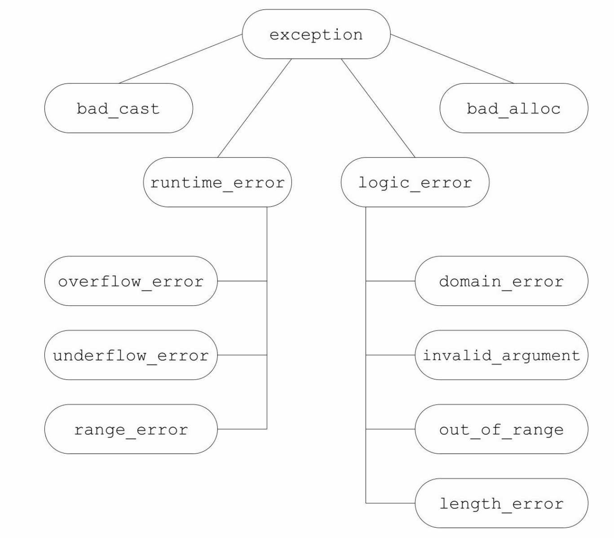

[总目录](<../目录.md>) · [本章目录](<01 章节导读.md>) · [上一篇](<../第18章 用于大型程序的工具/01 章节导读.md>) · [下一篇](<../第18章 用于大型程序的工具/18.2 命名空间.md>)

> 原 PDF 第 1112–1129 页。

<!-- PDF 第 1112 页 -->

# **18.1** 异常处理

异常处理(exception handling)机制允许程序中独立开发的部分能够在运行时就出现的问题进行通信并做出相应的处理。异常使得我们能够将问题的检测与解决过程分离开来。程序的一部分负责检测问题的出现,然后解决该问题的任务传递给程序的另一部分。检测环节无须知道问题处理模块的所有细节,反之亦然。

在5.6节(第173页)我们曾介绍过一些有关异常处理的基本概念和机理,本节将继续扩展这些知识。对于程序员来说,要想有效地使用异常处理,必须首先了解当抛出异常时发生了什么,捕获异常时发生了什么,以及用来传递错误的对象的意义。

## **18.1.1** 抛出异常

在C++语言中,我们通过抛出(throwing)一条表达式来引发 (raised)一个异常。被抛出的表达式的类型以及当前的调用链共同决定了哪段处理代码(handler)将被用来处理该异常。被选中的处理代码是在调用链中与抛出对象类型匹配的最近的处理代码。其中,根据抛出对象的类型和内容,程序的异常抛出部分将会告知异常处理部分到底发生了什么错误。

当执行一个throw时,跟在throw后面的语句将不再被执行。相反, 程序的控制权从throw转移到与之匹配的catch模块。该catch可能是同一个函数中的局部catch,也可能位于直接或间接调用了发生异常的函数的另一个函数中。控制权从一处转移到另一处,这有两个重要的含义:

· 沿着调用链的函数可能会提早退出。 · 一旦程序开始执行异常处理代码,则沿着调用链创建的对象将被销毁。

因为跟在throw后面的语句将不再被执行,所以throw语句的用法有点类似于return语句:它通常作为条件语句的一部分或者作为某个函数

<!-- PDF 第 1113 页 -->

的最后(或者唯一)一条语句。

#### 栈展开

当抛出一个异常后,程序暂停当前函数的执行过程并立即开始寻找与异常匹配的catch子句。当throw出现在一个**try**语句块(try block)内时,检查与该try块关联的catch子句。如果找到了匹配的catch,就使用该catch处理异常。如果这一步没找到匹配的catch且该try语句嵌套在其他try块中,则继续检查与外层try匹配的catch子句。如果还是找不到匹配的catch,则退出当前的函数,在调用当前函数的外层函数中继续寻找。

如果对抛出异常的函数的调用语句位于一个try语句块内,则检查与该try块关联的catch子句。如果找到了匹配的catch,就使用该catch处理异常。否则,如果该try语句嵌套在其他try块中,则继续检查与外层try 匹配的catch子句。如果仍然没有找到匹配的catch,则退出当前这个主调函数,继续在调用了刚刚退出的这个函数的其他函数中寻找,以此类推。

上述过程被称为栈展开(stack unwinding)过程。栈展开过程沿着嵌套函数的调用链不断查找,直到找到了与异常匹配的catch子句为止; 或者也可能一直没找到匹配的catch,则退出主函数后查找过程终止。

假设找到了一个匹配的catch子句,则程序进入该子句并执行其中的代码。当执行完这个catch子句后,找到与try块关联的最后一个catch子句之后的点,并从这里继续执行。

如果没找到匹配的catch子句,程序将退出。因为异常通常被认为是妨碍程序正常执行的事件,所以一旦引发了某个异常,就不能对它置之不理。当找不到匹配的catch时,程序将调用标准库函数**terminate**,顾名思义,terminate负责终止程序的执行过程。


一个异常如果没有被捕获,则它将终止当前的程序。

栈展开过程中对象被自动销毁

在栈展开过程中,位于调用链上的语句块可能会提前退出。通常情况下,程序在这些块中创建了一些局部对象。我们已经知道,块退出后

<!-- PDF 第 1114 页 -->

它的局部对象也将随之销毁,这条规则对于栈展开过程同样适用。如果在栈展开过程中退出了某个块,编译器将负责确保在这个块中创建的对象能被正确地销毁。如果某个局部对象的类型是类类型,则该对象的析构函数将被自动调用。与往常一样,编译器在销毁内置类型的对象时不需要做任何事情。

如果异常发生在构造函数中,则当前的对象可能只构造了一部分。 有的成员已经初始化了,而另外一些成员在异常发生前也许还没有初始化。即使某个对象只构造了一部分,我们也要确保已构造的成员能被正确地销毁。

类似的,异常也可能发生在数组或标准库容器的元素初始化过程中。与之前类似,如果在异常发生前已经构造了一部分元素,则我们应该确保这部分元素被正确地销毁。

### 析构函数与异常

析构函数总是会被执行的,但是函数中负责释放资源的代码却可能被跳过,这一特点对于我们如何组织程序结构有重要影响。如我们在 12.1.4节(第415页)介绍过的,如果一个块分配了资源,并且在负责释放这些资源的代码前面发生了异常,则释放资源的代码将不会被执行。 另一方面,类对象分配的资源将由类的析构函数负责释放。因此,如果我们使用类来控制资源的分配,就能确保无论函数正常结束还是遭遇异常,资源都能被正确地释放。

析构函数在栈展开的过程中执行,这一事实影响着我们编写析构函数的方式。在栈展开的过程中,已经引发了异常但是我们还没有处理它。如果异常抛出后没有被正确捕获,则系统将调用terminate函数。因此,出于栈展开可能使用析构函数的考虑,析构函数不应该抛出不能被它自身处理的异常。换句话说,如果析构函数需要执行某个可能抛出异常的操作,则该操作应该被放置在一个try语句块当中,并且在析构函数内部得到处理。

在实际的编程过程中,因为析构函数仅仅是释放资源,所以它不太可能抛出异常。所有标准库类型都能确保它们的析构函数不会引发异常。


<!-- PDF 第 1115 页 -->

在栈展开的过程中,运行类类型的局部对象的析构函数。因为这些析构函数是自动执行的,所以它们不应该抛出异常。一旦在栈展开的过程中析构函数抛出了异常, 并且析构函数自身没能捕获到该异常,则程序将被终止。

#### 异常对象

异常对象(exception object)是一种特殊的对象,编译器使用异常抛出表达式来对异常对象进行拷贝初始化(参见13.1.1节,第441页)。 因此,throw语句中的表达式必须拥有完全类型(参见7.3.3节,第250 页)。而且如果该表达式是类类型的话,则相应的类必须含有一个可访问的析构函数和一个可访问的拷贝或移动构造函数。如果该表达式是数组类型或函数类型,则表达式将被转换成与之对应的指针类型。

异常对象位于由编译器管理的空间中,编译器确保无论最终调用的是哪个catch子句都能访问该空间。当异常处理完毕后,异常对象被销毁。

如我们所知,当一个异常被抛出时,沿着调用链的块将依次退出直至找到与异常匹配的处理代码。如果退出了某个块,则同时释放块中局部对象使用的内存。因此,抛出一个指向局部对象的指针几乎肯定是一种错误的行为。出于同样的原因,从函数中返回指向局部对象的指针也是错误的(参见6.3.2节,第202页)。如果指针所指的对象位于某个块中,而该块在catch语句之前就已经退出了,则意味着在执行catch语句之前局部对象已经被销毁了。

当我们抛出一条表达式时,该表达式的静态编译时类型(参见 15.2.3节,第534页)决定了异常对象的类型。读者必须牢记这一点,因为很多情况下程序抛出的表达式类型来自于某个继承体系。如果一条 throw表达式解引用一个基类指针,而该指针实际指向的是派生类对象,则抛出的对象将被切掉一部分(参见15.2.3节,第535页),只有基类部分被抛出。


抛出指针要求在任何对应的处理代码存在的地方,指针所指的对象都必须存在。

#### **18.1.1**节练习

练习**18.1**:在下列throw语句中异常对象的类型是什么?

<!-- PDF 第 1116 页 -->

<!-- 代码原图: ../images/_page_1115_Picture_112.png -->
```c++
(a) range_error r("error");
    throw r;
(b) exception *p = &r;
    throw *p;
```

如果将(b)中的throw语句写成了throw p将发生什么情况?

练习**18.2**:当在指定的位置发生了异常时将出现什么情况?

<!-- 代码原图: ../images/_page_1115_Picture_113.png -->
```c++
void exercise(int *b, int *e)
{
    vector<int> v(b, e);
    int *p = new int[v.size()];
    ifstream in("ints");
    // 此处发生异常
}
```

练习**18.3**:要想让上面的代码在发生异常时能正常工作,有两种解决方案。请描述这两种方法并实现它们。

## **18.1.2** 捕获异常

**catch**子句(catch clause)中的异常声明(exception declaration)看起来像是只包含一个形参的函数形参列表。像在形参列表中一样,如果 catch无须访问抛出的表达式的话,则我们可以忽略捕获形参的名字。

声明的类型决定了处理代码所能捕获的异常类型。这个类型必须是完全类型(参见7.3.3节,第250页),它可以是左值引用,但不能是右值引用(参见13.6.1节,第471页)。

当进入一个catch语句后,通过异常对象初始化异常声明中的参数。 和函数的参数类似,如果catch的参数类型是非引用类型,则该参数是异常对象的一个副本,在catch语句内改变该参数实际上改变的是局部副本而非异常对象本身;相反,如果参数是引用类型,则和其他引用参数一样,该参数是异常对象的一个别名,此时改变参数也就是改变异常对象。

catch的参数还有一个特性也与函数的参数非常类似:如果catch的参数是基类类型,则我们可以使用其派生类类型的异常对象对其进行初始化。此时,如果catch的参数是非引用类型,则异常对象将被切掉一部

<!-- PDF 第 1117 页 -->

分(参见15.2.3节,第535页),这与将派生类对象以值传递的方式传给一个普通函数差不多。另一方面,如果catch的参数是基类的引用,则该参数将以常规方式绑定到异常对象上。

最后一点需要注意的是,异常声明的静态类型将决定catch语句所能执行的操作。如果catch的参数是基类类型,则catch无法使用派生类特有的任何成员。


通常情况下,如果catch接受的异常与某个继承体系有关,则最好将该catch的参数定义成引用类型。

### 查找匹配的处理代码

在搜寻catch语句的过程中,我们最终找到的catch未必是异常的最佳匹配。相反,挑选出来的应该是第一个与异常匹配的catch语句。因此,越是专门的catch越应该置于整个catch列表的前端。

因为catch语句是按照其出现的顺序逐一进行匹配的,所以当程序使用具有继承关系的多个异常时必须对catch语句的顺序进行组织和管理, 使得派生类异常的处理代码出现在基类异常的处理代码之前。

与实参和形参的匹配规则相比,异常和catch异常声明的匹配规则受到更多限制。此时,绝大多数类型转换都不被允许,除了一些极细小的差别之外,要求异常的类型和catch声明的类型是精确匹配的:

· 允许从非常量向常量的类型转换,也就是说,一条非常量对象的 throw语句可以匹配一个接受常量引用的catch语句。

· 允许从派生类向基类的类型转换。

· 数组被转换成指向数组(元素)类型的指针,函数被转换成指向该函数类型的指针。

除此之外,包括标准算术类型转换和类类型转换在内,其他所有转换规则都不能在匹配catch的过程中使用。


如果在多个catch语句的类型之间存在着继承关系,则我们应该把继承链最底端的

<!-- PDF 第 1118 页 -->

类(most derived type)放在前面,而将继承链最顶端的类(least derived type)放在后面。

重新抛出

有时,一个单独的catch语句不能完整地处理某个异常。在执行了某些校正操作之后,当前的catch可能会决定由调用链更上一层的函数接着处理异常。一条catch语句通过重新抛出(rethrowing)的操作将异常传递给另外一个catch语句。这里的重新抛出仍然是一条throw语句,只不过不包含任何表达式:

<!-- 代码原图: ../images/_page_1117_Picture_119.png -->
```c++
throw;
```

空的throw语句只能出现在catch语句或catch语句直接或间接调用的函数之内。如果在处理代码之外的区域遇到了空throw语句,编译器将调用terminate。

一个重新抛出语句并不指定新的表达式,而是将当前的异常对象沿着调用链向上传递。

很多时候,catch语句会改变其参数的内容。如果在改变了参数的内容后catch语句重新抛出异常,则只有当catch异常声明是引用类型时我们对参数所做的改变才会被保留并继续传播:

<!-- 代码原图: ../images/_page_1117_Picture_120.png -->
```c++
catch (my_error &eObj) {             // 引用类型
    eObj.status = errCodes::severeErr;    // 修改了异常对象
    throw;                            // 异常对象的 status 成员是 severeErr
} catch (other_error eObj) {         // 非引用类型
    eObj.status = errCodes::badErr;    // 只修改了异常对象的局部副本
    throw;                            // 异常对象的 status 成员没有改变
}
```

#### 捕获所有异常的处理代码

有时我们希望不论抛出的异常是什么类型,程序都能统一捕获它们。要想捕获所有可能的异常是比较有难度的,毕竟有些情况下我们也不知道异常的类型到底是什么。即使我们知道所有的异常类型,也很难为所有类型提供唯一一个catch语句。为了一次性捕获所有异常,我们使用省略号作为异常声明,这样的处理代码称为捕获所有异常(catch

<!-- PDF 第 1119 页 -->

all)的处理代码,形如catch(...)。一条捕获所有异常的语句可以与任意类型的异常匹配。

catch(...)通常与重新抛出语句一起使用,其中catch执行当前局部能完成的工作,随后重新抛出异常:

<!-- 代码原图: ../images/_page_1118_Picture_89.png -->
```c++
void manip() {
    try {
        // 这里的操作将引发并抛出一个异常
    }
    catch (...) {
        // 处理异常的某些特殊操作
        throw;
    }
}
```

catch(...)既能单独出现,也能与其他几个catch语句一起出现。


如果catch(...)与其他几个catch语句一起出现,则catch(...)必须在最后的位置。出现在捕获所有异常语句后面的catch语句将永远不会被匹配。

#### **18.1.2**节练习

练习**18.4**:查看图18.1(第693页)所示的继承体系,说明下面的try块有何错误并修改它。

<!-- 代码原图: ../images/_page_1118_Picture_91.png -->
```c++
try {
    // 使用 C++标准库
} catch(exception) {
    // ...
} catch(const runtime_error &re) {
    // ...
} catch(overflow_error eobj) { /* ... */ }
```

练习**18.5**:修改下面的main函数,使其能捕获图18.1(第693页)所示的任何异常类型:

<!-- PDF 第 1120 页 -->

<!-- 代码原图: ../images/_page_1119_Picture_94.png -->
```c++
int main() {
    // 使用 C++标准库
}
```

处理代码应该首先打印异常相关的错误信息,然后调用abort(定义在 cstdlib头文件中)终止main函数。

练习**18.6**:已知下面的异常类型和catch语句,书写一个throw表达式使其创建的异常对象能被这些catch语句捕获:

<!-- 代码原图: ../images/_page_1119_Picture_95.png -->
```c++
(a) class exceptionType { };
catch(exceptionType *pet) { }
(b) catch(...) { }
(c) typedef int EXCPTYPE;
catch(EXCPTYPE) { }
```

## **18.1.3** 函数**try**语句块与构造函数

通常情况下,程序执行的任何时刻都可能发生异常,特别是异常可能发生在处理构造函数初始值的过程中。构造函数在进入其函数体之前首先执行初始值列表。因为在初始值列表抛出异常时构造函数体内的try 语句块还未生效,所以构造函数体内的catch语句无法处理构造函数初始值列表抛出的异常。

要想处理构造函数初始值抛出的异常,我们必须将构造函数写成函数**try**语句块(也称为函数测试块,function try block)的形式。函数try 语句块使得一组catch语句既能处理构造函数体(或析构函数体),也能处理构造函数的初始化过程(或析构函数的析构过程)。举个例子,我们可以把Blob的构造函数(参见16.1.2节,第586页)置于一个函数try语句块中:

<!-- 代码原图: ../images/_page_1119_Picture_96.png -->
```c++
template <typename T>
Blob<T>::Blob(std::initializer_list<T> il) try :
```

<!-- 代码原图: ../images/_page_1119_Picture_97.png -->
```c++
data(std::make_shared<std::vector<T>>(il)) {
/* 空函数体*/
} catch(const std::bad_alloc &e) { handle_out_of_memory(e); }
```

<!-- PDF 第 1121 页 -->

注意:关键字try出现在表示构造函数初始值列表的冒号以及表示构造函数体(此例为空)的花括号之前。与这个try关联的catch既能处理构造函数体抛出的异常,也能处理成员初始化列表抛出的异常。

还有一种情况值得读者注意,在初始化构造函数的参数时也可能发生异常,这样的异常不属于函数try语句块的一部分。函数try语句块只能处理构造函数开始执行后发生的异常。和其他函数调用一样,如果在参数初始化的过程中发生了异常,则该异常属于调用表达式的一部分, 并将在调用者所在的上下文中处理。


处理构造函数初始值异常的唯一方法是将构造函数写成函数try语句块。

### **18.1.3**节练习

练习**18.7**:根据第16章的介绍定义你自己的Blob和BlobPtr,注意将构造函数写成函数try语句块。

# **18.1.4 noexcept**异常说明

对于用户及编译器来说,预先知道某个函数不会抛出异常显然大有裨益。首先,知道函数不会抛出异常有助于简化调用该函数的代码;其次,如果编译器确认函数不会抛出异常,它就能执行某些特殊的优化操作,而这些优化操作并不适用于可能出错的代码。


在C++11新标准中,我们可以通过提供**noexcept**说明(noexcept specification)指定某个函数不会抛出异常。其形式是关键字noexcept紧跟在函数的参数列表后面,用以标识该函数不会抛出异常:

<!-- 代码原图: ../images/_page_1120_Picture_129.png -->
```c++
void recoup(int) noexcept; // 不会抛出异常
void alloc(int); // 可能抛出异常
```

这两条声明语句指出recoup将不会抛出任何异常,而alloc可能抛出异常。我们说recoup做了不抛出说明(nonthrowing specification)。

对于一个函数来说,noexcept说明要么出现在该函数的所有声明语

<!-- PDF 第 1122 页 -->

句和定义语句中,要么一次也不出现。该说明应该在函数的尾置返回类型(参见6.3.3节,第206页)之前。我们也可以在函数指针的声明和定义中指定noexcept。在typedef或类型别名中则不能出现noexcept。在成员函数中,noexcept说明符需要跟在const及引用限定符之后,而在 final、override或虚函数的=0之前。

#### 违反异常说明

读者需要清楚的一个事实是编译器并不会在编译时检查noexcept说明。实际上,如果一个函数在说明了noexcept的同时又含有throw语句或者调用了可能抛出异常的其他函数,编译器将顺利编译通过,并不会因为这种违反异常说明的情况而报错(不排除个别编译器会对这种用法提出警告):

<!-- 代码原图: ../images/_page_1121_Picture_122.png -->
```c++
// 尽管该函数明显违反了异常说明，但它仍然可以顺利编译通过
void f() noexcept // 承诺不会抛出异常
{
```

<!-- 代码原图: ../images/_page_1121_Picture_123.png -->
```c++
throw exception();        // 违反了异常说明
}
```

因此可能出现这样一种情况:尽管函数声明了它不会抛出异常,但实际上还是抛出了。一旦一个noexcept函数抛出了异常,程序就会调用 terminate以确保遵守不在运行时抛出异常的承诺。上述过程对是否执行栈展开未作约定,因此noexcept可以用在两种情况下:一是我们确认函数不会抛出异常,二是我们根本不知道该如何处理异常。

指明某个函数不会抛出异常可以令该函数的调用者不必再考虑如何处理异常。无论是函数确实不抛出异常,还是程序被终止,调用者都无须为此负责。


通常情况下,编译器不能也不必在编译时验证异常说明。

#### 向后兼容:异常说明

早期的C++版本设计了一套更加详细的异常说明方案,该方案使得我们可以指定某个函数可能抛出的异常类型。函数可以指定一个关键字throw,在后面跟上括号括起来的异常类型列表。throw说明符所在的位置与新版本C++中noexcept所在的位置相

<!-- PDF 第 1123 页 -->

同。

上述使用throw的异常说明方案在C++11新版本中已经被取消了。然而尽管如此, 它还有一个重要的用处。如果函数被设计为是throw()的,则意味着该函数将不会抛出异常:

<!-- 代码原图: ../images/_page_1122_Picture_128.png -->
```c++
void recoup(int) noexcept; // recoup 不会抛出异常
void recoup(int) throw(); // 等价的声明
```

上面的两条声明语句是等价的,它们都承诺recoup不会抛出异常。

#### 异常说明的实参

noexcept说明符接受一个可选的实参,该实参必须能转换为bool类型:如果实参是true,则函数不会抛出异常;如果实参是false,则函数可能抛出异常:

<!-- 代码原图: ../images/_page_1122_Picture_129.png -->
```c++
void recoup(int) noexcept(true); // recoup 不会抛出异常
void alloc(int) noexcept(false); // alloc 可能抛出异常
```

#### **noexcept**运算符


noexcept说明符的实参常常与**noexcept**运算符(noexcept operator) 混合使用。noexcept运算符是一个一元运算符,它的返回值是一个bool 类型的右值常量表达式,用于表示给定的表达式是否会抛出异常。和 sizeof(参见4.9节,第139页)类似,noexcept也不会求其运算对象的值。

例如,因为我们声明recoup时使用了noexcept说明符,所以下面的表达式的返回值为true:

<!-- 代码原图: ../images/_page_1122_Picture_131.png -->
```c++
noexcept(recoup(i)) // 如果 recoup 不抛出异常则结果为 true；否则结果为 false
```

更普通的形式是:

<!-- 代码原图: ../images/_page_1122_Picture_132.png -->
```c++
noexcept (e)
```

当e调用的所有函数都做了不抛出说明且e本身不含有throw语句时,上述表达式为true;否则noexcept(e)返回false。

<!-- PDF 第 1124 页 -->

我们可以使用noexcept运算符得到如下的异常说明:

<!-- 代码原图: ../images/_page_1123_Picture_78.png -->
```c++
void f() noexcept(noexcept(g()))); // f和g的异常说明一致
```

如果函数g承诺了不会抛出异常,则f也不会抛出异常;如果g没有异常说明符,或者g虽然有异常说明符但是允许抛出异常,则f也可能抛出异常。


noexcept有两层含义:当跟在函数参数列表后面时它是异常说明符;而当作为 noexcept异常说明的bool实参出现时,它是一个运算符。

异常说明与指针、虚函数和拷贝控制

尽管noexcept说明符不属于函数类型的一部分,但是函数的异常说明仍然会影响函数的使用。

函数指针及该指针所指的函数必须具有一致的异常说明。也就是说,如果我们为某个指针做了不抛出异常的声明,则该指针将只能指向不抛出异常的函数。相反,如果我们显式或隐式地说明了指针可能抛出异常,则该指针可以指向任何函数,即使是承诺了不抛出异常的函数也可以:

<!-- 代码原图: ../images/_page_1123_Picture_80.png -->
```c++
// recoup 和 pf1 都承诺不会抛出异常
void (*pf1)(int) noexcept = recoup;
// 正确：recoup 不会抛出异常，pf2 可能抛出异常，二者之间互不干扰
void (*pf2)(int) = recoup;

pf1 = alloc;        // 错误：alloc 可能抛出异常，但是 pf1 已经说明了它不会抛出异常
pf2 = alloc;        // 正确：pf2 和 alloc 都可能抛出异常
```

如果一个虚函数承诺了它不会抛出异常,则后续派生出来的虚函数也必须做出同样的承诺;与之相反,如果基类的虚函数允许抛出异常, 则派生类的对应函数既可以允许抛出异常,也可以不允许抛出异常:

<!-- PDF 第 1125 页 -->

<!-- 代码原图: ../images/_page_1124_Picture_62.png -->
```c++
class Base {
public:
    virtual double f1(double) noexcept;    // 不会抛出异常
    virtual int f2() noexcept(false);     // 可能抛出异常
    virtual void f3();                    // 可能抛出异常
};

class Derived : public Base {
public:
    double f1(double);                // 错误：Base::f1 承诺不会抛出异常
    int f2() noexcept(false);        // 正确：与 Base::f2 的异常说明一致
    void f3() noexcept;              // 正确：Derived 的 f3 做了更严格的限定，
                                        // 这是允许的
};
```

当编译器合成拷贝控制成员时,同时也生成一个异常说明。如果对所有成员和基类的所有操作都承诺了不会抛出异常,则合成的成员是 noexcept的。如果合成成员调用的任意一个函数可能抛出异常,则合成的成员是noexcept(false)。而且,如果我们定义了一个析构函数但是没有为它提供异常说明,则编译器将合成一个。合成的异常说明将与假设由编译器为类合成析构函数时所得的异常说明一致。

#### **18.1.4**节练习

练习**18.8**:回顾你之前编写的各个类,为它们的构造函数和析构函数添加正确的异常说明。如果你认为某个析构函数可能抛出异常,尝试修改代码使得该析构函数不会抛出异常。

## **18.1.5** 异常类层次

标准库异常类(参见5.6.3节,第176页)构成了图18.1所示的继承体系(参见第15章)。

<!-- PDF 第 1126 页 -->



图18.1:标准exception类层次

类型exception仅仅定义了拷贝构造函数、拷贝赋值运算符、一个虚析构函数和一个名为what的虚成员。其中what函数返回一个const char \*,该指针指向一个以unll结尾的字符数组,并且确保不会抛出任何异常。

类exception、bad\_cast和bad\_alloc定义了默认构造函数。类 runtime\_error和logic\_error没有默认构造函数,但是有一个可以接受C风格字符串或者标准库string类型实参的构造函数,这些实参负责提供关于错误的更多信息。在这些类中,what负责返回用于初始化异常对象的信息。因为what是虚函数,所以当我们捕获基类的引用时,对what函数的调用将执行与异常对象动态类型对应的版本。

### 书店应用程序的异常类

实际的应用程序通常会自定义exception(或者exception的标准库派

<!-- PDF 第 1127 页 -->

生类)的派生类以扩展其继承体系。这些面向应用的异常类表示了与应用相关的异常条件。

如果我们构建的是一个真实的书店应用程序,则其中的类将比本书之前所示的复杂得多。复杂性的一个方面就是如何处理异常。实际上, 我们很可能需要建立一个自己的异常类体系,用它来表示与应用相关的各种问题。我们设计的异常类可能如下所示:

<!-- 代码原图: ../images/_page_1126_Picture_70.png -->
```c++
// 为某个书店应用程序设定的异常类

class out_of_stock: public std::runtime_error {
public:
    explicit out_of_stock(const std::string &s):
        std::runtime_error(s) { }
};

class isbn_mismatch: public std::logic_error {
public:
    explicit isbn_mismatch(const std::string &s):
        std::logic_error(s) { }
    isbn_mismatch(const std::string &s,
        const std::string &lhs, const std::string &rhs):
        std::logic_error(s), left(lhs), right(rhs) { }
    const std::string left, right;
};
```

由上可知,我们的面向应用的异常类继承自标准异常类。和其他继承体系一样,异常类也可以看作按照层次关系组织的。层次越低,表示的异常情况就越特殊。例如,在异常类继承体系中位于最顶层的通常是 exception,exception表示的含义是某处出错了,至于错误的细节则未作描述。

继承体系的第二层将exception划分为两个大的类别:运行时错误和逻辑错误。运行时错误表示的是只有在程序运行时才能检测到的错误; 而逻辑错误一般指的是我们可以在程序代码中发现的错误。

我们的书店应用程序进一步细分上述异常类别。名为out\_of\_stock 的类表示在运行时可能发生的错误,比如某些顺序无法满足;名为 isbn\_mismatch的类表示logic\_error的一个特例,程序可以通过比较对象的isbn()结果来阻止或处理这一错误。

<!-- PDF 第 1128 页 -->

使用我们自己的异常类型

我们使用自定义异常类的方式与使用标准异常类的方式完全一样。 程序在某处抛出异常类型的对象,在另外的地方捕获并处理这些出现的问题。举个例子,我们可以为Sales\_data类定义一个复合加法运算符, 当检测到参与加法的两个ISBN编号不一致时抛出名为isbn\_mismatch的异常:

<!-- 代码原图: ../images/_page_1127_Picture_50.png -->
```c++
// 如果参与加法的两个对象并非同一书籍，则抛出一个异常
Sales_data&
Sales_data::operator+=(const Sales_data& rhs)
{
    if (isbn() != rhs.isbn())
        throw isbn_mismatch("wrong isbns", isbn(), rhs.isbn());
    units_sold += rhs.units_sold;
    revenue += rhs.revenue;
    return *this;
}
```

使用了复合加法运算符的代码将能检测到这一错误,进而输出一条相应的错误信息并继续完成其他任务:

<!-- 代码原图: ../images/_page_1127_Picture_51.png -->
```c++
// 使用之前设定的书店程序异常类
Sales_data item1, item2, sum;
while (cin >> item1 >> item2) {        // 读取两条交易信息
    try {
        sum = item1 + item2;          // 计算它们的和
        // 此处使用 sum
    } catch (const isbn_mismatch &e) {
        cerr << e.what() << ": left isbn(" << e.left
            << ") right isbn(" << e.right << ")" << endl;
    }
}
```

#### **18.1.5**节练习

练习**18.9**:定义本节描述的书店程序异常类,然后为Sales\_data类重新编写一个复合赋值运算符并令其抛出一个异常。

<!-- PDF 第 1129 页 -->

练习**18.10**:编写程序令其对两个ISBN编号不相同的对象执行Sales\_data 的加法运算。为该程序编写两个不同的版本:一个处理异常,另一个不处理异常。观察并比较这两个程序的行为,用心体会当出现了一个未被捕获的异常时程序会发生什么情况。

练习**18.11**:为什么what函数不应该抛出异常?


