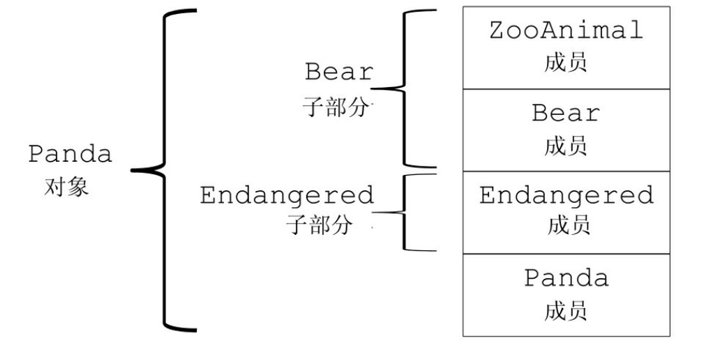
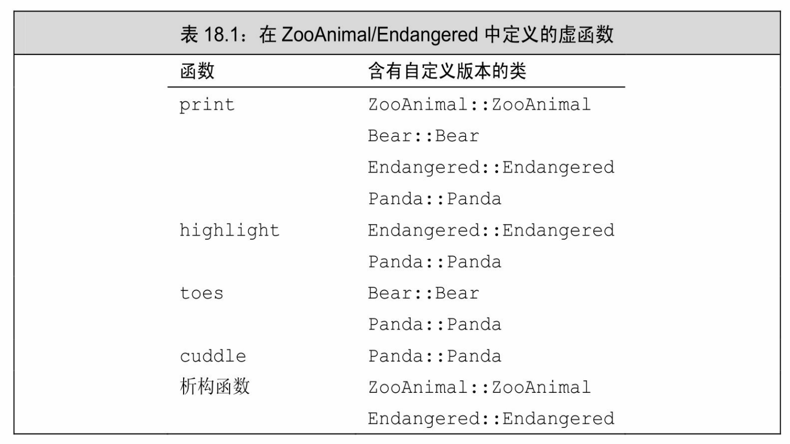
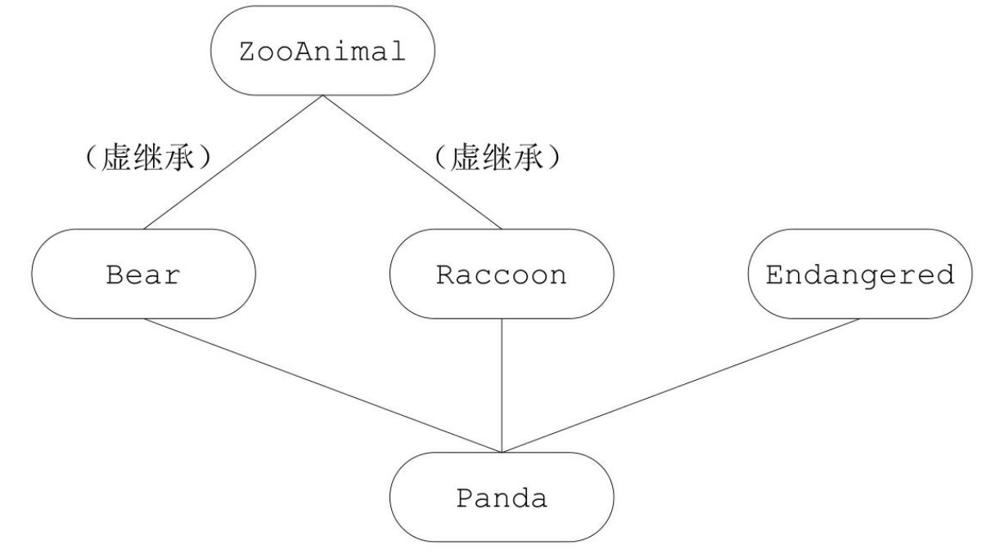

[总目录](<../目录.md>) · [本章目录](<01 章节导读.md>) · [上一篇](<../第18章 用于大型程序的工具/18.2 命名空间.md>) · [下一篇](<../第18章 用于大型程序的工具/小结.md>)

> 原 PDF 第 1154–1171 页。

<!-- PDF 第 1154 页 -->

# **18.3** 多重继承与虚继承

多重继承(multiple inheritance)是指从多个直接基类(参见15.2.2 节,第533页)中产生派生类的能力。多重继承的派生类继承了所有父类的属性。尽管概念上非常简单,但是多个基类相互交织产生的细节可能会带来错综复杂的设计问题与实现问题。

为了探讨有关多重继承的问题,我们将以动物园中动物的层次关系作为教学实例。动物园中的动物存在于不同的抽象级别上。有个体的动物,如Ling-Ling、Mowgli和Balou等,它们以名字进行区分;每个动物属于一个物种,例如Ling-Ling是一只大熊猫;物种又是科的成员,大熊猫是熊科的成员;每个科是动物界的成员,在这个例子中动物界是指一个动物园中所有动物的总和。

我们将定义一个抽象类ZooAnimal,用它来保存动物园中动物共有的信息并提供公共接口。类Bear将存放Bear科特有的信息,以此类推。

除了类ZooAnimal之外,我们的应用程序还包含其他一些辅助类, 这些类负责封装不同的抽象,如濒临灭绝的动物。以类Panda的实现为例,Panda是由Bear和Endangered共同派生而来的。

## **18.3.1** 多重继承

在派生类的派生列表中可以包含多个基类:

<!-- 代码原图: ../images/_page_1153_Picture_128.png -->
```c++
class Bear : public ZooAnimal {
class Panda : public Bear, public Endangered { /* ...*/ };
```

每个基类包含一个可选的访问说明符(参见15.5节,第543页)。 一如往常,如果访问说明符被忽略掉了,则关键字class对应的默认访问说明符是private,关键字struct对应的是public(参见15.5节,第546 页)。

和只有一个基类的继承一样,多重继承的派生列表也只能包含已经

<!-- PDF 第 1155 页 -->

被定义过的类,而且这些类不能是final的(参见15.2.2节,第533页)。 对于派生类能够继承的基类个数,C++没有进行特殊规定;但是在某个给定的派生列表中,同一个基类只能出现一次。

### 多重继承的派生类从每个基类中继承状态

在多重继承关系中,派生类的对象包含有每个基类的子对象(参见 15.2.2节,第530页)。如图18.2所示,在Panda对象中含有一个Bear部分 (其中又含有一个ZooAnimal部分)、一个Endangered部分以及在Panda 中声明的非静态数据成员。



图18.2:Panda对象的概念结构

派生类构造函数初始化所有基类

构造一个派生类的对象将同时构造并初始化它的所有基类子对象。 与从一个基类进行的派生一样(参见15.2.2节,第531页),多重继承的派生类的构造函数初始值也只能初始化它的直接基类:

<!-- 代码原图: ../images/_page_1154_Picture_91.png -->
```c++
// 显式地初始化所有基类
Panda::Panda(std::string name, bool onExhibit)
    : Bear(name, onExhibit, "Panda"),
    Endangered(Endangered::critical) { }
// 隐式地使用 Bear 的默认构造函数初始化 Bear 子对象
Panda::Panda()
    : Endangered(Endangered::critical) { }
```

派生类的构造函数初始值列表将实参分别传递给每个直接基类。其中基类的构造顺序与派生列表中基类的出现顺序保持一致,而与派生类构造函数初始值列表中基类的顺序无关。一个Panda对象按照如下次序

<!-- PDF 第 1156 页 -->

进行初始化:

· ZooAnimal是整个继承体系的最终基类,Bear是Panda的直接基类,ZooAnimal是Bear的基类,所以首先初始化ZooAnimal。

· 接下来初始化Panda的第一个直接基类Bear。 · 然后初始化Panda的第二个直接基类Endangered。 · 最后初始化Panda。

继承的构造函数与多重继承


在C++11新标准中,允许派生类从它的一个或几个基类中继承构造函数(参见15.7.4节,第557页)。但是如果从多个基类中继承了相同的构造函数(即形参列表完全相同),则程序将产生错误:

<!-- 代码原图: ../images/_page_1155_Picture_79.png -->
```c++
struct Base1 {
    Base1() = default;
    Base1(const std::string&);
    Base1(std::shared_ptr<int>);
};

struct Base2 {
    Base2() = default;
    Base2(const std::string&);
    Base2(int);
};

// 错误：D1 试图从两个基类中都继承 D1::D1(const string&)
struct D1: public Base1, public Base2 {
    using Base1::Base1;        // 从 Base1 继承构造函数
    using Base2::Base2;        // 从 Base2 继承构造函数
};
```

如果一个类从它的多个基类中继承了相同的构造函数,则这个类必须为该构造函数定义它自己的版本:

<!-- PDF 第 1157 页 -->

<!-- 代码原图: ../images/_page_1156_Picture_107.png -->
```c++
struct D2: public Base1, public Base2 {
    using Base1::Base1;          // 从 Base1 继承构造函数
    using Base2::Base2;          // 从 Base2 继承构造函数
    // D2 必须自定义一个接受 string 的构造函数
    D2(const string &s): Base1(s), Base2(s) { }
    D2() = default;             // 一旦 D2 定义了它自己的构造函数，则必须出现
};
```

析构函数与多重继承

和往常一样,派生类的析构函数只负责清除派生类本身分配的资源,派生类的成员及基类都是自动销毁的。合成的析构函数体为空。

析构函数的调用顺序正好与构造函数相反,在我们的例子中,析构函数的调用顺序是~Panda、~Endangered、~Bear和~ZooAnimal。

多重继承的派生类的拷贝与移动操作

与只有一个基类的继承一样,多重继承的派生类如果定义了自己的拷贝/赋值构造函数和赋值运算符,则必须在完整的对象上执行拷贝、 移动或赋值操作(参见15.7.2节,第553页)。只有当派生类使用的是合成版本的拷贝、移动或赋值成员时,才会自动对其基类部分执行这些操作。在合成的拷贝控制成员中,每个基类分别使用自己的对应成员隐式地完成构造、赋值或销毁等工作。

例如,假设Panda使用了合成版本的成员ling\_ling的初始化过程:

<!-- 代码原图: ../images/_page_1156_Picture_108.png -->
```c++
Panda ying_yang("ying_yang");
```

<!-- 代码原图: ../images/_page_1156_Picture_109.png -->
```c++
Panda ling_ling = ying_yang; // 使用拷贝构造函数
```

将调用Bear的拷贝构造函数,后者又在执行自己的拷贝任务之前先调用ZooAnimal的拷贝构造函数。一旦ling\_ling的Bear部分构造完成,接着就会调用Endangered的拷贝构造函数来创建对象相应的部分。最后, 执行Panda的拷贝构造函数。合成的移动构造函数的工作机理与之类似。

合成的拷贝赋值运算符的行为与拷贝构造函数很相似。它首先赋值 Bear部分(并且通过Bear赋值ZooAnimal部分),然后赋值Endangered部

<!-- PDF 第 1158 页 -->

分,最后是Panda部分。移动赋值运算符的工作机理与之类似。

### **18.3.1**节练习

练习**18.21**:解释下列声明的含义,在它们当中存在错误吗?如果有, 请指出来并说明错误的原因。

<!-- 代码原图: ../images/_page_1157_Picture_71.png -->
```c++
(a) class CADVehicle : public CAD, Vehicle { ... };
(b) class DblList: public List, public List { ... };
(c) class iostream: public istream, public ostream { ... };
```

练习**18.22**:已知存在如下所示的类的继承体系,其中每个类都定义了一个默认构造函数:

<!-- 代码原图: ../images/_page_1157_Picture_72.png -->
```c++
class A { ... };
class B : public A { ... };
class C : public B { ... };
class X { ... };
class Y { ... };
class Z : public X, public Y { ... };
class MI : public C, public Z { ... };
```

对于下面的定义来说,构造函数的执行顺序是怎样的?

<!-- 代码原图: ../images/_page_1157_Picture_73.png -->
```c++
MI mi;
```

## **18.3.2** 类型转换与多个基类

在只有一个基类的情况下,派生类的指针或引用能自动转换成一个可访问基类的指针或引用(参见15.2.2节,第530页;参见15.5节,第 544页)。多个基类的情况与之类似。我们可以令某个可访问基类的指针或引用直接指向一个派生类对象。例如,一个ZooAnimal、Bear或 Endangered类型的指针或引用可以绑定到Panda对象上:

<!-- PDF 第 1159 页 -->

<!-- 代码原图: ../images/_page_1158_Picture_81.png -->
```c++
// 接受 Panda 的基类引用的一系列操作
void print(const Bear&);
void highlight(const Endangered&);
ostream& operator<<(ostream&, const ZooAnimal&);
Panda ying_yang("ying_yang");
print(ying_yang);                // 把一个 Panda 对象传递给一个 Bear 的引用
highlight(ying_yang);            // 把一个 Panda 对象传递给一个 Endangered 的引用
cout << ying_yang << endl;      // 把一个 Panda 对象传递给一个 ZooAnimal 的引用
```

编译器不会在派生类向基类的几种转换中进行比较和选择,因为在它看来转换到任意一种基类都一样好。例如,如果存在如下所示的print 重载形式:

<!-- 代码原图: ../images/_page_1158_Picture_82.png -->
```c++
void print(const Bear&);
void print(const Endangered&);
```

则通过Panda对象对不带前缀限定符的print函数进行调用将产生编译错误:

<!-- 代码原图: ../images/_page_1158_Picture_83.png -->
```c++
Panda ying_yang("ying_yang");
print(ying_yang); // 二义性错误
```

基于指针类型或引用类型的查找

与只有一个基类的继承一样,对象、指针和引用的静态类型决定了我们能够使用哪些成员(参见15.6节,第547页)。如果我们使用一个 ZooAnimal指针,则只有定义在ZooAnimal中的操作是可以使用的, Panda接口中的Bear、Panda和Endangered特有的部分都不可见。类似的,一个Bear类型的指针或引用只能访问Bear及ZooAnimal的成员,一个Endangered的指针或引用只能访问Endangered的成员。

举个例子,已知我们的类已经定义了表18.1列出的虚函数,考虑下面的这些函数调用:

<!-- 代码原图: ../images/_page_1158_Picture_84.png -->
```c++
Bear *pb = new Panda("ying_yang");
pb->print(); // 正确：Panda::print()
pb->cuddle(); // 错误：不属于 Bear 的接口
pb->highlight(); // 错误：不属于 Bear 的接口
delete pb; // 正确：Panda::~Panda()
```

<!-- PDF 第 1160 页 -->

当我们通过Endangered的指针或引用访问一个Panda对象时,Panda 接口中Panda特有的部分以及属于Bear的部分都是不可见的:

<!-- 代码原图: ../images/_page_1159_Picture_52.png -->
```c++
Endangered *pe = new Panda("ying_yang");
pe->print(); // 正确：Panda::print()
pe->toes(); // 错误：不属于 Endangered 的接口
pe->cuddle(); // 错误：不属于 Endangered 的接口
pe->highlight(); // 正确：Panda::highlight()
delete pe; // 正确：Panda::~Panda()
```



### **18.3.2**节练习

练习**18.23**:使用练习18.22的继承体系以及下面定义的类D,同时假定每个类都定义了默认构造函数,请问下面的哪些类型转换是不被允许的?

<!-- 代码原图: ../images/_page_1159_Picture_54.png -->
```c++
class D : public X, public C { ... };
D *pd = new D;
(a) X *px = pd;  (b) A *pa = pd;
(c) B *pb = pd;  (d) C *pc = pd;
```

练习**18.24**:在第714页,我们使用一个指向Panda对象的Bear指针进行了

<!-- PDF 第 1161 页 -->

一系列调用,假设我们使用的是一个指向Panda对象的ZooAnimal指针将发生什么情况,请对这些调用语句逐一进行说明。

练习**18.25**:假设我们有两个基类Base1和Base2,它们各自定义了一个名为print的虚成员和一个虚析构函数。从这两个基类中我们派生出下面的类,它们都重新定义了print函数:

<!-- 代码原图: ../images/_page_1160_Picture_94.png -->
```c++
class D1 : public Base1 { /* ...*/ };
class D2 : public Base2 { /* ...*/ };
class MI : public D1, public D2 { /* ...*/ };
```

通过下面的指针,指出在每个调用中分别使用了哪个函数:

<!-- 代码原图: ../images/_page_1160_Picture_95.png -->
```c++
Base1 *pb1 = new MI;
Base2 *pb2 = new MI;
D1 *pd1 = new MI;
D2 *pd2 = new MI;
(a) pb1->print(); (b) pd1->print(); (c) pd2->print();
(d) delete pb2; (e) delete pd1; (f) delete pd2;
```

## **18.3.3** 多重继承下的类作用域

在只有一个基类的情况下,派生类的作用域嵌套在直接基类和间接基类的作用域中(参见15.6节,第547页)。查找过程沿着继承体系自底向上进行,直到找到所需的名字。派生类的名字将隐藏基类的同名成员。

在多重继承的情况下,相同的查找过程在所有直接基类中同时进行。如果名字在多个基类中都被找到,则对该名字的使用将具有二义性。

在我们的例子中,如果我们通过Panda的对象、指针或引用使用了某个名字,则程序会并行地在Endangered和Bear/ZooAnimal这两棵子树中查找该名字。如果名字在超过一棵子树中被找到,则该名字的使用具有二义性。对于一个派生类来说,从它的几个基类中分别继承名字相同的成员是完全合法的,只不过在使用这个名字时必须明确指出它的版本。

<!-- PDF 第 1162 页 -->


当一个类拥有多个基类时,有可能出现派生类从两个或更多基类中继承了同名成员的情况。此时,不加前缀限定符直接使用该名字将引发二义性。

例如,如果ZooAnimal和Endangered都定义了名为max\_weight的成员,并且Panda没有定义该成员,则下面的调用是错误的:

<!-- 代码原图: ../images/_page_1161_Picture_116.png -->
```c++
double d = ying_yang.max_weight();
```

Panda在派生的过程中拥有了两个名为max\_weight的成员,这是完全合法的。派生仅仅是产生了潜在的二义性,只要Panda对象不调用 max\_weight函数就能避免二义性错误。另外,如果每次调用max\_weight 时都指出所调用的版本(ZooAnimal::max\_weight或者 Endangered::max\_weight),也不会发生二义性。只有当要调用哪个函数含糊不清时程序才会出错。

在上面的例子中,派生类继承的两个max\_weight会产生二义性,这一点显而易见。一种更复杂的情况是,有时即使派生类继承的两个函数形参列表不同也可能发生错误。此外,即使max\_weight在一个类中是私有的,而在另一个类中是公有的或受保护的同样也可能发生错误。最后一种情况,假如max\_weight定义在Bear中而非ZooAnimal中,上面的程序仍然是错误的。

和往常一样,先查找名字后进行类型检查(参见6.4.1节,第210 页)。当编译器在两个作用域中同时发现了max\_weight时,将直接报告一个调用二义性的错误。

要想避免潜在的二义性,最好的办法是在派生类中为该函数定义一个新版本。例如,我们可以为Panda定义一个max\_weight函数从而解决二义性问题:

<!-- 代码原图: ../images/_page_1161_Picture_117.png -->
```c++
double Panda::max_weight() const
{
    return std::max(ZooAnimal::max_weight(),
        Endangered::max_weight());
}
```

<!-- PDF 第 1163 页 -->

### **18.3.3**节练习

<!-- 代码原图: ../images/_page_1162_Picture_33.png -->
```c++
struct Base1 {
    void print(int) const;             // 默认情况下是公有的
protected:
    int ival;
    double dval;
    char cval;
private:
    int *id;
};

struct Base2 {
    void print(double) const;         // 默认情况下是公有的
protected:
    double fval;
private:
    double dval;
};

struct Derived : public Base1 {
    void print(std::string) const;    // 默认情况下是公有的
protected:
    std::string sval;
    double dval;
};

struct MI : public Derived, public Base2 {
    void print(std::vector<double>); // 默认情况下是公有的
protected:
    int *ival;
    std::vector<double> dvec;
};
```

练习**18.26**:已知如上所示的继承体系,下面对print的调用为什么是错误的?适当修改MI,令其对print的调用可以编译通过并正确执行。

<!-- 代码原图: ../images/_page_1162_Picture_34.png -->
```c++
MI mi;
mi.print(42);
```

练习**18.27**:已知如上所示的继承体系,同时假定为MI添加了一个名为 foo的函数:

<!-- PDF 第 1164 页 -->

<!-- 代码原图: ../images/_page_1163_Picture_106.png -->
```c++
int ival;
double dval;
void MI::foo(double cval)
{
    int dval;
    // 练习中的问题发生在此处
}
```

(a) 列出在 MI::foo 中可见的所有名字。
(b) 是否存在某个可见的名字是继承自多个基类的？
(c) 将 Base1 的 dval 成员与 Derived 的 dval 成员求和后赋给 dval 的局部实例。
(d) 将 MI::dvec 的最后一个元素的值赋给 Base2::fval。
(e) 将从 Base1 继承的 cval 赋给从 Derived 继承的 sval 的第一个字符。

## **18.3.4** 虚继承

尽管在派生列表中同一个基类只能出现一次,但实际上派生类可以多次继承同一个类。派生类可以通过它的两个直接基类分别继承同一个间接基类,也可以直接继承某个基类,然后通过另一个基类再一次间接继承该类。

举个例子,IO标准库的istream和ostream分别继承了一个共同的名为 base\_ios的抽象基类。该抽象基类负责保存流的缓冲内容并管理流的条件状态。iostream是另外一个类,它从istream和ostream直接继承而来, 可以同时读写流的内容。因为istream和ostream都继承自base\_ios,所以 iostream继承了base\_ios两次,一次是通过istream,另一次是通过 ostream。

在默认情况下,派生类中含有继承链上每个类对应的子部分。如果某个类在派生过程中出现了多次,则派生类中将包含该类的多个子对象。

这种默认的情况对某些形如iostream的类显然是行不通的。一个 iostream对象肯定希望在同一个缓冲区中进行读写操作,也会要求条件状态能同时反映输入和输出操作的情况。假如在iostream对象中真的包含了base\_ios的两份拷贝,则上述的共享行为就无法实现了。

在C++语言中我们通过虚继承(virtual inheritance)的机制解决上述问题。虚继承的目的是令某个类做出声明,承诺愿意共享它的基类。其

<!-- PDF 第 1165 页 -->

中,共享的基类子对象称为虚基类(virtual base class)。在这种机制下,不论虚基类在继承体系中出现了多少次,在派生类中都只包含唯一一个共享的虚基类子对象。

### 另一个**Panda**类

在过去,科学界对于大熊猫属于Raccoon科还是Bear科争论不休。 为了如实地反映这种争论,我们可以对Panda类进行修改,令其同时继承Bear和Raccoon。此时,为了避免赋予Panda两份ZooAnimal的子对象,我们将Bear和Raccoon继承ZooAnimal的方式定义为虚继承。图18.3 描述了新的继承体系。



图18.3:Panda的虚继承层次

观察这个新的继承体系,我们将发现虚继承的一个不太直观的特征:必须在虚派生的真实需求出现前就已经完成虚派生的操作。例如在我们的类中,当我们定义Panda时才出现了对虚派生的需求,但是如果 Bear和Raccoon不是从ZooAnimal虚派生得到的,那么Panda的设计者就显得不太幸运了。

在实际的编程过程中,位于中间层次的基类将其继承声明为虚继承一般不会带来什么问题。通常情况下,使用虚继承的类层次是由一个人或一个项目组一次性设计完成的。对于一个独立开发的类来说,很少需要基类中的某一个是虚基类,况且新基类的开发者也无法改变已存在的类体系。

<!-- PDF 第 1166 页 -->


虚派生只影响从指定了虚基类的派生类中进一步派生出的类,它不会影响派生类本身。

使用虚基类

我们指定虚基类的方式是在派生列表中添加关键字virtual:

<!-- 代码原图: ../images/_page_1165_Picture_83.png -->
```c++
// 关键字 public 和 virtual 的顺序随意
class Raccoon : public virtual ZooAnimal { /* ...*/ };
class Bear : virtual public ZooAnimal { /* ...*/ };
```

通过上面的代码我们将ZooAnimal定义为Raccoon和Bear的虚基类。

virtual说明符表明了一种愿望,即在后续的派生类当中共享虚基类的同一份实例。至于什么样的类能够作为虚基类并没有特殊规定。

如果某个类指定了虚基类,则该类的派生仍按常规方式进行:

<!-- 代码原图: ../images/_page_1165_Picture_84.png -->
```c++
class Panda : public Bear,
    public Raccoon, public Endangered {
};
```

Panda通过Raccoon和Bear继承了ZooAnimal,因为Raccoon和Bear继承ZooAnimal的方式都是虚继承,所以在Panda中只有一个ZooAnimal基类部分。

### 支持向基类的常规类型转换

不论基类是不是虚基类,派生类对象都能被可访问基类的指针或引用操作。例如,下面这些从Panda向基类的类型转换都是合法的:

<!-- 代码原图: ../images/_page_1165_Picture_85.png -->
```c++
void dance(const Bear&);
void rummage(const Raccoon&);
ostream& operator<<(ostream&, const ZooAnimal&);
Panda ying_yang;
dance(ying_yang); // 正确：把一个 Panda 对象当成 Bear 传递
rummage(ying_yang); // 正确：把一个 Panda 对象当成 Raccoon 传递
cout << ying_yang; // 正确：把一个 Panda 对象当成 ZooAnimal 传递
```

<!-- PDF 第 1167 页 -->

虚基类成员的可见性

因为在每个共享的虚基类中只有唯一一个共享的子对象,所以该基类的成员可以被直接访问,并且不会产生二义性。此外,如果虚基类的成员只被一条派生路径覆盖,则我们仍然可以直接访问这个被覆盖的成员。但是如果成员被多余一个基类覆盖,则一般情况下派生类必须为该成员自定义一个新的版本。

例如,假定类B定义了一个名为x的成员,D1和D2都是从B虚继承得到的,D继承了D1和D2,则在D的作用域中,x通过D的两个基类都是可见的。如果我们通过D的对象使用x,有三种可能性:

· 如果在D1和D2中都没有x的定义,则x将被解析为B的成员,此时不存在二义性,一个D的对象只含有x的一个实例。

· 如果x是B的成员,同时是D1和D2中某一个的成员,则同样没有二义性,派生类的x比共享虚基类B的x优先级更高。

· 如果在D1和D2中都有x的定义,则直接访问x将产生二义性问题。

与非虚的多重继承体系一样,解决这种二义性问题最好的方法是在派生类中为成员自定义新的实例。

### **18.3.4**节练习

练习**18.28**:已知存在如下的继承体系,在VMI类的内部哪些继承而来的成员无须前缀限定符就能直接访问?哪些必须有限定符才能访问?说明你的原因。

<!-- PDF 第 1168 页 -->

<!-- 代码原图: ../images/_page_1167_Picture_73.png -->
```c++
struct Base {
    void bar(int);                // 默认情况下是公有的
protected:
    int ival;
};

struct Derived1 : virtual public Base {
    void bar(char);                // 默认情况下是公有的
    void foo(char);
protected:
    char cval;
};

struct Derived2 : virtual public Base {
    void foo(int);                // 默认情况下是公有的
protected:
    int ival;
```

<!-- 代码原图: ../images/_page_1167_Picture_74.png -->
```c++
    char cval;
};

class VMI : public Derived1, public Derived2 { };
```

## **18.3.5** 构造函数与虚继承

在虚派生中,虚基类是由最低层的派生类初始化的。以我们的程序为例,当创建Panda对象时,由Panda的构造函数独自控制ZooAnimal的初始化过程。

为了理解这一规则,我们不妨假设当以普通规则处理初始化任务时会发生什么情况。在此例中,虚基类将会在多条继承路径上被重复初始化。以ZooAnimal为例,如果应用普通规则,则Raccoon和Bear都会试图初始化Panda对象的ZooAnimal部分。

当然,继承体系中的每个类都可能在某个时刻成为"最低层的派生类"。只要我们能创建虚基类的派生类对象,该派生类的构造函数就必须初始化它的虚基类。例如在我们的继承体系中,当创建一个Bear(或 Raccoon)的对象时,它已经位于派生的最低层,因此Bear(或 Raccoon)的构造函数将直接初始化其ZooAnimal基类部分:

<!-- PDF 第 1169 页 -->

<!-- 代码原图: ../images/_page_1168_Picture_106.png -->
```c++
Bear::Bear(std::string name, bool onExhibit):
    ZooAnimal(name, onExhibit, "Bear") { }
Raccoon::Raccoon(std::string name, bool onExhibit)
    : ZooAnimal(name, onExhibit, "Raccoon") { }
```

而当创建一个Panda对象时,Panda位于派生的最低层并由它负责初始化共享的ZooAnimal基类部分。即使ZooAnimal不是Panda的直接基类,Panda的构造函数也可以初始化ZooAnimal:

<!-- 代码原图: ../images/_page_1168_Picture_107.png -->
```c++
Panda::Panda(std::string name, bool onExhibit)
: ZooAnimal(name, onExhibit, "Panda"),
Bear(name, onExhibit),
Raccoon(name, onExhibit),
Endangered(Endangered::critical),
sleeping_flag(false) { }
```

虚继承的对象的构造方式

含有虚基类的对象的构造顺序与一般的顺序稍有区别:首先使用提供给最低层派生类构造函数的初始值初始化该对象的虚基类子部分,接下来按照直接基类在派生列表中出现的次序依次对其进行初始化。

例如,当我们创建一个Panda对象时:

· 首先使用Panda的构造函数初始值列表中提供的初始值构造虚基类 ZooAnimal部分。

· 接下来构造Bear部分。 · 然后构造Raccoon部分。 · 然后构造第三个直接基类Endangered。 · 最后构造Panda部分。

如果Panda没有显式地初始化ZooAnimal基类,则ZooAnimal的默认构造函数将被调用。如果ZooAnimal没有默认构造函数,则代码将发生错误。


<!-- PDF 第 1170 页 -->

虚基类总是先于非虚基类构造,与它们在继承体系中的次序和位置无关。

构造函数与析构函数的次序

一个类可以有多个虚基类。此时,这些虚的子对象按照它们在派生列表中出现的顺序从左向右依次构造。例如,在下面这个稍显杂乱的 TeddyBear派生关系中有两个虚基类:ToyAnimal是直接虚基类, ZooAnimal是Bear的虚基类:

<!-- 代码原图: ../images/_page_1169_Picture_69.png -->
```c++
class Character { /* ...*/ };
class BookCharacter : public Character { /* ...*/ };
class ToyAnimal { /* ...*/ };
class TeddyBear : public BookCharacter,
    public Bear, public virtual ToyAnimal
    { /* ...*/ };
```

编译器按照直接基类的声明顺序对其依次进行检查,以确定其中是否含有虚基类。如果有,则先构造虚基类,然后按照声明的顺序逐一构造其他非虚基类。因此,要想创建一个TeddyBear对象,需要按照如下次序调用这些构造函数:

<!-- 代码原图: ../images/_page_1169_Picture_70.png -->
```c++
ZooAnimal(); // Bear的虚基类
ToyAnimal(); // 直接虚基类
Character(); // 第一个非虚基类的间接基类
BookCharacter(); // 第一个直接非虚基类
Bear(); // 第二个直接非虚基类
TeddyBear(); // 最低层的派生类
```

合成的拷贝和移动构造函数按照完全相同的顺序执行,合成的赋值运算符中的成员也按照该顺序赋值。和往常一样,对象的销毁顺序与构造顺序正好相反,首先销毁TeddyBear部分,最后销毁ZooAnimal部分。

### **18.3.5**节练习

练习**18.29**:已知有如下所示的类继承关系:

<!-- PDF 第 1171 页 -->

<!-- 代码原图: ../images/_page_1170_Picture_18.png -->
```c++
class Class { ... };
class Base : public Class { ... };
class D1 : virtual public Base { ... };
class D2 : virtual public Base { ... };
class MI : public D1, public D2 { ... };
class Final : public MI, public Class { ... };
```

(a)当作用于一个 Final 对象时，构造函数和析构函数的执行次序分别是什么？
(b)在一个 Final 对象中有几个 Base 部分？几个 Class 部分？
(c)下面的哪些赋值运算将造成编译错误？

```c++
Base *pb; Class *pc; MI *pmi; D2 *pd2;
(a) pb = new Class;
(b) pc = new Final;
(c) pmi = pb;
(d) pd2 = pmi;
```

练习**18.30**:在Base中定义一个默认构造函数、一个拷贝构造函数和一个接受int形参的构造函数。在每个派生类中分别定义这三种构造函数, 每个构造函数应该使用它的实参初始化其Base部分。


