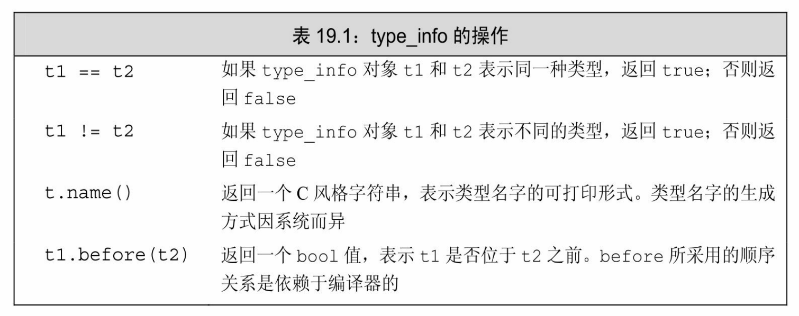

[总目录](<../目录.md>) · [本章目录](<01 章节导读.md>) · [上一篇](<../第19章 特殊工具与技术/19.1 控制内存分配.md>) · [下一篇](<../第19章 特殊工具与技术/19.3 枚举类型.md>)

> 原 PDF 第 1186–1196 页。

<!-- PDF 第 1186 页 -->

# **19.2** 运行时类型识别

运行时类型识别(run-time type identification,RTTI)的功能由两个运算符实现:

· typeid运算符,用于返回表达式的类型。

· dynamic\_cast运算符,用于将基类的指针或引用安全地转换成派生类的指针或引用。

当我们将这两个运算符用于某种类型的指针或引用,并且该类型含有虚函数时,运算符将使用指针或引用所绑定对象的动态类型(参见 15.2.3节,第534页)。

这两个运算符特别适用于以下情况:我们想使用基类对象的指针或引用执行某个派生类操作并且该操作不是虚函数。一般来说,只要有可能我们应该尽量使用虚函数。当操作被定义成虚函数时,编译器将根据对象的动态类型自动地选择正确的函数版本。

然而,并非任何时候都能定义一个虚函数。假设我们无法使用虚函数,则可以使用一个RTTI运算符。另一方面,与虚成员函数相比,使用RTTI运算符蕴含着更多潜在的风险:程序员必须清楚地知道转换的目标类型并且必须检查类型转换是否被成功执行。


使用RTTI必须要加倍小心。在可能的情况下,最好定义虚函数而非直接接管类型管理的重任。

## **19.2.1 dynamic\_cast**运算符

**dynamic\_cast**运算符(dynamic\_cast operator)的使用形式如下所示:

<!-- PDF 第 1187 页 -->

<!-- 代码原图: ../images/_page_1186_Picture_135.png -->
```c++
dynamic_cast<type*>(e)
dynamic_cast<type&>(e)
dynamic_cast<type&&>(e)
```

其中,*type*必须是一个类类型,并且通常情况下该类型应该含有虚函数。在第一种形式中,e必须是一个有效的指针(参见2.3.2节,第47 页);在第二种形式中,e必须是一个左值;在第三种形式中,e不能是左值。

在上面的所有形式中,e的类型必须符合以下三个条件中的任意一个:e的类型是目标*type*的公有派生类、e的类型是目标*type*的公有基类或者e的类型就是目标*type*的类型。如果符合,则类型转换可以成功。否则,转换失败。如果一条dynamic\_cast语句的转换目标是指针类型并且失败了,则结果为0。如果转换目标是引用类型并且失败了,则 dynamic\_cast运算符将抛出一个bad\_cast异常。

## 指针类型的**dynamic\_cast**

举个简单的例子,假定Base类至少含有一个虚函数,Derived是Base 的公有派生类。如果有一个指向Base的指针bp,则我们可以在运行时将它转换成指向Derived的指针,具体代码如下:

<!-- 代码原图: ../images/_page_1186_Picture_136.png -->
```c++
if (Derived *dp = dynamic_cast<Derived*>(bp))
{
    // 使用 dp 指向的 Derived 对象
} else { // bp 指向一个 Base 对象
    // 使用 bp 指向的 Base 对象
}
```

如果bp指向Derived对象,则上述的类型转换初始化dp并令其指向 bp所指的Derived对象。此时,if语句内部使用Derived操作的代码是安全的。否则,类型转换的结果为0,dp为0意味着if语句的条件失败,此时 else子句执行相应的Base操作。


我们可以对一个空指针执行dynamic\_cast,结果是所需类型的空指针。

<!-- PDF 第 1188 页 -->

值得注意的一点是,我们在条件部分定义了dp,这样做的好处是可以在一个操作中同时完成类型转换和条件检查两项任务。而且,指针dp 在if语句外部是不可访问的。一旦转换失败,即使后续的代码忘了做相应判断,也不会接触到这个未绑定的指针,从而确保程序是安全的。


在条件部分执行dynamic\_cast操作可以确保类型转换和结果检查在同一条表达式中完成。

## 引用类型的**dynamic\_cast**

引用类型的dynamic\_cast与指针类型的dynamic\_cast在表示错误发生的方式上略有不同。因为不存在所谓的空引用,所以对于引用类型来说无法使用与指针类型完全相同的错误报告策略。当对引用的类型转换失败时,程序抛出一个名为std::bad\_cast的异常,该异常定义在typeinfo 标准库头文件中。

我们可以按照如下的形式改写之前的程序,令其使用引用类型:

<!-- 代码原图: ../images/_page_1187_Picture_78.png -->
```c++
void f(const Base &b)
{
    try {
        const Derived &d = dynamic_cast<const Derived&>(b);
    // 使用 b 引用的 Derived 对象
    } catch (bad_cast) {
        // 处理类型转换失败的情况
    }
}
```

## **19.2.1**节练习

练习**19.3**:已知存在如下的类继承体系,其中每个类分别定义了一个公有的默认构造函数和一个虚析构函数:

<!-- 代码原图: ../images/_page_1187_Picture_79.png -->
```c++
class A { /* ...*/ };
class B : public A { /* ...*/ };
class C : public B { /* ...*/ };
class D : public B, public A { /* ...*/ };
```

<!-- PDF 第 1189 页 -->

下面的哪个dynamic\_cast将失败?

<!-- 代码原图: ../images/_page_1188_Picture_123.png -->
```c++
(a) A *pa = new C;
    B *pb = dynamic_cast<B*>(pa);
(b) B *pb = new B;
    C *pc = dynamic_cast<C*>(pb);
(c) A *pa = new D;
    B *pb = dynamic_cast<B*>(pa);
```

练习**19.4**:使用上一个练习定义的类改写下面的代码,将表达式\*pa转换成类型C&:

<!-- 代码原图: ../images/_page_1188_Picture_124.png -->
```c++
if (C *pc = dynamic_cast< C* >(pa))
{
    // 使用 C 的成员
} else {
    // 使用 A 的成员
}
```

练习**19.5**:在什么情况下你应该使用dynamic\_cast替代虚函数?

## **19.2.2 typeid**运算符

为RTTI提供的第二个运算符是**typeid**运算符(typeid operator),它允许程序向表达式提问:你的对象是什么类型?

typeid表达式的形式是typeid(e),其中e可以是任意表达式或类型的名字。typeid操作的结果是一个常量对象的引用,该对象的类型是标准库类型type\_info或者type\_info的公有派生类型。type\_info类定义在 typeinfo头文件中,19.2.4节(第735页)将介绍更多关于type\_info的细节。

typeid运算符可以作用于任意类型的表达式。和往常一样,顶层 const(参见2.4.3节,第57页)被忽略,如果表达式是一个引用,则 typeid返回该引用所引对象的类型。不过当typeid作用于数组或函数时, 并不会执行向指针的标准类型转换(参见4.11.2节,第143页)。也就是说,如果我们对数组a执行typeid(a),则所得的结果是数组类型而非

<!-- PDF 第 1190 页 -->

指针类型。

当运算对象不属于类类型或者是一个不包含任何虚函数的类时, typeid运算符指示的是运算对象的静态类型。而当运算对象是定义了至少一个虚函数的类的左值时,typeid的结果直到运行时才会求得。

## 使用**typeid**运算符

通常情况下,我们使用typeid比较两条表达式的类型是否相同,或者比较一条表达式的类型是否与指定类型相同:

<!-- 代码原图: ../images/_page_1189_Picture_86.png -->
```c++
Derived *dp = new Derived;
Base *bp = dp; // 两个指针都指向 Derived 对象
// 在运行时比较两个对象的类型
```

<!-- 代码原图: ../images/_page_1189_Picture_87.png -->
```c++
if (typeid(*bp) == typeid(*dp)) {
    // bp 和 dp 指向同一类型的对象
}

// 检查运行时类型是否是某种指定的类型

if (typeid(*bp) == typeid(Derived)) {
    // bp 实际指向 Derived 对象
}
```

在第一个if语句中,我们比较bp和dp所指的对象的动态类型是否相同。如果相同,则条件成功。类似的,当bp当前所指的是一个Derived 对象时,第二个if语句的条件满足。

注意,typeid应该作用于对象,因此我们使用\*bp而非bp:

<!-- 代码原图: ../images/_page_1189_Picture_88.png -->
```c++
// 下面的检查永远是失败的：bp 的类型是指向 Base 的指针
if (typeid(bp) == typeid(Derived)) {
    // 此处的代码永远不会执行
}
```

这个条件比较的是类型Base\*和Derived。尽管指针所指的对象类型是一个含有虚函数的类,但是指针本身并不是一个类类型的对象。类型 Base\*将在编译时求值,显然它与Derived不同,因此不论bp所指的对象到底是什么类型,上面的条件都不会满足。

<!-- PDF 第 1191 页 -->


当typeid作用于指针时(而非指针所指的对象),返回的结果是该指针的静态编译时类型。

typeid是否需要运行时检查决定了表达式是否会被求值。只有当类型含有虚函数时,编译器才会对表达式求值。反之,如果类型不含有虚函数,则typeid返回表达式的静态类型;编译器无须对表达式求值也能知道表达式的静态类型。

如果表达式的动态类型可能与静态类型不同,则必须在运行时对表达式求值以确定返回的类型。这条规则适用于typeid(\*p)的情况。如果指针p所指的类型不含有虚函数,则p不必非得是一个有效的指针。否则,\*p将在运行时求值,此时p必须是一个有效的指针。如果p是一个空指针,则typeid(\*p)将抛出一个名为bad\_typeid的异常。

## **19.2.2**节练习

练习**19.6**:编写一条表达式将Query\_base指针动态转换为AndQuery指针 (参见15.9.1节,第564页)。分别使用AndQuery的对象以及其他类型的对象测试转换是否有效。打印一条表示类型转换是否成功的信息,确保实际输出的结果与期望的一致。

练习**19.7**:编写与上一个练习类似的转换,这一次将Query\_base对象转换为AndQuery的引用。重复上面的测试过程,确保转换能正常工作。

练习**19.8**:编写一条typeid表达式检查两个Query\_base对象是否指向同一种类型。再检查该类型是否是AndQuery。

## **19.2.3** 使用**RTTI**

在某些情况下RTTI非常有用,比如当我们想为具有继承关系的类实现相等运算符时(参见14.3.1节,第497页)。对于两个对象来说,如果它们的类型相同并且对应的数据成员取值相同,则我们说这两个对象是相等的。在类的继承体系中,每个派生类负责添加自己的数据成员, 因此派生类的相等运算符必须把派生类的新成员考虑进来。

一种容易想到的解决方案是定义一套虚函数,令其在继承体系的各

<!-- PDF 第 1192 页 -->

个层次上分别执行相等性判断。此时,我们可以为基类的引用定义一个相等运算符,该运算符将它的工作委托给虚函数equal,由equal负责实际的操作。

遗憾的是,上述方案很难奏效。虚函数的基类版本和派生类版本必须具有相同的形参类型(参见15.3节,第537页)。如果我们想定义一个虚函数equal,则该函数的形参必须是基类的引用。此时,equal函数将只能使用基类的成员,而不能比较派生类独有的成员。

要想实现真正有效的相等比较操作,我们需要首先清楚一个事实: 即如果参与比较的两个对象类型不同,则比较结果为false。例如,如果我们试图比较一个基类对象和一个派生类对象,则==运算符应该返回 false。

基于上述推论,我们就可以使用RTTI解决问题了。我们定义的相等运算符的形参是基类的引用,然后使用typeid检查两个运算对象的类型是否一致。如果运算对象的类型不一致,则==返回false;类型一致才调用equal函数。每个类定义的equal函数负责比较类型自己的成员。这些运算符接受Base&形参,但是在进行比较操作前先把运算对象转换成运算符所属的类类型。

## 类的层次关系

为了更好地解释上述概念,我们定义两个示例类:

<!-- PDF 第 1193 页 -->

<!-- 代码原图: ../images/_page_1192_Picture_54.png -->
```c++
class Base {
    friend bool operator==(const Base&, const Base&);
public:
    // Base 的接口成员
protected:
    virtual bool equal(const Base&) const;
    // Base 的数据成员和其他用于实现的成员
};

class Derived: public Base {
public:
    // Derived 的其他接口成员
protected:
    bool equal(const Base&) const;
    // Derived 的数据成员和其他用于实现的成员
};
```

## 类型敏感的相等运算符

接下来介绍我们是如何定义整体的相等运算符的:

<!-- 代码原图: ../images/_page_1192_Picture_55.png -->
```c++
bool operator==(const Base &lhs, const Base &rhs)
{
    // 如果 typeid 不相同，返回 false；否则虚调用 equal
    return typeid(lhs) == typeid(rhs) && lhs.equal(rhs);
}
```

在这个运算符中,如果运算对象的类型不同则返回false。否则,如果运算对象的类型相同,则运算符将其工作委托给虚函数equal。当运算对象是Base的对象时,调用Base::equal;当运算对象是Derived的对象时,调用Derived::equal。

## 虚**equal**函数

继承体系中的每个类必须定义自己的equal函数。派生类的所有函数要做的第一件事都是相同的,那就是将实参的类型转换为派生类类型:

<!-- PDF 第 1194 页 -->

<!-- 代码原图: ../images/_page_1193_Picture_59.png -->
```c++
bool Derived::equal(const Base &rhs) const
{
    // 我们清楚这两个类型是相等的，所以转换过程不会抛出异常
    auto r = dynamic_cast<const Derived&>(rhs);
    // 执行比较两个 Derived 对象的操作并返回结果
}
```

上面的类型转换永远不会失败,因为毕竟我们只有在验证了运算对象的类型相同之后才会调用该函数。然而这样的类型转换是必不可少的,执行了类型转换后,当前函数才能访问右侧运算对象的派生类成员。

## 基类**equal**函数

下面这个操作比其他的稍微简单一点:

<!-- 代码原图: ../images/_page_1193_Picture_60.png -->
```c++
bool Base::equal(const Base &rhs) const
{
    // 执行比较 Base 对象的操作
}
```

无须事先转换形参的类型。\*this和形参都是Base对象,因此当前对象可用的操作对于形参类型同样有效。

## **19.2.4 type\_info**类

**type\_info**类的精确定义随着编译器的不同而略有差异。不过, C++标准规定type\_info类必须定义在typeinfo头文件中,并且至少提供表 19.1所列的操作。

<!-- PDF 第 1195 页 -->



除此之外,因为type\_info类一般是作为一个基类出现,所以它还应该提供一个公有的虚析构函数。当编译器希望提供额外的类型信息时, 通常在type\_info的派生类中完成。

type\_info类没有默认构造函数,而且它的拷贝和移动构造函数以及赋值运算符都被定义成删除的(参见13.1.6节,第450页)。因此,我们无法定义或拷贝type\_info类型的对象,也不能为type\_info类型的对象赋值。创建type\_info对象的唯一途径是使用typeid运算符。

type\_info类的name成员函数返回一个C风格字符串,表示对象的类型名字。对于某种给定的类型来说,name的返回值因编译器而异并且不一定与在程序中使用的名字一致。对于name返回值的唯一要求是,类型不同则返回的字符串必须有所区别。例如:

<!-- 代码原图: ../images/_page_1194_Picture_73.png -->
```c++
int arr[10];
Derived d;
Base *p = &d;

cout << typeid(42).name() << ", "
    << typeid(arr).name() << ", "
    << typeid(Sales_data).name() << ", "
    << typeid(std::string).name() << ", "
    << typeid(p).name() << ", "
    << typeid(*p).name() << endl;
```

在作者的计算机上运行该程序,输出结果如下:

**i,A10\_i,10Sales\_data,Ss,P4Base,7Derived**

<!-- PDF 第 1196 页 -->


type\_info类在不同的编译器上有所区别。有的编译器提供了额外的成员函数以提供程序中所用类型的额外信息。读者应该仔细阅读你所用编译器的使用手册,从而获取关于type\_info的更多细节。

#### **19.2.4**节练习

练习**19.9**:编写与本节最后一个程序类似的代码,令其打印你的编译器为一些常见类型所起的名字。如果你得到的输出结果与本书类似,尝试编写一个函数将这些字符串翻译成人们更容易读懂的形式。

练习**19.10**:已知存在如下的类继承体系,其中每个类定义了一个默认公有的构造函数和一个虚析构函数。下面的语句将打印哪些类型名字?

<!-- 代码原图: ../images/_page_1195_Picture_41.png -->
```c++
class A { /* ...*/ };
class B : public A { /* ...*/ };
class C : public B { /* ...*/ };

(a) A *pa = new C;
cout << typeid(pa).name() << endl;

(b) C cobj;
A& ra = cobj;
cout << typeid(&ra).name() << endl;

(c) B *px = new B;
A& ra = *px;
cout << typeid(ra).name() << endl;
```


