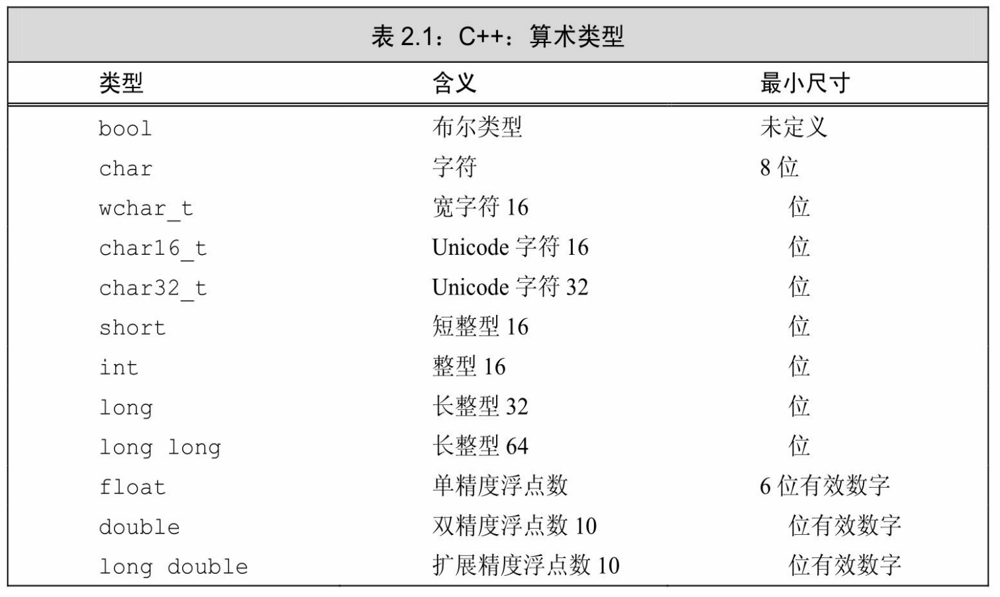
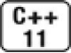
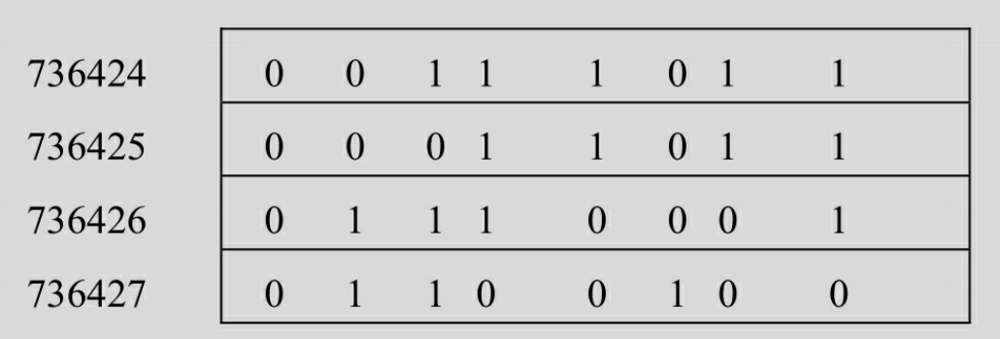
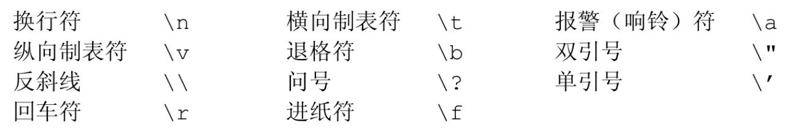
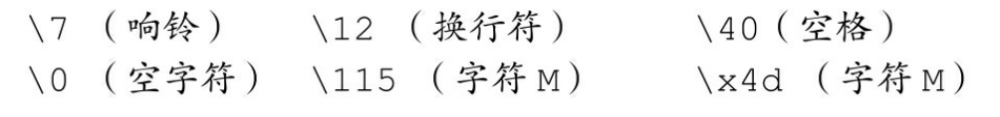
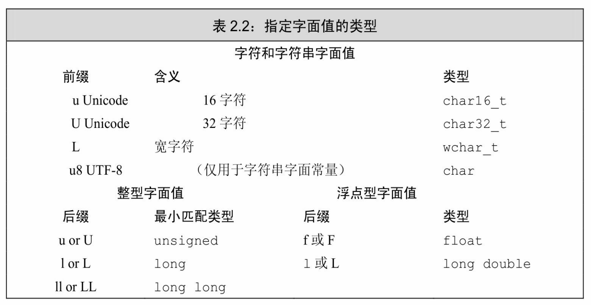

[总目录](<../目录.md>) · [本章目录](<01 章节导读.md>) · [上一篇](<../第2章 变量和基本类型/01 章节导读.md>) · [下一篇](<../第2章 变量和基本类型/2.2 变量.md>)

> 原 PDF 第 63–74 页。

<!-- PDF 第 63 页 -->

# **2.1** 基本内置类型

C++定义了一套包括算术类型(arithmetic type)和空类型(void) 在内的基本数据类型。其中算术类型包含了字符、整型数、布尔值和浮点数。空类型不对应具体的值,仅用于一些特殊的场合,例如最常见的是,当函数不返回任何值时使用空类型作为返回类型。

# **2.1.1** 算术类型

算术类型分为两类:整型(integral type,包括字符和布尔类型在内)和浮点型。

算术类型的尺寸(也就是该类型数据所占的比特数)在不同机器上有所差别。表2.1列出了C++标准规定的尺寸的最小值,同时允许编译器赋予这些类型更大的尺寸。某一类型所占的比特数不同,它所能表示的数据范围也不一样。



<!-- PDF 第 64 页 -->

布尔类型(bool)的取值是真(true)或者假(false)。

C++提供了几种字符类型,其中多数支持国际化。基本的字符类型是char,一个char的空间应确保可以存放机器基本字符集中任意字符对应的数字值。也就是说,一个char的大小和一个机器字节一样。

其他字符类型用于扩展字符集,如wchar\_t、char16\_t、char32\_t。 wchar\_t类型用于确保可以存放机器最大扩展字符集中的任意一个字符,类型char16\_t和char32\_t则为Unicode字符集服务(Unicode是用于表示所有自然语言中字符的标准)。

除字符和布尔类型之外,其他整型用于表示(可能)不同尺寸的整数。C++语言规定一个int至少和一个short一样大,一个long至少和一个 int一样大,一个long long至少和一个long一样大。其中,数据类型long long是在C++11中新定义的。



内置类型的机器实现

计算机以比特序列存储数据,每个比特非0即1,例如:

00011011011100010110010000111011 ...

大多数计算机以2的整数次幂个比特作为块来处理内存,可寻址的最小内存块称为"字节(byte)",存储的基本单元称为"字(word)",它通常由几个字节组成。在 C++语言中,一个字节要至少能容纳机器基本字符集中的字符。大多数机器的字节由8 比特构成,字则由32或64比特构成,也就是4或8字节。

大多数计算机将内存中的每个字节与一个数字(被称为"地址(address)")关联起来,在一个字节为8比特、字为32比特的机器上,我们可能看到一个字的内存区域如下所示:



其中,左侧是字节的地址,右侧是字节中8比特的具体内容。

我们能够使用某个地址来表示从这个地址开始的大小不同的比特串,例如,我们可能会说地址736424的那个字或者地址736427的那个字节。为了赋予内存中某个地址明确的含义,必须首先知道存储在该地址的数据的类型。类型决定了数据所占的比特数以及该如何解释这些比特的内容。

<!-- PDF 第 65 页 -->

如果位置736424处的对象类型是float,并且该机器中float以32比特存储,那么我们就能知道这个对象的内容占满了整个字。这个float数的实际值依赖于该机器是如何存储浮点数的。或者如果位置736424处的对象类型是unsigned char,并且该机器使用 ISO-Latin-1字符集,则该位置处的字节表示一个分号。

浮点型可表示单精度、双精度和扩展精度值。C++标准指定了一个浮点数有效位数的最小值,然而大多数编译器都实现了更高的精度。通常,float以1个字(32比特)来表示,double以2个字(64比特)来表示,long double以3或4个字(96或128比特)来表示。一般来说,类型 float和double分别有7和16个有效位;类型long double则常常被用于有特殊浮点需求的硬件,它的具体实现不同,精度也各不相同。

### 带符号类型和无符号类型

除去布尔型和扩展的字符型之外,其他整型可以划分为带符号的 (signed)和无符号的(unsigned)两种。带符号类型可以表示正数、 负数或0,无符号类型则仅能表示大于等于0的值。

类型int、short、long和long long都是带符号的,通过在这些类型名前添加unsigned就可以得到无符号类型,例如unsigned long。类型 unsigned int可以缩写为unsigned。

与其他整型不同,字符型被分为了三种:char、signed char和 unsigned char。特别需要注意的是:类型char和类型signed char并不一样。尽管字符型有三种,但是字符的表现形式却只有两种:带符号的和无符号的。类型char实际上会表现为上述两种形式中的一种,具体是哪种由编译器决定。

无符号类型中所有比特都用来存储值,例如,8比特的unsigned char 可以表示0至255区间内的值。

C++标准并没有规定带符号类型应如何表示,但是约定了在表示范围内正值和负值的量应该平衡。因此,8比特的signed char理论上应该可以表示-127至127区间内的值,大多数现代计算机将实际的表示范围定为-128至127。

### 建议:如何选择类型

和C语言一样,C++的设计准则之一也是尽可能地接近硬件。C++的算术类型必须满足各种硬件特质,所以它们常常显得繁杂而令人不知所措。事实上,大多数程序员能够(也应该)对数据类型的使用做出限定从而简化选择的过程。以下是选择类型的一些经验准则:

<!-- PDF 第 66 页 -->

· 当明确知晓数值不可能为负时,选用无符号类型。 · 使用int执行整数运算。在实际应用中,short常常显得太小而long一般和int有一样的尺寸。如果你的数值超过了int的表示范围,选用long long。 · 在算术表达式中不要使用char或bool,只有在存放字符或布尔值时才使用它们。 因为类型char在一些机器上是有符号的,而在另一些机器上又是无符号的,所以如果使用char进行运算特别容易出问题。如果你需要使用一个不大的整数,那么明确指定它的类型是signed char或者unsigned char。 精度浮点数的计算代价相差无几。事实上,对于某些机器来说,双精度运算甚至比单

· 执行浮点数运算选用double,这是因为float通常精度不够而且双精度浮点数和单精度还快。long double提供的精度在一般情况下是没有必要的,况且它带来的运行时消耗也不容忽视。

#### **2.1.1**节练习

练习**2.1**:类型int、long、long long和short的区别是什么?无符号类型和带符号类型的区别是什么?float和double的区别是什么?

练习**2.2**:计算按揭贷款时,对于利率、本金和付款分别应选择何种数据类型?说明你的理由。

## **2.1.2** 类型转换

对象的类型定义了对象能包含的数据和能参与的运算,其中一种运算被大多数类型支持,就是将对象从一种给定的类型转换(convert)为另一种相关类型。

当在程序的某处我们使用了一种类型而其实对象应该取另一种类型时,程序会自动进行类型转换,在4.11节(第141页)中我们将对类型转换做更详细的介绍。此处,有必要说明当给某种类型的对象强行赋了另一种类型的值时,到底会发生什么。

当我们像下面这样把一种算术类型的值赋给另外一种类型时:

<!-- 代码原图: ../images/_page_65_Picture_160.png -->
```c++
bool b = 42; // b为真
```

<!-- 代码原图: ../images/_page_65_Picture_161.png -->
```c++
int i = b; // i的值为1
i = 3.14; // i的值为3
double pi = i; // pi的值为3.0
unsigned char c = -1; // 假设char占8比特，c的值为255
signed char c2 = 256; // 假设char占8比特，c2的值是未定义的
```

<!-- PDF 第 67 页 -->

类型所能表示的值的范围决定了转换的过程:

· 当我们把一个非布尔类型的算术值赋给布尔类型时,初始值为0则结果为false,否则结果为true。

· 当我们把一个布尔值赋给非布尔类型时,初始值为false则结果为 0,初始值为true则结果为1。

· 当我们把一个浮点数赋给整数类型时,进行了近似处理。结果值将仅保留浮点数中小数点之前的部分。

· 当我们把一个整数值赋给浮点类型时,小数部分记为0。如果该整数所占的空间超过了浮点类型的容量,精度可能有损失。

· 当我们赋给无符号类型一个超出它表示范围的值时,结果是初始值对无符号类型表示数值总数取模后的余数。例如,8比特大小的 unsigned char可以表示0至255区间内的值,如果我们赋了一个区间以外的值,则实际的结果是该值对256取模后所得的余数。因此,把-1赋给8 比特大小的unsigned char所得的结果是255。

· 当我们赋给带符号类型一个超出它表示范围的值时,结果是未定义的(undefined)。此时,程序可能继续工作、可能崩溃,也可能生成垃圾数据。

建议:避免无法预知和依赖于实现环境的行为

无法预知的行为源于编译器无须(有时是不能)检测的错误。即使代码编译通过了,如果程序执行了一条未定义的表达式,仍有可能产生错误。

不幸的是,在某些情况和/或某些编译器下,含有无法预知行为的程序也能正确执行。但是我们却无法保证同样一个程序在别的编译器下能正常工作,甚至已经编译通过的代码再次执行也可能会出错。此外,也不能认为这样的程序对一组输入有效,对另一组输入就一定有效。

程序也应该尽量避免依赖于实现环境的行为。如果我们把int的尺寸看成是一个确定不变的已知值,那么这样的程序就称作不可移植的(nonportable)。当程序移植到别的机器上后,依赖于实现环境的程序就可能发生错误。要从过去的代码中定位这类错误可不是一件轻松愉快的工作。

当在程序的某处使用了一种算术类型的值而其实所需的是另一种类型的值时,编译器同样会执行上述的类型转换。例如,如果我们使用了一个非布尔值作为条件(参见1.4.1节,第10页),那么它会被自动地转换成布尔值,这一做法和把非布尔值赋给布尔变量时的操作完全一样:

<!-- PDF 第 68 页 -->

<!-- 代码原图: ../images/_page_67_Picture_97.png -->
```c++
int i = 42;
if (i)                // if 条件的值将为 true
    i = 0;
```

如果i的值为0,则条件的值为false;i的所有其他取值(非0)都将使条件为true。

以此类推,如果我们把一个布尔值用在算术表达式里,则它的取值非0即1,所以一般不宜在算术表达式里使用布尔值。

### 含有无符号类型的表达式

尽管我们不会故意给无符号对象赋一个负值,却可能(特别容易) 写出这么做的代码。例如,当一个算术表达式中既有无符号数又有int值时,那个int值就会转换成无符号数。把int转换成无符号数的过程和把int 直接赋给无符号变量一样:

<!-- 代码原图: ../images/_page_67_Picture_98.png -->
```c++
unsigned u = 10;
int i = -42;
std::cout << i + i << std::endl; // 输出-84
std::cout << u + i << std::endl; // 如果 int 占 32 位，输出 4294967264
```

在第一个输出表达式里,两个(负)整数相加并得到了期望的结果。在第二个输出表达式里,相加前首先把整数-42转换成无符号数。 把负数转换成无符号数类似于直接给无符号数赋一个负值,结果等于这个负数加上无符号数的模。

当从无符号数中减去一个值时,不管这个值是不是无符号数,我们都必须确保结果不能是一个负值:

<!-- 代码原图: ../images/_page_67_Picture_99.png -->
```c++
unsigned u1 = 42, u2 = 10;
std::cout << u1 - u2 << std::endl; // 正确：输出 32
std::cout << u2 - u1 << std::endl; // 正确：不过，结果是取模后的值
```

无符号数不会小于0这一事实同样关系到循环的写法。例如,在 1.4.1节的练习(第11页)中需要写一个循环,通过控制变量递减的方式把从10到0的数字降序输出。这个循环可能类似于下面的形式:

<!-- PDF 第 69 页 -->

<!-- 代码原图: ../images/_page_68_Picture_168.png -->
```c++
for (int i = 10; i >= 0; --i)
    std::cout << i << std::endl;
```

可能你会觉得反正也不打算输出负数,可以用无符号数来重写这个循环。然而,这个不经意的改变却意味着死循环:

<!-- 代码原图: ../images/_page_68_Picture_169.png -->
```c++
// 错误：变量 u 永远也不会小于 0，循环条件一直成立
for (unsigned u = 10; u >= 0; --u)
    std::cout << u << std::endl;
```

来看看当u等于0时发生了什么,这次迭代输出0,然后继续执行for 语句里的表达式。表达式--u从u当中减去1,得到的结果-1并不满足无符号数的要求,此时像所有表示范围之外的其他数字一样,-1被自动地转换成一个合法的无符号数。假设int类型占32位,则当u等于0时,--u的结果将会是4294967295。

一种解决的办法是,用while语句来代替for语句,因为前者让我们能够在输出变量之前(而非之后)先减去1:

<!-- 代码原图: ../images/_page_68_Picture_170.png -->
```c++
unsigned u = 11; // 确定要输出的最大数，从比它大1的数开始
while (u > 0){
    --u;           // 先减1，这样最后一次迭代时就会输出0
    std::cout << u << std::endl;
}
```

改写后的循环先执行对循环控制变量减1的操作,这样最后一次迭代时,进入循环的u值为1。此时将其减1,则这次迭代输出的数就是0; 下一次再检验循环条件时,u的值等于0而无法再进入循环。因为我们要先做减1的操作,所以初始化u的值应该比要输出的最大值大1。这里,u 初始化为11,输出的最大数是10。

#### 提示:切勿混用带符号类型和无符号类型

如果表达式里既有带符号类型又有无符号类型,当带符号类型取值为负时会出现异常结果,这是因为带符号数会自动地转换成无符号数。例如,在一个形如a\*b的式子中,如果a = -1,b = 1,而且a和b都是int,则表达式的值显然为-1。然而,如果a是 int,而b是unsigned,则结果须视在当前机器上int所占位数而定。在我们的环境里,结果是4294967295。

#### **2.1.2**节练习

<!-- PDF 第 70 页 -->

练习**2.3**:读程序写结果。

<!-- 代码原图: ../images/_page_69_Picture_121.png -->
```c++
unsigned u = 10, u2 = 42;
std::cout << u2 - u << std::endl;
std::cout << u - u2 << std::endl;

int i = 10, i2 = 42;
std::cout << i2 -i<< std::endl;
std::cout << i - i2<< std::endl;
std::cout << i - u<< std::endl;
std::cout << u - i<< std::endl;
```

练习**2.4**:编写程序检查你的估计是否正确,如果不正确,请仔细研读本节直到弄明白问题所在。

## **2.1.3** 字面值常量

一个形如42的值被称作字面值常量(literal),这样的值一望而知。每个字面值常量都对应一种数据类型,字面值常量的形式和值决定了它的数据类型。

整型和浮点型字面值

我们可以将整型字面值写作十进制数、八进制数或十六进制数的形式。以0开头的整数代表八进制数,以0x或0X开头的代表十六进制数。 例如,我们能用下面的任意一种形式来表示数值20:

<!-- 代码原图: ../images/_page_69_Picture_122.png -->
```c++
20 /* 十进制 */ 024 /* 八进制 */ 0x14 /* 十六进制 */
```

整型字面值具体的数据类型由它的值和符号决定。默认情况下,十进制字面值是带符号数,八进制和十六进制字面值既可能是带符号的也可能是无符号的。十进制字面值的类型是int、long和long long中尺寸最小的那个(例如,三者当中最小是int),当然前提是这种类型要能容纳下当前的值。八进制和十六进制字面值的类型是能容纳其数值的int、 unsigned int、long、unsigned long、long long和unsigned long long中的尺寸最小者。如果一个字面值连与之关联的最大的数据类型都放不下,将产生错误。类型short没有对应的字面值。在表2.2(第37页)中,我们

<!-- PDF 第 71 页 -->

将以后缀代表相应的字面值类型。

尽管整型字面值可以存储在带符号数据类型中,但严格来说,十进制字面值不会是负数。如果我们使用了一个形如-42的负十进制字面值,那个负号并不在字面值之内,它的作用仅仅是对字面值取负值而已。

浮点型字面值表现为一个小数或以科学计数法表示的指数,其中指数部分用E或e标识:

<!-- 代码原图: ../images/_page_70_Picture_109.png -->
```c++
3.14159 3.14159E0 0. 0e0 .001
```

默认的,浮点型字面值是一个double,我们可以使用表2.2(第37 页)中的后缀来表示其他浮点型。

字符和字符串字面值

由单引号括起来的一个字符称为char型字面值,双引号括起来的零个或多个字符则构成字符串型字面值。

<!-- 代码原图: ../images/_page_70_Picture_110.png -->
```c++
'a' // 字符字面值
"Hello World!" // 字符串字面值
```

字符串字面值的类型实际上是由常量字符构成的数组(array),该类型将在3.5.4节(第109页)介绍。编译器在每个字符串的结尾处添加一个空字符(′\0′),因此,字符串字面值的实际长度要比它的内容多 1。例如,字面值'A'表示的就是单独的字符A,而字符串"A"则代表了一个字符的数组,该数组包含两个字符:一个是字母A、另一个是空字符。

如果两个字符串字面值位置紧邻且仅由空格、缩进和换行符分隔, 则它们实际上是一个整体。当书写的字符串字面值比较长,写在一行里不太合适时,就可以采取分开书写的方式:

<!-- 代码原图: ../images/_page_70_Picture_111.png -->
```c++
// 分多行书写的字符串字面值
std::cout << "a really, really long string literal "
    "that spans two lines" << std::endl;
```

转义序列

<!-- PDF 第 72 页 -->

有两类字符程序员不能直接使用:一类是不可打印(nonprintable) 的字符,如退格或其他控制字符,因为它们没有可视的图符;另一类是在C++语言中有特殊含义的字符(单引号、双引号、问号、反斜线)。 在这些情况下需要用到转义序列(escape sequence),转义序列均以反斜线作为开始,C++语言规定的转义序列包括:



在程序中,上述转义序列被当作一个字符使用:

<!-- 代码原图: ../images/_page_71_Picture_122.png -->
```c++
std::cout << '\n'; // 转到新一行
std::cout << "\tHi!\n"; // 输出一个制表符，输出"Hi!",转到新一行
```

我们也可以使用泛化的转义序列,其形式是\x后紧跟1个或多个十六进制数字,或者\后紧跟1个、2个或3个八进制数字,其中数字部分表示的是字符对应的数值。假设使用的是Latin-1字符集,以下是一些示例:



我们可以像使用普通字符那样使用C++语言定义的转义序列:

<!-- 代码原图: ../images/_page_71_Picture_124.png -->
```c++
std::cout << "Hi \x4d0\115!\n"; //输出 Hi MOM!，转到新一行
```

<!-- 代码原图: ../images/_page_71_Picture_125.png -->
```c++
std::cout << ' \115' << ' \n' ; //输出 M，转到新一行
```

注意,如果反斜线\后面跟着的八进制数字超过3个,只有前3个数字与\构成转义序列。例如,"\1234"表示2个字符,即八进制数123对应的字符以及字符4。相反,\x要用到后面跟着的所有数字,例如,"\x1234"表示一个16位的字符,该字符由这4个十六进制数所对应的比特唯一确定。因为大多数机器的char型数据占8位,所以上面这个例子可能会报错。一般来说,超过8位的十六进制字符都是与表2.2中某个前缀作为开头的扩展字符集一起使用的。

<!-- PDF 第 73 页 -->

指定字面值的类型

通过添加如表2.2中所列的前缀和后缀,可以改变整型、浮点型和字符型字面值的默认类型。

<!-- 代码原图: ../images/_page_72_Picture_92.png -->
```c++
L'a' // 宽字符型字面值，类型是 wchar_t
u8"hi!" // utf-8 字符串字面值（utf-8 用 8 位编码一个 Unicode 字符）
42ULL // 无符号整型字面值，类型是 unsigned long long
1E-3F // 单精度浮点型字面值，类型是 float
3.14159L // 扩展精度浮点型字面值，类型是 long double
```


当使用一个长整型字面值时,请使用大写字母L来标记,因为小写字母l和数字1太容易混淆了。



对于一个整型字面值来说,我们能分别指定它是否带符号以及占用多少空间。如果后缀中有U,则该字面值属于无符号类型,也就是说, 以U为后缀的十进制数、八进制数或十六进制数都将从unsigned int、 unsigned long和unsigned long long中选择能匹配的空间最小的一个作为其数据类型。如果后缀中有L,则字面值的类型至少是long;如果后缀中有LL,则字面值的类型将是long long和unsigned long long 中的一种。 显然我们可以将U与L或LL合在一起使用。例如,以UL为后缀的字面值

<!-- PDF 第 74 页 -->

的数据类型将根据具体数值情况或者取unsigned long,或者取unsigned long long。

布尔字面值和指针字面值

true和false是布尔类型的字面值:

<!-- 代码原图: ../images/_page_73_Picture_85.png -->
```c++
bool test = false;
```

nullptr是指针字面值,2.3.2节(第47页)将有更多关于指针和指针字面值的介绍。

### **2.1.3**节练习

练习**2.5**:指出下述字面值的数据类型并说明每一组内几种字面值的区别:

<!-- 代码原图: ../images/_page_73_Picture_86.png -->
```c++
(a) 'a',L'a',"a",L"a"
(b) 10,10u,10L,10uL,012,0xC
(c) 3.14,3.14f,3.14L
(d) 10,10u,10.,10e-2
```

练习**2.6**:下面两组定义是否有区别,如果有,请叙述之:

<!-- 代码原图: ../images/_page_73_Picture_87.png -->
```c++
int month = 9, day = 7;
int month = 09, day = 07;
```

练习**2.7**:下述字面值表示何种含义?它们各自的数据类型是什么?

<!-- 代码原图: ../images/_page_73_Picture_88.png -->
```c++
(a) "Who goes with F\145rgus?\012"
(b) 3.14e1L (c) 1024f (d) 3.14L
```

练习**2.8**:请利用转义序列编写一段程序,要求先输出2M,然后转到新一行。修改程序使其先输出2,然后输出制表符,再输出M,最后转到新一行。


