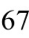

[总目录](<../目录.md>) · [本章目录](<01 章节导读.md>) · [上一篇](<../第2章 变量和基本类型/2.5 处理类型.md>) · [下一篇](<../第2章 变量和基本类型/小结.md>)

> 原 PDF 第 118–125 页。

<!-- PDF 第 118 页 -->

# **2.6** 自定义数据结构

从最基本的层面理解,数据结构是把一组相关的数据元素组织起来然后使用它们的策略和方法。举一个例子,我们的Sales\_item类把书本的ISBN编号、售出量及销售收入等数据组织在了一起,并且提供诸如 isbn函数、>>、<<、+、+=等运算在内的一系列操作,Sales\_item类就是一个数据结构。

C++语言允许用户以类的形式自定义数据类型,而库类型string、 istream、ostream等也都是以类的形式定义的,就像第1章的Sales\_item类型一样。C++语言对类的支持甚多,事实上本书的第Ⅲ部分和第Ⅳ部分都将大篇幅地介绍与类有关的知识。尽管Sales\_item类非常简单,但是要想给出它的完整定义可在第14章介绍自定义运算符之后。

## **2.6.1** 定义**Sales\_data**类型

尽管我们还写不出完整的Sales\_item类,但是可以尝试着把那些数据元素组织到一起形成一个简单点儿的类。初步的想法是用户能直接访问其中的数据元素,也能实现一些基本的操作。

既然我们筹划的这个数据结构不带有任何运算功能,不妨把它命名为Sales\_data以示与Sales\_item的区别。Sales\_data初步定义如下:

<!-- 代码原图: ../images/_page_117_Picture_125.png -->
```c++
struct Sales_data {
    std::string bookNo;
    unsigned units_sold = 0;
    double revenue = 0.0;
};
```

我们的类以关键字**struct**开始,紧跟着类名和类体(其中类体部分可以为空)。类体由花括号包围形成了一个新的作用域(参见2.2.4节, 第43页)。类内部定义的名字必须唯一,但是可以与类外部定义的名字重复。

<!-- PDF 第 119 页 -->

类体右侧的表示结束的花括号后必须写一个分号,这是因为类体后面可以紧跟变量名以示对该类型对象的定义,所以分号必不可少:

<!-- 代码原图: ../images/_page_118_Picture_127.png -->
```c++
struct Sales_data { /* ... */ } accum, trans, *salesptr;
// 与上一条语句等价，但可能更好一些

struct Sales_data { /* ... */ };

Sales_data accum, trans, *salesptr;
```

分号表示声明符(通常为空)的结束。一般来说,最好不要把对象的定义和类的定义放在一起。这么做无异于把两种不同实体的定义混在了一条语句里,一会儿定义类,一会儿又定义变量,显然这是一种不被建议的行为。


很多新手程序员经常忘了在类定义的最后加上分号。

### 类数据成员

类体定义类的成员,我们的类只有数据成员(data member)。类的数据成员定义了类的对象的具体内容,每个对象有自己的一份数据成员拷贝。修改一个对象的数据成员,不会影响其他Sales\_data的对象。

定义数据成员的方法和定义普通变量一样:首先说明一个基本类型,随后紧跟一个或多个声明符。我们的类有3个数据成员:一个名为 bookNo的string成员、一个名为units\_sold的unsigned成员和一个名为 revenue的double成员。每个Sales\_data的对象都将包括这3个数据成员。


C++11新标准规定,可以为数据成员提供一个类内初始值(in-class initializer)。创建对象时,类内初始值将用于初始化数据成员。没有初始值的成员将被默认初始化(参见2.2.1节,第40页)。因此当定义 Sales\_data的对象时,units\_sold和revenue都将初始化为0,bookNo将初始化为空字符串。

对类内初始值的限制与之前(参见2.2.1节,第39页)介绍的类似: 或者放在花括号里,或者放在等号右边,记住不能使用圆括号。

7.2节(第240页)将要介绍,用户可以使用C++语言提供的另外一

<!-- PDF 第 120 页 -->

个关键字class来定义自己的数据结构,到时也将说明现在我们使用struct 的原因。在第7章学习与class有关的知识之前,建议读者继续使用struct 定义自己的数据类型。

## **2.6.1**节练习

练习**2.39**:编译下面的程序观察其运行结果,注意,如果忘记写类定义体后面的分号会发生什么情况?记录下相关信息,以后可能会有用。

<!-- 代码原图: ../images/_page_119_Picture_129.png -->
```c++
struct Foo { /* 此处为空 */ } // 注意：没有分号
int main()
{
    return 0;
}
```

练习**2.40**:根据自己的理解写出Sales\_data类,最好与书中的例子有所区别。

## **2.6.2** 使用**Sales\_data**类

和Sales\_item类不同的是,我们自定义的Sales\_data类没有提供任何操作,Sales\_data类的使用者如果想执行什么操作就必须自己动手实现。例如,我们将参照1.5.2节(第20页)的例子写一段程序实现求两次交易相加结果的功能。程序的输入是下面这两条交易记录:

## **0-201-78345-X 3 20.00**

## **0-201-78345-X 2 25.00**

每笔交易记录着图书的ISBN编号、售出数量和售出单价。

## 添加两个**Sales\_data**对象

因为Sales\_data类没有提供任何操作,所以我们必须自己编码实现输入、输出和相加的功能。假设已知Sales\_data类定义于Sales\_data.h文件内,2.6.3节(第页)将详细介绍定义头文件的方法。



因为程序比较长,所以接下来分成几部分介绍。总的来说,程序的结构如下:

<!-- PDF 第 121 页 -->

<!-- 代码原图: ../images/_page_120_Picture_103.png -->
```c++
#include <iostream>
#include <string>
#include "Sales_data.h"
int main()
{
    Sales_data data1, data2;
    // 读入 data1 和 data2 的代码
    // 检查 data1 和 data2 的 ISBN 是否相同的代码
    // 如果相同，求 data1 和 data2 的总和
}
```

和原来的程序一样,先把所需的头文件包含进来并且定义变量用于接受输入。和Sales\_item类不同的是,新程序还包含了string头文件,因为我们的代码中将用到string类型的成员变量bookNo。

### **Sales\_data**对象读入数据

第3章和第10章将详细介绍string类型的细节,在此之前,我们先了解一点儿关于string的知识以便定义和使用我们的ISBN成员。string类型其实就是字符的序列,它的操作有>>、<<和==等,功能分别是读入字符串、写出字符串和比较字符串。这样我们就能书写代码读入第一笔交易了:

<!-- 代码原图: ../images/_page_120_Picture_104.png -->
```c++
double price = 0; // 书的单价，用于计算销售收入
// 读入第1笔交易：ISBN、销售数量、单价
std::cin >> data1.bookNo >> data1.units_sold >> price;
// 计算销售收入
data1.revenue = data1.units_sold * price;
```

交易信息记录的是书售出的单价,而数据结构存储的是一次交易的销售收入,因此需要将单价读入到double变量price,然后再计算销售收入revenue。输入语句

<!-- 代码原图: ../images/_page_120_Picture_105.png -->
```c++
std::cin >> data1.bookNo >> data1.units_sold >> price;
```

使用点操作符(参见1.5.2节,第20页)读入对象data1的bookNo成员和units\_sold成员。

最后一条语句把data1.units\_sold和price的乘积赋值给data1的revenue

<!-- PDF 第 122 页 -->

成员。

接下来程序重复上述过程读入对象data2的数据:

<!-- 代码原图: ../images/_page_121_Picture_94.png -->
```c++
// 读入第2笔交易
std::cin >> data2.bookNo >> data2.units_sold >> price;
data2.revenue = data2.units_sold * price;
```

### 输出两个**Sales\_data**对象的和

剩下的工作就是检查两笔交易涉及的ISBN编号是否相同了。如果相同输出它们的和,否则输出一条报错信息:

<!-- 代码原图: ../images/_page_121_Picture_95.png -->
```c++
if (data1.bookNo == data2.bookNo) {
    unsigned totalCnt = data1.units_sold + data2.units_sold;
    double totalRevenue = data1.revenue + data2.revenue;
    // 输出：ISBN、总销售量、总销售额、平均价格
    std::cout << data1.bookNo << " " << totalCnt
             << " " << totalRevenue << " ";
    if (totalCnt != 0)
        std::cout << totalRevenue/totalCnt << std::endl;
    else
        std::cout << "(no sales)" << std::endl;
    return 0;          // 标示成功
} else {
    // 两笔交易的 ISBN 不一样
    std::cerr << "Data must refer to the same ISBN"
             << std::endl;
    return -1;          // 标示失败
}
```

在第一个if语句中比较了data1和data2的bookNo成员是否相同。如果相同则执行第一个if语句花括号内的操作,首先计算units\_sold的和并赋给变量totalCnt,然后计算revenue的和并赋给变量totalRevenue,输出这些值。接下来检查是否确实售出了书籍,如果是,计算并输出每本书的平均价格;如果售量为零,输出一条相应的信息。

### **2.6.2**节练习

练习**2.41**:使用你自己的Sales\_data类重写1.5.1节(第20页)、1.5.2节 (第21页)和1.6节(第22页)的练习。眼下先把Sales\_data类的定义和 main函数放在同一个文件里。

<!-- PDF 第 123 页 -->

## **2.6.3** 编写自己的头文件

尽管如19.7节(第754页)所讲可以在函数体内定义类,但是这样的类毕竟受到了一些限制。所以,类一般都不定义在函数体内。当在函数体外部定义类时,在各个指定的源文件中可能只有一处该类的定义。 而且,如果要在不同文件中使用同一个类,类的定义就必须保持一致。

为了确保各个文件中类的定义一致,类通常被定义在头文件中,而且类所在头文件的名字应与类的名字一样。例如,库类型string在名为 string的头文件中定义。又如,我们应该把Sales\_data类定义在名为 Sales\_data.h的头文件中。

头文件通常包含那些只能被定义一次的实体,如类、const和 constexpr变量(参见2.4节,第54页)等。头文件也经常用到其他头文件的功能。例如,我们的Sales\_data类包含有一个string成员,所以 Sales\_data.h必须包含string.h头文件。同时,使用Sales\_data类的程序为了能操作bookNo成员需要再一次包含string.h头文件。这样,事实上使用Sales\_data类的程序就先后两次包含了string.h头文件:一次是直接包含的,另有一次是随着包含Sales\_data.h被隐式地包含进来的。有必要在书写头文件时做适当处理,使其遇到多次包含的情况也能安全和正常地工作。


头文件一旦改变,相关的源文件必须重新编译以获取更新过的声明。

### 预处理器概述

确保头文件多次包含仍能安全工作的常用技术是预处理器 (preprocessor),它由C++语言从C语言继承而来。预处理器是在编译之前执行的一段程序,可以部分地改变我们所写的程序。之前已经用到了一项预处理功能#include,当预处理器看到#include标记时就会用指定的头文件的内容代替#include。

C++程序还会用到的一项预处理功能是头文件保护符(header guard),头文件保护符依赖于预处理变量(参见2.3.2节,第48页)。 预处理变量有两种状态:已定义和未定义。**#define**指令把一个名字设定 

<!-- PDF 第 124 页 -->

为预处理变量,另外两个指令则分别检查某个指定的预处理变量是否已经定义:**#ifdef**当且仅当变量已定义时为真,**#ifndef**当且仅当变量未定义时为真。一旦检查结果为真,则执行后续操作直至遇到**#endif**指令为止。

使用这些功能就能有效地防止重复包含的发生:

<!-- 代码原图: ../images/_page_123_Picture_93.png -->
```c++
#ifndef SALES_DATA_H
#define SALES_DATA_H
#include <string>
struct Sales_data {
    std::string bookNo;
    unsigned units_sold = 0;
    double revenue = 0.0;
};
#endif
```

第一次包含Sales\_data.h时,#ifndef的检查结果为真,预处理器将顺序执行后面的操作直至遇到#endif为止。此时,预处理变量 SALES\_DATA\_H的值将变为已定义,而且Sales\_data.h也会被拷贝到我们的程序中来。后面如果再一次包含Sales\_data.h,则#ifndef的检查结果将为假,编译器将忽略#ifndef到#endif之间的部分。


预处理变量无视C++语言中关于作用域的规则。

整个程序中的预处理变量包括头文件保护符必须唯一,通常的做法是基于头文件中类的名字来构建保护符的名字,以确保其唯一性。为了避免与程序中的其他实体发生名字冲突,一般把预处理变量的名字全部大写。


头文件即使(目前还)没有被包含在任何其他头文件中,也应该设置保护符。头文件保护符很简单,程序员只要习惯性地加上就可以了,没必要太在乎你的程序到底需不需要。

**2.6.3**节练习

<!-- PDF 第 125 页 -->

练习**2.42**:根据你自己的理解重写一个Sales\_data.h头文件,并以此为基础重做2.6.2节(第67页)的练习。


