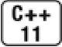
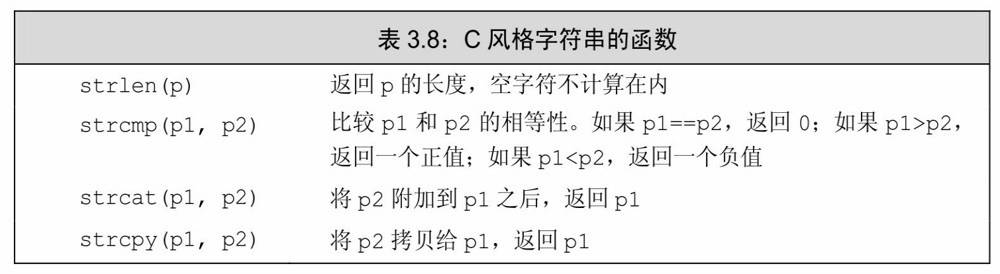

[总目录](<../目录.md>) · [本章目录](<01 章节导读.md>) · [上一篇](<../第3章 字符串、向量和数组/3.4 迭代器介绍.md>) · [下一篇](<../第3章 字符串、向量和数组/3.6 多维数组.md>)

> 原 PDF 第 177–194 页。

<!-- PDF 第 177 页 -->

# **3.5** 数组

数组是一种类似于标准库类型vector(参见3.3节,第86页)的数据结构,但是在性能和灵活性的权衡上又与vector有所不同。与vector相似的地方是,数组也是存放类型相同的对象的容器,这些对象本身没有名字,需要通过其所在位置访问。与vector不同的地方是,数组的大小确定不变,不能随意向数组中增加元素。因为数组的大小固定,因此对某些特殊的应用来说程序的运行时性能较好,但是相应地也损失了一些灵活性。


如果不清楚元素的确切个数,请使用vector。

### **3.5.1** 定义和初始化内置数组

数组是一种复合类型(参见2.3节,第45页)。数组的声明形如 a[d],其中a是数组的名字,d是数组的维度。维度说明了数组中元素的个数,因此必须大于0。数组中元素的个数也属于数组类型的一部分, 编译的时候维度应该是已知的。也就是说,维度必须是一个常量表达式 (参见2.4.4节,第58页):

<!-- 代码原图: ../images/_page_176_Picture_98.png -->
```c++
unsigned cnt = 42; // 不是常量表达式
constexpr unsigned sz = 42; // 常量表达式，关于 constexpr，参见2.4.4节（第59页）
int arr[10]; // 含有10个整数的数组
int *parr[sz]; // 含有42个整型指针的数组
string bad[cnt]; // 错误：cnt不是常量表达式
string strs[get_size()]; // 当 get_size 是 constexpr 时正确；否则错误
```

默认情况下,数组的元素被默认初始化(参见2.2.1节,第40页)。


和内置类型的变量一样,如果在函数内部定义了某种内置类型的数组,那么默认

<!-- PDF 第 178 页 -->

初始化会令数组含有未定义的值。

定义数组的时候必须指定数组的类型,不允许用auto关键字由初始值的列表推断类型。另外和vector一样,数组的元素应为对象,因此不存在引用的数组。

#### 显式初始化数组元素

可以对数组的元素进行列表初始化(参见3.3.1节,第88页),此时允许忽略数组的维度。如果在声明时没有指明维度,编译器会根据初始值的数量计算并推测出来;相反,如果指明了维度,那么初始值的总数量不应该超出指定的大小。如果维度比提供的初始值数量大,则用提供的初始值初始化靠前的元素,剩下的元素被初始化成默认值(参见3.3.1 节,第88页):

<!-- 代码原图: ../images/_page_177_Picture_106.png -->
```c++
const unsigned sz = 3;
int ia1[sz] = {0, 1, 2}; // 含有 3 个元素的数组,元素值分别是 0,1,2
int a2[] = {0, 1, 2}; // 维度是 3 的数组
int a3[5] = {0, 1, 2}; // 等价于 a3[] = {0, 1, 2, 0, 0}
string a4[3] = {"hi", "bye"}; // 等价于 a4[] = {"hi", "bye", ""}
int a5[2] = {0,1,2}; // 错误：初始值过多
```

#### 字符数组的特殊性

字符数组有一种额外的初始化形式,我们可以用字符串字面值(参见2.1.3节,第36页)对此类数组初始化。当使用这种方式时,一定要注意字符串字面值的结尾处还有一个空字符,这个空字符也会像字符串的其他字符一样被拷贝到字符数组中去:

<!-- 代码原图: ../images/_page_177_Picture_107.png -->
```c++
char a1[] = {'C', '+', '+'}; // 列表初始化，没有空字符
char a2[] = {'C', '+', '+','\0'}; // 列表初始化，含有显式的空字符
char a3[] = "C++"; // 自动添加表示字符串结束的空字符
const char a4[6] = "Daniel"; // 错误：没有空间可存放空字符！
```

a1的维度是3,a2和a3的维度都是4,a4的定义是错误的。尽管字符串字面值"Daniel"看起来只有6个字符,但是数组的大小必须至少是7, 其中6个位置存放字面值的内容,另外1个存放结尾处的空字符。

#### 不允许拷贝和赋值

<!-- PDF 第 179 页 -->

不能将数组的内容拷贝给其他数组作为其初始值,也不能用数组为其他数组赋值:

<!-- 代码原图: ../images/_page_178_Picture_125.png -->
```c++
int a[] = {0, 1, 2}; // 含有3个整数的数组
int a2[] = a; // 错误：不允许使用一个数组初始化另一个数组
a2 = a; // 错误：不能把一个数组直接赋值给另一个数组
```


一些编译器支持数组的赋值,这就是所谓的编译器扩展(compiler extension)。 但一般来说,最好避免使用非标准特性,因为含有非标准特性的程序很可能在其他编译器上无法正常工作。

#### 理解复杂的数组声明

和vector一样,数组能存放大多数类型的对象。例如,可以定义一个存放指针的数组。又因为数组本身就是对象,所以允许定义数组的指针及数组的引用。在这几种情况中,定义存放指针的数组比较简单和直接,但是定义数组的指针或数组的引用就稍微复杂一点了:

<!-- 代码原图: ../images/_page_178_Picture_127.png -->
```c++
int *ptrs[10]; // ptrs 是含有 10 个整型指针的数组
int &refs[10] = /* ? */; // 错误：不存在引用的数组
int (*Parray)[10] = &arr; // Parray 指向一个含有 10 个整数的数组
int (&arrRef)[10] = arr; // arrRef 引用一个含有 10 个整数的数组
```

默认情况下,类型修饰符从右向左依次绑定。对于ptrs来说,从右向左(参见2.3.3节,第52页)理解其含义比较简单:首先知道我们定义的是一个大小为10的数组,它的名字是ptrs,然后知道数组中存放的是指向int的指针。

但是对于Parray来说,从右向左理解就不太合理了。因为数组的维度是紧跟着被声明的名字的,所以就数组而言,由内向外阅读要比从右向左好多了。由内向外的顺序可帮助我们更好地理解Parray的含义:首先是圆括号括起来的部分,\*Parray意味着Parray是个指针,接下来观察右边,可知道Parray是个指向大小为10的数组的指针,最后观察左边,知道数组中的元素是int。这样最终的含义就明白无误了,Parray是一个指针,它指向一个int数组,数组中包含10个元素。同理,

(&arrRef)表示arrRef是一个引用,它引用的对象是一个大小为10的数组,数组中元素的类型是int。

<!-- PDF 第 180 页 -->

当然,对修饰符的数量并没有特殊限制:

<!-- 代码原图: ../images/_page_179_Picture_88.png -->
```c++
int *(&arry)[10] = ptrs; // arry是数组的引用，该数组含有10个指针
```

按照由内向外的顺序阅读上述语句,首先知道arry是一个引用,然后观察右边知道,arry引用的对象是一个大小为10的数组,最后观察左边知道,数组的元素类型是指向int的指针。这样,arry就是一个含有10 个int型指针的数组的引用。


要想理解数组声明的含义,最好的办法是从数组的名字开始按照由内向外的顺序阅读。

#### **3.5.1**节练习

练习**3.27**:假设txt\_size是一个无参数的函数,它的返回值是int。请回答下列哪个定义是非法的?为什么?

<!-- 代码原图: ../images/_page_179_Picture_90.png -->
```c++
unsigned buf_size = 1024;
(a) int ia[buf_size];
(b) int ia[4 * 7 - 14];
(c) int ia[txt_size()];
(d) char st[11] = "fundamental";
```

练习**3.28**:下列数组中元素的值是什么?

<!-- 代码原图: ../images/_page_179_Picture_91.png -->
```c++
string sa[10];
int ia[10];
int main() {
    string sa2[10];
    int     ia2[10];
}
```

练习**3.29**:相比于vector来说,数组有哪些缺点,请列举一些。

### **3.5.2** 访问数组元素

与标准库类型vector和string一样,数组的元素也能使用范围for语句

<!-- PDF 第 181 页 -->

或下标运算符来访问。数组的索引从0开始,以一个包含10个元素的数组为例,它的索引从0到9,而非从1到10。

在使用数组下标的时候,通常将其定义为**size\_t**类型。size\_t是一种机器相关的无符号类型,它被设计得足够大以便能表示内存中任意对象的大小。在cstddef头文件中定义了size\_t类型,这个文件是C标准库 stddef.h头文件的C++语言版本。

数组除了大小固定这一特点外,其他用法与vector基本类似。例如,可以用数组来记录各分数段的成绩个数,从而实现与3.3.3节(第93 页)的程序一样的功能:

<!-- 代码原图: ../images/_page_180_Picture_129.png -->
```c++
// 以10分为一个分数段统计成绩的数量： 0~9,10~19,...,90~99,100
unsigned scores[11] = {};    // 11个分数段，全部初始化为0
unsigned grade;
while (cin >> grade) {
    if (grade <= 100)
        ++scores[grade/10];  // 将当前分数段的计数值加1
}
```

与93页的程序相比,上面程序最大的不同是scores的声明。这里 scores是一个含有11个无符号元素的数组。另外一处不太明显的区别是,本例所用的下标运算符是由C++语言直接定义的,这个运算符能用在数组类型的运算对象上。93页的那个程序所用的下标运算符是库模板 vector定义的,只能用于vector类型的运算对象。

与vector和string一样,当需要遍历数组的所有元素时,最好的办法也是使用范围for语句。例如,下面的程序输出所有的scores:

<!-- 代码原图: ../images/_page_180_Picture_130.png -->
```c++
for (auto i : scores)                // 对于 scores 中的每个计数值
    cout << i << " ";              // 输出当前的计数值
cout << endl;
```

因为维度是数组类型的一部分,所以系统知道数组scores中有多少个元素,使用范围for语句可以减轻人为控制遍历过程的负担。

#### 检查下标的值

与vector和string一样,数组的下标是否在合理范围之内由程序员负

<!-- PDF 第 182 页 -->

责检查,所谓合理就是说下标应该大于等于0而且小于数组的大小。要想防止数组下标越界,除了小心谨慎注意细节以及对代码进行彻底的测试之外,没有其他好办法。对于一个程序来说,即使顺利通过编译并执行,也不能肯定它不包含此类致命的错误。


大多数常见的安全问题都源于缓冲区溢出错误。当数组或其他类似数据结构的下标越界并试图访问非法内存区域时,就会产生此类错误。

#### **3.5.2**节练习

练习**3.30**:指出下面代码中的索引错误。

<!-- 代码原图: ../images/_page_181_Picture_101.png -->
```c++
constexpr size_t array_size = 10;
int ia[array_size];
for (size_t ix = 1; ix <= array_size; ++ix)
    ia[ix] = ix;
```

练习**3.31**:编写一段程序,定义一个含有10个int的数组,令每个元素的值就是其下标值。

练习**3.32**:将上一题刚刚创建的数组拷贝给另外一个数组。利用vector 重写程序,实现类似的功能。

练习**3.33**:对于104页的程序来说,如果不初始化scores将发生什么?

### **3.5.3** 指针和数组

在C++语言中,指针和数组有非常紧密的联系。就如即将介绍的, 使用数组的时候编译器一般会把它转换成指针。

通常情况下,使用取地址符(参见2.3.2节,第47页)来获取指向某个对象的指针,取地址符可以用于任何对象。数组的元素也是对象,对数组使用下标运算符得到该数组指定位置的元素。因此像其他对象一样,对数组的元素使用取地址符就能得到指向该元素的指针:

<!-- 代码原图: ../images/_page_181_Picture_102.png -->
```c++
string nums[] = {"one", "two", "three"}; // 数组的元素是 string 对象
string *p = &nums[0]; // p指向 nums的第一个元素
```

<!-- PDF 第 183 页 -->

然而,数组还有一个特性:在很多用到数组名字的地方,编译器都会自动地将其替换为一个指向数组首元素的指针:

<!-- 代码原图: ../images/_page_182_Picture_98.png -->
```c++
string *p2 = nums; // 等价于 p2 = &nums[0]
```


在大多数表达式中,使用数组类型的对象其实是使用一个指向该数组首元素的指针。

由上可知,在一些情况下数组的操作实际上是指针的操作,这一结论有很多隐含的意思。其中一层意思是当使用数组作为一个auto(参见 2.5.2节,第61页)变量的初始值时,推断得到的类型是指针而非数组:

<!-- 代码原图: ../images/_page_182_Picture_100.png -->
```c++
int ia[] = {0,1,2,3,4,5,6,7,8,9}; // ia是一个含有10个整数的数组
auto ia2(ia); // ia2是一个整型指针，指向ia的第一个元素
ia2 = 42; // 错误：ia2是一个指针，不能用int值给指针赋值
```

尽管ia是由10个整数构成的数组,但当使用ia作为初始值时,编译器实际执行的初始化过程类似于下面的形式:

<!-- 代码原图: ../images/_page_182_Picture_101.png -->
```c++
auto ia2(&ia[0]); //显然 ia2的类型是 int*
```

必须指出的是,当使用decltype关键字(参见2.5.3节,第62页)时上述转换不会发生,decltype(ia)返回的类型是由10个整数构成的数组:

<!-- 代码原图: ../images/_page_182_Picture_102.png -->
```c++
// ia3 是一个含有10个整数的数组
decltype(ia) ia3 = {0,1,2,3,4,5,6,7,8,9};
ia3 = p;    // 错误：不能用整型指针给数组赋值
ia3[4] = i; // 正确：把i的值赋给ia3的一个元素
```

#### 指针也是迭代器

与2.3.2节(第47页)介绍的内容相比,指向数组元素的指针拥有更多功能。vector和string的迭代器(参见3.4节,第95页)支持的运算,数组的指针全都支持。例如,允许使用递增运算符将指向数组元素的指针向前移动到下一个位置上:

<!-- PDF 第 184 页 -->

<!-- 代码原图: ../images/_page_183_Picture_102.png -->
```c++
int arr[] = {0,1,2,3,4,5,6,7,8,9};
int *p = arr;    // p指向arr的第一个元素
++p;             // p指向arr[1]
```

就像使用迭代器遍历vector对象中的元素一样,使用指针也能遍历数组中的元素。当然,这样做的前提是先得获取到指向数组第一个元素的指针和指向数组尾元素的下一位置的指针。之前已经介绍过,通过数组名字或者数组中首元素的地址都能得到指向首元素的指针;不过获取尾后指针就要用到数组的另外一个特殊性质了。我们可以设法获取数组尾元素之后的那个并不存在的元素的地址:

<!-- 代码原图: ../images/_page_183_Picture_103.png -->
```c++
int *e = &arr[10];//指向arr尾元素的下一位置的指针
```

这里显然使用下标运算符索引了一个不存在的元素,arr有10个元素,尾元素所在位置的索引是9,接下来那个不存在的元素唯一的用处就是提供其地址用于初始化e。就像尾后迭代器(参见3.4.1节,第95 页)一样,尾后指针也不指向具体的元素。因此,不能对尾后指针执行解引用或递增的操作。

利用上面得到的指针能重写之前的循环,令其输出arr的全部元素:

<!-- 代码原图: ../images/_page_183_Picture_104.png -->
```c++
for (int *b = arr; b != e; ++b)
cout << *b << endl; // 输出 arr的元素
```

#### 标准库函数**begin**和**end**



尽管能计算得到尾后指针,但这种用法极易出错。为了让指针的使用更简单、更安全,C++11新标准引入了两个名为begin和end的函数。 这两个函数与容器中的两个同名成员(参见3.4.1节,第95页)功能类似,不过数组毕竟不是类类型,因此这两个函数不是成员函数。正确的使用形式是将数组作为它们的参数:

<!-- 代码原图: ../images/_page_183_Picture_106.png -->
```c++
int ia[] = {0,1,2,3,4,5,6,7,8,9}; // ia是一个含有10个整数的数组
int *beg = begin(ia); // 指向ia首元素的指针
int *last = end(ia); // 指向arr尾元素的下一位置的指针
```

begin函数返回指向ia首元素的指针,end函数返回指向ia尾元素下一

<!-- PDF 第 185 页 -->

位置的指针,这两个函数定义在iterator头文件中。

使用begin和end可以很容易地写出一个循环并处理数组中的元素。 例如,假设arr是一个整型数组,下面的程序负责找到arr中的第一个负数:

<!-- 代码原图: ../images/_page_184_Picture_126.png -->
```c++
// pbeg 指向 arr的首元素，pend 指向 arr 尾元素的下一位置
int *pbeg = begin(arr),*pend = end(arr);
// 寻找第一个负值元素，如果已经检查完全部元素则结束循环
while (pbeg != pend && *pbeg >= 0)
    ++pbeg;
```

首先定义了两个名为pbeg和pend的整型指针,其中pbeg指向arr的第一个元素,pend指向arr尾元素的下一位置。while语句的条件部分通过比较pbeg和pend来确保可以安全地对pbeg解引用,如果pbeg确实指向了一个元素,将其解引用并检查元素值是否为负值。如果是,条件失效、 退出循环;如果不是,将指针向前移动一位继续考查下一个元素。


一个指针如果指向了某种内置类型数组的尾元素的"下一位置",则其具备与vector 的end函数返回的与迭代器类似的功能。特别要注意,尾后指针不能执行解引用和递增操作。

#### 指针运算

指向数组元素的指针可以执行表3.6(第96页)和表3.7(第99页) 列出的所有迭代器运算。这些运算,包括解引用、递增、比较、与整数相加、两个指针相减等,用在指针和用在迭代器上意义完全一致。

给(从)一个指针加上(减去)某整数值,结果仍是指针。新指针指向的元素与原来的指针相比前进了(后退了)该整数值个位置:

<!-- 代码原图: ../images/_page_184_Picture_128.png -->
```c++
constexpr size_t sz = 5;
int arr[sz] = {1,2,3,4,5};
int *ip = arr; // 等价于 int *ip = &arr[0]
int *ip2 = ip + 4; // ip2 指向 arr 的尾元素 arr[4]
```

ip加上4所得的结果仍是一个指针,该指针所指的元素与ip原来所指的元素相比前进了4个位置。

<!-- PDF 第 186 页 -->

给指针加上一个整数,得到的新指针仍需指向同一数组的其他元素,或者指向同一数组的尾元素的下一位置:

<!-- 代码原图: ../images/_page_185_Picture_80.png -->
```c++
// 正确：arr 转换成指向它首元素的指针；p 指向 arr 尾元素的下一位置
int *p = arr + sz; // 使用警告：不要解引用！
int *p2 = arr + 10; // 错误：arr 只有 5 个元素，p2 的值未定义
```

当给arr加上sz时,编译器自动地将arr转换成指向数组arr中首元素的指针。执行加法后,指针从首元素开始向前移动了sz(这里是5)个位置,指向新位置的元素。也就是说,它指向了数组arr尾元素的下一位置。如果计算所得的指针超出了上述范围就将产生错误,而且这种错误编译器一般发现不了。

和迭代器一样,两个指针相减的结果是它们之间的距离。参与运算的两个指针必须指向同一个数组当中的元素:

<!-- 代码原图: ../images/_page_185_Picture_81.png -->
```c++
auto n = end(arr) - begin(arr); // n的值是5，也就是arr中元素的数量
```

两个指针相减的结果的类型是一种名为**ptrdiff\_t**的标准库类型,和 size\_t一样,ptrdiff\_t也是一种定义在cstddef头文件中的机器相关的类型。因为差值可能为负值,所以ptrdiff\_t是一种带符号类型。

只要两个指针指向同一个数组的元素,或者指向该数组的尾元素的下一位置,就能利用关系运算符对其进行比较。例如,可以按照如下的方式遍历数组中的元素:

<!-- 代码原图: ../images/_page_185_Picture_82.png -->
```c++
int *b = arr, *e = arr + sz;
while (b < e) {
    // 使用 *b
    ++b;
}
```

如果两个指针分别指向不相关的对象,则不能比较它们:

<!-- 代码原图: ../images/_page_185_Picture_83.png -->
```c++
int i = 0, sz = 42;
int *p = &i, *e = &sz;
// 未定义的：p和e无关，因此比较毫无意义！
while (p < e)
```

<!-- PDF 第 187 页 -->

尽管作用可能不是特别明显,但必须说明的是,上述指针运算同样适用于空指针(参见2.3.2节,第48页)和所指对象并非数组的指针。在后一种情况下,两个指针必须指向同一个对象或该对象的下一位置。如果p是空指针,允许给p加上或减去一个值为0的整型常量表达式(参见 2.4.4节,第58页)。两个空指针也允许彼此相减,结果当然是0。

#### 解引用和指针运算的交互

指针加上一个整数所得的结果还是一个指针。假设结果指针指向了一个元素,则允许解引用该结果指针:

<!-- 代码原图: ../images/_page_186_Picture_111.png -->
```c++
int ia[] = {0,2,4,6,8}; // 含有5个整数的数组
int last = *(ia + 4); // 正确：把last初始化成8，也就是ia[4]的值
```

表达式\*(ia+4)计算ia前进4个元素后的新地址,解引用该结果指针的效果等价于表达式ia[4]。

回忆一下在3.4.1节(第98页)中介绍过如果表达式含有解引用运算符和点运算符,最好在必要的地方加上圆括号。类似的,此例中指针加法的圆括号也不可缺少。如果写成下面的形式:

<!-- 代码原图: ../images/_page_186_Picture_112.png -->
```c++
last = *ia + 4; // 正确：last =4等价于ia[0] +4
```

含义就与之前完全不同了,此时先解引用ia,然后给解引用的结果再加上4。4.1.2节(第121页)将对这一问题做进一步分析。

#### 下标和指针

如前所述,在很多情况下使用数组的名字其实用的是一个指向数组首元素的指针。一个典型的例子是当对数组使用下标运算符时,编译器会自动执行上述转换操作。给定

<!-- 代码原图: ../images/_page_186_Picture_113.png -->
```c++
int ia[] = {0,2,4,6,8}; // 含有5个整数的数组
```

此时,ia[0]是一个使用了数组名字的表达式,对数组执行下标运算其实是对指向数组元素的指针执行下标运算:

<!-- PDF 第 188 页 -->

<!-- 代码原图: ../images/_page_187_Picture_86.png -->
```c++
int i = ia[2]; // ia 转换成指向数组首元素的指针
// ia[2]得到(ia + 2)所指的元素
int *p = ia; // p指向ia的首元素
i = *(p + 2); // 等价于 i = ia[2]
```

只要指针指向的是数组中的元素(或者数组中尾元素的下一位置),都可以执行下标运算:

<!-- 代码原图: ../images/_page_187_Picture_87.png -->
```c++
int *p = &ia[2]; // p指向索引为2的元素
int j = p[1]; // p[1]等价于 $ \star $ (p+1)，就是ia[3]表示的那个元素
int k = p[-2]; // p[-2]是ia[0]表示的那个元素
```

虽然标准库类型string和vector也能执行下标运算,但是数组与它们相比还是有所不同。标准库类型限定使用的下标必须是无符号类型,而内置的下标运算无此要求,上面的最后一个例子很好地说明了这一点。 内置的下标运算符可以处理负值,当然,结果地址必须指向原来的指针所指同一数组中的元素(或是同一数组尾元素的下一位置)。


内置的下标运算符所用的索引值不是无符号类型,这一点与vector和string不一样。

#### **3.5.3**节练习

练习**3.34**:假定p1和p2指向同一个数组中的元素,则下面程序的功能是什么?什么情况下该程序是非法的?

<!-- 代码原图: ../images/_page_187_Picture_89.png -->
```c++
p1 += p2 - p1;
```

练习**3.35**:编写一段程序,利用指针将数组中的元素置为0。

练习**3.36**:编写一段程序,比较两个数组是否相等。再写一段程序,比较两个vector对象是否相等。

### **3.5.4 C**风格字符串

<!-- PDF 第 189 页 -->


尽管C++支持C风格字符串,但在C++程序中最好还是不要使用它们。这是因为C 风格字符串不仅使用起来不太方便,而且极易引发程序漏洞,是诸多安全问题的根本原因。

字符串字面值是一种通用结构的实例,这种结构即是C++由C继承而来的**C**风格字符串(C-style character string)。C风格字符串不是一种类型,而是为了表达和使用字符串而形成的一种约定俗成的写法。按此习惯书写的字符串存放在字符数组中并以空字符结束(null terminated)。以空字符结束的意思是在字符串最后一个字符后面跟着一个空字符('\0')。一般利用指针来操作这些字符串。

### **C**标准库**String**函数

表3.8列举了C语言标准库提供的一组函数,这些函数可用于操作C 风格字符串,它们定义在cstring头文件中,cstring是C语言头文件string.h 的C++版本。




表3.8所列的函数不负责验证其字符串参数。

传入此类函数的指针必须指向以空字符作为结束的数组:

<!-- 代码原图: ../images/_page_188_Picture_117.png -->
```c++
char ca[] = {'C', '+', '+'}; // 不以空字符结束
cout << strlen(ca) << endl; // 严重错误：ca没有以空字符结束
```

此例中,ca虽然也是一个字符数组但它不是以空字符作为结束的, 因此上述程序将产生未定义的结果。strlen函数将有可能沿着ca在内存中的位置不断向前寻找,直到遇到空字符才停下来。

<!-- PDF 第 190 页 -->

比较字符串

比较两个C风格字符串的方法和之前学习过的比较标准库string对象的方法大相径庭。比较标准库string对象的时候,用的是普通的关系运算符和相等性运算符:

<!-- 代码原图: ../images/_page_189_Picture_105.png -->
```c++
string s1 = "A string example";
string s2 = "A different string";
if (s1 < s2) // false: s2 小于 s1
```

如果把这些运算符用在两个C风格字符串上,实际比较的将是指针而非字符串本身:

<!-- 代码原图: ../images/_page_189_Picture_106.png -->
```c++
const char ca1[] = "A string example";
const char ca2[] = "A different string";
if (ca1 < ca2) // 未定义的：试图比较两个无关地址
```

谨记之前介绍过的,当使用数组的时候其实真正用的是指向数组首元素的指针(参见3.5.3节,第105页)。因此,上面的if条件实际上比较的是两个const char\*的值。这两个指针指向的并非同一对象,所以将得到未定义的结果。

要想比较两个C风格字符串需要调用strcmp函数,此时比较的就不再是指针了。如果两个字符串相等,strcmp返回0;如果前面的字符串较大,返回正值;如果后面的字符串较大,返回负值:

<!-- 代码原图: ../images/_page_189_Picture_107.png -->
```c++
if(strcmp(ca1,ca2)<0)// 和两个 string 对象的比较 s1 < s2 效果一样
```

目标字符串的大小由调用者指定

连接或拷贝C风格字符串也与标准库string对象的同类操作差别很大。例如,要想把刚刚定义的那两个string对象s1和s2连接起来,可以直接写成下面的形式:

<!-- 代码原图: ../images/_page_189_Picture_108.png -->
```c++
// 将 largeStr 初始化成 s1、一个空格和 s2 的连接 string largeStr = s1 + " " + s2;
```

同样的操作如果放到ca1和ca2这两个数组身上就会产生错误了。表

<!-- PDF 第 191 页 -->

达式ca1 + ca2试图将两个指针相加,显然这样的操作没什么意义,也肯定是非法的。

正确的方法是使用strcat函数和strcpy函数。不过要想使用这两个函数,还必须提供一个用于存放结果字符串的数组,该数组必须足够大以便容纳下结果字符串及末尾的空字符。下面的代码虽然很常见,但是充满了安全风险,极易引发严重错误:

<!-- 代码原图: ../images/_page_190_Picture_96.png -->
```c++
// 如果我们计算错了 largeStr 的大小将引发严重错误
strcpy(largeStr, ca1); // 把 ca1 拷贝给 largeStr
strcat(largeStr, " "); // 在 largeStr 的末尾加上一个空格
strcat(largeStr, ca2); // 把 ca2 连接到 largeStr 后面
```

一个潜在的问题是,我们在估算largeStr所需的空间时不容易估准, 而且largeStr所存的内容一旦改变,就必须重新检查其空间是否足够。不幸的是,这样的代码到处都是,程序员根本没法照顾周全。这类代码充满了风险而且经常导致严重的安全泄漏。


对大多数应用来说,使用标准库string要比使用C风格字符串更安全、更高效。

#### **3.5.4**节练习

练习**3.37**:下面的程序是何含义,程序的输出结果是什么?

<!-- 代码原图: ../images/_page_190_Picture_98.png -->
```c++
const char ca[] = {'h', 'e', 'l', 'l', 'o'};
const char *cp = ca;
while (*cp) {
    cout << *cp << endl;
    ++cp;
}
```

练习**3.38**:在本节中我们提到,将两个指针相加不但是非法的,而且也没什么意义。请问为什么两个指针相加没什么意义?

练习**3.39**:编写一段程序,比较两个string对象。再编写一段程序,比较两个C风格字符串的内容。

练习**3.40**:编写一段程序,定义两个字符数组并用字符串字面值初始化

<!-- PDF 第 192 页 -->

它们;接着再定义一个字符数组存放前两个数组连接后的结果。使用 strcpy和strcat把前两个数组的内容拷贝到第三个数组中。

## **3.5.5** 与旧代码的接口

很多C++程序在标准库出现之前就已经写成了,它们肯定没用到 string和vector类型。而且,有一些C++程序实际上是与C语言或其他语言的接口程序,当然也无法使用C++标准库。因此,现代的C++程序不得不与那些充满了数组和/或C风格字符串的代码衔接,为了使这一工作简单易行,C++专门提供了一组功能。

### 混用**string**对象和**C**风格字符串

3.2.1节(第76页)介绍过允许使用字符串字面值来初始化string对象:

<!-- 代码原图: ../images/_page_191_Picture_142.png -->
```c++
string s("Hello World"); // s的内容是 Hello World
```

更一般的情况是,任何出现字符串字面值的地方都可以用以空字符结束的字符数组来替代:

· 允许使用以空字符结束的字符数组来初始化string对象或为string对象赋值。

· 在string对象的加法运算中允许使用以空字符结束的字符数组作为其中一个运算对象(不能两个运算对象都是);在string对象的复合赋值运算中允许使用以空字符结束的字符数组作为右侧的运算对象。

上述性质反过来就不成立了:如果程序的某处需要一个C风格字符串,无法直接用string对象来代替它。例如,不能用string对象直接初始化指向字符的指针。为了完成该功能,string专门提供了一个名为c\_str 的成员函数:

<!-- 代码原图: ../images/_page_191_Picture_143.png -->
```c++
char *str = s; // 错误：不能用 string 对象初始化 char*
const char *str = s.c_str(); // 正确
```

顾名思义,c\_str函数的返回值是一个C风格的字符串。也就是说, 函数的返回结果是一个指针,该指针指向一个以空字符结束的字符数

<!-- PDF 第 193 页 -->

组,而这个数组所存的数据恰好与那个string对象的一样。结果指针的类型是const char\*,从而确保我们不会改变字符数组的内容。

我们无法保证c\_str函数返回的数组一直有效,事实上,如果后续的操作改变了s的值就可能让之前返回的数组失去效用。


如果执行完c\_str()函数后程序想一直都能使用其返回的数组,最好将该数组重新拷贝一份。

## 使用数组初始化**vector**对象

3.5.1节(第102页)介绍过不允许使用一个数组为另一个内置类型的数组赋初值,也不允许使用vector对象初始化数组。相反的,允许使用数组来初始化vector对象。要实现这一目的,只需指明要拷贝区域的首元素地址和尾后地址就可以了:

<!-- 代码原图: ../images/_page_192_Picture_136.png -->
```c++
int int_arr[] = {0, 1, 2, 3, 4, 5};
// ivec有6个元素，分别是int_arr中对应元素的副本
vector<int> ivec(begin(int_arr), end(int_arr));
```

在上述代码中,用于创建ivec的两个指针实际上指明了用来初始化的值在数组int\_arr中的位置,其中第二个指针应指向待拷贝区域尾元素的下一位置。此例中,使用标准库函数begin和end(参见3.5.3节,第106 页)来分别计算int\_arr的首指针和尾后指针。在最终的结果中,ivec将包含6个元素,它们的次序和值都与数组int\_arr完全一样。

用于初始化vector对象的值也可能仅是数组的一部分:

<!-- 代码原图: ../images/_page_192_Picture_137.png -->
```c++
// 拷贝三个元素：int_arr[1]、int_arr[2]、int_arr[3]
vector<int> subVec(int_arr + 1, int_arr + 4);
```

这条初始化语句用3个元素创建了对象subVec,3个元素的值分别来自int\_arr[1]、int\_arr[2]和int\_arr[3]。

### 建议:尽量使用标准库类型而非数组

使用指针和数组很容易出错。一部分原因是概念上的问题:指针常用于底层操作,因此容易引发一些与烦琐细节有关的错误。其他问题则源于语法错误,特别是声明指针时的语法错误。

<!-- PDF 第 194 页 -->

现代的C++程序应当尽量使用vector和迭代器,避免使用内置数组和指针;应该尽量使用string,避免使用C风格的基于数组的字符串。

## **3.5.5**节练习

练习**3.41**:编写一段程序,用整型数组初始化一个vector对象。

练习**3.42**:编写一段程序,将含有整数元素的vector对象拷贝给一个整型数组。


