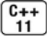

[总目录](<../目录.md>) · [本章目录](<01 章节导读.md>) · [上一篇](<../第3章 字符串、向量和数组/3.5 数组.md>) · [下一篇](<../第3章 字符串、向量和数组/小结.md>)

> 原 PDF 第 195–201 页。

<!-- PDF 第 195 页 -->

# **3.6** 多维数组

严格来说,C++语言中没有多维数组,通常所说的多维数组其实是数组的数组。谨记这一点,对今后理解和使用多维数组大有益处。

当一个数组的元素仍然是数组时,通常使用两个维度来定义它:一个维度表示数组本身大小,另外一个维度表示其元素(也是数组)大小:

<!-- 代码原图: ../images/_page_194_Picture_109.png -->
```c++
int ia[3][4];// 大小为3的数组，每个元素是含有4个整数的数组
// 大小为10的数组，它的每个元素都是大小为20的数组，
// 这些数组的元素是含有30个整数的数组
int arr[10][20][30] = {0};// 将所有元素初始化为0
```

如3.5.1节(第103页)所介绍的,按照由内而外的顺序阅读此类定义有助于更好地理解其真实含义。在第一条语句中,我们定义的名字是 ia,显然ia是一个含有3个元素的数组。接着观察右边发现,ia的元素也有自己的维度,所以ia的元素本身又都是含有4个元素的数组。再观察左边知道,真正存储的元素是整数。因此最后可以明确第一条语句的含义:它定义了一个大小为3的数组,该数组的每个元素都是含有4个整数的数组。

使用同样的方式理解arr的定义。首先arr是一个大小为10的数组, 它的每个元素都是大小为20的数组,这些数组的元素又都是含有30个整数的数组。实际上,定义数组时对下标运算符的数量并没有限制,因此只要愿意就可以定义这样一个数组:它的元素还是数组,下一级数组的元素还是数组,再下一级数组的元素还是数组,以此类推。

对于二维数组来说,常把第一个维度称作行,第二个维度称作列。 多维数组的初始化

允许使用花括号括起来的一组值初始化多维数组,这点和普通的数组一样。下面的初始化形式中,多维数组的每一行分别用花括号括了起来:

<!-- PDF 第 196 页 -->

<!-- 代码原图: ../images/_page_195_Picture_65.png -->
```c++
int ia[3][4] = {
    {0, 1, 2, 3},
    {4, 5, 6, 7},
    {8, 9, 10, 11}
};
// 三个元素，每个元素都是大小为 4 的数组
// 第 1 行的初始值
// 第 2 行的初始值
// 第 3 行的初始值
};
```

其中内层嵌套着的花括号并非必需的,例如下面的初始化语句,形式上更为简洁,完成的功能和上面这段代码完全一样:

<!-- 代码原图: ../images/_page_195_Picture_66.png -->
```c++
// 没有标识每行的花括号，与之前的初始化语句是等价的 int ia[3][4] = {0,1,2,3,4,5,6,7,8,9,10,11};
```

类似于一维数组,在初始化多维数组时也并非所有元素的值都必须包含在初始化列表之内。如果仅仅想初始化每一行的第一个元素,通过如下的语句即可:

<!-- 代码原图: ../images/_page_195_Picture_67.png -->
```c++
// 显式地初始化每行的首元素
int ia[3][4] = {{ 0 }, { 4 }, { 8 }};
```

其他未列出的元素执行默认值初始化,这个过程和一维数组(参见 3.5.1节,第102页)一样。在这种情况下如果再省略掉内层的花括号, 结果就大不一样了。下面的代码

<!-- 代码原图: ../images/_page_195_Picture_68.png -->
```c++
// 显式地初始化第1行，其他元素执行值初始化
int ix[3][4] = {0,3,6,9};
```

含义发生了变化,它初始化的是第一行的4个元素,其他元素被初始化为0。

### 多维数组的下标引用

可以使用下标运算符来访问多维数组的元素,此时数组的每个维度对应一个下标运算符。

如果表达式含有的下标运算符数量和数组的维度一样多,该表达式的结果将是给定类型的元素;反之,如果表达式含有的下标运算符数量比数组的维度小,则表达式的结果将是给定索引处的一个内层数组:

<!-- PDF 第 197 页 -->

<!-- 代码原图: ../images/_page_196_Picture_95.png -->
```c++
// 用 arr的首元素为 ia 最后一行的最后一个元素赋值
ia[2][3] = arr[0][0][0];
int (&row)[4] = ia[1]; // 把 row 绑定到 ia 的第二个 4 元素数组上
```

在第一个例子中,对于用到的两个数组来说,表达式提供的下标运算符数量都和它们各自的维度相同。在等号左侧,ia[2]得到数组ia的最后一行,此时返回的是表示ia最后一行的那个一维数组而非任何实际元素;对这个一维数组再取下标,得到编号为[3]的元素,也就是这一行的最后一个元素。

类似的,等号右侧的运算对象包含3个维度。首先通过索引0得到最外层的数组,它是一个大小为20的(多维)数组;接着获取这20个元素数组的第一个元素,得到一个大小为30的一维数组;最后再取出其中的第一个元素。

在第二个例子中,把row定义成一个含有4个整数的数组的引用,然后将其绑定到ia的第2行。

再举一个例子,程序中经常会用到两层嵌套的for循环来处理多维数组的元素:

<!-- 代码原图: ../images/_page_196_Picture_96.png -->
```c++
constexpr size_t rowCnt = 3, colCnt = 4;
```

<!-- 代码原图: ../images/_page_196_Picture_97.png -->
```c++
int ia[rowCnt][colCnt]; // 12 个未初始化的元素
// 对于每一行

for (size_t i = 0; i != rowCnt; ++i) {
    // 对于行内的每一列

    for (size_t j = 0; j != colCnt; ++j) {
        // 将元素的位置索引作为它的值

        ia[i][j] = i * colCnt + j;
    }
}
```

外层的for循环遍历ia的所有元素,注意这里的元素是一维数组;内层的for循环则遍历那些一维数组的整数元素。此例中,我们将元素的值设为该元素在整个数组中的序号。

使用范围 **for**语句处理多维数组

<!-- PDF 第 198 页 -->

由于在C++11新标准中新增了范围for语句,所以前一个程序可以简化为如下形式:

<!-- 代码原图: ../images/_page_197_Picture_116.png -->
```c++
size_t cnt = 0;
for (auto &row : ia)                // 对于外层数组的每一个元素
    for (auto &col : row) {        // 对于内层数组的每一个元素
        col = cnt;                  // 将下一个值赋给该元素
        ++cnt;                      // 将 cnt 加 1
    }
```

这个循环赋给ia元素的值和之前那个循环是完全相同的,区别之处是通过使用范围for语句把管理数组索引的任务交给了系统来完成。因为要改变元素的值,所以得把控制变量row和col声明成引用类型(参见 3.2.3节,第83页)。第一个for循环遍历ia的所有元素,这些元素是大小为4的数组,因此row的类型就应该是含有4个整数的数组的引用。第二个for循环遍历那些4元素数组中的某一个,因此col的类型是整数的引用。每次迭代把cnt的值赋给ia的当前元素,然后将cnt加1。

在上面的例子中,因为要改变数组元素的值,所以我们选用引用类型作为循环控制变量,但其实还有一个深层次的原因促使我们这么做。 举一个例子,考虑如下的循环:

<!-- 代码原图: ../images/_page_197_Picture_117.png -->
```c++
for (const auto &row : ia)    // 对于外层数组的每一个元素
    for (auto col : row)    // 对于内层数组的每一个元素
        cout << col << endl;
```

这个循环中并没有任何写操作,可是我们还是将外层循环的控制变量声明成了引用类型,这是为了避免数组被自动转成指针(参见3.5.3 节,第105页)。假设不用引用类型,则循环如下述形式:

<!-- 代码原图: ../images/_page_197_Picture_118.png -->
```c++
for (auto row : ia)
for (auto col : row)
```

程序将无法通过编译。这是因为,像之前一样第一个循环遍历ia的所有元素,注意这些元素实际上是大小为4的数组。因为row不是引用类型,所以编译器初始化row时会自动将这些数组形式的元素(和其他类型的数组一样)转换成指向该数组内首元素的指针。这样得到的row的

<!-- PDF 第 199 页 -->

类型就是int\*,显然内层的循环就不合法了,编译器将试图在一个int\* 内遍历,这显然和程序的初衷相去甚远。


要使用范围for语句处理多维数组,除了最内层的循环外,其他所有循环的控制变量都应该是引用类型。

指针和多维数组

当程序使用多维数组的名字时,也会自动将其转换成指向数组首元素的指针。


定义指向多维数组的指针时,千万别忘了这个多维数组实际上是数组的数组。

因为多维数组实际上是数组的数组,所以由多维数组名转换得来的指针实际上是指向第一个内层数组的指针:

<!-- 代码原图: ../images/_page_198_Picture_100.png -->
```c++
int ia[3][4]; // 大小为3的数组，每个元素是含有4个整数的数组
int (*p)[4] = ia; // p指向含有4个整数的数组
p = &ia[2]; // p指向ia的尾元素
```

根据3.5.1节(第103页)提出的策略,我们首先明确(\*p)意味着 p是一个指针。接着观察右边发现,指针p所指的是一个维度为4的数组;再观察左边知道,数组中的元素是整数。因此,p就是指向含有4个整数的数组的指针。


在上述声明中,圆括号必不可少:

<!-- 代码原图: ../images/_page_198_Picture_102.png -->
```c++
int *ip[4]; // 整型指针的数组
int (*ip)[4]; // 指向含有4个整数的数组
```



随着C++11新标准的提出,通过使用auto或者decltype(参见2.5.2 节,第61页)就能尽可能地避免在数组前面加上一个指针类型了:

<!-- PDF 第 200 页 -->

<!-- 代码原图: ../images/_page_199_Picture_109.png -->
```c++
// 输出 ia 中每个元素的值，每个内层数组各占一行
// p 指向含有 4 个整数的数组
for (auto p = ia; p != ia + 3; ++p) {
    // q 指向 4 个整数数组的首元素，也就是说，q 指向一个整数
    for (auto q = *p; q != *p + 4; ++q)
        cout << *q << ' ';
    cout << endl;
}
```

外层的for循环首先声明一个指针p并令其指向ia的第一个内层数组,然后依次迭代直到ia的全部3行都处理完为止。其中递增运算++p负责将指针p移动到ia的下一行。

内层的for循环负责输出内层数组所包含的值。它首先令指针q指向p 当前所在行的第一个元素。\*p是一个含有4个整数的数组,像往常一样,数组名被自动地转换成指向该数组首元素的指针。内层for循环不断迭代直到我们处理完了当前内层数组的所有元素为止。为了获取内层for 循环的终止条件,再一次解引用p得到指向内层数组首元素的指针,给它加上4就得到了终止条件。

当然,使用标准库函数begin和end(参见3.5.3节,第106页)也能实现同样的功能,而且看起来更简洁一些:

<!-- 代码原图: ../images/_page_199_Picture_110.png -->
```c++
// p指向ia的第一个数组
for (auto p = begin(ia); p != end(ia); ++p) {
    // q指向内层数组的首元素
    for (auto q = begin(*p); q != end(*p); ++q)
        cout << *q << ' '; // 输出q所指的整数值
    cout << endl;
}
```

在这一版本的程序中,循环终止条件由end函数负责判断。虽然我们也能推断出p的类型是指向含有4个整数的数组的指针,q的类型是指向整数的指针,但是使用auto关键字我们就不必再烦心这些类型到底是什么了。

类型别名简化多维数组的指针

读、写和理解一个指向多维数组的指针是一个让人不胜其烦的工

<!-- PDF 第 201 页 -->

作,使用类型别名(参见2.5.1节,第60页)能让这项工作变得简单一点儿,例如:

<!-- 代码原图: ../images/_page_200_Picture_88.png -->
```c++
using int_array = int[4]; // 新标准下类型别名的声明，参见2.5.1节（第60页）
typedef int int_array[4]; // 等价的 typedef 声明，参见2.5.1节（第60页）

// 输出ia中每个元素的值，每个内层数组各占一行
for (int_array *p = ia; p != ia + 3; ++p) {
    for (int *q = *p; q != *p + 4; ++q)
        cout << *q << ' ';
    cout << endl;
}
```

程序将类型"4个整数组成的数组"命名为int\_array,用类型名 int\_array定义外层循环的控制变量让程序显得简洁明了。

## **3.6**节练习

练习**3.43**:编写3个不同版本的程序,令其均能输出ia的元素。版本1使用范围for语句管理迭代过程;版本2和版本3都使用普通的for语句,其中版本2要求用下标运算符,版本3要求用指针。此外,在所有3个版本的程序中都要直接写出数据类型,而不能使用类型别名、auto关键字或 decltype关键字。

练习**3.44**:改写上一个练习中的程序,使用类型别名来代替循环控制变量的类型。

练习**3.45**:再一次改写程序,这次使用auto关键字。


