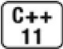

[总目录](<../目录.md>) · [本章目录](<01 章节导读.md>) · [上一篇](<../第4章 表达式/4.3 逻辑和关系运算符.md>) · [下一篇](<../第4章 表达式/4.5 递增和递减运算符.md>)

> 原 PDF 第 225–229 页。

<!-- PDF 第 225 页 -->

## **4.4** 赋值运算符

赋值运算符的左侧运算对象必须是一个可修改的左值。如果给定

<!-- 代码原图: ../images/_page_224_Picture_68.png -->
```c++
int i = 0, j = 0, k = 0; // 初始化而非赋值
const int ci = i; // 初始化而非赋值
```

则下面的赋值语句都是非法的:

<!-- 代码原图: ../images/_page_224_Picture_69.png -->
```c++
1024 = k; // 错误：字面值是右值
i + j = k; // 错误：算术表达式是右值
ci = k; // 错误：ci是常量（不可修改的）左值
```

赋值运算的结果是它的左侧运算对象,并且是一个左值。相应的, 结果的类型就是左侧运算对象的类型。如果赋值运算符的左右两个运算对象类型不同,则右侧运算对象将转换成左侧运算对象的类型:

<!-- 代码原图: ../images/_page_224_Picture_70.png -->
```c++
k=0; // 结果：类型是 int，值是0
k=3.14159; // 结果：类型是 int，值是3
```



C++11新标准允许使用花括号括起来的初始值列表(参见2.2.1节, 第39页)作为赋值语句的右侧运算对象:

<!-- 代码原图: ../images/_page_224_Picture_72.png -->
```c++
k = {3.14}; // 错误：窄化转换
vector<int> vi; // 初始为空
vi = {0,1,2,3,4,5,6,7,8,9}; // vi 现在含有10个元素了，值从0到9
```

如果左侧运算对象是内置类型,那么初始值列表最多只能包含一个值,而且该值即使转换的话其所占空间也不应该大于目标类型的空间 (参见2.2.1节,第39页)。

对于类类型来说,赋值运算的细节由类本身决定。对于vector来说,vector模板重载了赋值运算符并且可以接收初始值列表,当赋值发生时用右侧运算对象的元素替换左侧运算对象的元素。

<!-- PDF 第 226 页 -->

无论左侧运算对象的类型是什么,初始值列表都可以为空。此时, 编译器创建一个值初始化(参见3.3.1节,第88页)的临时量并将其赋给左侧运算对象。

#### 赋值运算满足右结合律

赋值运算符满足右结合律,这一点与其他二元运算符不太一样:

<!-- 代码原图: ../images/_page_225_Picture_116.png -->
```c++
int ival, jval;
ival = jval = 0; // 正确：都被赋值为0
```

因为赋值运算符满足右结合律,所以靠右的赋值运算jval=0作为靠左的赋值运算符的右侧运算对象。又因为赋值运算返回的是其左侧运算对象,所以靠右的赋值运算的结果(即jval)被赋给了ival。

对于多重赋值语句中的每一个对象,它的类型或者与右边对象的类型相同、或者可由右边对象的类型转换得到(参见4.11节,第141 页):

<!-- 代码原图: ../images/_page_225_Picture_117.png -->
```c++
int ival, *pval; // ival的类型是 int; pval 是指向 int 的指针
ival = pval = 0; // 错误：不能把指针的值赋给 int
string s1, s2;
s1 = s2 = "OK"; // 字符串字面值"OK"转换成 string 对象
```

因为ival和pval的类型不同,而且pval的类型(int\*)无法转换成 ival的类型(int),所以尽管0这个值能赋给任何对象,但是第一条赋值语句仍然是非法的。

与之相反,第二条赋值语句是合法的。这是因为字符串字面值可以转换成string对象并赋给s2,而s2和s1的类型相同,所以s2的值可以继续赋给s1。

#### 赋值运算优先级较低

赋值语句经常会出现在条件当中。因为赋值运算的优先级相对较低,所以通常需要给赋值部分加上括号使其符合我们的原意。下面这个循环说明了把赋值语句放在条件当中有什么用处,它的目的是反复调用一个函数直到返回期望的值(比如42)为止:

<!-- PDF 第 227 页 -->

<!-- 代码原图: ../images/_page_226_Picture_94.png -->
```c++
// 这是一种形式烦琐、容易出错的写法
int i = get_value();          // 得到第一个值
while (i != 42) {
    // 其他处理 ……
    i = get_value();          // 得到剩下的值
}
```

在这段代码中,首先调用get\_value函数得到一个值,然后循环部分使用该值作为条件。在循环体内部,最后一条语句会再次调用get\_value 函数并不断重复循环。可以将上述代码以更简单直接的形式表达出来:

<!-- 代码原图: ../images/_page_226_Picture_95.png -->
```c++
int i;
// 更好的写法：条件部分表达得更加清晰
while ((i = get_value()) != 42) {
    // 其他处理……
}
```

这个版本的while条件更容易表达我们的真实意图:不断循环读取数据直至遇到42为止。其处理过程是首先将get\_value函数的返回值赋给 i,然后比较i和42是否相等。

如果不加括号的话含义会有很大变化,比较运算符!=的运算对象将是get\_value函数的返回值及42,比较的结果不论真假将以布尔值的形式赋值给i,这显然不是我们期望的结果。


因为赋值运算符的优先级低于关系运算符的优先级,所以在条件语句中,赋值部分通常应该加上括号。

切勿混淆相等运算符和赋值运算符

C++语言允许用赋值运算作为条件,但是这一特性可能带来意想不到的后果:

<!-- 代码原图: ../images/_page_226_Picture_97.png -->
```c++
if (i=j)
```

此时,if语句的条件部分把j的值赋给i,然后检查赋值的结果是否为真。如果j不为0,条件将为真。然而程序员的初衷很可能是想判断i和j

<!-- PDF 第 228 页 -->

是否相等:

<!-- 代码原图: ../images/_page_227_Picture_79.png -->
```c++
if (i == j)
```

程序的这种缺陷显然很难被发现,好在一部分编译器会对类似的代码给出警告信息。

复合赋值运算符

我们经常需要对对象施以某种运算,然后把计算的结果再赋给该对象。举个例子,考虑1.4.2节(第11页)的求和程序:

<!-- 代码原图: ../images/_page_227_Picture_80.png -->
```c++
int sum = 0;
// 计算从1到10（包含10在内）的和
for (int val = 1; val <= 10; ++val)
    sum += val;        // 等价于 sum = sum + val
```

这种复合操作不仅对加法来说很常见,而且也常常应用于其他算术运算符或者4.8节(第135页)将要介绍的位运算符。每种运算符都有相应的复合赋值形式:

<!-- 代码原图: ../images/_page_227_Picture_81.png -->
```c++
+= -= *= /= %= //算术运算符
<<= >>= &= ^= |= //位运算符，参见4.8节（第135页）
```

任意一种复合运算符都完全等价于

<!-- 代码原图: ../images/_page_227_Picture_82.png -->
```c++
a = a op b;
```

唯一的区别是左侧运算对象的求值次数:使用复合运算符只求值一次,使用普通的运算符则求值两次。这两次包括:一次是作为右边子表达式的一部分求值,另一次是作为赋值运算的左侧运算对象求值。其实在很多地方,这种区别除了对程序性能有些许影响外几乎可以忽略不计。

### **4.4**节练习

练习**4.13**:在下述语句中,当赋值完成后i和d的值分别是多少?

<!-- PDF 第 229 页 -->

<!-- 代码原图: ../images/_page_228_Picture_26.png -->
```c++
int i; double d;
(a) d = i = 3.5; (b) i = d = 3.5;
```

练习**4.14**:执行下述if语句后将发生什么情况?

<!-- 代码原图: ../images/_page_228_Picture_27.png -->
```c++
if (42=i)//... if (i=42)//...
```

练习**4.15**:下面的赋值是非法的,为什么?应该如何修改?

<!-- 代码原图: ../images/_page_228_Picture_28.png -->
```c++
double dval; int ival; int *pi;
dval = ival = pi = 0;
```

练习**4.16**:尽管下面的语句合法,但它们实际执行的行为可能和预期并不一样,为什么?应该如何修改?

<!-- 代码原图: ../images/_page_228_Picture_29.png -->
```c++
(a) if (p = getPtr() != 0) (b) if (i = 1024)
```


