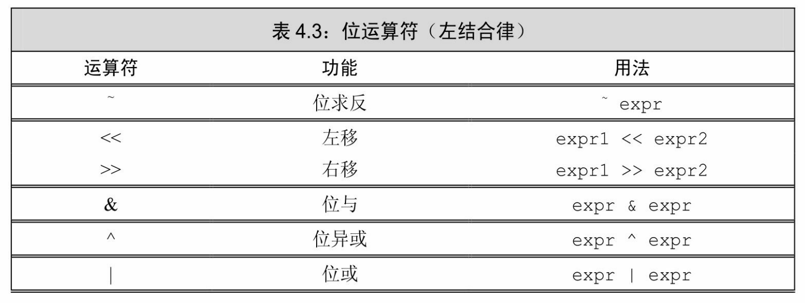
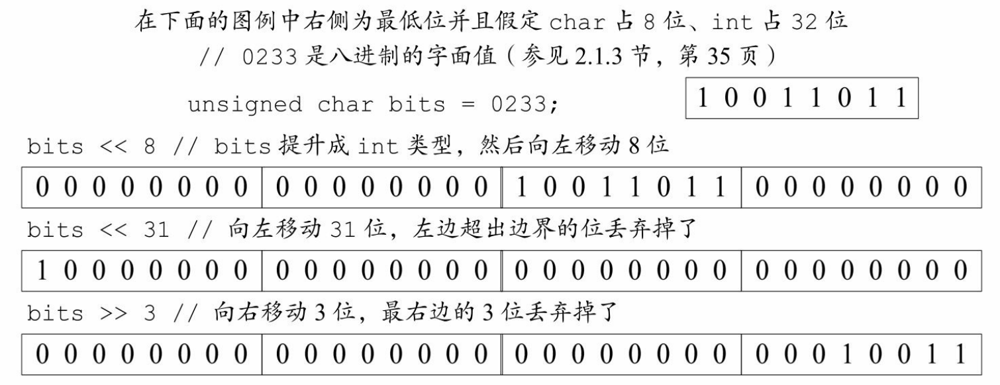
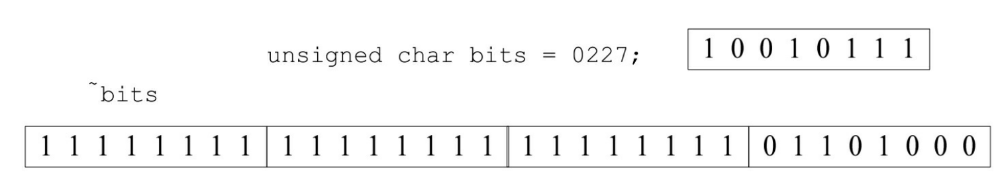
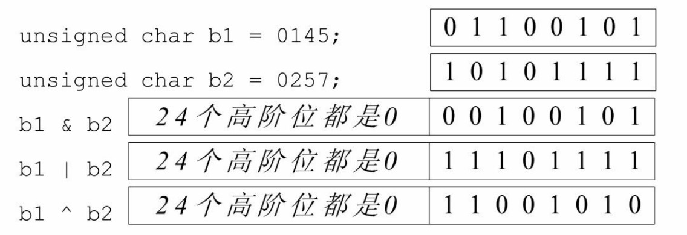

[总目录](<../目录.md>) · [本章目录](<01 章节导读.md>) · [上一篇](<../第4章 表达式/4.7 条件运算符.md>) · [下一篇](<../第4章 表达式/4.9 sizeof运算符.md>)

> 原 PDF 第 237–242 页。

<!-- PDF 第 237 页 -->

# **4.8** 位运算符

位运算符作用于整数类型的运算对象,并把运算对象看成是二进制位的集合。位运算符提供检查和设置二进制位的功能,如17.2节(第 640页)将要介绍的,一种名为bitset的标准库类型也可以表示任意大小的二进制位集合,所以位运算符同样能用于bitset类型。



一般来说,如果运算对象是"小整型",则它的值会被自动提升(参见4.11.1节,第142页)成较大的整数类型。运算对象可以是带符号的, 也可以是无符号的。如果运算对象是带符号的且它的值为负,那么位运算符如何处理运算对象的"符号位"依赖于机器。而且,此时的左移操作可能会改变符号位的值,因此是一种未定义的行为。


关于符号位如何处理没有明确的规定,所以强烈建议仅将位运算符用于处理无符号类型。

### 移位运算符

之前在处理输入和输出操作时,我们已经使用过标准IO库定义的<< 运算符和>>运算符的重载版本。这两种运算符的内置含义是对其运算对象执行基于二进制位的移动操作,首先令左侧运算对象的内容按照右侧运算对象的要求移动指定位数,然后将经过移动的(可能还进行了提升)左侧运算对象的拷贝作为求值结果。其中,右侧的运算对象一定不

<!-- PDF 第 238 页 -->

能为负,而且值必须严格小于结果的位数,否则就会产生未定义的行为。二进制位或者向左移(<<)或者向右移(>>),移出边界之外的位就被舍弃掉了:



左移运算符(<<)在右侧插入值为0的二进制位。右移运算符 (>>)的行为则依赖于其左侧运算对象的类型:如果该运算对象是无符号类型,在左侧插入值为0的二进制位;如果该运算对象是带符号类型,在左侧插入符号位的副本或值为0的二进制位,如何选择要视具体环境而定。

#### 位求反运算符

位求反运算符(~)将运算对象逐位求反后生成一个新值,将1置为 0、将0置为1:



char类型的运算对象首先提升成int类型,提升时运算对象原来的位保持不变,往高位(high order position)添加0即可。因此在本例中,首先将bits提升成int类型,增加24个高位0,随后将提升后的值逐位求反。

### 位与、位或、位异或运算符

与(&)、或(|)、异或(^)运算符在两个运算对象上逐位执行

<!-- PDF 第 239 页 -->

相应的逻辑操作:



对于位与运算符(&)来说,如果两个运算对象的对应位置都是1 则运算结果中该位为1,否则为0。对于位或运算符(|)来说,如果两个运算对象的对应位置至少有一个为1则运算结果中该位为1,否则为 0。对于位异或运算符(^)来说,如果两个运算对象的对应位置有且只有一个为1则运算结果中该位为1,否则为0。


有一种常见的错误是把位运算符和逻辑运算符(参见4.3节,第126页)搞混了, 比如位与(&)和逻辑与(&&)、位或(|)和逻辑或(||)、位求反(~)和逻辑非 (!)。

#### 使用位运算符

我们举一个使用位运算符的例子:假设班级中有30个学生,老师每周都会对学生进行一次小测验,测验的结果只有通过和不通过两种。为了更好地追踪测验的结果,我们用一个二进制位代表某个学生在一次测验中是否通过,显然全班的测验结果可以用一个无符号整数来表示:

<!-- 代码原图: ../images/_page_238_Picture_140.png -->
```c++
unsigned long quiz1 = 0; // 我们把这个值当成是位的集合来使用
```

定义quiz1的类型是unsigned long,这样,quiz1在任何机器上都将至少拥有32位;给quiz1赋一个明确的初始值,使得它的每一位在开始时都有统一且固定的值。

教师必须有权设置并检查每一个二进制位。例如,我们需要对序号为27的学生对应的位进行设置,以表示他通过了测验。为了达到这一目的,首先创建一个值,该值只有第27位是1其他位都是0,然后将这个值与quiz1进行位或运算,这样就能强行将quiz1的第27位设置为1,其他位

<!-- PDF 第 240 页 -->

都保持不变。

为了实现本例的目的,我们将quiz1的低阶位赋值为0、下一位赋值为1,以此类推,最后统计quiz1各个位的情况。

使用左移运算符和一个unsigned long类型的整数字面值1(参见2.1.3 节,第35页)就能得到一个表示学生27通过了测验的数值:

<!-- 代码原图: ../images/_page_239_Picture_155.png -->
```c++
1UL << 27 // 生成一个值，该值只有第27位为1
```

1UL的低阶位上有一个1,除此之外(至少)还有31个值为0的位。 之所以使用unsigned long类型,是因为int类型只能确保占用16位,而我们至少需要27位。上面这条表达式通过在值为1的那个二进制位后面添加0,使得它向左移动了27位。

接下来将所得的值与quiz1进行位或运算。为了同时更新quiz1的值,使用一条复合赋值语句(参见4.4节,第130页):

<!-- 代码原图: ../images/_page_239_Picture_156.png -->
```c++
quiz1 |= 1UL << 27; // 表示学生27通过了测验
```

| =运算符的工作原理和+=非常相似,它等价于

<!-- 代码原图: ../images/_page_239_Picture_157.png -->
```c++
quiz1 = quiz1 | 1UL << 27; // 等价于 quiz1 |= 1UL << 27;
```

假定教师在重新核对测验结果时发现学生27实际上并没有通过测验,他必须要把第27位的值置为0。此时我们需要使用一个特殊的整数,它的第27位是0、其他所有位都是1。将这个值与quiz1进行位与运算就能实现目的了:

<!-- 代码原图: ../images/_page_239_Picture_158.png -->
```c++
quiz1 &= ~(1UL << 27); // 学生27没有通过测验
```

通过将之前的值按位求反得到一个新值,除了第27位外都是1,只有第27位的值是0。随后将该值与quiz1进行位与运算,所得结果除了第 27位外都保持不变。

最后,我们试图检查学生27测验的情况到底怎么样:

<!-- 代码原图: ../images/_page_239_Picture_159.png -->
```c++
bool status = quiz1 & (1UL << 27); // 学生27是否通过了测验？
```

<!-- PDF 第 241 页 -->

我们将quiz1和一个只有第27位是1的值按位求与,如果quiz1的第27 位是1,计算的结果就是非0(真);否则结果是0。

移位运算符(又叫**IO**运算符)满足左结合律

尽管很多程序员从未直接用过位运算符,但是几乎所有人都用过它们的重载版本来进行IO操作。重载运算符的优先级和结合律都与它的内置版本一样,因此即使程序员用不到移位运算符的内置含义,也仍然有必要理解其优先级和结合律。

因为移位运算符满足左结合律,所以表达式

<!-- 代码原图: ../images/_page_240_Picture_130.png -->
```c++
cout << "hi" << " there" << endl;
```

的执行过程实际上等同于

<!-- 代码原图: ../images/_page_240_Picture_131.png -->
```c++
( (cout << "hi") << " there" ) << endl;
```

在这条语句中,运算对象"hi"和第一个<<组合在一起,它的结果和第二个<<组合在一起,接下来的结果再和第三个<<组合在一起。

移位运算符的优先级不高不低,介于中间:比算术运算符的优先级低,但比关系运算符、赋值运算符和条件运算符的优先级高。因此在一次使用多个运算符时,有必要在适当的地方加上括号使其满足我们的要求。

<!-- 代码原图: ../images/_page_240_Picture_132.png -->
```c++
cout << 42 + 10; // 正确：+的优先级更高，因此输出求和结果
cout << (10 < 42); // 正确：括号使运算对象按照我们的期望组合在一起，输出1
cout << 10 < 42; // 错误：试图比较cout和42！
```

最后一个cout的含义其实是

<!-- 代码原图: ../images/_page_240_Picture_133.png -->
```c++
(cout << 10) < 42;
```

也就是"把数字10写到cout,然后将结果(即cout)与42进行比较"。

### **4.8**节练习

练习**4.25**:如果一台机器上int占32位、char占8位,用的是Latin-1字符

<!-- PDF 第 242 页 -->

集,其中字符'q'的二进制形式是01110001,那么表达式~'q'<<6的值是什么?

练习**4.26**:在本节关于测验成绩的例子中,如果使用unsigned int作为 quiz1的类型会发生什么情况?

练习**4.27**:下列表达式的结果是什么?

<!-- 代码原图: ../images/_page_241_Picture_33.png -->
```c++
unsigned long ul1 = 3, ul2 = 7;
(a) ul1 & ul2 (b) ul1 | ul2
(c) ul1 && ul2 (d) ul1 || ul2
```


