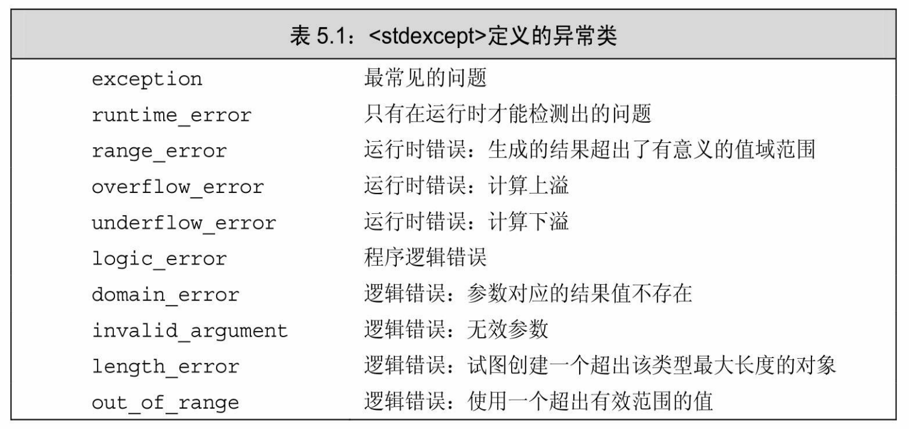

[总目录](<../目录.md>) · [本章目录](<01 章节导读.md>) · [上一篇](<../第5章 语句/5.5 跳转语句.md>) · [下一篇](<../第5章 语句/小结.md>)

> 原 PDF 第 298–304 页。

<!-- PDF 第 298 页 -->

## **5.6 try**语句块和异常处理

异常是指存在于运行时的反常行为,这些行为超出了函数正常功能的范围。典型的异常包括失去数据库连接以及遇到意外输入等。处理反常行为可能是设计所有系统最难的一部分。

当程序的某部分检测到一个它无法处理的问题时,需要用到异常处理。此时,检测出问题的部分应该发出某种信号以表明程序遇到了故障,无法继续下去了,而且信号的发出方无须知道故障将在何处得到解决。一旦发出异常信号,检测出问题的部分也就完成了任务。

如果程序中含有可能引发异常的代码,那么通常也会有专门的代码处理问题。例如,如果程序的问题是输入无效,则异常处理部分可能会要求用户重新输入正确的数据;如果丢失了数据库连接,会发出报警信息。

异常处理机制为程序中异常检测和异常处理这两部分的协作提供支持。在C++语言中,异常处理包括:

· **throw**表达式(throw expression),异常检测部分使用throw表达式来表示它遇到了无法处理的问题。我们说throw引发(raise)了异常。

· **try**语句块(try block),异常处理部分使用try语句块处理异常。 try语句块以关键字try开始,并以一个或多个**catch**子句(catch clause) 结束。try语句块中代码抛出的异常通常会被某个catch子句处理。因为 catch子句"处理"异常,所以它们也被称作异常处理代码(exception handler)。

· 一套异常类(exception class),用于在throw表达式和相关的catch 子句之间传递异常的具体信息。

在本节的剩余部分,我们将分别介绍异常处理的这三个组成部分。 在18.1节(第684页)还将介绍更多关于异常的知识。

## **5.6.1 throw**表达式

<!-- PDF 第 299 页 -->

程序的异常检测部分使用throw表达式引发一个异常。throw表达式包含关键字throw和紧随其后的一个表达式,其中表达式的类型就是抛出的异常类型。throw表达式后面通常紧跟一个分号,从而构成一条表达式语句。

举个简单的例子,回忆1.5.2节(第20页)把两个Sales\_item对象相加的程序。这个程序检查它读入的记录是否是关于同一种书籍的,如果不是,输出一条信息然后退出。

<!-- 代码原图: ../images/_page_298_Picture_92.png -->
```c++
Sales_item item1, item2;
cin >> item1 >> item2;
// 首先检查 item1 和 item2 是否表示同一种书籍
if (item1.isbn() == item2.isbn()) {
    cout << item1 + item2 << endl;
    return 0; // 表示成功
} else {
    cerr << "Data must refer to same ISBN" << endl;
    return -1; // 表示失败
}
```

在真实的程序中,应该把对象相加的代码和用户交互的代码分离开来。此例中,我们改写程序使得检查完成后不再直接输出一条信息,而是抛出一个异常:

<!-- 代码原图: ../images/_page_298_Picture_93.png -->
```c++
// 首先检查两条数据是否是关于同一种书籍的
if (item1.isbn() != item2.isbn())
    throw runtime_error("Data must refer to same ISBN");
// 如果程序执行到了这里，表示两个 ISBN 是相同的
cout << item1 + item2 << endl;
```

在这段代码中,如果ISBN不一样就抛出一个异常,该异常是类型 runtime\_error的对象。抛出异常将终止当前的函数,并把控制权转移给能处理该异常的代码。

类型runtime\_error是标准库异常类型的一种,定义在stdexcept头文件中。关于标准库异常类型更多的知识将在5.6.3节(第176页)介绍。 我们必须初始化runtime\_error的对象,方式是给它提供一个string对象或者一个C风格的字符串(参见3.5.4节,第109页),这个字符串中有一些 

<!-- PDF 第 300 页 -->

关于异常的辅助信息。

## **5.6.2 try**语句块

try语句块的通用语法形式是

<!-- 代码原图: ../images/_page_299_Picture_109.png -->
```c++
try {
    program-statements
} catch (exception-declaration) {
    handler-statements
} catch (exception-declaration) {
    handler-statements
} // ...
```

try语句块的一开始是关键字try,随后紧跟着一个块,这个块就像大多数时候那样是花括号括起来的语句序列。

跟在try块之后的是一个或多个catch子句。catch子句包括三部分: 关键字catch、括号内一个(可能未命名的)对象的声明(称作异常声明,exception declaration)以及一个块。当选中了某个catch子句处理异常之后,执行与之对应的块。catch一旦完成,程序跳转到try语句块最后一个catch子句之后的那条语句继续执行。

try语句块中的*program-statements*组成程序的正常逻辑,像其他任何块一样,*program-statements*可以有包括声明在内的任意C++语句。一如往常,try语句块内声明的变量在块外部无法访问,特别是在catch子句内也无法访问。

#### 编写处理代码

在之前的例子里,我们使用了一个throw表达式以避免把两个代表不同书籍的Sales\_item相加。我们假设执行Sales\_item对象加法的代码是与用户交互的代码分离开来的。其中与用户交互的代码负责处理发生的异常,它的形式可能如下所示:

<!-- PDF 第 301 页 -->

<!-- 代码原图: ../images/_page_300_Picture_133.png -->
```c++
while (cin >> item1 >> item2) {
    try {
        // 执行添加两个 Sales_item 对象的代码
        // 如果添加失败，代码抛出一个 runtime_error 异常
    } catch (runtime_error err) {
        // 提醒用户两个 ISBN 必须一致，询问是否重新输入
        cout << err.what()
            << "\nTry Again? Enter y or n" << endl;
        char c;
        cin >> c;
```

<!-- 代码原图: ../images/_page_300_Picture_134.png -->
```c++
if (!cin || c == 'n')
    break; // 跳出 while 循环
}
}
```

程序本来要执行的任务出现在try语句块中,这是因为这段代码可能会抛出一个runtime\_error类型的异常。

try语句块对应一个catch子句,该子句负责处理类型为runtime\_error 的异常。如果try语句块的代码抛出了runtime\_error异常,接下来执行 catch块内的语句。在我们书写的catch子句中,输出一段提示信息要求用户指定程序是否继续。如果用户输入'n',执行break语句并退出while 循环;否则,直接执行while循环的右侧花括号,意味着程序控制权跳回到while条件部分准备下一次迭代。

给用户的提示信息中输出了err.what()的返回值。我们知道err的类型是runtime\_error,因此能推断what是runtime\_error类的一个成员函数 (参见1.5.2节,第20页)。每个标准库异常类都定义了名为what的成员函数,这些函数没有参数,返回值是C风格字符串(即const char\*)。 其中,runtime\_error的what成员返回的是初始化一个具体对象时所用的 string对象的副本。如果上一节编写的代码抛出异常,则本节的catch子句输出

#### **Data must refer to same ISBN**

#### **Try Again? Enter y or n**

函数在寻找处理代码的过程中退出

<!-- PDF 第 302 页 -->

在复杂系统中,程序在遇到抛出异常的代码前,其执行路径可能已经经过了多个try语句块。例如,一个try语句块可能调用了包含另一个 try语句块的函数,新的try语句块可能调用了包含又一个try语句块的新函数,以此类推。

寻找处理代码的过程与函数调用链刚好相反。当异常被抛出时,首先搜索抛出该异常的函数。如果没找到匹配的catch子句,终止该函数, 并在调用该函数的函数中继续寻找。如果还是没有找到匹配的catch子句,这个新的函数也被终止,继续搜索调用它的函数。以此类推,沿着程序的执行路径逐层回退,直到找到适当类型的catch子句为止。

如果最终还是没能找到任何匹配的catch子句,程序转到名为**terminate**的标准库函数。该函数的行为与系统有关,一般情况下,执行该函数将导致程序非正常退出。

对于那些没有任何try语句块定义的异常,也按照类似的方式处理: 毕竟,没有try语句块也就意味着没有匹配的catch子句。如果一段程序没有try语句块且发生了异常,系统会调用terminate函数并终止当前程序的执行。

#### 提示:编写异常安全的代码非常困难

要好好理解这句话:异常中断了程序的正常流程。异常发生时,调用者请求的一部分计算可能已经完成了,另一部分则尚未完成。通常情况下,略过部分程序意味着某些对象处理到一半就戛然而止,从而导致对象处于无效或未完成的状态,或者资源没有正常释放,等等。那些在异常发生期间正确执行了"清理"工作的程序被称作异常安全(exception safe)的代码。然而经验表明,编写异常安全的代码非常困难,这部分知识也(远远)超出了本书的范围。

对于一些程序来说,当异常发生时只是简单地终止程序。此时,我们不怎么需要担心异常安全的问题。

但是对于那些确实要处理异常并继续执行的程序,就要加倍注意了。我们必须时刻清楚异常何时发生,异常发生后程序应如何确保对象有效、资源无泄漏、程序处于合理状态,等等。

我们会在本书中介绍一些比较常规的提升异常安全性的技术。但是读者需要注意,如果你的程序要求非常鲁棒的异常处理,那么仅有我们介绍的这些技术恐怕还是不够的。

## **5.6.3** 标准异常

<!-- PDF 第 303 页 -->

C++标准库定义了一组类,用于报告标准库函数遇到的问题。这些异常类也可以在用户编写的程序中使用,它们分别定义在4个头文件中:

· exception头文件定义了最通用的异常类exception。它只报告异常的发生,不提供任何额外信息。

· stdexcept头文件定义了几种常用的异常类,详细信息在表5.1中列出。

· new头文件定义了bad\_alloc异常类型,这种类型将在12.1.2节(第 407页)详细介绍。

· type\_info头文件定义了bad\_cast异常类型,这种类型将在19.2节 (第731页)详细介绍。



标准库异常类只定义了几种运算,包括创建或拷贝异常类型的对象,以及为异常类型的对象赋值。

我们只能以默认初始化(参见2.2.1节,第40页)的方式初始化 exception、bad\_alloc和bad\_cast对象,不允许为这些对象提供初始值。

其他异常类型的行为则恰好相反:应该使用string对象或者C风格字符串初始化这些类型的对象,但是不允许使用默认初始化的方式。当创建此类对象时,必须提供初始值,该初始值含有错误相关的信息。

<!-- PDF 第 304 页 -->

异常类型只定义了一个名为what的成员函数,该函数没有任何参数,返回值是一个指向C风格字符串(参见3.5.4节,第109页)的const char\*。该字符串的目的是提供关于异常的一些文本信息。

what函数返回的C风格字符串的内容与异常对象的类型有关。如果异常类型有一个字符串初始值,则what返回该字符串。对于其他无初始值的异常类型来说,what返回的内容由编译器决定。

#### **5.6.3**节练习

练习**5.23**:编写一段程序,从标准输入读取两个整数,输出第一个数除以第二个数的结果。

练习**5.24**:修改你的程序,使得当第二个数是0时抛出异常。先不要设定catch子句,运行程序并真的为除数输入0,看看会发生什么?

练习**5.25**:修改上一题的程序,使用try语句块去捕获异常。catch子句应该为用户输出一条提示信息,询问其是否输入新数并重新执行try语句块的内容。


