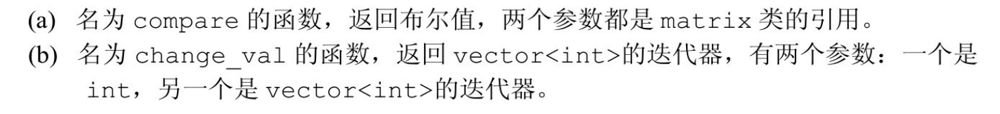
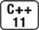
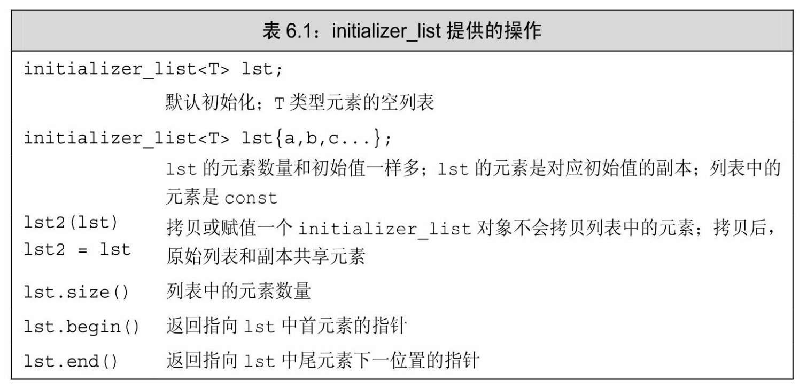

[总目录](<../目录.md>) · [本章目录](<01 章节导读.md>) · [上一篇](<../第6章 函数/6.1 函数基础.md>) · [下一篇](<../第6章 函数/6.3 返回类型和return语句.md>)

> 原 PDF 第 320–338 页。

<!-- PDF 第 320 页 -->

# **6.2** 参数传递

如前所述,每次调用函数时都会重新创建它的形参,并用传入的实参对形参进行初始化。


形参初始化的机理与变量初始化一样。

和其他变量一样,形参的类型决定了形参和实参交互的方式。如果形参是引用类型(参见2.3.1节,第45页),它将绑定到对应的实参上; 否则,将实参的值拷贝后赋给形参。

当形参是引用类型时,我们说它对应的实参被引用传递(passed by reference)或者函数被传引用调用(called by reference)。和其他引用一样,引用形参也是它绑定的对象的别名;也就是说,引用形参是它对应的实参的别名。

当实参的值被拷贝给形参时,形参和实参是两个相互独立的对象。 我们说这样的实参被值传递(passed by value)或者函数被传值调用 (called by value)。

## **6.2.1** 传值参数

当初始化一个非引用类型的变量时,初始值被拷贝给变量。此时, 对变量的改动不会影响初始值:

<!-- 代码原图: ../images/_page_319_Picture_109.png -->
```c++
int n = 0; // int类型的初始变量
int i = n; // i是n的值的副本
i = 42; // i的值改变；n的值不变
```

传值参数的机理完全一样,函数对形参做的所有操作都不会影响实参。例如,在fact函数(参见6.1节,第182页)内对变量val执行递减操作:

<!-- PDF 第 321 页 -->

<!-- 代码原图: ../images/_page_320_Picture_74.png -->
```c++
ret *= val--; // 将val的值减1
```

尽管fact函数改变了val的值,但是这个改动不会影响传入fact的实参。调用fact(i)不会改变i的值。

#### 指针形参

指针的行为和其他非引用类型一样。当执行指针拷贝操作时,拷贝的是指针的值。拷贝之后,两个指针是不同的指针。因为指针使我们可以间接地访问它所指的对象,所以通过指针可以修改它所指对象的值:

<!-- 代码原图: ../images/_page_320_Picture_75.png -->
```c++
int n = 0, i = 42;
int *p = &n, *q = &i; // p指向n；q指向i
*p = 42; // n的值改变；p不变
p = q; // p现在指向了i；但是i和n的值都不变
```

指针形参的行为与之类似:

<!-- 代码原图: ../images/_page_320_Picture_76.png -->
```c++
// 该函数接受一个指针，然后将指针所指的值置为0
void reset(int *ip)
{
    *ip = 0;    // 改变指针 ip 所指对象的值
    ip = 0;    // 只改变了 ip 的局部拷贝，实参未被改变
}
```

调用reset函数之后,实参所指的对象被置为0,但是实参本身并没有改变:

<!-- 代码原图: ../images/_page_320_Picture_77.png -->
```c++
int i = 42;
reset(&i);                        // 改变 i 的值而非 i 的地址
cout << "i = " << i << endl;     // 输出 i = 0
```


熟悉C的程序员常常使用指针类型的形参访问函数外部的对象。在C++语言中,建议使用引用类型的形参替代指针。

#### **6.2.1**节练习

练习**6.10**:编写一个函数,使用指针形参交换两个整数的值。在代码中

<!-- PDF 第 322 页 -->

调用该函数并输出交换后的结果,以此验证函数的正确性。

## **6.2.2** 传引用参数

回忆过去所学的知识,我们知道对于引用的操作实际上是作用在引用所引的对象上(参见2.3.1节,第45页):

<!-- 代码原图: ../images/_page_321_Picture_70.png -->
```c++
int n = 0, i = 42;
int &r = n;    // r绑定了n（即r是n的另一个名字）
```

<!-- 代码原图: ../images/_page_321_Picture_71.png -->
```c++
r = 42; // 现在 n的值是42
r = i; // 现在 n的值和 i相同
i = r; // i的值和 n相同
```

引用形参的行为与之类似。通过使用引用形参,允许函数改变一个或多个实参的值。

举个例子,我们可以改写上一小节的reset程序,使其接受的参数是引用类型而非指针:

<!-- 代码原图: ../images/_page_321_Picture_72.png -->
```c++
//该函数接受一个 int 对象的引用，然后将对象的值置为 0
void reset(int &i)    // i 是传给 reset 函数的对象的另一个名字
{
    i = 0;             // 改变了 i 所引对象的值
}
```

和其他引用一样,引用形参绑定初始化它的对象。当调用这一版本的reset函数时,i绑定我们传给函数的int对象,此时改变i也就是改变i所引对象的值。此例中,被改变的对象是传入reset的实参。

调用这一版本的reset函数时,我们直接传入对象而无须传递对象的地址:

<!-- 代码原图: ../images/_page_321_Picture_73.png -->
```c++
int j = 42;
reset(j);                // j 采用传引用方式，它的值被改变
cout << "j = " << j << endl;    // 输出 j = 0
```

<!-- PDF 第 323 页 -->

在上述调用过程中,形参i仅仅是j的又一个名字。在reset内部对i的使用即是对j的使用。

#### 使用引用避免拷贝

拷贝大的类类型对象或者容器对象比较低效,甚至有的类类型(包括IO类型在内)根本就不支持拷贝操作。当某种类型不支持拷贝操作时,函数只能通过引用形参访问该类型的对象。

举个例子,我们准备编写一个函数比较两个string对象的长度。因为string对象可能会非常长,所以应该尽量避免直接拷贝它们,这时使用引用形参是比较明智的选择。又因为比较长度无须改变string对象的内容,所以把形参定义成对常量的引用(参见2.4.1节,第54页):

<!-- 代码原图: ../images/_page_322_Picture_106.png -->
```c++
// 比较两个 string 对象的长度
bool isShorter(const string &s1, const string &s2)
{
    return s1.size() < s2.size();
}
```

如6.2.3节(第191页)将要介绍的,当函数无须修改引用形参的值时最好使用常量引用。


如果函数无须改变引用形参的值,最好将其声明为常量引用。

#### 使用引用形参返回额外信息

一个函数只能返回一个值,然而有时函数需要同时返回多个值,引用形参为我们一次返回多个结果提供了有效的途径。举个例子,我们定义一个名为find\_char的函数,它返回在string对象中某个指定字符第一次出现的位置。同时,我们也希望函数能返回该字符出现的总次数。

该如何定义函数使得它能够既返回位置也返回出现次数呢?一种方法是定义一个新的数据类型,让它包含位置和数量两个成员。还有另一种更简单的方法,我们可以给函数传入一个额外的引用实参,令其保存字符出现的次数:

<!-- PDF 第 324 页 -->

<!-- 代码原图: ../images/_page_323_Picture_126.png -->
```c++
// 返回 s 中 c 第一次出现的位置索引
// 引用形参 occurs 负责统计 c 出现的总次数
string::size_type find_char(const string &s, char c,
                            string::size_type &occurs)
{
    auto ret = s.size();             // 第一次出现的位置（如果有的话）
    occurs = 0;                      // 设置表示出现次数的形参的值
    for (decltype(ret) i = 0; i != s.size(); ++i) {
        if (s[i] == c) {
            if (ret == s.size())
                ret = i;             // 记录 c 第一次出现的位置
            ++occurs;                 // 将出现的次数加 1
        }
    }
    return ret;                    // 出现次数通过 occurs 隐式地返回
}
```

当我们调用find\_char函数时,必须传入三个实参:作为查找范围的一个string对象、要找的字符以及一个用于保存字符出现次数的 size\_type(参见3.2.2节,第79页)对象。假设s是一个string对象,ctr是一个size\_type对象,则我们通过如下形式调用find\_char函数:

<!-- 代码原图: ../images/_page_323_Picture_127.png -->
```c++
auto index = find_char(s, 'o', ctr);
```

调用完成后,如果string对象中确实存在o,那么ctr的值就是o出现的次数,index指向o第一次出现的位置;否则如果string对象中没有o, index等于s.size()而ctr等于0。

#### **6.2.2**节练习

练习**6.11**:编写并验证你自己的reset函数,使其作用于引用类型的参数。

练习**6.12**:改写6.2.1节中练习6.10(第188页)的程序,使用引用而非指针交换两个整数的值。你觉得哪种方法更易于使用呢?为什么?

练习**6.13**:假设T是某种类型的名字,说明以下两个函数声明的区别: 一个是void f(T),另一个是void f(&T)。

练习**6.14**:举一个形参应该是引用类型的例子,再举一个形参不能是引

<!-- PDF 第 325 页 -->

用类型的例子。

练习**6.15**:说明find\_char函数中的三个形参为什么是现在的类型,特别说明为什么s是常量引用而occurs是普通引用?为什么s和occurs是引用类型而c不是?如果令s是普通引用会发生什么情况?如果令occurs是常量引用会发生什么情况?

## **6.2.3 const**形参和实参

当形参是const时,必须要注意2.4.3节(第57页)关于顶层const的讨论。如前所述,顶层const作用于对象本身:

<!-- 代码原图: ../images/_page_324_Picture_123.png -->
```c++
const int ci = 42; // 不能改变 ci，const 是顶层的
int i = ci; // 正确：当拷贝 ci 时，忽略了它的顶层 const
int * const p = &i; // const 是顶层的，不能给 p 赋值
*p = 0; // 正确：通过 p 改变对象的内容是允许的，现在 i 变成了 0
```

和其他初始化过程一样,当用实参初始化形参时会忽略掉顶层 const。换句话说,形参的顶层const被忽略掉了。当形参有顶层const 时,传给它常量对象或者非常量对象都是可以的:

<!-- 代码原图: ../images/_page_324_Picture_124.png -->
```c++
void fcn(const int i) { /* fcn能够读取i，但是不能向i写值*/ }
```

调用fcn函数时,既可以传入const int也可以传入int。忽略掉形参的顶层const可能产生意想不到的结果:

<!-- 代码原图: ../images/_page_324_Picture_125.png -->
```c++
void fcn(const int i) { /* fcn 能够读取 i，但是不能向 i 写值 */ }
void fcn(int i) { /* ...*/ } // 错误：重复定义了 fcn(int)
```

在C++语言中,允许我们定义若干具有相同名字的函数,不过前提是不同函数的形参列表应该有明显的区别。因为顶层const被忽略掉了, 所以在上面的代码中传入两个fcn函数的参数可以完全一样。因此第二个fcn是错误的,尽管形式上有差异,但实际上它的形参和第一个fcn的形参没什么不同。

指针或引用形参与**const**

<!-- PDF 第 326 页 -->

形参的初始化方式和变量的初始化方式是一样的,所以回顾通用的初始化规则有助于理解本节知识。我们可以使用非常量初始化一个底层 const对象,但是反过来不行;同时一个普通的引用必须用同类型的对象初始化。

<!-- 代码原图: ../images/_page_325_Picture_79.png -->
```c++
int i = 42;
const int *cp = &i; // 正确：但是 cp不能改变 i（参见2.4.2节，第56页）
const int &r = i; // 正确：但是 r不能改变 i（参见2.4.1节，第55页）
const int &r2 = 42; // 正确：（参见2.4.1节，第55页）
int *p = cp; // 错误：p的类型和cp的类型不匹配（参见2.4.2节，第56页）
int &r3 = r; // 错误：r3的类型和r的类型不匹配（参见2.4.1节，第55页）
int &r4 = 42; // 错误：不能用字面值初始化一个非常量引用（参见2.3.1节，第45页）
```

将同样的初始化规则应用到参数传递上可得如下形式:

<!-- 代码原图: ../images/_page_325_Picture_80.png -->
```c++
int i = 0;
const int ci = i;
string::size_type ctr = 0;
reset(&i);                // 调用形参类型是 int*的 reset 函数
reset(&ci);              // 错误：不能用指向 const int 对象的指针初始化 int*
reset(i);                // 调用形参类型是 int&的 reset 函数
reset(ci);                // 错误：不能把普通引用绑定到 const 对象 ci 上
reset(42);                // 错误：不能把普通应用绑定到字面值上
reset(ctr);                // 错误：类型不匹配，ctr 是无符号类型
// 正确：find_char 的第一个形参是对常量的引用
find_char("Hello World!", 'o', ctr);
```

要想调用引用版本的reset(参见6.2.2节,第189页),只能使用int 类型的对象,而不能使用字面值、求值结果为int的表达式、需要转换的对象或者const int类型的对象。类似的,要想调用指针版本的reset(参见6.2.1节,第188页)只能使用int\*。另一方面,我们能传递一个字符串字面值作为find\_char(参见6.2.2节,第189页)的第一个实参,这是因为该函数的引用形参是常量引用,而C++允许我们用字面值初始化常量引用。

#### 尽量使用常量引用

把函数不会改变的形参定义成(普通的)引用是一种比较常见的错

<!-- PDF 第 327 页 -->

误,这么做带给函数的调用者一种误导,即函数可以修改它的实参的值。此外,使用引用而非常量引用也会极大地限制函数所能接受的实参类型。就像刚刚看到的,我们不能把const对象、字面值或者需要类型转换的对象传递给普通的引用形参。

这种错误绝不像看起来那么简单,它可能造成出人意料的后果。以 6.2.2节(第189页)的find\_char函数为例,那个函数(正确地)将它的 string类型的形参定义成常量引用。假如我们把它定义成普通的 string&:

<!-- 代码原图: ../images/_page_326_Picture_97.png -->
```c++
//不良设计：第一个形参的类型应该是 const string&
string::size_type find_char(string &s, char c,
string::size_type &occurs);
```

则只能将find\_char函数作用于string对象。类似下面这样的调用

<!-- 代码原图: ../images/_page_326_Picture_98.png -->
```c++
find_char("Hello World", 'o', ctr);
```

将在编译时发生错误。

还有一个更难察觉的问题,假如其他函数(正确地)将它们的形参定义成常量引用,那么第二个版本的find\_char无法在此类函数中正常使用。举个例子,我们希望在一个判断string对象是否是句子的函数中使用find\_char:

<!-- 代码原图: ../images/_page_326_Picture_99.png -->
```c++
bool is_sentence(const string &s)
{
    // 如果在 s 的末尾有且只有一个句号，则 s 是一个句子
    string::size_type ctr = 0;
    return find_char(s, '.' , ctr) == s.size() - 1 && ctr == 1;
}
```

如果find\_char的第一个形参类型是string&,那么上面这条调用 find\_char的语句将在编译时发生错误。原因在于s是常量引用,但 find\_char被(不正确地)定义成只能接受普通引用。

解决该问题的一种思路是修改is\_sentence的形参类型,但是这么做只不过转移了错误而已,结果是is\_sentence函数的调用者只能接受非常

<!-- PDF 第 328 页 -->

量string对象了。

正确的修改思路是改正find\_char函数的形参。如果实在不能修改 find\_char,就在is\_sentence内部定义一个string类型的变量,令其为s的副本,然后把这个string对象传递给find\_char。

#### **6.2.3**节练习

练习**6.16**:下面的这个函数虽然合法,但是不算特别有用。指出它的局限性并设法改善。

<!-- 代码原图: ../images/_page_327_Picture_95.png -->
```c++
bool is_empty(string& s) { return s.empty(); }
```

练习**6.17**:编写一个函数,判断string对象中是否含有大写字母。编写另一个函数,把string对象全都改成小写形式。在这两个函数中你使用的形参类型相同吗?为什么?

练习**6.18**:为下面的函数编写函数声明,从给定的名字中推测函数具备的功能。



练习**6.19**:假定有如下声明,判断哪个调用合法、哪个调用不合法。对于不合法的函数调用,说明原因。

<!-- 代码原图: ../images/_page_327_Picture_97.png -->
```c++
double calc(double);
int count(const string &, char);
int sum(vector<int>::iterator, vector<int>::iterator, int);
vector<int> vec(10);
(a) calc(23.4, 55.1); (b) count("abcda", 'a');
(c) calc(66); (d) sum(vec.begin(), vec.end(), 3.8);
```

练习**6.20**:引用形参什么时候应该是常量引用?如果形参应该是常量引用,而我们将其设为了普通引用,会发生什么情况?

## **6.2.4** 数组形参

<!-- PDF 第 329 页 -->

数组的两个特殊性质对我们定义和使用作用在数组上的函数有影响,这两个性质分别是:不允许拷贝数组(参见3.5.1节,第102页)以及使用数组时(通常)会将其转换成指针(参见3.5.3节,第105页)。 因为不能拷贝数组,所以我们无法以值传递的方式使用数组参数。因为数组会被转换成指针,所以当我们为函数传递一个数组时,实际上传递的是指向数组首元素的指针。

尽管不能以值传递的方式传递数组,但是我们可以把形参写成类似数组的形式:

<!-- 代码原图: ../images/_page_328_Picture_86.png -->
```c++
// 尽管形式不同，但这三个 print 函数是等价的
// 每个函数都有一个 const int*类型的形参
void print(const int*);
void print(const int[]);    // 可以看出来，函数的意图是作用于一个数组
void print(const int[10]);    // 这里的角度表示我们期望数组含有多少元素，实际
// 不一定
```

尽管表现形式不同,但上面的三个函数是等价的:每个函数的唯一形参都是const int\*类型的。当编译器处理对print函数的调用时,只检查传入的参数是否是const int\*类型:

<!-- 代码原图: ../images/_page_328_Picture_87.png -->
```c++
int i = 0, j[2] = {0, 1};
print(&i); // 正确：&i的类型是 int*
print(j); // 正确：j转换成 int*并指向 j[0]
```

如果我们传给print函数的是一个数组,则实参自动地转换成指向数组首元素的指针,数组的大小对函数的调用没有影响。


和其他使用数组的代码一样,以数组作为形参的函数也必须确保使用数组时不会越界。

因为数组是以指针的形式传递给函数的,所以一开始函数并不知道数组的确切尺寸,调用者应该为此提供一些额外的信息。管理指针形参有三种常用的技术。

使用标记指定数组长度

<!-- PDF 第 330 页 -->

管理数组实参的第一种方法是要求数组本身包含一个结束标记,使用这种方法的典型示例是C风格字符串(参见3.5.4节,第109页)。C风格字符串存储在字符数组中,并且在最后一个字符后面跟着一个空字符。函数在处理C风格字符串时遇到空字符停止:

<!-- 代码原图: ../images/_page_329_Picture_76.png -->
```c++
void print(const char *cp)
{
    if (cp)                // 若 cp 不是一个空指针
        while (*cp)        // 只要指针所指的字符不是空字符
            cout << *cp++;  // 输出当前字符并将指针向前移动一个位置
}
```

这种方法适用于那些有明显结束标记且该标记不会与普通数据混淆的情况,但是对于像int这样所有取值都是合法值的数据就不太有效了。 使用标准库规范

管理数组实参的第二种技术是传递指向数组首元素和尾后元素的指针,这种方法受到了标准库技术的启发,关于其细节将在第II部分详细介绍。使用该方法,我们可以按照如下形式输出元素内容:

<!-- 代码原图: ../images/_page_329_Picture_77.png -->
```c++
void print(const int *beg, const int *end)
{
    // 输出 beg 到 end 之间（不含 end）的所有元素
    while (beg != end)
        cout << *beg++ << endl; // 输出当前元素并将指针向前移动一个位置
}
```

while循环使用解引用运算符和后置递减运算符(参见4.5节,第131 页)输出当前元素并在数组内将beg向前移动一个元素,当beg和end相等时结束循环。

为了调用这个函数,我们需要传入两个指针:一个指向要输出的首元素,另一个指向尾元素的下一位置:

<!-- 代码原图: ../images/_page_329_Picture_78.png -->
```c++
int j[2] = {0, 1};
// j转换成指向它首元素的指针
// 第二个实参是指向 j的尾后元素的指针
print(begin(j), end(j));    // begin和end函数，参见第3.5.3节（106页）
```

<!-- PDF 第 331 页 -->

只要调用者能正确地计算指针所指的位置,那么上述代码就是安全的。在这里,我们使用标准库begin和end函数(参见3.5.3节,第106页) 提供所需的指针。

#### 显式传递一个表示数组大小的形参

第三种管理数组实参的方法是专门定义一个表示数组大小的形参, 在C程序和过去的C++程序中常常使用这种方法。使用该方法,可以将 print函数重写成如下形式:

<!-- 代码原图: ../images/_page_330_Picture_106.png -->
```c++
// const int ia[]等价于 const int* ia
// size 表示数组的大小，将它显式地传给函数用于控制对 ia 元素的访问
void print(const int ia[], size_t size)
{
    for (size_t i = 0; i != size; ++i) {
        cout << ia[i] << endl;
    }
}
```

这个版本的程序通过形参size的值确定要输出多少个元素,调用 print函数时必须传入这个表示数组大小的值:

<!-- 代码原图: ../images/_page_330_Picture_107.png -->
```c++
int j[] = { 0, 1 }; // 大小为2的整型数组
print(j, end(j) - begin(j));
```

只要传递给函数的size值不超过数组实际的大小,函数就是安全的。

#### 数组形参和**const**

我们的三个print函数都把数组形参定义成了指向const的指针,6.2.3 节(第191页)关于引用的讨论同样适用于指针。当函数不需要对数组元素执行写操作的时候,数组形参应该是指向const的指针(参见2.4.2 节,第56页)。只有当函数确实要改变元素值的时候,才把形参定义成指向非常量的指针。

#### 数组引用形参

C++语言允许将变量定义成数组的引用(参见3.5.1节,第101 页),基于同样的道理,形参也可以是数组的引用。此时,引用形参绑 

<!-- PDF 第 332 页 -->

定到对应的实参上,也就是绑定到数组上:

<!-- 代码原图: ../images/_page_331_Picture_72.png -->
```c++
// 正确：形参是数组的引用，维度是类型的一部分
void print(int (&arr)[10])
{
    for (auto elem : arr)
        cout << elem << endl;
}
```


&arr两端的括号必不可少(参见3.5.1节,第101页):

<!-- 代码原图: ../images/_page_331_Picture_74.png -->
```c++
f(int &arr[10])// 错误：将 arr 声明成了引用的数组
f(int (&arr)[10]) // 正确：arr是具有10个整数的整型数组的引用
```

因为数组的大小是构成数组类型的一部分,所以只要不超过维度, 在函数体内就可以放心地使用数组。但是,这一用法也无形中限制了 print函数的可用性,我们只能将函数作用于大小为10的数组:

<!-- 代码原图: ../images/_page_331_Picture_75.png -->
```c++
int i = 0, j[2] = {0, 1};
int k[10] = {0,1,2,3,4,5,6,7,8,9};
print(&i); // 错误：实参不是含有10个整数的数组
print(j); // 错误：实参不是含有10个整数的数组
print(k); // 正确：实参是含有10个整数的数组
```

16.1.1节(第578页)将要介绍我们应该如何编写这个函数,使其可以给引用类型的形参传递任意大小的数组。

#### 传递多维数组

我们曾经介绍过,在C++语言中实际上没有真正的多维数组(参见 3.6节,第112页),所谓多维数组其实是数组的数组。

和所有数组一样,当将多维数组传递给函数时,真正传递的是指向数组首元素的指针(参见3.6节,第115页)。因为我们处理的是数组的数组,所以首元素本身就是一个数组,指针就是一个指向数组的指针。 数组第二维(以及后面所有维度)的大小都是数组类型的一部分,不能

<!-- PDF 第 333 页 -->

省略:

<!-- 代码原图: ../images/_page_332_Picture_94.png -->
```c++
// matrix指向数组的首元素，该数组的元素是由10个整数构成的数组
void print(int (*matrix)[10], int rowSize) { /* ...*/ }
```

上述语句将matrix声明成指向含有10个整数的数组的指针。


再一次强调,\*matrix两端的括号必不可少:

<!-- 代码原图: ../images/_page_332_Picture_96.png -->
```c++
int *matrix[10]; //10个指针构成的数组
int (*matrix)[10]; //指向含有10个整数的数组的指针
```

我们也可以使用数组的语法定义函数,此时编译器会一如既往地忽略掉第一个维度,所以最好不要把它包括在形参列表内:

<!-- 代码原图: ../images/_page_332_Picture_97.png -->
```c++
// 等价定义
void print(int matrix[][10], int rowSize) { /* ... */ }
```

matrix的声明看起来是一个二维数组,实际上形参是指向含有10个整数的数组的指针。

#### **6.2.4**节练习

练习**6.21**:编写一个函数,令其接受两个参数:一个是int型的数,另一个是int指针。函数比较int的值和指针所指的值,返回较大的那个。在该函数中指针的类型应该是什么?

练习**6.22**:编写一个函数,令其交换两个int指针。

练习**6.23**:参考本节介绍的几个print函数,根据理解编写你自己的版本。依次调用每个函数使其输入下面定义的i和j:

<!-- 代码原图: ../images/_page_332_Picture_98.png -->
```c++
int i = 0, j[2] = {0, 1};
```

练习**6.24**:描述下面这个函数的行为。如果代码中存在问题,请指出并改正。

<!-- PDF 第 334 页 -->

<!-- 代码原图: ../images/_page_333_Picture_101.png -->
```c++
void print(const int ia[10])
{
    for (size_t i = 0; i != 10; ++i)
        cout << ia[i] << endl;
}
```

## **6.2.5 main**:处理命令行选项

main函数是演示C++程序如何向函数传递数组的好例子。到目前为止,我们定义的main函数都只有空形参列表:

<!-- 代码原图: ../images/_page_333_Picture_102.png -->
```c++
int main() { ... }
```

然而,有时我们确实需要给main传递实参,一种常见的情况是用户通过设置一组选项来确定函数所要执行的操作。例如,假定main函数位于可执行文件prog之内,我们可以向程序传递下面的选项:

<!-- 代码原图: ../images/_page_333_Picture_103.png -->
```c++
prog -d -o ofile data0
```

这些命令行选项通过两个(可选的)形参传递给main函数:

<!-- 代码原图: ../images/_page_333_Picture_104.png -->
```c++
int main(int argc, char *argv[]) { ... }
```

第二个形参argv是一个数组,它的元素是指向C风格字符串的指针;第一个形参argc表示数组中字符串的数量。因为第二个形参是数组,所以main函数也可以定义成:

<!-- 代码原图: ../images/_page_333_Picture_105.png -->
```c++
int main(int argc, char **argv) { ... }
```

其中argv指向char\*。

当实参传给main函数之后,argv的第一个元素指向程序的名字或者一个空字符串,接下来的元素依次传递命令行提供的实参。最后一个指针之后的元素值保证为0。

以上面提供的命令行为例,argc应该等于5,argv应该包含如下的C 风格字符串:

<!-- PDF 第 335 页 -->

<!-- 代码原图: ../images/_page_334_Picture_103.png -->
```c++
argv[0] = "prog";    // 或者 argv[0]也可以指向一个空字符串
argv[1] = "-d";
argv[2] = "-o";
argv[3] = "ofile";
argv[4] = "data0";
argv[5] = 0;
```


当使用argv中的实参时,一定要记得可选的实参从argv[1]开始;argv[0]保存程序的名字,而非用户输入。

#### **6.2.5**节练习

练习**6.25**:编写一个main函数,令其接受两个实参。把实参的内容连接成一个string对象并输出出来。

练习**6.26**:编写一个程序,使其接受本节所示的选项;输出传递给main 函数的实参的内容。

## **6.2.6** 含有可变形参的函数

有时我们无法提前预知应该向函数传递几个实参。例如,我们想要编写代码输出程序产生的错误信息,此时最好用同一个函数实现该项功能,以便对所有错误的处理能够整齐划一。然而,错误信息的种类不同,所以调用错误输出函数时传递的实参也各不相同。

为了编写能处理不同数量实参的函数,C++11新标准提供了两种主要的方法:如果所有的实参类型相同,可以传递一个名为initializer\_list 的标准库类型;如果实参的类型不同,我们可以编写一种特殊的函数, 也就是所谓的可变参数模板,关于它的细节将在16.4节(第618页)介绍。

C++还有一种特殊的形参类型(即省略符),可以用它传递可变数量的实参。本节将简要介绍省略符形参,不过需要注意的是,这种功能一般只用于与C函数交互的接口程序。

#### **initializer\_list**形参



<!-- PDF 第 336 页 -->

如果函数的实参数量未知但是全部实参的类型都相同,我们可以使用**initializer\_list**类型的形参。initializer\_list是一种标准库类型,用于表示某种特定类型的值的数组(参见3.5节,第101页)。initializer\_list类型定义在同名的头文件中,它提供的操作如表6.1所示。



和vector一样,initializer\_list也是一种模板类型(参见3.3节,第86 页)。定义initializer\_list对象时,必须说明列表中所含元素的类型:

<!-- 代码原图: ../images/_page_335_Picture_64.png -->
```c++
initializer_list<string> ls; // initializer_list的元素类型是 string
initializer_list<int> li; // initializer_list的元素类型是 int
```

和vector不一样的是,initializer\_list对象中的元素永远是常量值,我们无法改变initializer\_list对象中元素的值。

我们使用如下的形式编写输出错误信息的函数,使其可以作用于可变数量的实参:

<!-- 代码原图: ../images/_page_335_Picture_65.png -->
```c++
void error_msg(initializer_list<string> il)
{
    for (auto beg = il.begin(); beg != il.end(); ++beg)
        cout << *beg << " " ;
    cout << endl;
}
```

<!-- PDF 第 337 页 -->

作用于initializer\_list对象的begin和end操作类似于vector对应的成员 (参见3.4.1节,第195页)。begin()成员提供一个指向列表首元素的指针,end()成员提供一个指向列表尾后元素的指针。我们的函数首先初始化beg令其表示首元素,然后依次遍历列表中的每个元素。在循环体中,解引用beg以访问当前元素并输出它的值。

如果想向initializer\_list形参中传递一个值的序列,则必须把序列放在一对花括号内:

<!-- 代码原图: ../images/_page_336_Picture_110.png -->
```c++
// expected和actual是string对象
if (expected != actual)
    error_msg({"functionX", expected, actual});
else
    error_msg({"functionX", "okay"});
```

在上面的代码中我们调用了同一个函数error\_msg,但是两次调用传递的参数数量不同:第一次调用传入了三个值,第二次调用只传入了两个。

含有initializer\_list形参的函数也可以同时拥有其他形参。例如,调试系统可能有个名为ErrCode的类用来表示不同类型的错误,因此我们可以改写之前的程序,使其包含一个initializer\_list形参和一个ErrCode形参:

<!-- 代码原图: ../images/_page_336_Picture_111.png -->
```c++
void error_msg(ErrCode e, initializer_list<string> il)
{
```

<!-- 代码原图: ../images/_page_336_Picture_112.png -->
```c++
cout << e.msg() << ": ";
for (const auto &elem : il)
    cout << elem << " " ;
cout << endl;
}
```

因为initializer\_list包含begin和end成员,所以我们可以使用范围for 循环(参见5.4.3节,第167页)处理其中的元素。和之前的版本类似, 这段程序遍历传给il形参的列表值,每次迭代时访问一个元素。

为了调用这个版本的error\_msg函数,需要额外传递一个ErrCode实

<!-- PDF 第 338 页 -->

参:

<!-- 代码原图: ../images/_page_337_Picture_107.png -->
```c++
if (expected != actual)
    error_msg(ErrCode(42), {"functionX", expected, actual});
else
    error_msg(ErrCode(0), {"functionX", "okay"});
```

省略符形参

省略符形参是为了便于C++程序访问某些特殊的C代码而设置的, 这些代码使用了名为varargs的C标准库功能。通常,省略符形参不应用于其他目的。你的C编译器文档会描述如何使用varargs。


省略符形参应该仅仅用于C和C++通用的类型。特别应该注意的是,大多数类类型的对象在传递给省略符形参时都无法正确拷贝。

省略符形参只能出现在形参列表的最后一个位置,它的形式无外乎以下两种:

<!-- 代码原图: ../images/_page_337_Picture_109.png -->
```c++
void foo(parm_list, ...);
void foo(...);
```

第一种形式指定了foo函数的部分形参的类型,对应于这些形参的实参将会执行正常的类型检查。省略符形参所对应的实参无须类型检查。在第一种形式中,形参声明后面的逗号是可选的。

### **6.2.6**节练习

练习**6.27**:编写一个函数,它的参数是initializer\_list<int>类型的对象, 函数的功能是计算列表中所有元素的和。

练习**6.28**:在error\_msg函数的第二个版本中包含ErrCode类型的参数, 其中循环内的elem是什么类型?

练习**6.29**:在范围for循环中使用initializer\_list对象时,应该将循环控制变量声明成引用类型吗?为什么?


