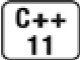
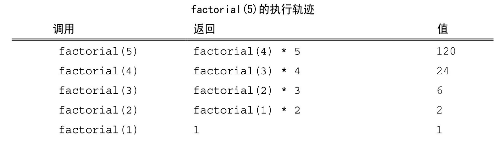
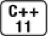

[总目录](<../目录.md>) · [本章目录](<01 章节导读.md>) · [上一篇](<../第6章 函数/6.2 参数传递.md>) · [下一篇](<../第6章 函数/6.4 函数重载.md>)

> 原 PDF 第 339–350 页。

<!-- PDF 第 339 页 -->

# **6.3** 返回类型和**return**语句

return语句终止当前正在执行的函数并将控制权返回到调用该函数的地方。return语句有两种形式:

<!-- 代码原图: ../images/_page_338_Picture_86.png -->
```c++
return;
return expression;
```

## **6.3.1** 无返回值函数

没有返回值的return语句只能用在返回类型是void的函数中。返回 void的函数不要求非得有return语句,因为在这类函数的最后一句后面会隐式地执行return。

通常情况下,void函数如果想在它的中间位置提前退出,可以使用 return语句。return的这种用法有点类似于我们用break语句(参见5.5.1 节,第170页)退出循环。例如,可以编写一个swap函数,使其在参与交换的值相等时什么也不做直接退出:

<!-- 代码原图: ../images/_page_338_Picture_87.png -->
```c++
void swap(int &v1, int &v2)
{
    // 如果两个值是相等的，则不需要交换，直接退出
    if (v1 == v2)
        return;
    // 如果程序执行到了这里，说明还需要继续完成某些功能
    int tmp = v2;
    v2 = v1;
    v1 = tmp;
    // 此处无须显式的 return 语句
}
```

这个函数首先检查值是否相等,如果相等直接退出函数;如果不相等才交换它们的值。在最后一条赋值语句后面隐式地执行return。

一个返回类型是void的函数也能使用return语句的第二种形式,不过

<!-- PDF 第 340 页 -->

此时return语句的*expression*必须是另一个返回void的函数。强行令void 函数返回其他类型的表达式将产生编译错误。

## **6.3.2** 有返回值函数

return语句的第二种形式提供了函数的结果。只要函数的返回类型不是void,则该函数内的每条return语句必须返回一个值。return语句返回值的类型必须与函数的返回类型相同,或者能隐式地转换成(参见 4.11节,第141页)函数的返回类型。

尽管C++无法确保结果的正确性,但是可以保证每个return语句的结果类型正确。也许无法顾及所有情况,但是编译器仍然尽量确保具有返回值的函数只能通过一条有效的return语句退出。例如:

<!-- 代码原图: ../images/_page_339_Picture_77.png -->
```c++
// 因为含有不正确的返回值，所以这段代码无法通过编译
bool str_subrange(const string &str1, const string &str2)
{
    // 大小相同：此时用普通的相等性判断结果作为返回值
    if (str1.size() == str2.size())
        return str1 == str2;           // 正确：==运算符返回布尔值
    // 得到较短 string 对象的大小，条件运算符参见第 4.7 节（134 页）
    auto size = (str1.size() < str2.size())
        ? str1.size() : str2.size();
    // 检查两个 string 对象的对应字符是否相等，以较短的字符串长度为限
    for (decltype(size) i = 0; i != size; ++i) {
        if (str1[i] != str2[i])
            return; // 错误 #1：没有返回值，编译器将报告这一错误
    }
}
```

<!-- 代码原图: ../images/_page_339_Picture_78.png -->
```c++
// 错误#2：控制流可能尚未返回任何值就结束了函数的执行
// 编译器可能检查不出这一错误
}
```

for循环内的return语句是错误的,因为它没有返回值,编译器能检测到这个错误。

第二个错误是函数在for循环之后没有提供return语句。在上面的程

<!-- PDF 第 341 页 -->

序中,如果一个string对象是另一个的子集,则函数在执行完for循环后还将继续其执行过程,显然应该有一条return语句专门处理这种情况。 编译器也许能检测到这个错误,也许不能;如果编译器没有发现这个错误,则运行时的行为将是未定义的。


在含有return语句的循环后面应该也有一条return语句,如果没有的话该程序就是错误的。很多编译器都无法发现此类错误。

### 值是如何被返回的

返回一个值的方式和初始化一个变量或形参的方式完全一样:返回的值用于初始化调用点的一个临时量,该临时量就是函数调用的结果。

必须注意当函数返回局部变量时的初始化规则。例如我们书写一个函数,给定计数值、单词和结束符之后,判断计数值是否大于1:如果是,返回单词的复数形式;如果不是,返回单词原形:

<!-- 代码原图: ../images/_page_340_Picture_88.png -->
```c++
// 如果 ctr 的值大于 1，返回 word 的复数形式
string make_plural(size_t ctr, const string &word,
                        const string &ending)
{
    return (ctr > 1) ? word + ending : word;
}
```

该函数的返回类型是string,意味着返回值将被拷贝到调用点。因此,该函数将返回word的副本或者一个未命名的临时string对象,该对象的内容是word和ending的和。

同其他引用类型一样,如果函数返回引用,则该引用仅是它所引对象的一个别名。举个例子来说明,假定某函数挑出两个string形参中较短的那个并返回其引用:

<!-- 代码原图: ../images/_page_340_Picture_89.png -->
```c++
// 挑出两个 string 对象中较短的那个，返回其引用
const string &shorterString(const string &s1, const string &s2)
{
    return s1.size() <= s2.size() ? s1 : s2;
}
```

<!-- PDF 第 342 页 -->

其中形参和返回类型都是const string的引用,不管是调用函数还是返回结果都不会真正拷贝string对象。

### 不要返回局部对象的引用或指针

函数完成后,它所占用的存储空间也随之被释放掉(参见6.1.1节, 第184页)。因此,函数终止意味着局部变量的引用将指向不再有效的内存区域:

<!-- 代码原图: ../images/_page_341_Picture_88.png -->
```c++
// 严重错误：这个函数试图返回局部对象的引用
const string &manip()
{
    string ret;
```

<!-- 代码原图: ../images/_page_341_Picture_89.png -->
```c++
// 以某种方式改变一下 ret
if (!ret.empty())
    return ret;        // 错误：返回局部对象的引用!
else
    return "Empty";  // 错误："Empty"是一个局部临时量
}
```

上面的两条return语句都将返回未定义的值,也就是说,试图使用 manip函数的返回值将引发未定义的行为。对于第一条return语句来说, 显然它返回的是局部对象的引用。在第二条return语句中,字符串字面值转换成一个局部临时string对象,对于manip来说,该对象和ret一样都是局部的。当函数结束时临时对象占用的空间也就随之释放掉了,所以两条return语句都指向了不再可用的内存空间。


要想确保返回值安全,我们不妨提问:引用所引的是在函数之前已经存在的哪个对象?

如前所述,返回局部对象的引用是错误的;同样,返回局部对象的指针也是错误的。一旦函数完成,局部对象被释放,指针将指向一个不存在的对象。

返回类类型的函数和调用运算符

<!-- PDF 第 343 页 -->

和其他运算符一样,调用运算符也有优先级和结合律(参见4.1.2 节,第121页)。调用运算符的优先级与点运算符和箭头运算符(参见 4.6节,第133页)相同,并且也符合左结合律。因此,如果函数返回指针、引用或类的对象,我们就能使用函数调用的结果访问结果对象的成员。

例如,我们可以通过如下形式得到较短string对象的长度:

<!-- 代码原图: ../images/_page_342_Picture_74.png -->
```c++
// 调用 string 对象的 size 成员，该 string 对象是由 shorterString 函数返回的 auto sz = shorterString(s1, s2).size();
```

因为上面提到的运算符都满足左结合律,所以shorterString的结果是点运算符的左侧运算对象,点运算符可以得到该string对象的size成员,size又是第二个调用运算符的左侧运算对象。

### 引用返回左值

函数的返回类型决定函数调用是否是左值(参见4.1.1节,第121 页)。调用一个返回引用的函数得到左值,其他返回类型得到右值。可以像使用其他左值那样来使用返回引用的函数的调用,特别是,我们能为返回类型是非常量引用的函数的结果赋值:

<!-- 代码原图: ../images/_page_342_Picture_75.png -->
```c++
char &get_val(string &str, string::size_type ix)
{
    return str[ix];                // get_val 假定索引值是有效的
}
int main()
{
    string s("a value");
    cout << s << endl;             // 输出 a value
    get_val(s, 0) = 'A';          // 将 s[0]的值改为 A
    cout << s << endl;             // 输出 A value
```

<!-- 代码原图: ../images/_page_342_Picture_76.png -->
```c++
    return 0;
}
```

把函数调用放在赋值语句的左侧可能看起来有点奇怪,但其实这没什么特别的。返回值是引用,因此调用是个左值,和其他左值一样它也

<!-- PDF 第 344 页 -->

能出现在赋值运算符的左侧。

如果返回类型是常量引用,我们不能给调用的结果赋值,这一点和我们熟悉的情况是一样的:

<!-- 代码原图: ../images/_page_343_Picture_99.png -->
```c++
shorterString("hi", "bye") = "X"; // 错误：返回值是个常量
```

### 列表初始化返回值



C++11新标准规定,函数可以返回花括号包围的值的列表。类似于其他返回结果,此处的列表也用来对表示函数返回的临时量进行初始化。如果列表为空,临时量执行值初始化(参见3.3.1节,第88页);否则,返回的值由函数的返回类型决定。

举个例子,回忆6.2.6节(第198页)的error\_msg函数,该函数的输入是一组可变数量的string实参,输出由这些string对象组成的错误信息。在下面的函数中,我们返回一个vector对象,用它存放表示错误信息的string对象:

<!-- 代码原图: ../images/_page_343_Picture_101.png -->
```c++
vector<string> process()
{
    // ...
    // expected 和 actual 是 string 对象
    if (expected.empty())
        return {};                // 返回一个空 vector 对象
    else if (expected == actual)
        return {"functionX", "okay"};    // 返回列表初始化的 vector 对象
    else
        return {"functionX", expected, actual};
}
```

第一条return语句返回一个空列表,此时,process函数返回的vector 对象是空的。如果expected不为空,根据expected和actual是否相等,函数返回的vector对象分别用两个或三个元素初始化。

如果函数返回的是内置类型,则花括号包围的列表最多包含一个值,而且该值所占空间不应该大于目标类型的空间(参见2.2.1节,第39 页)。如果函数返回的是类类型,由类本身定义初始值如何使用(参见

<!-- PDF 第 345 页 -->

3.3.1节,第89页)。

主函数**main**的返回值

之前介绍过,如果函数的返回类型不是void,那么它必须返回一个值。但是这条规则有个例外:我们允许main函数没有return语句直接结束。如果控制到达了main函数的结尾处而且没有return语句,编译器将隐式地插入一条返回0的return语句。

如1.1节(第2页)介绍的,main函数的返回值可以看做是状态指示器。返回0表示执行成功,返回其他值表示执行失败,其中非0值的具体含义依机器而定。为了使返回值与机器无关,cstdlib头文件定义了两个预处理变量(参见2.3.2节,第49页),我们可以使用这两个变量分别表示成功与失败:

<!-- 代码原图: ../images/_page_344_Picture_101.png -->
```c++
int main()
{
    if (some_failure)
```

<!-- 代码原图: ../images/_page_344_Picture_102.png -->
```c++
    return EXIT_FAILURE;        // 定义在 cstdlib 头文件中
else
    return EXIT_SUCCESS;      // 定义在 cstdlib 头文件中
}
```

因为它们是预处理变量,所以既不能在前面加上std::,也不能在 using声明中出现。

### 递归

如果一个函数调用了它自身,不管这种调用是直接的还是间接的, 都称该函数为递归函数(recursive function)。举个例子,我们可以使用递归函数重新实现求阶乘的功能:

<!-- PDF 第 346 页 -->

<!-- 代码原图: ../images/_page_345_Picture_89.png -->
```c++
// 计算 val 的阶乘，即 1 * 2 * 3 ... * val
int factorial(int val)
{
    if (val > 1)
        return factorial(val-1) * val;
    return 1;
}
```

在上面的代码中,我们递归地调用factorial函数以求得从val中减去1 后新数字的阶乘。当val递减到1时,递归终止,返回1。

在递归函数中,一定有某条路径是不包含递归调用的;否则,函数将"永远"递归下去,换句话说,函数将不断地调用它自身直到程序栈空间耗尽为止。我们有时候会说这种函数含有递归循环(recursion loop)。在factorial函数中,递归终止的条件是val等于1。

下面的表格显示了当给factorial函数传入参数5时,函数的执行轨迹。




main函数不能调用它自己。

### **6.3.2**节练习

练习**6.30**:编译第200页的str\_subrange函数,看看你的编译器是如何处理函数中的错误的。

练习**6.31**:什么情况下返回的引用无效?什么情况下返回常量的引用无效?

<!-- PDF 第 347 页 -->

练习**6.32**:下面的函数合法吗?如果合法,说明其功能;如果不合法, 修改其中的错误并解释原因。

<!-- 代码原图: ../images/_page_346_Picture_92.png -->
```c++
int &get(int *arry, int index) { return arry[index]; }
int main() {
```

<!-- 代码原图: ../images/_page_346_Picture_93.png -->
```c++
int ia[10];
for (int i = 0; i != 10; ++i)
    get(ia, i) = i;
}
```

练习**6.33**:编写一个递归函数,输出vector对象的内容。

练习**6.34**:如果factorial函数的停止条件如下所示,将发生什么情况?

<!-- 代码原图: ../images/_page_346_Picture_94.png -->
```c++
if (val != 0)
```

练习**6.35**:在调用factorial函数时,为什么我们传入的值是val-1而非val- -?

## **6.3.3** 返回数组指针

因为数组不能被拷贝,所以函数不能返回数组。不过,函数可以返回数组的指针或引用(参见3.5.1节,第102页)。虽然从语法上来说, 要想定义一个返回数组的指针或引用的函数比较烦琐,但是有一些方法可以简化这一任务,其中最直接的方法是使用类型别名(参见2.5.1节, 第60页):

<!-- 代码原图: ../images/_page_346_Picture_95.png -->
```c++
typedef int arrT[10]; // arrT是一个类型别名，它表示的类型是含有10个
// 整数的数组
using arrT = int[10]; // arrT的等价声明，参见2.5.1节（第60页）
arrT* func(int i); // func返回一个指向含有10个整数的数组的指针
```

其中arrT是含有10个整数的数组的别名。因为我们无法返回数组, 所以将返回类型定义成数组的指针。因此,func函数接受一个int实参, 返回一个指向包含10个整数的数组的指针。

<!-- PDF 第 348 页 -->

声明一个返回数组指针的函数

要想在声明func时不使用类型别名,我们必须牢记被定义的名字后面数组的维度:

<!-- 代码原图: ../images/_page_347_Picture_134.png -->
```c++
int arr[10]; // arr 是一个含有 10 个整数的数组
int *p1[10]; // p1 是一个含有 10 个指针的数组
int (*p2)[10] = &arr; // p2 是一个指针，它指向含有 10 个整数的数组
```

和这些声明一样,如果我们想定义一个返回数组指针的函数,则数组的维度必须跟在函数名字之后。然而,函数的形参列表也跟在函数名字后面且形参列表应该先于数组的维度。因此,返回数组指针的函数形式如下所示:

<!-- 代码原图: ../images/_page_347_Picture_135.png -->
```c++
Type ( *function (parameter_list) )[dimension]
```

类似于其他数组的声明,*Type*表示元素的类型,*dimension*表示数组的大小。(*\*function*(*parameter\_list*))两端的括号必须存在,就像我们定义p2时两端必须有括号一样。如果没有这对括号,函数的返回类型将是指针的数组。

举个具体点的例子,下面这个func函数的声明没有使用类型别名:

<!-- 代码原图: ../images/_page_347_Picture_136.png -->
```c++
int (*func(int i))[10];
```

可以按照以下的顺序来逐层理解该声明的含义:

· func(int i)表示调用func函数时需要一个int类型的实参。

· (\*func(int i))意味着我们可以对函数调用的结果执行解引用操作。

· (\*func(int i))[10]表示解引用func的调用将得到一个大小是 10的数组。

· int (\*func(int i))[10]表示数组中的元素是int类型。

使用尾置返回类型



<!-- PDF 第 349 页 -->

在C++11新标准中还有一种可以简化上述func声明的方法,就是使用尾置返回类型(trailing return type)。任何函数的定义都能使用尾置返回,但是这种形式对于返回类型比较复杂的函数最有效,比如返回类型是数组的指针或者数组的引用。尾置返回类型跟在形参列表后面并以一个->符号开头。为了表示函数真正的返回类型跟在形参列表之后,我们在本应该出现返回类型的地方放置一个auto:

<!-- 代码原图: ../images/_page_348_Picture_111.png -->
```c++
// func 接受一个 int 类型的实参，返回一个指针，该指针指向含有 10 个整数的数组 auto func(int i) -> int(*) [10];
```

因为我们把函数的返回类型放在了形参列表之后,所以可以清楚地看到func函数返回的是一个指针,并且该指针指向了含有10个整数的数组。

### 使用**decltype**

还有一种情况,如果我们知道函数返回的指针将指向哪个数组,就可以使用decltype关键字声明返回类型。例如,下面的函数返回一个指针,该指针根据参数i的不同指向两个已知数组中的某一个:

<!-- 代码原图: ../images/_page_348_Picture_112.png -->
```c++
int odd[] = {1,3,5,7,9};
int even[] = {0,2,4,6,8};
// 返回一个指针，该指针指向含有 5 个整数的数组
decltype(odd) *arrPtr(int i)
{
    return (i % 2) ? &odd : &even; // 返回一个指向数组的指针
}
```


arrPtr使用关键字decltype表示它的返回类型是个指针,并且该指针所指的对象与odd的类型一致。因为odd是数组,所以arrPtr返回一个指向含有5个整数的数组的指针。有一个地方需要注意:decltype并不负责把数组类型转换成对应的指针,所以decltype的结果是个数组,要想表示arrPtr返回指针还必须在函数声明时加一个\*符号。

### **6.3.3**节练习

练习**6.36**:编写一个函数的声明,使其返回数组的引用并且该数组包含

<!-- PDF 第 350 页 -->

10个string对象。不要使用尾置返回类型、decltype或者类型别名。

练习**6.37**:为上一题的函数再写三个声明,一个使用类型别名,另一个使用尾置返回类型,最后一个使用decltype关键字。你觉得哪种形式最好?为什么?

练习**6.38**:修改arrPtr函数,使其返回数组的引用。


