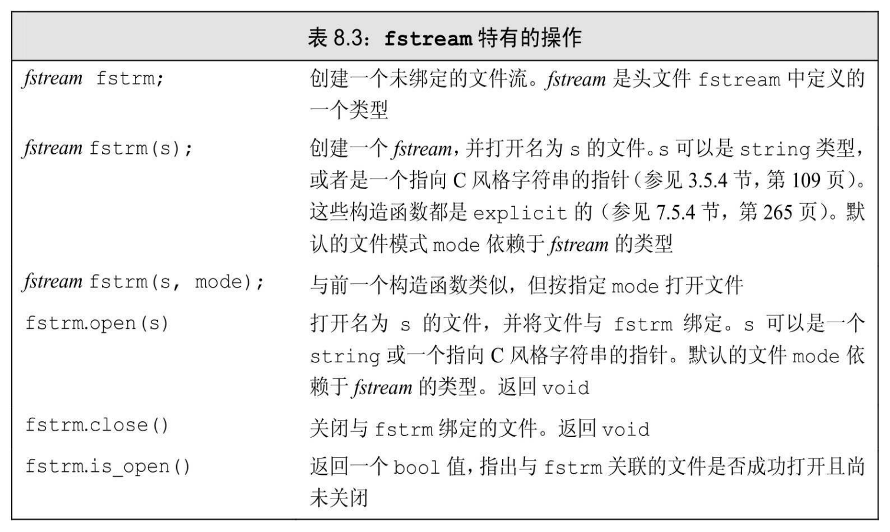
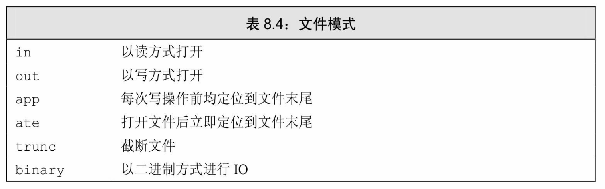

[总目录](<../目录.md>) · [本章目录](<01 章节导读.md>) · [上一篇](<../第8章 IO库/8.1 IO类.md>) · [下一篇](<../第8章 IO库/8.3 string流.md>)

> 原 PDF 第 473–479 页。

<!-- PDF 第 473 页 -->

# **8.2** 文件输入输出

头文件fstream定义了三个类型来支持文件IO:**ifstream**从一个给定文件读取数据,**ofstream**向一个给定文件写入数据,以及**fstream**可以读写给定文件。在17.5.3节中(第676页)我们将介绍如何对同一个文件流既读又写。

这些类型提供的操作与我们之前已经使用过的对象cin和cout的操作一样。特别是,我们可以用IO运算符(<<和>>)来读写文件,可以用 getline(参见3.2.2节,第79页)从一个ifstream读取数据,包括8.1节中 (第278页)介绍的内容也都适用于这些类型。

除了继承自iostream类型的行为之外,fstream中定义的类型还增加了一些新的成员来管理与流关联的文件。在表8.3中列出了这些操作, 我们可以对fstream、ifstream和ofstream对象调用这些操作,但不能对其他IO类型调用这些操作。



<!-- PDF 第 474 页 -->

## **8.2.1** 使用文件流对象

当我们想要读写一个文件时,可以定义一个文件流对象,并将对象与文件关联起来。每个文件流类都定义了一个名为open的成员函数,它完成一些系统相关的操作,来定位给定的文件,并视情况打开为读或写模式。

创建文件流对象时,我们可以提供文件名(可选的)。如果提供了一个文件名,则open会自动被调用:

<!-- 代码原图: ../images/_page_473_Picture_130.png -->
```c++
ifstream in(ifile); // 构造一个 ifstream 并打开给定文件
ofstream out; // 输出文件流未关联到任何文件
```


这段代码定义了一个输入流in,它被初始化为从文件读取数据,文件名由string类型的参数ifile指定。第二条语句定义了一个输出流out,未与任何文件关联。在新C++标准中,文件名既可以是库类型string对象, 也可以是C风格字符数组(参见3.5.4节,第109页)。旧版本的标准库只允许C风格字符数组。

### 用**fstream**代替**iostream&**

我们在8.1节(第279页)已经提到过,在要求使用基类型对象的地方,我们可以用继承类型的对象来替代。这意味着,接受一个iostream 类型引用(或指针)参数的函数,可以用一个对应的fstream(或 sstream)类型来调用。也就是说,如果有一个函数接受一个ostream&参数,我们在调用这个函数时,可以传递给它一个ofstream对象,对 istream&和ifstream也是类似的。

例如,我们可以用7.1.3节中的read和print函数来读写命名文件。在本例中,我们假定输入和输出文件的名字是通过传递给main函数的参数来指定的(参见6.2.5节,第196页):

<!-- PDF 第 475 页 -->

<!-- 代码原图: ../images/_page_474_Picture_75.png -->
```c++
ifstream input(argv[1]);        // 打开销售记录文件
ofstream output(argv[2]);     // 打开输出文件
Sales_data total;            // 保存销售总额的变量
if (read(input, total)) {     // 读取第一条销售记录
    Sales_data trans;         // 保存下一条销售记录的变量
    while(read(input, trans)) {        // 读取剩余记录
        if (total.isbn() == trans.isbn())    // 检查 isbn
            total.combine(trans);    // 更新销售总额
        else {
            print(output, total) << endl;    // 打印结果
            total = trans;            // 处理下一本书
        }
    }
    print(output, total) << endl;    // 打印最后一本书的销售额
} else                            // 文件中无输入数据
    cerr << "No data?!" << endl;
```

除了读写的是命名文件外,这段程序与229页的加法程序几乎是完全相同的。重要的部分是对read和print的调用。虽然两个函数定义时指定的形参分别是istream&和ostream&,但我们可以向它们传递fstream对象。

#### 成员函数**open**和**close**

如果我们定义了一个空文件流对象,可以随后调用open来将它与文件关联起来:

<!-- 代码原图: ../images/_page_474_Picture_76.png -->
```c++
ifstream in(ifile); // 构筑一个 ifstream 并打开给定文件
ofstream out; // 输出文件流未与任何文件相关联
out.open(ifile + ".copy"); // 打开指定文件
```

如果调用open失败,failbit会被置位(参见8.1.2节,第280页)。因为调用open可能失败,进行open是否成功的检测通常是一个好习惯:

<!-- 代码原图: ../images/_page_474_Picture_77.png -->
```c++
if(out) // 检查 open 是否成功
// open 成功，我们可以使用文件了
```

这个条件判断与我们之前将cin用作条件相似。如果open失败,条件会为假,我们就不会去使用out了。

<!-- PDF 第 476 页 -->

一旦一个文件流已经打开,它就保持与对应文件的关联。实际上, 对一个已经打开的文件流调用open会失败,并会导致failbit被置位。随后的试图使用文件流的操作都会失败。为了将文件流关联到另外一个文件,必须首先关闭已经关联的文件。一旦文件成功关闭,我们可以打开新的文件:

<!-- 代码原图: ../images/_page_475_Picture_105.png -->
```c++
in.close(); // 关闭文件
in.open(ifile + "2"); // 打开另一个文件
```

如果open成功,则open会设置流的状态,使得good()为true。

#### 自动构造和析构

考虑这样一个程序,它的main函数接受一个要处理的文件列表(参见6.2.5节,第196页)。这种程序可能会有如下的循环:

<!-- 代码原图: ../images/_page_475_Picture_106.png -->
```c++
// 对每个传递给程序的文件执行循环操作
for (auto p = argv + 1; p != argv + argc; ++p) {
    ifstream input(*p); // 创建输出流并打开文件
    if (input) { // 如果文件打开成功，“处理”此文件
        process(input);
    } else
        cerr << "couldn't open: " + string(*p);
} // 每个循环步 input 都会离开作用域，因此会被销毁
```

每个循环步构造一个新的名为input的ifstream对象,并打开它来读取给定的文件。像之前一样,我们检查open是否成功。如果成功,将文件传递给一个函数,该函数负责读取并处理输入数据。如果open失败, 打印一条错误信息并继续处理下一个文件。

因为input是while循环的局部变量,它在每个循环步中都要创建和销毁一次(参见5.4.1节,第165页)。当一个fstream对象离开其作用域时,与之关联的文件会自动关闭。在下一步循环中,input会再次被创建。


当一个fstream对象被销毁时,close会自动被调用。

<!-- PDF 第 477 页 -->

#### **8.2.1**节练习

练习**8.4**:编写函数,以读模式打开一个文件,将其内容读入到一个 string的vector中,将每一行作为一个独立的元素存于vector中。

练习**8.5**:重写上面的程序,将每个单词作为一个独立的元素进行存储。

练习**8.6**:重写7.1.1节的书店程序(第229页),从一个文件中读取交易记录。将文件名作为一个参数传递给main(参见6.2.5节,第196页)。

## **8.2.2** 文件模式

每个流都有一个关联的文件模式(file mode),用来指出如何使用文件。表8.4列出了文件模式和它们的含义。



无论用哪种方式打开文件,我们都可以指定文件模式,调用open打开文件时可以,用一个文件名初始化流来隐式打开文件时也可以。指定文件模式有如下限制:

· 只可以对ofstream或fstream对象设定out模式。 · 只可以对ifstream或fstream对象设定in模式。 · 只有当out也被设定时才可设定trunc模式。

· 只要trunc没被设定,就可以设定app模式。在app模式下,即使没有显式指定out模式,文件也总是以输出方式被打开。

· 默认情况下,即使我们没有指定trunc,以out模式打开的文件也会

<!-- PDF 第 478 页 -->

被截断。为了保留以out模式打开的文件的内容,我们必须同时指定app 模式,这样只会将数据追加写到文件末尾;或者同时指定in模式,即打开文件同时进行读写操作(参见17.5.3节,第676页,将介绍对同一个文件既进行输入又进行输出的方法)。

· ate和binary模式可用于任何类型的文件流对象,且可以与其他任何文件模式组合使用。

每个文件流类型都定义了一个默认的文件模式,当我们未指定文件模式时,就使用此默认模式。与ifstream关联的文件默认以in模式打开; 与ofstream关联的文件默认以out模式打开;与fstream关联的文件默认以 in和out模式打开。

以**out**模式打开文件会丢弃已有数据

默认情况下,当我们打开一个ofstream时,文件的内容会被丢弃。 阻止一个ofstream清空给定文件内容的方法是同时指定app模式:

<!-- 代码原图: ../images/_page_477_Picture_102.png -->
```c++
// 在这几条语句中，file1都被截断
ofstream out("file1"); // 隐含以输出模式打开文件并截断文件
ofstream out2("file1", ofstream::out); // 隐含地截断文件
ofstream out3("file1", ofstream::out | ofstream::trunc);
// 为了保留文件内容，我们必须显式指定 app 模式
ofstream app("file2", ofstream::app); // 隐含为输出模式
ofstream app2("file2", ofstream::out | ofstream::app);
```


保留被ofstream打开的文件中已有数据的唯一方法是显式指定app或in模式。

每次调用**open**时都会确定文件模式

对于一个给定流,每当打开文件时,都可以改变其文件模式。

<!-- 代码原图: ../images/_page_477_Picture_104.png -->
```c++
ofstream out; // 未指定文件打开模式
out.open("scratchpad"); // 模式隐含设置为输出和截断
out.close(); // 关闭 out，以便我们将其用于其他文件
out.open("precious", ofstream::app); // 模式为输出和追加
out.close();
```

<!-- PDF 第 479 页 -->

第一个open调用未显式指定输出模式,文件隐式地以out模式打开。通常情况下,out模式意味着同时使用trunc模式。因此,当前目录下名为scratchpad的文件的内容将被清空。当打开名为precious的文件时,我们指定了append模式。文件中已有的数据都得以保留,所有写操作都在文件末尾进行。


在每次打开文件时,都要设置文件模式,可能是显式地设置,也可能是隐式地设置。当程序未指定模式时,就使用默认值。

#### **8.2.2**节练习

练习**8.7**:修改上一节的书店程序,将结果保存到一个文件中。将输出文件名作为第二个参数传递给main函数。

练习**8.8**:修改上一题的程序,将结果追加到给定的文件末尾。对同一个输出文件,运行程序至少两次,检验数据是否得以保留。


