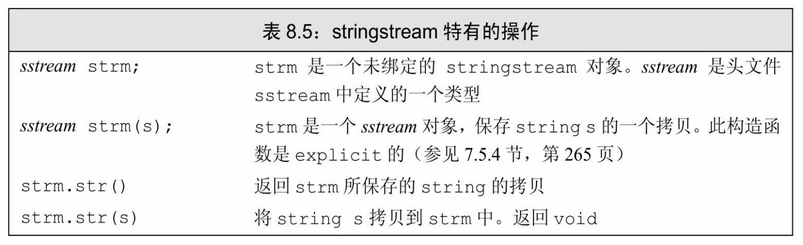

[总目录](<../目录.md>) · [本章目录](<01 章节导读.md>) · [上一篇](<../第8章 IO库/8.2 文件输入输出.md>) · [下一篇](<../第8章 IO库/小结.md>)

> 原 PDF 第 480–483 页。

<!-- PDF 第 480 页 -->

# **8.3 string**流

sstream头文件定义了三个类型来支持内存IO,这些类型可以向 string写入数据,从string读取数据,就像string是一个IO流一样。

**istringstream**从string读取数据,**ostringstream**向string写入数据, 而头文件**stringstream**既可从string读数据也可向string写数据。与fstream 类型类似,头文件sstream中定义的类型都继承自我们已经使用过的 iostream头文件中定义的类型。除了继承得来的操作,sstream中定义的类型还增加了一些成员来管理与流相关联的string。表8.5列出了这些操作,可以对stringstream对象调用这些操作,但不能对其他IO类型调用这些操作。



### **8.3.1** 使用**istringstream**

当我们的某些工作是对整行文本进行处理,而其他一些工作是处理行内的单个单词时,通常可以使用istringstream。

考虑这样一个例子,假定有一个文件,列出了一些人和他们的电话号码。某些人只有一个号码,而另一些人则有多个——家庭电话、工作电话、移动电话等。我们的输入文件看起来可能是这样的:

**morgan 2015552368 8625550123**

**drew 9735550130**

<!-- PDF 第 481 页 -->

#### **lee 6095550132 2015550175 8005550000**

文件中每条记录都以一个人名开始,后面跟随一个或多个电话号码。我们首先定义一个简单的类来描述输入数据:

<!-- 代码原图: ../images/_page_480_Picture_91.png -->
```c++
// 成员默认为公有；参见 7.2 节（第 240 页）
struct PersonInfo {
    string name;
    vector<string> phones;
};
```

类型PersonInfo的对象会有一个成员来表示人名,还有一个vector来保存此人的所有电话号码。

我们的程序会读取数据文件,并创建一个PersonInfo的vector。 vector中每个元素对应文件中的一条记录。我们在一个循环中处理输入数据,每个循环步读取一条记录,提取出一个人名和若干电话号码:

<!-- 代码原图: ../images/_page_480_Picture_92.png -->
```c++
string line, word; // 分别保存来自输入的一行和单词
vector<PersonInfo> people; // 保存来自输入的所有记录
// 逐行从输入读取数据，直至 cin 遇到文件尾（或其他错误）
while (getline(cin, line)) {
    PersonInfo info; // 创建一个保存此记录数据的对象
    istringstream record(line); // 将记录绑定到刚读入的行
    record >> info.name; // 读取名字
    while (record >> word) // 读取电话号码
        info.phones.push_back(word); // 保持它们
    people.push_back(info); // 将此记录追加到 people 末尾
}
```

这里我们用getline从标准输入读取整条记录。如果getline调用成功,那么line中将保存着从输入文件而来的一条记录。在while中,我们定义了一个局部PersonInfo对象,来保存当前记录中的数据。

接下来我们将一个istringstream与刚刚读取的文本行进行绑定,这样就可以在此istringstream上使用输入运算符来读取当前记录中的每个元素。我们首先读取人名,随后用一个while循环读取此人的电话号码。

当读取完line中所有数据后,内层while循环就结束了。此循环的工

<!-- PDF 第 482 页 -->

作方式与前面章节中读取cin的循环很相似,不同之处是,此循环从一个string而不是标准输入读取数据。当string中的数据全部读出后,同样会触发"文件结束"信号,在record上的下一个输入操作会失败。

我们将刚刚处理好的PersonInfo追加到vector中,外层while循环的一个循环步就随之结束了。外层while循环会持续执行,直至遇到cin的文件结束标识。

### **8.3.1**节练习

练习**8.9**:使用你为8.1.2节(第281页)第一个练习所编写的函数打印一个istringstream对象的内容。

练习**8.10**:编写程序,将来自一个文件中的行保存在一个vector<string> 中。然后使用一个istringstream从vector读取数据元素,每次读取一个单词。

练习**8.11**:本节的程序在外层while循环中定义了istringstream对象。如果record对象定义在循环之外,你需要对程序进行怎样的修改?重写程序,将record的定义移到while循环之外,验证你设想的修改方法是否正确。

练习**8.12**:我们为什么没有在PersonInfo中使用类内初始化?

## **8.3.2** 使用**ostringstream**

当我们逐步构造输出,希望最后一起打印时,ostringstream是很有用的。例如,对上一节的例子,我们可能想逐个验证电话号码并改变其格式。如果所有号码都是有效的,我们希望输出一个新的文件,包含改变格式后的号码。对于那些无效的号码,我们不会将它们输出到新文件中,而是打印一条包含人名和无效号码的错误信息。

由于我们不希望输出有无效电话号码的人,因此对每个人,直到验证完所有电话号码后才可以进行输出操作。但是,我们可以先将输出内容"写入"到一个内存ostringstream中:

<!-- PDF 第 483 页 -->

<!-- 代码原图: ../images/_page_482_Picture_66.png -->
```c++
for (const auto &entry : people) { // 对 people 中每一项
    ostringstream formatted, badNums; // 每个循环步创建的对象
    for (const auto &nums : entry.phones) { // 对每个数
        if (!valid(nums)) {
            badNums << " " << nums; // 将数的字符串形式存入 badNums
        } else
            // 将格式化的字符串“写入”formatted
            formatted << " " << format(nums);
    }
    if (badNums.str().empty())             // 没有错误的数
        os << entry.name << " "             // 打印名字
        << formatted.str() << endl;        // 和格式化的数
    else // 否则，打印名字和错误的数
        cerr << "input error: " << entry.name
            << " invalid number(s) " << badNums.str() << endl;
}
```

在此程序中,我们假定已有两个函数,valid和format,分别完成电话号码验证和改变格式的功能。程序最有趣的部分是对字符串流 formatted和badNums的使用。我们使用标准的输出运算符(<<)向这些对象写入数据,但这些"写入"操作实际上转换为string操作,分别向 formatted和badNums中的string对象添加字符。

### **8.3.2**节练习

练习**8.13**:重写本节的电话号码程序,从一个命名文件而非cin读取数据。

练习**8.14**:我们为什么将entry和nums定义为const auto&?


