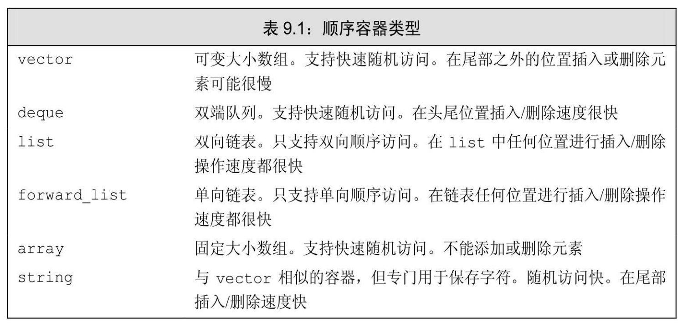
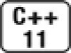

[总目录](<../目录.md>) · [本章目录](<01 章节导读.md>) · [上一篇](<../第9章 顺序容器/01 章节导读.md>) · [下一篇](<../第9章 顺序容器/9.2 容器库概览.md>)

> 原 PDF 第 488–491 页。

<!-- PDF 第 488 页 -->

# **9.1** 顺序容器概述

表9.1列出了标准库中的顺序容器,所有顺序容器都提供了快速顺序访问元素的能力。但是,这些容器在以下方面都有不同的性能折中:

· 向容器添加或从容器中删除元素的代价 · 非顺序访问容器中元素的代价

除了固定大小的array外,其他容器都提供高效、灵活的内存管理。 我们可以添加和删除元素,扩张和收缩容器的大小。容器保存元素的策略对容器操作的效率有着固有的,有时是重大的影响。在某些情况下, 存储策略还会影响特定容器是否支持特定操作。

例如,string和vector将元素保存在连续的内存空间中。由于元素是连续存储的,由元素的下标来计算其地址是非常快速的。但是,在这两种容器的中间位置添加或删除元素就会非常耗时:在一次插入或删除操作后,需要移动插入/删除位置之后的所有元素,来保持连续存储。而且,添加一个元素有时可能还需要分配额外的存储空间。在这种情况下,每个元素都必须移动到新的存储空间中。

list和forward\_list两个容器的设计目的是令容器任何位置的添加和删

<!-- PDF 第 489 页 -->

除操作都很快速。作为代价,这两个容器不支持元素的随机访问:为了访问一个元素,我们只能遍历整个容器。而且,与vector、deque和array 相比,这两个容器的额外内存开销也很大。

deque是一个更为复杂的数据结构。与string和vector类似,deque支持快速的随机访问。与string和vector一样,在deque的中间位置添加或删除元素的代价(可能)很高。但是,在deque的两端添加或删除元素都是很快的,与list或forward\_list添加删除元素的速度相当。

forward\_list和array是新C++标准增加的类型。与内置数组相比, array是一种更安全、更容易使用的数组类型。与内置数组类似,array对象的大小是固定的。因此,array不支持添加和删除元素以及改变容器大小的操作。forward\_list的设计目标是达到与最好的手写的单向链表数据结构相当的性能。因此,forward\_list没有size操作,因为保存或计算其大小就会比手写链表多出额外的开销。对其他容器而言,size保证是一个快速的常量时间的操作。

新标准库的容器比旧版本快得多,原因我们将在13.6节(第470页)解释。新标准库容器的性能几乎肯定与最精心优化过的同类数据结构一样好(通常会更好)。现代 C++程序应该使用标准库容器,而不是更原始的数据结构,如内置数组。

### 确定使用哪种顺序容器

通常,使用vector是最好的选择,除非你有很好的理由选择其他容器。

以下是一些选择容器的基本原则:

· 除非你有很好的理由选择其他容器,否则应使用vector。

· 如果你的程序有很多小的元素,且空间的额外开销很重要,则不要使用list或forward\_list。

· 如果程序要求随机访问元素,应使用vector或deque。

· 如果程序要求在容器的中间插入或删除元素,应使用list或

<!-- PDF 第 490 页 -->

#### forward\_list。

· 如果程序需要在头尾位置插入或删除元素,但不会在中间位置进行插入或删除操作,则使用deque。

· 如果程序只有在读取输入时才需要在容器中间位置插入元素,随后需要随机访问元素,则

— 首先,确定是否真的需要在容器中间位置添加元素。当处理输入数据时,通常可以很容易地向vector追加数据,然后再调用标准库的 sort函数(我们将在10.2.3节介绍sort(第343页))来重排容器中的元素,从而避免在中间位置添加元素。

— 如果必须在中间位置插入元素,考虑在输入阶段使用list,一旦输入完成,将list中的内容拷贝到一个vector中。

如果程序既需要随机访问元素,又需要在容器中间位置插入元素, 那该怎么办?答案取决于在list或forward\_list中访问元素与vector或deque 中插入/删除元素的相对性能。一般来说,应用中占主导地位的操作 (执行的访问操作更多还是插入/删除更多)决定了容器类型的选择。 在此情况下,对两种容器分别测试应用的性能可能就是必要的了。

如果你不确定应该使用哪种容器,那么可以在程序中只使用vector和list公共的操作:使用迭代器,不使用下标操作,避免随机访问。这样,在必要时选择使用vector或 list都很方便。

### **9.1**节练习

练习**9.1**:对于下面的程序任务,vector、deque和list哪种容器最为适合?解释你的选择的理由。如果没有哪一种容器优于其他容器,也请解释理由。

(a) 读取固定数量的单词,将它们按字典序插入到容器中。我们将在下一章中看到,关联容器更适合这个问题。

(b) 读取未知数量的单词,总是将新单词插入到末尾。删除操作在头部进行。

(c) 从一个文件读取未知数量的整数。将这些数排序,然后将它

<!-- PDF 第 491 页 -->

们打印到标准输出。

