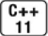
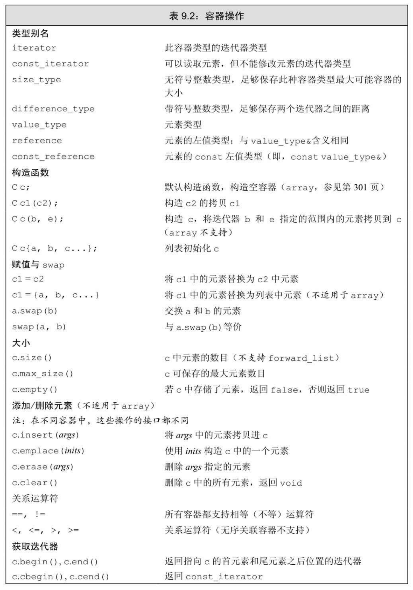
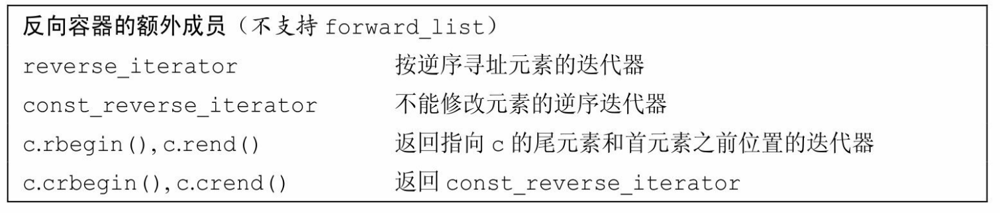
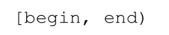
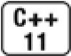
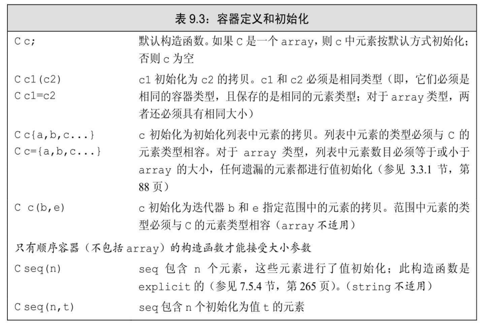
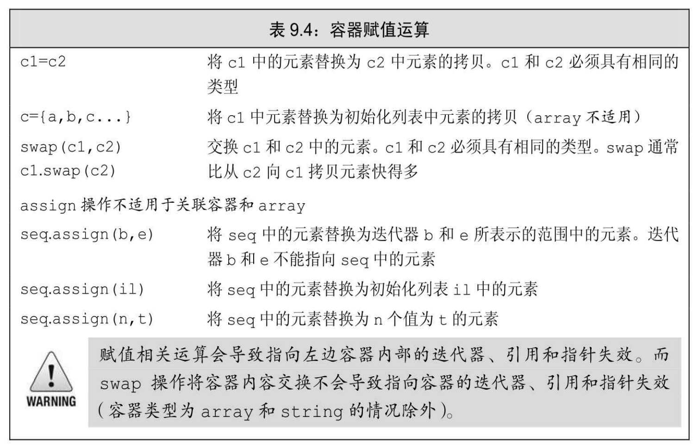

[总目录](<../目录.md>) · [本章目录](<01 章节导读.md>) · [上一篇](<../第9章 顺序容器/9.1 顺序容器概述.md>) · [下一篇](<../第9章 顺序容器/9.3 顺序容器操作.md>)

> 原 PDF 第 492–509 页。

<!-- PDF 第 492 页 -->

# **9.2** 容器库概览

容器类型上的操作形成了一种层次:

· 某些操作是所有容器类型都提供的(参见表9.2,第295页)。

· 另外一些操作仅针对顺序容器(参见表9.3,第299页)、关联容器(参见表11.7,第388页)或无序容器(参见表11.8,第395页)。

· 还有一些操作只适用于一小部分容器。

在本节中,我们将介绍对所有容器都适用的操作。本章剩余部分将聚焦于仅适用于顺序容器的操作。关联容器特有的操作将在第11章介绍。

一般来说,每个容器都定义在一个头文件中,文件名与类型名相同。即,deque定义在头文件deque中,list定义在头文件list中,以此类推。容器均定义为模板类(参见3.3节,第86页)。例如对vector,我们必须提供额外信息来生成特定的容器类型。对大多数,但不是所有容器,我们还需要额外提供元素类型信息:

<!-- 代码原图: ../images/_page_491_Picture_120.png -->
```c++
list<Sales_data> // 保存 Sales_data 对象的 list
deque<double> // 保存 double 的 deque
```

对容器可以保存的元素类型的限制

顺序容器几乎可以保存任意类型的元素。特别是,我们可以定义一个容器,其元素的类型是另一个容器。这种容器的定义与任何其他容器类型完全一样:在尖括号中指定元素类型(此种情况下,是另一种容器类型):

<!-- 代码原图: ../images/_page_491_Picture_121.png -->
```c++
vector<vector<string>> lines; // vector的vector
```



此处lines是一个vector,其元素类型是string的vector。

<!-- PDF 第 493 页 -->


较旧的编译器可能需要在两个尖括号之间键入空格,例如, vector<vector<string>>。

虽然我们可以在容器中保存几乎任何类型,但某些容器操作对元素类型有其自己的特殊要求。我们可以为不支持特定操作需求的类型定义容器,但这种情况下就只能使用那些没有特殊要求的容器操作了。

例如,顺序容器构造函数的一个版本接受容器大小参数(参见3.3.1 节,第88页),它使用了元素类型的默认构造函数。但某些类没有默认构造函数。我们可以定义一个保存这种类型对象的容器,但我们在构造这种容器时不能只传递给它一个元素数目参数:

<!-- 代码原图: ../images/_page_492_Picture_43.png -->
```c++
// 假定 noDefault 是一个没有默认构造函数的类型
vector<noDefault> v1(10, init); // 正确：提供了元素初始化器
vector<noDefault> v2(10); // 错误：必须提供一个元素初始化器
```

当后面介绍容器操作时,我们还会注意到每个容器操作对元素类型的其他限制。

<!-- PDF 第 494 页 -->



<!-- PDF 第 495 页 -->

续表



### **9.2**节练习

练习**9.2**:定义一个list对象,其元素类型是int的deque。

## **9.2.1** 迭代器

与容器一样,迭代器有着公共的接口:如果一个迭代器提供某个操作,那么所有提供相同操作的迭代器对这个操作的实现方式都是相同的。例如,标准容器类型上的所有迭代器都允许我们访问容器中的元素,而所有迭代器都是通过解引用运算符来实现这个操作的。类似的, 标准库容器的所有迭代器都定义了递增运算符,从当前元素移动到下一个元素。

表3.6(第96页)列出了容器迭代器支持的所有操作,其中有一个例外不符合公共接口特点——forward\_list迭代器不支持递减运算符(- -)。表3.7(第99页)列出了迭代器支持的算术运算,这些运算只能应用于string、vector、deque和array的迭代器。我们不能将它们用于其他任何容器类型的迭代器。

### 迭代器范围


迭代器范围的概念是标准库的基础。

一个迭代器范围(iterator range)由一对迭代器表示,两个迭代器分别指向同一个容器中的元素或者是尾元素之后的位置(one past the last element)。这两个迭代器通常被称为begin和end,或者是first和 last(可能有些误导),它们标记了容器中元素的一个范围。

<!-- PDF 第 496 页 -->

虽然第二个迭代器常常被称为last,但这种叫法有些误导,因为第二个迭代器从来都不会指向范围中的最后一个元素,而是指向尾元素之后的位置。迭代器范围中的元素包含first所表示的元素以及从first开始直至last(但不包含last)之间的所有元素。

这种元素范围被称为左闭合区间(left-inclusive interval),其标准数学描述为



表示范围自begin开始,于end之前结束。迭代器begin和end必须指向相同的容器。end可以与begin指向相同的位置,但不能指向begin之前的位置。

对构成范围的迭代器的要求

如果满足如下条件,两个迭代器begin和end构成一个迭代器范: · 它们指向同一个容器中的元素,或者是容器最后一个元素之后的位置,且 · 我们可以通过反复递增begin来到达end。换句话说,end不在begin之前。


编译器不会强制这些要求。确保程序符合这些约定是程序员的责任。

使用左闭合范围蕴含的编程假定

标准库使用左闭合范围是因为这种范围有三种方便的性质。假定 begin和end构成一个合法的迭代器范围,则

· 如果begin与end相等,则范围为空

· 如果begin与end不等,则范围至少包含一个元素,且begin指向该范围中的第一个元素

· 我们可以对begin递增若干次,使得begin==end

这些性质意味着我们可以像下面的代码一样用一个循环来处理一个元素范围,而这是安全的:

<!-- PDF 第 497 页 -->

<!-- 代码原图: ../images/_page_496_Picture_118.png -->
```c++
while (begin != end) {
    *begin = val;    // 正确：范围非空，因此 begin 指向一个元素
    ++begin;         // 移动迭代器，获取下一个元素
}
```

给定构成一个合法范围的迭代器begin和end,若begin==end,则范围为空。在此情况下,我们应该退出循环。如果范围不为空,begin指向此非空范围的一个元素。因此,在while循环体中,可以安全地解引用begin,因为begin必然指向一个元素。最后,由于每次循环对begin递增一次,我们确定循环最终会结束。

### **9.2.1**节练习

练习**9.3**:构成迭代器范围的迭代器有何限制?

练习**9.4**:编写函数,接受一对指向vector<int>的迭代器和一个int值。在两个迭代器指定的范围中查找给定的值,返回一个布尔值来指出是否找到。

练习**9.5**:重写上一题的函数,返回一个迭代器指向找到的元素。注意,程序必须处理未找到给定值的情况。

练习**9.6**:下面程序有何错误?你应该如何修改它?

<!-- 代码原图: ../images/_page_496_Picture_119.png -->
```c++
list<int> lst1;
list<int>::iterator iter1 = lst1.begin(),
    iter2 = lst1.end();
while (iter1 < iter2) /* ... */
```

## **9.2.2** 容器类型成员

每个容器都定义了多个类型,如表9.2所示(第295页)。我们已经使用过其中三种:size\_type(参见3.2.2节,第79页)、iterator和 const\_iterator(参见3.4.1节,第97页)。

除了已经使用过的迭代器类型,大多数容器还提供反向迭代器。简单地说,反向迭代器就是一种反向遍历容器的迭代器,与正向迭代器相比,各种操作的含义也都发生了颠倒。例如,对一个反向迭代器执行

<!-- PDF 第 498 页 -->

++操作,会得到上一个元素。我们将在10.4.3节(第363页)介绍更多关于反向迭代器的内容。

剩下的就是类型别名了,通过类型别名,我们可以在不了解容器中元素类型的情况下使用它。如果需要元素类型,可以使用容器的 value\_type。如果需要元素类型的一个引用,可以使用reference或 const\_reference。这些元素相关的类型别名在泛型编程中非常有用,我们将在16章中介绍相关内容。

为了使用这些类型,我们必须显式使用其类名:

<!-- 代码原图: ../images/_page_497_Picture_142.png -->
```c++
// iter 是通过 list<string>定义的一个迭代器类型
list<string>::iterator iter;
// count 是通过 vector<int>定义的一个 difference_type 类型
vector<int>::difference_type count;
```

这些声明语句使用了作用域运算符(参见1.2节,第7页)来说明我们希望使用list<string>类的iterator成员及vector<int>类定义的 difference\_type。

### **9.2.2**节练习

练习**9.7**:为了索引int的vector中的元素,应该使用什么类型?

练习**9.8**:为了读取string的list中的元素,应该使用什么类型?如果写入 list,又该使用什么类型?

## **9.2.3 begin**和**end**成员

begin和end操作(参见3.4.1节,第95页)生成指向容器中第一个元素和尾元素之后位置的迭代器。这两个迭代器最常见的用途是形成一个包含容器中所有元素的迭代器范围。

如表9.2(第295页)所示,begin和end有多个版本:带r的版本返回反向迭代器(我们将在10.4.3节(第363页)中介绍相关内容);以c开头的版本则返回const迭代器:

<!-- PDF 第 499 页 -->

<!-- 代码原图: ../images/_page_498_Picture_122.png -->
```c++
list<string> a = {"Milton", "Shakespeare", "Austen"};
auto it1 = a.begin(); // list<string>::iterator
auto it2 = a.rbegin(); // list<string>::reverse_iterator
auto it3 = a.cbegin(); // list<string>::const_iterator
auto it4 = a.crbegin();// list<string>::const_reverse_iterator
```

不以c开头的函数都是被重载过的。也就是说,实际上有两个名为 begin的成员。一个是const成员(参见7.1.2节,第231页),返回容器的 const\_iterator类型。另一个是非常量成员,返回容器的iterator类型。 rbegin、end和rend的情况类似。当我们对一个非常量对象调用这些成员时,得到的是返回iterator的版本。只有在对一个const对象调用这些函数时,才会得到一个const版本。与const指针和引用类似,可以将一个普通的iterator转换为对应的const\_iterator,但反之不行。



以c开头的版本是C++新标准引入的,用以支持auto(参见2.5.2节, 第61页)与begin和end函数结合使用。过去,没有其他选择,只能显式声明希望使用哪种类型的迭代器:

<!-- 代码原图: ../images/_page_498_Picture_124.png -->
```c++
// 显式指定类型

list<string>::iterator it5 = a.begin();
```

<!-- 代码原图: ../images/_page_498_Picture_125.png -->
```c++
list<string>::const_iterator it6 = a.begin();
// 是 iterator 还是 const_iterator 依赖于 a 的类型
auto it7 = a.begin(); // 仅当 a 是 const 时，it7 是 const_iterator
auto it8 = a.cbegin(); // it8 是 const_iterator
```

当auto与begin或end结合使用时,获得的迭代器类型依赖于容器类型,与我们想要如何使用迭代器毫不相干。但以c开头的版本还是可以获得const\_iterator的,而不管容器的类型是什么。


当不需要写访问时,应使用cbegin和cend。

#### **9.2.3**节练习

练习**9.9**:begin和cbegin两个函数有什么不同?

<!-- PDF 第 500 页 -->

练习**9.10**:下面4个对象分别是什么类型?

<!-- 代码原图: ../images/_page_499_Picture_48.png -->
```c++
vector<int> v1;
const vector<int> v2;
auto it1 = v1.begin(), it2 = v2.begin();
auto it3 = v1.cbegin(), it4 = v2.cbegin();
```

# **9.2.4** 容器定义和初始化

每个容器类型都定义了一个默认构造函数(参见7.1.4节,第236 页)。除array之外,其他容器的默认构造函数都会创建一个指定类型的空容器,且都可以接受指定容器大小和元素初始值的参数。



### 将一个容器初始化为另一个容器的拷贝

将一个新容器创建为另一个容器的拷贝的方法有两种:可以直接拷贝整个容器,或者(array除外)拷贝由一个迭代器对指定的元素范围。

为了创建一个容器为另一个容器的拷贝,两个容器的类型及其元素

<!-- PDF 第 501 页 -->

类型必须匹配。不过,当传递迭代器参数来拷贝一个范围时,就不要求容器类型是相同的了。而且,新容器和原容器中的元素类型也可以不同,只要能将要拷贝的元素转换(参见4.11节,第141页)为要初始化的容器的元素类型即可。

<!-- 代码原图: ../images/_page_500_Picture_68.png -->
```c++
// 每个容器有三个元素，用给定的初始化器进行初始化
list<string> authors = {"Milton", "Shakespeare", "Austen"};
vector<const char*> articles = {"a", "an", "the"};

list<string> list2(authors);    // 正确：类型匹配
deque<string> authList(authors); // 错误：容器类型不匹配
vector<string> words(articles); // 错误：容器类型必须匹配
// 正确：可以将 const char*元素转换为 string
forward_list<string> words(articles.begin(), articles.end());
```


当将一个容器初始化为另一个容器的拷贝时,两个容器的容器类型和元素类型都必须相同。

接受两个迭代器参数的构造函数用这两个迭代器表示我们想要拷贝的一个元素范围。与以往一样,两个迭代器分别标记想要拷贝的第一个元素和尾元素之后的位置。新容器的大小与范围中元素的数目相同。新容器中的每个元素都用范围中对应元素的值进行初始化。

由于两个迭代器表示一个范围,因此可以使用这种构造函数来拷贝一个容器中的子序列。例如,假定迭代器it表示authors中的一个元素, 我们可以编写如下代码

<!-- 代码原图: ../images/_page_500_Picture_70.png -->
```c++
// 拷贝元素，直到（但不包括）it指向的元素
deque<string> authList(authors.begin(), it);
```

列表初始化


在新标准中,我们可以对一个容器进行列表初始化(参见3.3.1节, 第88页)

<!-- PDF 第 502 页 -->

<!-- 代码原图: ../images/_page_501_Picture_82.png -->
```c++
// 每个容器有三个元素，用给定的初始化器进行初始化
list<string> authors = {"Milton", "Shakespeare", "Austen"};
vector<const char*> articles = {"a", "an", "the"};
```

当这样做时,我们就显式地指定了容器中每个元素的值。对于除 array之外的容器类型,初始化列表还隐含地指定了容器的大小:容器将包含与初始值一样多的元素。

与顺序容器大小相关的构造函数

除了与关联容器相同的构造函数外,顺序容器(array除外)还提供另一个构造函数,它接受一个容器大小和一个(可选的)元素初始值。 如果我们不提供元素初始值,则标准库会创建一个值初始化器(参见 3.3.1节,第88页):

<!-- 代码原图: ../images/_page_501_Picture_83.png -->
```c++
vector<int> ivec(10, -1); // 10个 int 元素，每个都初始化为-1
list<string> svec(10, "hi!"); // 10个 strings；每个都初始化为"hi!"
forward_list<int> ivec(10); // 10个元素，每个都初始化为0
deque<string> svec(10); // 10个元素，每个都是空 string
```

如果元素类型是内置类型或者是具有默认构造函数(参见9.2节, 第294页)的类类型,可以只为构造函数提供一个容器大小参数。如果元素类型没有默认构造函数,除了大小参数外,还必须指定一个显式的元素初始值。


只有顺序容器的构造函数才接受大小参数,关联容器并不支持。

标准库**array**具有固定大小

与内置数组一样,标准库array的大小也是类型的一部分。当定义一个array时,除了指定元素类型,还要指定容器大小:

<!-- 代码原图: ../images/_page_501_Picture_85.png -->
```c++
array<int,42> // 类型为：保存42个int的数组
array<string,10> // 类型为：保存10个string的数组
```

为了使用array类型,我们必须同时指定元素类型和大小:

<!-- PDF 第 503 页 -->

<!-- 代码原图: ../images/_page_502_Picture_115.png -->
```c++
array<int,10>::size_type i; // 数组类型包括元素类型和大小
array<int>::size_type j; // 错误：array<int>不是一个类型
```

由于大小是array类型的一部分,array不支持普通的容器构造函数。 这些构造函数都会确定容器的大小,要么隐式地,要么显式地。而允许用户向一个array构造函数传递大小参数,最好情况下也是多余的,而且容易出错。

array大小固定的特性也影响了它所定义的构造函数的行为。与其他容器不同,一个默认构造的array是非空的:它包含了与其大小一样多的元素。这些元素都被默认初始化(参见2.2.1节,第40页),就像一个内置数组(参见3.5.1节,第102页)中的元素那样。如果我们对array进行列表初始化,初始值的数目必须等于或小于array的大小。如果初始值数目小于array的大小,则它们被用来初始化array中靠前的元素,所有剩余元素都会进行值初始化(参见3.3.1节,第88页)。在这两种情况下,如果元素类型是一个类类型,那么该类必须有一个默认构造函数,以使值初始化能够进行:

<!-- 代码原图: ../images/_page_502_Picture_116.png -->
```c++
array<int, 10> ia1; // 10个默认初始化的 int
array<int, 10> ia2 = {0,1,2,3,4,5,6,7,8,9}; // 列表初始化
array<int, 10> ia3 = {42}; // ia3[0]为42，剩余元素为0
```

值得注意的是,虽然我们不能对内置数组类型进行拷贝或对象赋值操作(参见3.5.1节,第102页),但array并无此限制:

<!-- 代码原图: ../images/_page_502_Picture_117.png -->
```c++
int digs[10] = {0,1,2,3,4,5,6,7,8,9};
int cpy[10] = digs; // 错误：内置数组不支持拷贝或赋值
array<int, 10> digits = {0,1,2,3,4,5,6,7,8,9};
array<int, 10> copy = digits; // 正确：只要数组类型匹配即合法
```

与其他容器一样,array也要求初始值的类型必须与要创建的容器类型相同。此外,array还要求元素类型和大小也都一样,因为大小是array 类型的一部分。

### **9.2.4**节练习

练习**9.11**:对6种创建和初始化vector对象的方法,每一种都给出一个实

<!-- PDF 第 504 页 -->

例。解释每个vector包含什么值。

练习**9.12**:对于接受一个容器创建其拷贝的构造函数,和接受两个迭代器创建拷贝的构造函数,解释它们的不同。

练习**9.13**:如何从一个list<int>初始化一个vector<double>?从一个 vector<int>又该如何创建?编写代码验证你的答案。

## **9.2.5** 赋值和**swap**

表9.4中列出的与赋值相关的运算符可用于所有容器。赋值运算符将其左边容器中的全部元素替换为右边容器中元素的拷贝:

<!-- 代码原图: ../images/_page_503_Picture_81.png -->
```c++
c1 = c2; // 将 c1 的内容替换为 c2 中元素的拷贝
c1 = {a,b,c}; // 赋值后，c1 大小为 3
```

第一个赋值运算后,左边容器将与右边容器相等。如果两个容器原来大小不同,赋值运算后两者的大小都与右边容器的原大小相同。第二个赋值运算后,c1的size变为3,即花括号列表中值的数目。

与内置数组不同,标准库array类型允许赋值。赋值号左右两边的运算对象必须具有相同的类型:

<!-- 代码原图: ../images/_page_503_Picture_82.png -->
```c++
array<int, 10> a1 = {0,1,2,3,4,5,6,7,8,9};
array<int, 10> a2 = {0}; // 所有元素值均为0
a1 = a2; // 替换 a1 中的元素
a2 = {0}; // 错误：不能将一个花括号列表赋予数组
```

由于右边运算对象的大小可能与左边运算对象的大小不同,因此 array类型不支持assign,也不允许用花括号包围的值列表进行赋值。

<!-- PDF 第 505 页 -->



## 使用**assign**(仅顺序容器)

赋值运算符要求左边和右边的运算对象具有相同的类型。它将右边运算对象中所有元素拷贝到左边运算对象中。顺序容器(array除外)还定义了一个名为assign的成员,允许我们从一个不同但相容的类型赋值,或者从容器的一个子序列赋值。assign操作用参数所指定的元素 (的拷贝)替换左边容器中的所有元素。例如,我们可以用assgin实现将一个vector中的一段char \*值赋予一个list中的string:

<!-- 代码原图: ../images/_page_504_Picture_64.png -->
```c++
list<string> names;
vector<const char*> oldstyle;
names = oldstyle; // 错误：容器类型不匹配
// 正确：可以将 const char*转换为 string
names.assign(oldstyle.cbegin(), oldstyle.cend());
```

这段代码中对assign的调用将names中的元素替换为迭代器指定的范围中的元素的拷贝。assign的参数决定了容器中将有多少个元素以及它们的值都是什么。

<!-- PDF 第 506 页 -->


由于其旧元素被替换,因此传递给assign的迭代器不能指向调用assign的容器。

assign的第二个版本接受一个整型值和一个元素值。它用指定数目且具有相同给定值的元素替换容器中原有的元素:

<!-- 代码原图: ../images/_page_505_Picture_133.png -->
```c++
// 等价于 slist1.clear();
// 后跟 slist1.insert(slist1.begin(), 10, "Hiya!");
list<string> slist1(1);    // 1个元素，为空 string
slist1.assign(10, "Hiya!"); // 10个元素，每个都是“Hiya!”
```

## 使用**swap**

swap操作交换两个相同类型容器的内容。调用swap之后,两个容器中的元素将会交换:

<!-- 代码原图: ../images/_page_505_Picture_134.png -->
```c++
vector<string> svec1(10); // 10个元素的 vector
vector<string> svec2(24); // 24个元素的 vector
swap(svec1, svec2);
```

调用swap后,svec1将包含24个string元素,svec2将包含10个string。 除array外,交换两个容器内容的操作保证会很快——元素本身并未交换,swap只是交换了两个容器的内部数据结构。


除array外,swap不对任何元素进行拷贝、删除或插入操作,因此可以保证在常数时间内完成。

元素不会被移动的事实意味着,除string外,指向容器的迭代器、 引用和指针在swap操作之后都不会失效。它们仍指向swap操作之前所指向的那些元素。但是,在swap之后,这些元素已经属于不同的容器了。 例如,假定iter在swap之前指向svec1[3]的string,那么在swap之后它指向 svec2[3]的元素。与其他容器不同,对一个string调用swap会导致迭代器、引用和指针失效。

与其他容器不同,swap两个array会真正交换它们的元素。因此,交换两个array所需的时间与array中元素的数目成正比。

<!-- PDF 第 507 页 -->

因此,对于array,在swap操作之后,指针、引用和迭代器所绑定的元素保持不变,但元素值已经与另一个array中对应元素的值进行了交换。


在新标准库中,容器既提供成员函数版本的swap,也提供非成员版本的swap。而早期标准库版本只提供成员函数版本的swap。非成员版本的swap在泛型编程中是非常重要的。统一使用非成员版本的swap是一个好习惯。

## **9.2.5**节练习

练习**9.14**:编写程序,将一个list中的char \*指针(指向C风格字符串)元素赋值给一个vector中的string。

## **9.2.6** 容器大小操作

除了一个例外,每个容器类型都有三个与大小相关的操作。成员函数size(参见3.2.2节,第78页)返回容器中元素的数目;empty当size为0 时返回布尔值true,否则返回false;max\_size返回一个大于或等于该类型容器所能容纳的最大元素数的值。forward\_list支持max\_size和empty, 但不支持size,原因我们将在下一节解释。

## **9.2.7** 关系运算符

每个容器类型都支持相等运算符(==和!=);除了无序关联容器外的所有容器都支持关系运算符(>、>=、<、<=)。关系运算符左右两边的运算对象必须是相同类型的容器,且必须保存相同类型的元素。 即,我们只能将一个vector<int>与另一个vector<int>进行比较,而不能将一个vector<int>与一个list<int>或一个vector<double>进行比较。

比较两个容器实际上是进行元素的逐对比较。这些运算符的工作方式与string的关系运算(参见3.2.2节,第79页)类似:

· 如果两个容器具有相同大小且所有元素都两两对应相等,则这两个容器相等;否则两个容器不等。

<!-- PDF 第 508 页 -->

· 如果两个容器大小不同,但较小容器中每个元素都等于较大容器中的对应元素,则较小容器小于较大容器。

· 如果两个容器都不是另一个容器的前缀子序列,则它们的比较结果取决于第一个不相等的元素的比较结果。

下面的例子展示了这些关系运算符是如何工作的:

<!-- 代码原图: ../images/_page_507_Picture_101.png -->
```c++
vector<int> v1 = { 1, 3, 5, 7, 9, 12 };
vector<int> v2 = { 1, 3, 9 };
vector<int> v3 = { 1, 3, 5, 7 };
vector<int> v4 = { 1, 3, 5, 7, 9, 12 };
v1 < v2 // true；v1和v2在元素[2]处不同：v1[2]小于等于v2[2]
v1 < v3 // false；所有元素都相等，但v3中元素数目更少
v1 == v4 // true；每个元素都相等，且v1和v4大小相同
v1 == v2 // false；v2元素数目比v1少
```

容器的关系运算符使用元素的关系运算符完成比较


只有当其元素类型也定义了相应的比较运算符时,我们才可以使用关系运算符来比较两个容器。

容器的相等运算符实际上是使用元素的==运算符实现比较的,而其他关系运算符是使用元素的<运算符。如果元素类型不支持所需运算符,那么保存这种元素的容器就不能使用相应的关系运算。例如,我们在第7章中定义的Sales\_data类型并未定义==和<运算。因此,就不能比较两个保存Sales\_data元素的容器:

<!-- 代码原图: ../images/_page_507_Picture_103.png -->
```c++
vector<Sales_data> storeA, storeB;
if (storeA < storeB) // 错误：Sales_data没有<运算符
```

### **9.2.7**节练习

练习**9.15**:编写程序,判定两个vector<int>是否相等。

练习**9.16**:重写上一题的程序,比较一个list<int>中的元素和一个 vector<int>中的元素。

练习**9.17**:假定c1和c2是两个容器,下面的比较操作有何限制(如果有

<!-- PDF 第 509 页 -->

的话)?

<!-- 代码原图: ../images/_page_508_Picture_4.png -->
```c++
if (c1 < c2)
```


