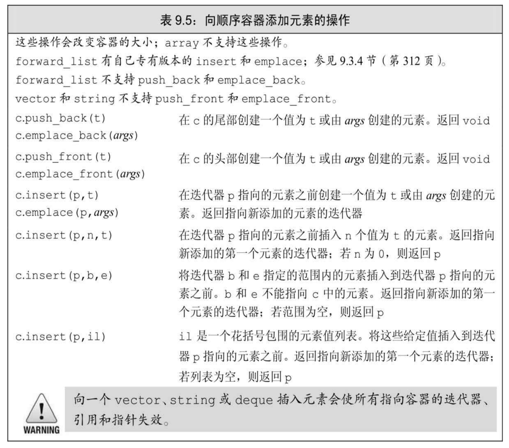
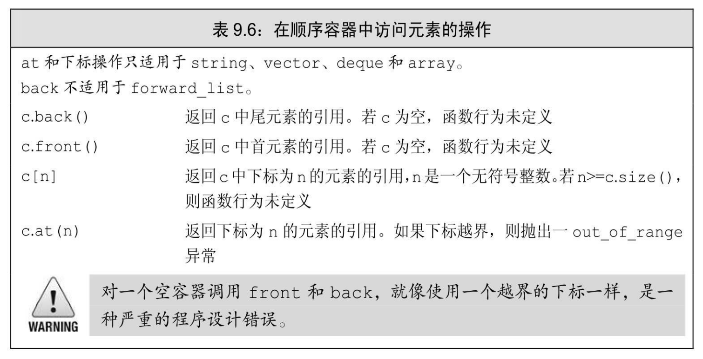
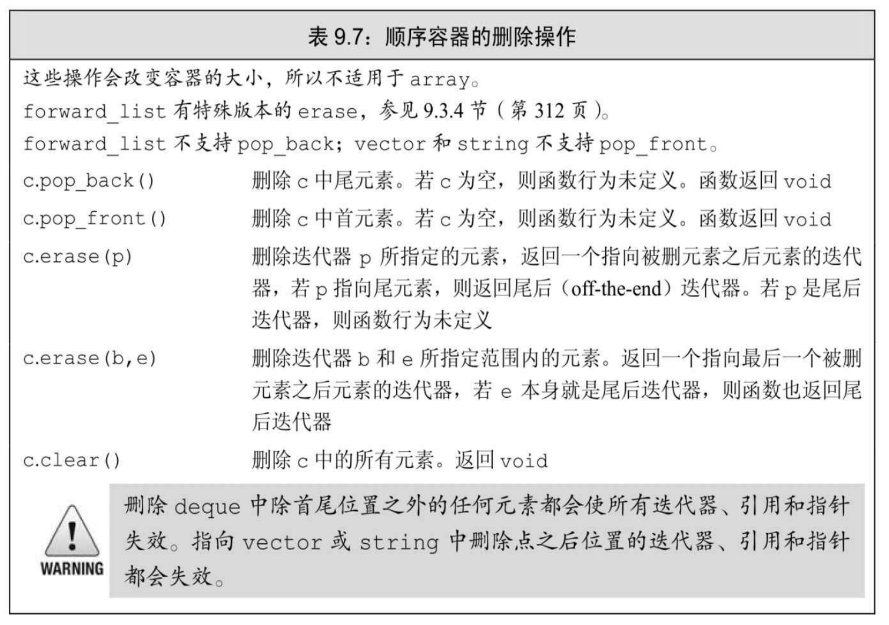
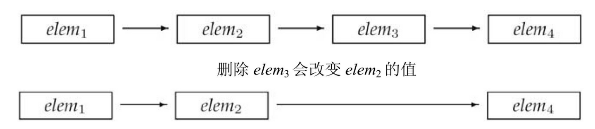
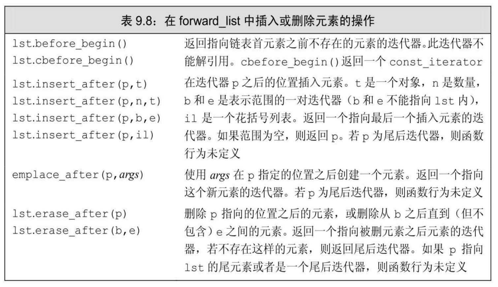
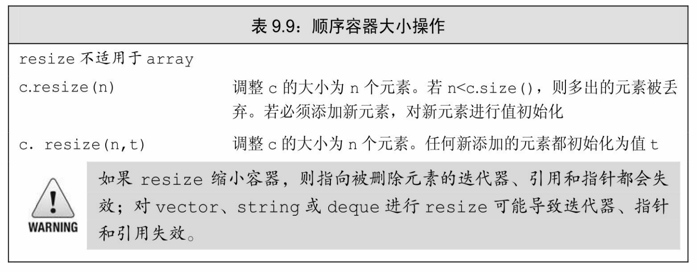

[总目录](<../目录.md>) · [本章目录](<01 章节导读.md>) · [上一篇](<../第9章 顺序容器/9.2 容器库概览.md>) · [下一篇](<../第9章 顺序容器/9.4 vector对象是如何增长的.md>)

> 原 PDF 第 510–529 页。

<!-- PDF 第 510 页 -->

# **9.3** 顺序容器操作

顺序容器和关联容器的不同之处在于两者组织元素的方式。这些不同之处直接关系到了元素如何存储、访问、添加以及删除。上一节介绍了所有容器都支持的操作(罗列于表9.2(第295页))。本章剩余部分将介绍顺序容器所特有的操作。

## **9.3.1** 向顺序容器添加元素

除array外,所有标准库容器都提供灵活的内存管理。在运行时可以动态添加或删除元素来改变容器大小。表9.5列出了向顺序容器(非 array)添加元素的操作。

<!-- PDF 第 511 页 -->



当我们使用这些操作时,必须记得不同容器使用不同的策略来分配元素空间,而这些策略直接影响性能。在一个vector或string的尾部之外的任何位置,或是一个deque的首尾之外的任何位置添加元素,都需要移动元素。而且,向一个vector或string添加元素可能引起整个对象存储空间的重新分配。重新分配一个对象的存储空间需要分配新的内存,并将元素从旧的空间移动到新的空间中。

## 使用**push\_back**

在3.3.2节(第90页)中,我们看到push\_back将一个元素追加到一个vector的尾部。除array和forward\_list之外,每个顺序容器(包括string 类型)都支持push\_back。

例如,下面的循环每次读取一个string到word中,然后追加到容器

<!-- PDF 第 512 页 -->

尾部:

<!-- 代码原图: ../images/_page_511_Picture_125.png -->
```c++
// 从标准输入读取数据，将每个单词放到容器末尾 string word;
while (cin >> word)
    container.push_back(word);
```

对push\_back的调用在container尾部创建了一个新的元素,将 container的size增大了1。该元素的值为word的一个拷贝。container的类型可以是list、vector或deque。

由于string是一个字符容器,我们也可以用push\_back在string末尾添加字符:

<!-- 代码原图: ../images/_page_511_Picture_126.png -->
```c++
void pluralize(size_t cnt, string &word)
{
    if (cnt > 1)
        word.push_back('s'); // 等价于 word += 's'
}
```

关键概念:容器元素是拷贝

当我们用一个对象来初始化容器时,或将一个对象插入到容器中时,实际上放入到容器中的是对象值的一个拷贝,而不是对象本身。就像我们将一个对象传递给非引用参数(参见3.2.2节,第79页)一样,容器中的元素与提供值的对象之间没有任何关联。随后对容器中元素的任何改变都不会影响到原始对象,反之亦然。

## 使用**push\_front**

除了push\_back,list、forward\_list和deque容器还支持名为push\_front 的类似操作。此操作将元素插入到容器头部:

<!-- 代码原图: ../images/_page_511_Picture_127.png -->
```c++
list<int> ilist;
// 将元素添加到 ilist 开头
for (size_t ix = 0; ix != 4; ++ix)
    ilist.push_front(ix);
```

此循环将元素0、1、2、3添加到ilist头部。每个元素都插入到list的新的开始位置(new beginning)。即,当我们插入1时,它会被放置在0 之前,2被放置在1之前,依此类推。因此,在循环中以这种方式将元素

<!-- PDF 第 513 页 -->

添加到容器中,最终会形成逆序。在循环执行完毕后,ilist保存序列3、 2、1、0。

注意,deque像vector一样提供了随机访问元素的能力,但它提供了 vector所不支持的push\_front。deque保证在容器首尾进行插入和删除元素的操作都只花费常数时间。与vector一样,在deque首尾之外的位置插入元素会很耗时。

## 在容器中的特定位置添加元素

push\_back和push\_front操作提供了一种方便地在顺序容器尾部或头部插入单个元素的方法。insert成员提供了更一般的添加功能,它允许我们在容器中任意位置插入0个或多个元素。vector、deque、list和string 都支持insert成员。forward\_list提供了特殊版本的insert成员,我们将在 9.3.4节(第312页)中介绍。

每个insert函数都接受一个迭代器作为其第一个参数。迭代器指出了在容器中什么位置放置新元素。它可以指向容器中任何位置,包括容器尾部之后的下一个位置。由于迭代器可能指向容器尾部之后不存在的元素的位置,而且在容器开始位置插入元素是很有用的功能,所以 insert函数将元素插入到迭代器所指定的位置之前。例如,下面的语句

<!-- 代码原图: ../images/_page_512_Picture_131.png -->
```c++
slist.insert(iter, "Hello!"); // 将"Hello!"添加到 iter 之前的位置
```

将一个值为"Hello"的string插入到iter指向的元素之前的位置。

虽然某些容器不支持push\_front操作,但它们对于insert操作并无类似的限制(插入开始位置)。因此我们可以将元素插入到容器的开始位置,而不必担心容器是否支持push\_front:

<!-- 代码原图: ../images/_page_512_Picture_132.png -->
```c++
vector<string> svec;
list<string> slist;

// 等价于调用 slist.push_front("Hello!");
slist.insert(slist.begin(), "Hello!");

// vector 不支持 push_front，但我们可以插入到 begin()之前
// 警告：插入到 vector 末尾之外的任何位置都可能很慢
svec.insert(svec.begin(), "Hello!");
```

<!-- PDF 第 514 页 -->


将元素插入到vector、deque和string中的任何位置都是合法的。然而,这样做可能很耗时。

### 插入范围内元素

除了第一个迭代器参数之外,insert函数还可以接受更多的参数, 这与容器构造函数类似。==其中一个版本接受一个元素数目和一个值==,它将指定数量的元素添加到指定位置之前,这些元素都按给定值初始化:

<!-- 代码原图: ../images/_page_513_Picture_94.png -->
```c++
svec.insert(svec.end(), 10, "Anna");
```

这行代码将10个元素插入到svec的末尾,并将所有元素都初始化为 string "Anna"。

==接受一对迭代器或一个初始化列表的insert版本==将给定范围中的元素插入到指定位置之前:

<!-- 代码原图: ../images/_page_513_Picture_95.png -->
```c++
vector<string> v = {"quasi", "simba", "frollo", "scar"};
// 将 v 的最后两个元素添加到 slist 的开始位置
slist.insert(slist.begin(), v.end() - 2, v.end());
slist.insert(slist.end(), {"these", "words", "will",
"go", "at", "the", "end"});
```

<!-- 代码原图: ../images/_page_513_Picture_96.png -->
```c++
// 运行时错误：迭代器表示要拷贝的范围，不能指向与目的位置相同的容器 slist.insert(slist.begin(), slist.begin(), slist.end());
```

如果我们传递给insert一对迭代器,它们不能指向添加元素的目标容器。


在新标准下,接受元素个数或范围的insert版本返回指向第一个新加入元素的迭代器。(在旧版本的标准库中,这些操作返回void。)如果范围为空,不插入任何元素,insert操作会将第一个参数返回。

## 使用**insert**的返回值

通过使用insert的返回值,可以在容器中一个特定位置反复插入元

<!-- PDF 第 515 页 -->

素:

<!-- 代码原图: ../images/_page_514_Picture_119.png -->
```c++
list<string> lst;
auto iter = lst.begin();
while (cin >> word)
    iter = lst.insert(iter, word); // 等价于调用 push_front
```


理解这个循环是如何工作的非常重要,特别是理解这个循环为什么等价于调用 push\_front尤为重要。

在循环之前,我们将iter初始化为lst.begin()。第一次调用insert会将我们刚刚读入的string插入到iter所指向的元素之前的位置。insert返回的迭代器恰好指向这个新元素。我们将此迭代器赋予iter并重复循环, 读取下一个单词。只要继续有单词读入,每步while循环就会将一个新元素插入到iter之前,并将iter改变为新加入元素的位置。此元素为(新的)首元素。因此,每步循环将一个新元素插入到list首元素之前的位置。

## 使用**emplace**操作


新标准引入了三个新成员——emplace\_front、emplace和 emplace\_back,这些操作构造而不是拷贝元素。这些操作分别对应 push\_front、insert和push\_back,允许我们将元素放置在容器头部、一个指定位置之前或容器尾部。

当调用push或insert成员函数时,我们将元素类型的对象传递给它们,这些对象被拷贝到容器中。而当我们调用一个emplace成员函数时,则是将参数传递给元素类型的构造函数。emplace成员使用这些参数在容器管理的内存空间中直接构造元素。例如,假定c保存 Sales\_data(参见7.1.4节,第237页)元素:

<!-- PDF 第 516 页 -->

<!-- 代码原图: ../images/_page_515_Picture_94.png -->
```c++
// 在 c 的末尾构造一个 Sales_data 对象
// 使用三个参数的 Sales_data 构造函数
c.emplace_back("978-0590353403", 25, 15.99);
// 错误：没有接受三个参数的 push_back 版本
c.push_back("978-0590353403", 25, 15.99);
// 正确：创建一个临时的 Sales_data 对象传递给 push_back
c.push_back(Sales_data("978-0590353403", 25, 15.99));
```

其中对emplace\_back的调用和第二个push\_back调用都会创建新的 Sales\_data对象。在调用emplace\_back时,会在容器管理的内存空间中直接创建对象。而调用push\_back则会创建一个局部临时对象,并将其压入容器中。

emplace函数的参数根据元素类型而变化,参数必须与元素类型的构造函数相匹配:

<!-- 代码原图: ../images/_page_515_Picture_95.png -->
```c++
// iter指向c中一个元素，其中保存了Sales_data元素
```

<!-- 代码原图: ../images/_page_515_Picture_96.png -->
```c++
c.emplace_back(); // 使用 Sales_data 的默认构造函数
c.emplace(iter, "999-999999999"); // 使用 Sales_data(string)
// 使用 Sales_data 的接受一个 ISBN、一个 count 和一个 price 的构造函数
c.emplace_front("978-0590353403", 25, 15.99);
```


emplace函数在容器中直接构造元素。传递给emplace函数的参数必须与元素类型的构造函数相匹配。

## **9.3.1**节练习

练习**9.18**:编写程序,从标准输入读取string序列,存入一个deque中。 编写一个循环,用迭代器打印deque中的元素。

练习**9.19**:重写上题的程序,用list替代deque。列出程序要做出哪些改变。

练习**9.20**:编写程序,从一个list<int>拷贝元素到两个deque中。值为偶数的所有元素都拷贝到一个deque中,而奇数值元素都拷贝到另一个 deque中。

<!-- PDF 第 517 页 -->

练习**9.21**:如果我们将第308页中使用insert返回值将元素添加到list中的循环程序改写为将元素插入到vector中,分析循环将如何工作。

练习**9.22**:假定iv是一个int的vector,下面的程序存在什么错误?你将如何修改?

<!-- 代码原图: ../images/_page_516_Picture_97.png -->
```c++
vector<int>::iterator iter = iv.begin(),
    mid = iv.begin() + iv.size()/2;
while (iter != mid)
    if (*iter == some_val)
        iv.insert(iter, 2 * some_val);
```

## **9.3.2** 访问元素

表9.6列出了我们可以用来在顺序容器中访问元素的操作。如果容器中没有元素,访问操作的结果是未定义的。

包括array在内的每个顺序容器都有一个front成员函数,而除 forward\_list之外的所有顺序容器都有一个back成员函数。这两个操作分别返回首元素和尾元素的引用:

<!-- 代码原图: ../images/_page_516_Picture_98.png -->
```c++
// 在解引用一个迭代器或调用 front 或 back 之前检查是否有元素
if (!c.empty()) {
    // val 和 val2 是 c 中第一个元素值的拷贝
    auto val = *c.begin(), val2 = c.front();
    // val3 和 val4 是 c 中最后一个元素值的拷贝
    auto last = c.end();
    auto val3 = *(--last); // 不能递减 forward_list 迭代器
    auto val4 = c.back(); // forward_list 不支持
}
```

此程序用两种不同方式来获取c中的首元素和尾元素的引用。直接的方法是调用front和back。而间接的方法是通过解引用begin返回的迭代器来获得首元素的引用,以及通过递减然后解引用end返回的迭代器来获得尾元素的引用。

这个程序有两点值得注意:迭代器end指向的是容器尾元素之后的 (不存在的)元素。为了获取尾元素,必须首先递减此迭代器。另一个 

<!-- PDF 第 518 页 -->

重要之处是,在调用front和back(或解引用begin和end返回的迭代器) 之前,要确保c非空。如果容器为空,if中操作的行为将是未定义的。



### 访问成员函数返回的是引用

在容器中访问元素的成员函数(即,front、back、下标和at)返回的都是引用。如果容器是一个const对象,则返回值是const的引用。如果容器不是const的,则返回值是普通引用,我们可以用来改变元素的值:

<!-- 代码原图: ../images/_page_517_Picture_75.png -->
```c++
if (!c.empty()) {
    c.front() = 42;                        // 将 42 赋予 c 中的第一个元素
    auto &v = c.back();                  // 获得指向最后一个元素的引用
    v = 1024;                            // 改变 c 中的元素
    auto v2 = c.back();                  // v2 不是一个引用，它是 c.back()的一个拷贝
    v2 = 0;                             // 未改变 c 中的元素
}
```

与往常一样,如果我们使用auto变量来保存这些函数的返回值,并且希望使用此变量来改变元素的值,必须记得将变量定义为引用类型。

下标操作和安全的随机访问

提供快速随机访问的容器(string、vector、deque和array)也都提

<!-- PDF 第 519 页 -->

供下标运算符(参见3.3.3节,第91页)。就像我们已经看到的那样,下标运算符接受一个下标参数,返回容器中该位置的元素的引用。给定下标必须"在范围内"(即,大于等于0,且小于容器的大小)。保证下标有效是程序员的责任,下标运算符并不检查下标是否在合法范围内。使用越界的下标是一种严重的程序设计错误,而且编译器并不检查这种错误。

如果我们希望确保下标是合法的,可以使用at成员函数。at成员函数类似下标运算符,但如果下标越界,at会抛出一个out\_of\_range异常 (参见5.6节,第173页):

<!-- 代码原图: ../images/_page_518_Picture_113.png -->
```c++
vector<string> svec; // 空 vector
cout << svec[0]; // 运行时错误：svec 中没有元素！
cout << svec.at(0); // 抛出一个 out_of_range 异常
```

## **9.3.2**节练习

练习**9.23**:在本节第一个程序(第309页)中,若c.size()为1,则 val、val2、val3和val4的值会是什么?

练习**9.24**:编写程序,分别使用at、下标运算符、front和begin提取一个 vector中的第一个元素。在一个空vector上测试你的程序。

## **9.3.3** 删除元素

与添加元素的多种方式类似,(非array)容器也有多种删除元素的方式。表9.7列出了这些成员函数。

<!-- PDF 第 520 页 -->




删除元素的成员函数并不检查其参数。在删除元素之前,程序员必须确保它 (们)是存在的。

### **pop\_front**和**pop\_back**成员函数

pop\_front和pop\_back成员函数分别删除首元素和尾元素。与vector 和string不支持push\_front一样,这些类型也不支持pop\_front。类似的, forward\_list不支持pop\_back。与元素访问成员函数类似,不能对一个空容器执行弹出操作。

这些操作返回void。如果你需要弹出的元素的值,就必须在执行弹出操作之前保存它:

<!-- 代码原图: ../images/_page_519_Picture_56.png -->
```c++
while (!ilist.empty()) {
    process(ilist.front()); // 对 ilist 的首元素进行一些处理
    ilist.pop_front();        // 完成处理后删除首元素
}
```

<!-- PDF 第 521 页 -->

从容器内部删除一个元素

成员函数erase从容器中指定位置删除元素。我们可以删除由一个迭代器指定的单个元素,也可以删除由一对迭代器指定的范围内的所有元素。两种形式的erase都返回指向删除的(最后一个)元素之后位置的迭代器。即,若j是i之后的元素,那么erase(i)将返回指向j的迭代器。

例如,下面的循环删除一个list中的所有奇数元素:

<!-- 代码原图: ../images/_page_520_Picture_96.png -->
```c++
list<int> lst = {0,1,2,3,4,5,6,7,8,9};
auto it = lst.begin();
while (it != lst.end())
    if (*it % 2)                // 若元素为奇数
        it = lst.erase(it);    // 删除此元素
    else
        ++it;
```

每个循环步中,首先检查当前元素是否是奇数。如果是,就删除该元素,并将it设置为我们所删除的元素之后的元素。如果\*it为偶数,我们将it递增,从而在下一步循环检查下一个元素。

删除多个元素

接受一对迭代器的erase版本允许我们删除一个范围内的元素:

<!-- 代码原图: ../images/_page_520_Picture_97.png -->
```c++
// 删除两个迭代器表示的范围内的元素
// 返回指向最后一个被删元素之后位置的迭代器
elem1 = slist.erase(elem1, elem2); // 调用后，elem1 == elem2
```

迭代器elem1指向我们要删除的第一个元素,elem2指向我们要删除的最后一个元素之后的位置。

为了删除一个容器中的所有元素,我们既可以调用clear,也可以用 begin和end获得的迭代器作为参数调用erase:

<!-- 代码原图: ../images/_page_520_Picture_98.png -->
```c++
slist.clear(); // 删除容器中所有元素
slist.erase(slist.begin(), slist.end()); // 等价调用
```

**9.3.3**节练习

<!-- PDF 第 522 页 -->

练习**9.25**:对于第312页中删除一个范围内的元素的程序,如果elem1与 elem2相等会发生什么?如果elem2是尾后迭代器,或者elem1和elem2皆为尾后迭代器,又会发生什么?

练习**9.26**:使用下面代码定义的ia,将ia拷贝到一个vector和一个list中。 使用单迭代器版本的erase从list中删除奇数元素,从vector中删除偶数元素。

<!-- 代码原图: ../images/_page_521_Picture_162.png -->
```c++
int ia[] = { 0, 1, 1, 2, 3, 5, 8, 13, 21, 55, 89 };
```

## **9.3.4** 特殊的**forward\_list**操作

为了理解forward\_list为什么有特殊版本的添加和删除操作,考虑当我们从一个单向链表中删除一个元素时会发生什么。如图9.1所示,删除一个元素会改变序列中的链接。在此情况下,删除*elem*3会改变 *elem*2,*elem*2原来指向*elem*3,但删除*elem*3后,*elem*2指向了*elem*4。



图9.1:forward\_list的特殊操作

当添加或删除一个元素时,删除或添加的元素之前的那个元素的后继会发生改变。为了添加或删除一个元素,我们需要访问其前驱,以便改变前驱的链接。但是,forward\_list是单向链表。在一个单向链表中, 没有简单的方法来获取一个元素的前驱。出于这个原因,在一个 forward\_list中添加或删除元素的操作是通过改变给定元素之后的元素来完成的。这样,我们总是可以访问到被添加或删除操作所影响的元素。

由于这些操作与其他容器上的操作的实现方式不同,forward\_list并未定义insert、emplace和erase,而是定义了名为insert\_after、 emplace\_after和erase\_after的操作(参见表9.8)。例如,在我们的例子中,为了删除*elem3*,应该用指向*elem2*的迭代器调用 erase\_after。为了支

<!-- PDF 第 523 页 -->

持这些操作,forward\_list也定义了before\_begin,它返回一个首前(offthe-beginning)迭代器。这个迭代器允许我们在链表首元素之前并不存在的元素"之后"添加或删除元素(亦即在链表首元素之前添加删除元素)。



当在forward\_list中添加或删除元素时,我们必须关注两个迭代器 ——一个指向我们要处理的元素,另一个指向其前驱。例如,可以改写第312页中从list中删除奇数元素的循环程序,将其改为从forward\_list中删除元素:

<!-- 代码原图: ../images/_page_522_Picture_46.png -->
```c++
forward_list<int> flst = {0,1,2,3,4,5,6,7,8,9};
auto prev = flst.before_begin(); // 表示 flst 的“首前元素”
auto curr = flst.begin(); // 表示 flst 中的第一个元素
while (curr != flst.end()) { // 仍有元素要处理
    if (*curr % 2) // 若元素为奇数
        curr = flst.erase_after(prev); // 删除它并移动 curr
    else {
        prev = curr; // 移动迭代器 curr，指向下一个元素，prev 指向
```

<!-- 代码原图: ../images/_page_522_Picture_47.png -->
```c++
    ++curr;    // curr之前的元素
  }
}
```

<!-- PDF 第 524 页 -->

此例中,curr表示我们要处理的元素,prev表示curr的前驱。调用 begin来初始化curr,这样第一步循环就会检查第一个元素是否是奇数。 我们用before\_begin来初始化prev,它返回指向curr之前不存在的元素的迭代器。

当找到奇数元素后,我们将prev传递给erase\_after。此调用将prev之后的元素删除,即,删除curr指向的元素。然后我们将curr重置为 erase\_after的返回值,使得curr指向序列中下一个元素,prev保持不变, 仍指向(新)curr之前的元素。如果curr指向的元素不是奇数,在else中我们将两个迭代器都向前移动。

## **9.3.4**节练习

练习**9.27**:编写程序,查找并删除forward\_list<int>中的奇数元素。

练习**9.28**:编写函数,接受一个forward\_list<string>和两个string共三个参数。函数应在链表中查找第一个string,并将第二个string插入到紧接着第一个string之后的位置。若第一个string未在链表中,则将第二个 string插入到链表末尾。

## **9.3.5** 改变容器大小

如表9.9所描述,我们可以用resize来增大或缩小容器,与往常一样,array不支持resize。如果当前大小大于所要求的大小,容器后部的元素会被删除;如果当前大小小于新大小,会将新元素添加到容器后部:

<!-- 代码原图: ../images/_page_523_Picture_155.png -->
```c++
list<int> ilist(10, 42); // 10个 int：每个的值都是42
ilist.resize(15); // 将5个值为0的元素添加到 ilist的末尾
ilist.resize(25, -1); // 将10个值为-1的元素添加到 ilist的末尾
ilist.resize(5); // 从 ilist末尾删除20个元素
```

resize操作接受一个可选的元素值参数,用来初始化添加到容器中的元素。如果调用者未提供此参数,新元素进行值初始化(参见3.3.1 节,第88页)。如果容器保存的是类类型元素,且resize向容器添加新元素,则我们必须提供初始值,或者元素类型必须提供一个默认构造函数。

<!-- PDF 第 525 页 -->



## **9.3.5**节练习

练习**9.29**:假定vec包含25个元素,那么vec.resize(100)会做什么?如果接下来调用vec.resize(10)会做什么?

练习**9.30**:接受单个参数的resize版本对元素类型有什么限制(如果有的话)?

## **9.3.6** 容器操作可能使迭代器失效

向容器中添加元素和从容器中删除元素的操作可能会使指向容器元素的指针、引用或迭代器失效。一个失效的指针、引用或迭代器将不再表示任何元素。使用失效的指针、引用或迭代器是一种严重的程序设计错误,很可能引起与使用未初始化指针一样的问题(参见2.3.2节,第49 页)

在向容器添加元素后:

· 如果容器是vector或string,且存储空间被重新分配,则指向容器的迭代器、指针和引用都会失效。如果存储空间未重新分配,指向插入位置之前的元素的迭代器、指针和引用仍有效,但指向插入位置之后元素的迭代器、指针和引用将会失效。

· 对于deque,插入到除首尾位置之外的任何位置都会导致迭代器、 指针和引用失效。如果在首尾位置添加元素,迭代器会失效,但指向存在的元素的引用和指针不会失效。

<!-- PDF 第 526 页 -->

· 对于list和forward\_list,指向容器的迭代器(包括尾后迭代器和首前迭代器)、指针和引用仍有效。

当我们从一个容器中删除元素后,指向被删除元素的迭代器、指针和引用会失效,这应该不会令人惊讶。毕竟,这些元素都已经被销毁了。当我们删除一个元素后:

· 对于list和forward\_list,指向容器其他位置的迭代器(包括尾后迭代器和首前迭代器)、引用和指针仍有效。

· 对于deque,如果在首尾之外的任何位置删除元素,那么指向被删除元素外其他元素的迭代器、引用或指针也会失效。如果是删除deque 的尾元素,则尾后迭代器也会失效,但其他迭代器、引用和指针不受影响;如果是删除首元素,这些也不会受影响。

· 对于vector和string,指向被删元素之前元素的迭代器、引用和指针仍有效。注意:当我们删除元素时,尾后迭代器总是会失效。


使用失效的迭代器、指针或引用是严重的运行时错误。

## 建议:管理迭代器

当你使用迭代器(或指向容器元素的引用或指针)时,最小化要求迭代器必须保持有效的程序片段是一个好的方法。

由于向迭代器添加元素和从迭代器删除元素的代码可能会使迭代器失效,因此必须保证每次改变容器的操作之后都正确地重新定位迭代器。这个建议对vector、string 和deque尤为重要。

## 编写改变容器的循环程序

添加/删除vector、string或deque元素的循环程序必须考虑迭代器、 引用和指针可能失效的问题。程序必须保证每个循环步中都更新迭代器、引用或指针。如果循环中调用的是insert或erase,那么更新迭代器很容易。这些操作都返回迭代器,我们可以用来更新:

<!-- PDF 第 527 页 -->

<!-- 代码原图: ../images/_page_526_Picture_105.png -->
```c++
// 傻瓜循环，删除偶数元素，复制每个奇数元素
vector<int> vi = {0,1,2,3,4,5,6,7,8,9};
auto iter = vi.begin(); // 调用 begin 而不是 cbegin，因为我们要改变 vi
while (iter != vi.end()) {
    if (*iter % 2) {
        iter = vi.insert(iter, *iter); // 复制当前元素
        iter += 2; // 向前移动迭代器，跳过当前元素以及插入到它之前的元素
    } else
        iter = vi.erase(iter);          // 删除偶数元素
    // 不应向前移动迭代器，iter 指向我们删除的元素之后的元素
}
```

此程序删除vector中的偶数值元素,并复制每个奇数值元素。我们在调用insert和erase后都更新迭代器,因为两者都会使迭代器失效。

在调用erase后,不必递增迭代器,因为erase返回的迭代器已经指向序列中下一个元素。调用insert后,需要递增迭代器两次。记住,insert 在给定位置之前插入新元素,然后返回指向新插入元素的迭代器。因此,在调用insert后,iter指向新插入元素,位于我们正在处理的元素之前。我们将迭代器递增两次,恰好越过了新添加的元素和正在处理的元素,指向下一个未处理的元素。

## 不要保存**end**返回的迭代器

当我们添加/删除vector或string的元素后,或在deque中首元素之外任何位置添加/删除元素后,原来end返回的迭代器总是会失效。因此, 添加或删除元素的循环程序必须反复调用end,而不能在循环之前保存 end返回的迭代器,一直当作容器末尾使用。通常C++标准库的实现中 end()操作都很快,部分就是因为这个原因。

例如,考虑这样一个循环,它处理容器中的每个元素,在其后添加一个新元素。我们希望循环能跳过新添加的元素,只处理原有元素。在每步循环之后,我们将定位迭代器,使其指向下一个原有元素。如果我们试图"优化"这个循环,在循环之前保存end()返回的迭代器,一直用作容器末尾,就会导致一场灾难:

<!-- PDF 第 528 页 -->

<!-- 代码原图: ../images/_page_527_Picture_84.png -->
```c++
// 灾难：此循环的行为是未定义的
auto begin = v.begin(),
    end = v.end(); // 保存尾迭代器的值是一个坏主意
while (begin != end) {
    // 做一些处理
    // 插入新值，对 begin 重新赋值，否则的话它就会失效
    ++begin; // 向前移动 begin，因为我们想在此元素之后插入元素
    begin = v.insert(begin, 42); // 插入新值
    ++begin; // 向前移动 begin 跳过我们刚刚加入的元素
}
```

此代码的行为是未定义的。在很多标准库实现上,此代码会导致无限循环。问题在于我们将end操作返回的迭代器保存在一个名为end的局部变量中。在循环体中,我们向容器中添加了一个元素,这个操作使保存在end中的迭代器失效了。这个迭代器不再指向v中任何元素,或是v 中尾元素之后的位置。


如果在一个循环中插入/删除deque、string或vector中的元素,不要缓存end返回的迭代器。

必须在每次插入操作后重新调用end(),而不能在循环开始前保存它返回的迭代器:

<!-- 代码原图: ../images/_page_527_Picture_86.png -->
```c++
// 更安全的方法：在每个循环步添加/删除元素后都重新计算 end
while (begin != v.end()) {
    // 做一些处理
    ++begin; // 向前移动 begin，因为我们想在此元素之后插入元素
    begin = v.insert(begin, 42); // 插入新值
    ++begin; // 向前移动 begin，跳过我们刚刚加入的元素
}
```

### **9.3.6**节练习

练习**9.31**:第316页中删除偶数值元素并复制奇数值元素的程序不能用于list或forward\_list。为什么?修改程序,使之也能用于这些类型。

练习**9.32**:在第316页的程序中,向下面语句这样调用insert是否合法?

<!-- PDF 第 529 页 -->

如果不合法,为什么?

<!-- 代码原图: ../images/_page_528_Picture_31.png -->
```c++
iter = vi.insert(iter, *iter++);
```

练习**9.33**:在本节最后一个例子中,如果不将insert的结果赋予begin, 将会发生什么?编写程序,去掉此赋值语句,验证你的答案。

练习**9.34**:假定vi是一个保存int的容器,其中有偶数值也有奇数值,分析下面循环的行为,然后编写程序验证你的分析是否正确。

<!-- 代码原图: ../images/_page_528_Picture_32.png -->
```c++
iter = vi.begin();
while (iter != vi.end())
    if (*iter % 2)
        iter = vi.insert(iter, *iter);
    ++iter;
```


