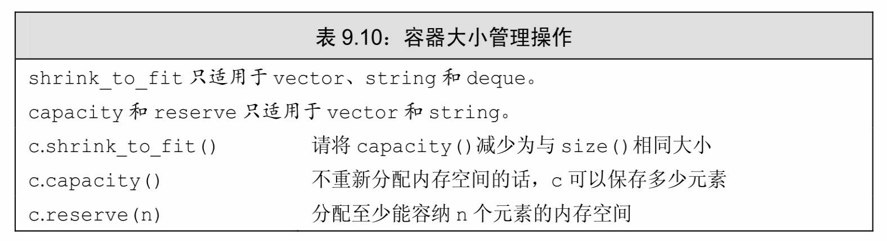
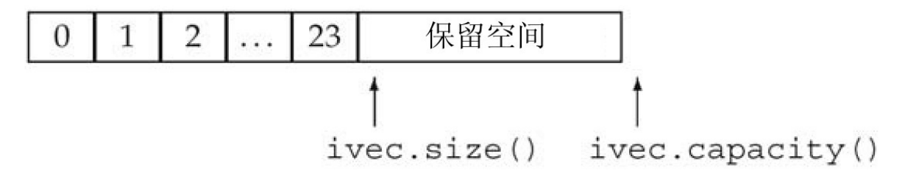

[总目录](<../目录.md>) · [本章目录](<01 章节导读.md>) · [上一篇](<../第9章 顺序容器/9.3 顺序容器操作.md>) · [下一篇](<../第9章 顺序容器/9.5 额外的string操作.md>)

> 原 PDF 第 530–535 页。

<!-- PDF 第 530 页 -->

# **9.4 vector**对象是如何增长的

为了支持快速随机访问,vector将元素连续存储——每个元素紧挨着前一个元素存储。通常情况下,我们不必关心一个标准库类型是如何实现的,而只需关心它如何使用。然而,对于vector和string,其部分实现渗透到了接口中。

假定容器中元素是连续存储的,且容器的大小是可变的,考虑向 vector或string中添加元素会发生什么:如果没有空间容纳新元素,容器不可能简单地将它添加到内存中其他位置——因为元素必须连续存储。 容器必须分配新的内存空间来保存已有元素和新元素,将已有元素从旧位置移动到新空间中,然后添加新元素,释放旧存储空间。如果我们每添加一个新元素,vector就执行一次这样的内存分配和释放操作,性能会慢到不可接受。

为了避免这种代价,标准库实现者采用了可以减少容器空间重新分配次数的策略。当不得不获取新的内存空间时,vector和string的实现通常会分配比新的空间需求更大的内存空间。容器预留这些空间作为备用,可用来保存更多的新元素。这样,就不需要每次添加新元素都重新分配容器的内存空间了。

这种分配策略比每次添加新元素时都重新分配容器内存空间的策略要高效得多。其实际性能也表现得足够好——虽然vector在每次重新分配内存空间时都要移动所有元素,但使用此策略后,其扩张操作通常比 list和deque还要快。

### 管理容量的成员函数

如表9.10所示,vector和string类型提供了一些成员函数,允许我们与它的实现中内存分配部分互动。capacity操作告诉我们容器在不扩张内存空间的情况下可以容纳多少个元素。reserve操作允许我们通知容器它应该准备保存多少个元素。

<!-- PDF 第 531 页 -->




reserve并不改变容器中元素的数量,它仅影响vector预先分配多大的内存空间。

只有当需要的内存空间超过当前容量时,reserve调用才会改变 vector的容量。如果需求大小大于当前容量,reserve至少分配与需求一样大的内存空间(可能更大)。

如果需求大小小于或等于当前容量,reserve什么也不做。特别是, 当需求大小小于当前容量时,容器不会退回内存空间。因此,在调用 reserve之后,capacity将会大于或等于传递给reserve的参数。

这样,调用reserve永远也不会减少容器占用的内存空间。类似的, resize成员函数(参见9.3.5节,第314页)只改变容器中元素的数目,而不是容器的容量。我们同样不能使用resize来减少容器预留的内存空间。


在新标准库中,我们可以调用shrink\_to\_fit来要求deque、vector或 string退回不需要的内存空间。此函数指出我们不再需要任何多余的内存空间。但是,具体的实现可以选择忽略此请求。也就是说,调用 shrink\_to\_fit也并不保证一定退回内存空间。

#### **capacity**和**size**

理解capacity和size的区别非常重要。容器的size是指它已经保存的元素的数目;而capacity则是在不分配新的内存空间的前提下它最多可以保存多少元素。

下面的代码展示了size和capacity之间的相互作用:

<!-- PDF 第 532 页 -->

<!-- 代码原图: ../images/_page_531_Picture_84.png -->
```c++
vector<int> ivec;
// size 应该为 0；capacity 的值依赖于具体实现
cout << " ivec: size: " << ivec.size()
    << " capacity: " << ivec.capacity() << endl;
// 向 ivec 添加 24 个元素
```

<!-- 代码原图: ../images/_page_531_Picture_85.png -->
```c++
for (vector<int>::size_type ix = 0; ix != 24; ++ix)
    ivec.push_back(ix);

// size 应该为 24；capacity 应该大于等于 24，具体值依赖于标准库实现
cout << "ivec: size: " << ivec.size()
    << " capacity: " << ivec.capacity() << endl
```

当在我们的系统上运行时,这段程序得到如下输出:

**ivec: size: 0 capacity: 0**

**ivec: size: 24 capacity: 32**

我们知道一个空vector的size为0,显然在我们的标准库实现中一个空vector的capacity也为0。当向vector中添加元素时,我们知道size与添加的元素数目相等。而capacity至少与size一样大,具体会分配多少额外空间则视标准库具体实现而定。在我们的标准库实现中,每次添加1个元素,共添加24个元素,会使capacity变为32。

可以想象ivec的当前状态如下图所示:



现在可以预分配一些额外空间:

<!-- 代码原图: ../images/_page_531_Picture_87.png -->
```c++
ivec.reserve(50); // 将 capacity 至少设定为 50，可能会更大
// size 应该为 24；capacity 应该大于等于 50，具体值依赖于标准库实现
cout << "ivec: size: " << ivec.size()
<< " capacity: " << ivec.capacity() << endl;
```

<!-- PDF 第 533 页 -->

程序的输出表明reserve严格按照我们需求的大小分配了新的空间:

#### **ivec: size: 24 capacity: 50**

接下来可以用光这些预留空间:

<!-- 代码原图: ../images/_page_532_Picture_103.png -->
```c++
// 添加元素用光多余容量
while (ivec.size() != ivec.capacity())
    ivec.push_back(0);
// capacity 应该未改变，size 和 capacity 不相等
cout << "ivec: size: " << ivec.size()
    << " capacity: " << ivec.capacity() << endl;
```

程序输出表明此时我们确实用光了预留空间,size和capacity相等:

#### **ivec: size: 50 capacity: 50**

由于我们只使用了预留空间,因此没有必要为vector分配新的空间。实际上,只要没有操作需求超出vector的容量,vector就不能重新分配内存空间。

如果我们现在再添加一个新元素,vector就不得不重新分配空间:

<!-- 代码原图: ../images/_page_532_Picture_104.png -->
```c++
ivec.push_back(42); // 再添加一个元素
// size 应该为 51；capacity 应该大于等于 51，具体值依赖于标准库实现
cout << "ivec: size: " << ivec.size()
<< " capacity: " << ivec.capacity() << endl;
```

这段程序的输出为

#### **ivec: size: 51 capacity: 100**

这表明vector的实现采用的策略似乎是在每次需要分配新内存空间时将当前容量翻倍。

可以调用shrink\_to\_fit来要求vector将超出当前大小的多余内存退回给系统:

<!-- PDF 第 534 页 -->

<!-- 代码原图: ../images/_page_533_Picture_126.png -->
```c++
ivec.shrink_to_fit(); // 要求归还内存
// size 应该未改变；capacity 的值依赖于具体实现
cout << "ivec: size: " << ivec.size()
    << " capacity: " << ivec.capacity() << endl;
```

调用shrink\_to\_fit只是一个请求,标准库并不保证退还内存。


每个vector实现都可以选择自己的内存分配策略。但是必须遵守的一条原则是:只有当迫不得已时才可以分配新的内存空间。

只有在执行insert操作时size与capacity相等,或者调用resize或 reserve时给定的大小超过当前capacity,vector才可能重新分配内存空间。会分配多少超过给定容量的额外空间,取决于具体实现。

虽然不同的实现可以采用不同的分配策略,但所有实现都应遵循一个原则:确保用push\_back向vector添加元素的操作有高效率。从技术角度说,就是通过在一个初始为空的vector上调用*n*次push\_back来创建一个*n*个元素的vector,所花费的时间不能超过*n*的常数倍。

#### **9.4**节练习

练习**9.35**:解释一个vector的capacity和size有何区别。

练习**9.36**:一个容器的capacity可能小于它的size吗?

练习**9.37**:为什么list或array没有capacity成员函数?

练习**9.38**:编写程序,探究在你的标准库实现中,vector是如何增长的。

练习**9.39**:解释下面程序片段做了什么:

<!-- 代码原图: ../images/_page_533_Picture_128.png -->
```c++
vector<string> svec;
svec.reserve(1024);
string word;
while (cin >> word)
    svec.push_back(word);
svec.resize(svec.size()+svec.size()/2);
```

<!-- PDF 第 535 页 -->

练习**9.40**:如果上一题中的程序读入了256个词,在resize之后容器的 capacity可能是多少?如果读入了512个、1000个或1048个词呢?


