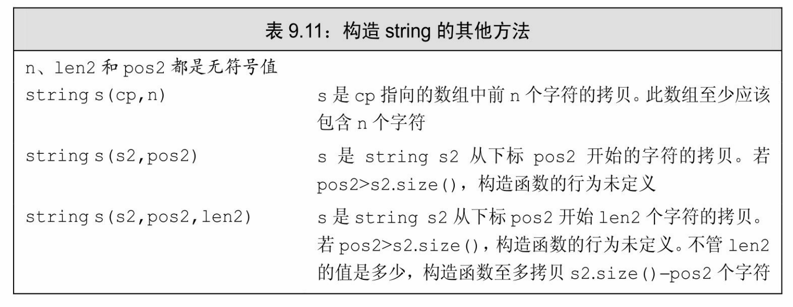
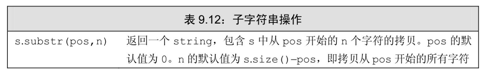
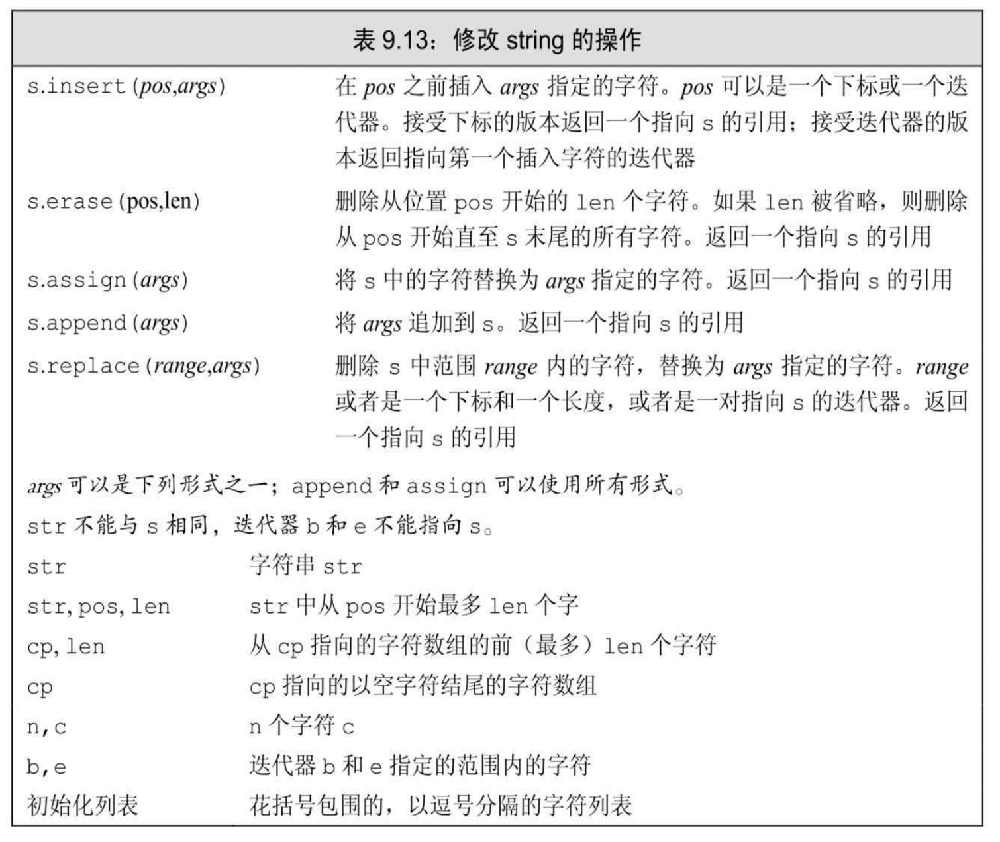
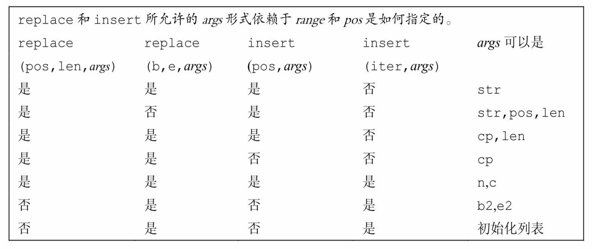
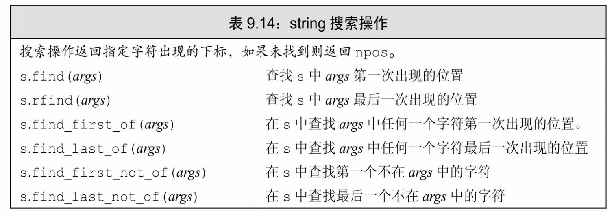
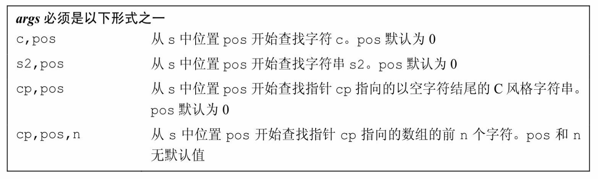
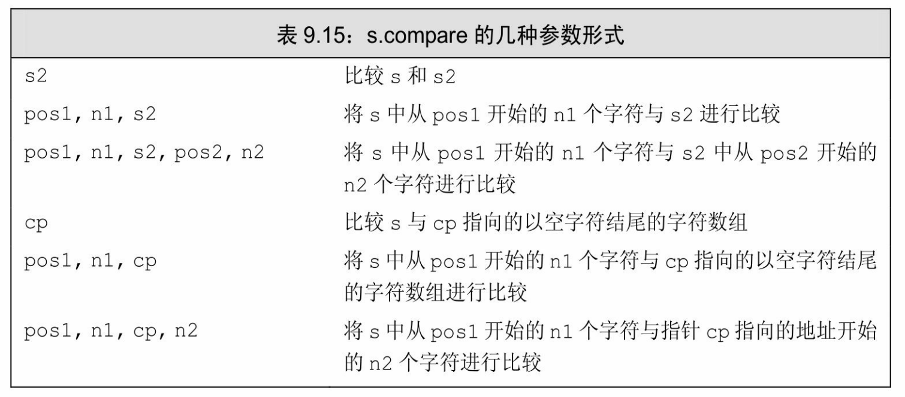
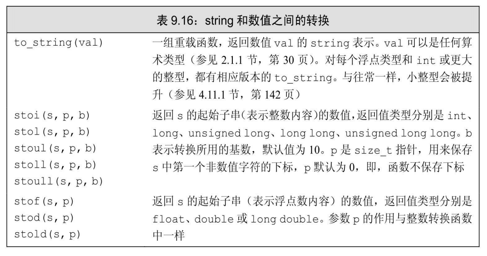

[总目录](<../目录.md>) · [本章目录](<01 章节导读.md>) · [上一篇](<../第9章 顺序容器/9.4 vector对象是如何增长的.md>) · [下一篇](<../第9章 顺序容器/9.6 容器适配器.md>)

> 原 PDF 第 536–547 页。

<!-- PDF 第 536 页 -->

# **9.5** 额外的**string**操作

除了顺序容器共同的操作之外,string类型还提供了一些额外的操作。这些操作中的大部分要么是提供string类和C风格字符数组之间的相互转换,要么是增加了允许我们用下标代替迭代器的版本。

标准库string类型定义了大量函数。幸运的是,这些函数使用了重复的模式。由于函数过多,本节初次阅读可能令人心烦,因此读者可能希望快速浏览本节。当你了解string支持哪些类型的操作后,就可以在需要使用一个特定操作时回过头来仔细阅读。

## **9.5.1** 构造**string**的其他方法

除了我们在3.2.1节(第76页)已经介绍过的构造函数,以及与其他顺序容器相同的构造函数(参见表9.3,第299页)外,string类型还支持另外三个构造函数,如表9.11所示。



这些构造函数接受一个string或一个const char\*参数,还接受(可选的)指定拷贝多少个字符的参数。当我们传递给它们的是一个string 时,还可以给定一个下标来指出从哪里开始拷贝:

<!-- PDF 第 537 页 -->

<!-- 代码原图: ../images/_page_536_Picture_101.png -->
```c++
const char *cp = "Hello World!!!";    // 以空字符结束的数组
char noNull[] = {'H', 'i'};            // 不是以空字符结束
string s1(cp); // 拷贝 cp 中的字符直到遇到空字符；s1 == "Hello World!!!"
string s2(noNull,2);           // 从 noNull 拷贝两个字符；s2 == "Hi"
string s3(noNull);             // 未定义：noNull 不是以空字符结束
string s4(cp + 6, 5);          // 从 cp[6]开始拷贝 5 个字符；s4 == "World"
string s5(s1, 6, 5);          // 从 s1[6]开始拷贝 5 个字符；s5 == "World"
string s6(s1, 6);             // 从 s1[6]开始拷贝，直至 s1 末尾；s6 == "World!!!"
string s7(s1,6,20);          // 正确，只拷贝到 s1 末尾；s7 == "World!!!"
string s8(s1, 16);            // 抛出一个 out_of_range 异常
```

通常当我们从一个const char\*创建string时,指针指向的数组必须以空字符结尾,拷贝操作遇到空字符时停止。如果我们还传递给构造函数一个计数值,数组就不必以空字符结尾。如果我们未传递计数值且数组也未以空字符结尾,或者给定计数值大于数组大小,则构造函数的行为是未定义的。

当从一个string拷贝字符时,我们可以提供一个可选的开始位置和一个计数值。开始位置必须小于或等于给定的string的大小。如果位置大于size,则构造函数抛出一个out\_of\_range异常(参见5.6节,第173 页)。如果我们传递了一个计数值,则从给定位置开始拷贝这么多个字符。不管我们要求拷贝多少个字符,标准库最多拷贝到string结尾,不会更多。

#### **substr**操作

substr操作(参见表9.12)返回一个string,它是原始string的一部分或全部的拷贝。可以传递给substr一个可选的开始位置和计数值:

<!-- 代码原图: ../images/_page_536_Picture_102.png -->
```c++
string s("hello world");
string s2 = s.substr(0, 5); // s2 = hello
string s3 = s.substr(6); // s3 = world
string s4 = s.substr(6, 11); // s3 = world
string s5 = s.substr(12); // 抛出一个 out_of_range 异常
```

如果开始位置超过了string的大小,则substr函数抛出一个 out\_of\_range异常(参见5.6节,第173页)。如果开始位置加上计数值大于string的大小,则substr会调整计数值,只拷贝到string的末尾。

<!-- PDF 第 538 页 -->



#### **9.5.1**节练习

练习**9.41**:编写程序,从一个vector<char>初始化一个string。

练习**9.42**:假定你希望每次读取一个字符存入一个string中,而且知道最少需要读取100个字符,应该如何提高程序的性能?

## **9.5.2** 改变**string**的其他方法

string类型支持顺序容器的赋值运算符以及assign、insert和erase操作 (参见9.2.5节,第302页;9.3.1节,第306页;9.3.3节,第311页)。除此之外,它还定义了额外的insert和erase版本。

除了接受迭代器的insert和erase版本外,string还提供了接受下标的版本。下标指出了开始删除的位置,或是insert到给定值之前的位置:

<!-- 代码原图: ../images/_page_537_Picture_145.png -->
```c++
s.insert(s.size(),5,'!'); // 在 s 末尾插入 5 个感叹号
s.erase(s.size() - 5,5); // 从 s 删除最后 5 个字符
```

标准库string类型还提供了接受C风格字符数组的insert和assign版本。例如,我们可以将以空字符结尾的字符数组insert到或assign给一个 string:

<!-- 代码原图: ../images/_page_537_Picture_146.png -->
```c++
const char *cp = "Stately, plump Buck";
s.assign(cp, 7); // s == "Stately"
s.insert(s.size(), cp + 7); // s == "Stately, plump Buck"
```

此处我们首先通过调用assign替换s的内容。我们赋予s的是从cp指向的地址开始的7个字符。要求赋值的字符数必须小于或等于cp指向的数组中的字符数(不包括结尾的空字符)。

接下来在s上调用insert,我们的意图是将字符插入到s[size()]处

<!-- PDF 第 539 页 -->

(不存在的)元素之前的位置。在此例中,我们将cp开始的7个字符 (至多到结尾空字符之前)拷贝到s中。

我们也可以指定将来自其他string或子字符串的字符插入到当前 string中或赋予当前string:

<!-- 代码原图: ../images/_page_538_Picture_86.png -->
```c++
string s = "some string", s2 = "some other string";
s.insert(0, s2); // 在 s 中位置 0 之前插入 s2 的拷贝
```

<!-- 代码原图: ../images/_page_538_Picture_87.png -->
```c++
// 在 s[0]之前插入 s2 中 s2[0]开始的 s2.size()个字符 s.insert(0，s2，0，s2.size());
```

#### **append**和**replace**函数

string类定义了两个额外的成员函数:append和replace,这两个函数可以改变string的内容。表9.13描述了这两个函数的功能。append操作是在string末尾进行插入操作的一种简写形式:

<!-- 代码原图: ../images/_page_538_Picture_88.png -->
```c++
string s("C++ Primer"), s2 = s; // 将 s 和 s2 初始化为"C++ Primer"
s.insert(s.size(), " 4th Ed."); // s == "C++ Primer 4th Ed."
s2.append(" 4th Ed."); // 等价方法：将" 4th Ed."追加到 s2；s == s2
```

replace操作是调用erase和insert的一种简写形式:

<!-- 代码原图: ../images/_page_538_Picture_89.png -->
```c++
// 将"4th"替换为"5th"的等价方法
s.erase(11, 3); // s == "C++ Primer Ed."
s.insert(11, "5th"); // s == "C++ Primer 5th Ed."
// 从位置11开始，删除3个字符并插入"5th"
s2.replace(11, 3, "5th"); // 等价方法：s == s2
```

此例中调用replace时,插入的文本恰好与删除的文本一样长。这不是必须的,可以插入一个更长或更短的string:

<!-- 代码原图: ../images/_page_538_Picture_90.png -->
```c++
s.replace(11, 3, "Fifth"); // s == "C++ Primer Fifth Ed."
```

在此调用中,删除了3个字符,但在其位置插入了5个新字符。

<!-- PDF 第 540 页 -->



续表



### 改变**string**的多种重载函数

<!-- PDF 第 541 页 -->

表9.13列出的append、assign、insert和replace函数有多个重载版本。根据我们如何指定要添加的字符和string中被替换的部分,这些函数的参数有不同版本。幸运的是,这些函数有共同的接口。

assign和append函数无须指定要替换string中哪个部分:assign总是替换string中的所有内容,append总是将新字符追加到string末尾。

replace函数提供了两种指定删除元素范围的方式。可以通过一个位置和一个长度来指定范围,也可以通过一个迭代器范围来指定。insert 函数允许我们用两种方式指定插入点:用一个下标或一个迭代器。在两种情况下,新元素都会插入到给定下标(或迭代器)之前的位置。

可以用好几种方式来指定要添加到string中的字符。新字符可以来自于另一个string,来自于一个字符指针(指向的字符数组),来自于一个花括号包围的字符列表,或者是一个字符和一个计数值。当字符来自于一个string或一个字符指针时,我们可以传递一个额外的参数来控制是拷贝部分还是全部字符。

并不是每个函数都支持所有形式的参数。例如,insert就不支持下标和初始化列表参数。类似的,如果我们希望用迭代器指定插入点,就不能用字符指针指定新字符的来源。

### **9.5.2**节练习

练习**9.43**:编写一个函数,接受三个string参数s、oldVal和newVal。使用迭代器及insert和erase函数将s中所有oldVal替换为newVal。测试你的程序,用它替换通用的简写形式,如,将"tho"替换为"though", 将"thru"替换为"through"。

练习**9.44**:重写上一题的函数,这次使用一个下标和replace。

练习**9.45**:编写一个函数,接受一个表示名字的string参数和两个分别表示前缀(如"Mr."或"Ms.")和后缀(如"Jr."或"III")的字符串。使用迭代器及insert和append函数将前缀和后缀添加到给定的名字中,将生成的新string返回。

练习**9.46**:重写上一题的函数,这次使用位置和长度来管理string,并只使用insert。

<!-- PDF 第 542 页 -->

## **9.5.3 string**搜索操作

string类提供了6个不同的搜索函数,每个函数都有4个重载版本。 表9.14描述了这些搜索成员函数及其参数。每个搜索操作都返回一个 string::size\_type值,表示匹配发生位置的下标。如果搜索失败,则返回一个名为string::npos的static成员(参见7.6节,第268页)。标准库将npos定义为一个const string::size\_type类型,并初始化为值-1。由于 npos是一个unsigned类型,此初始值意味着npos等于任何string最大的可能大小(参见2.1.2节,第32页)。


string搜索函数返回string::size\_type值,该类型是一个unsigned类型。因此,用一个int或其他带符号类型来保存这些函数的返回值不是一个好主意(参见2.1.2节,第 33页)。

find函数完成最简单的搜索。它查找参数指定的字符串,若找到, 则返回第一个匹配位置的下标,否则返回npos:

<!-- 代码原图: ../images/_page_541_Picture_151.png -->
```c++
string name("AnnaBelle");
auto pos1 = name.find("Anna"); // pos1 == 0
```

这段程序返回0,即子字符串"Anna"在"AnnaBelle"中第一次出现的下标。

搜索(以及其他string操作)是大小写敏感的。当在string中查找子字符串时,要注意大小写:

<!-- 代码原图: ../images/_page_541_Picture_152.png -->
```c++
string lowercase("annabelle");
pos1 = lowercase.find("Anna"); // pos1 == npos
```

这段代码会将pos1置为npos,因为Anna与anna不匹配。

一个更复杂一些的问题是查找与给定字符串中任何一个字符匹配的位置。例如,下面代码定位name中的第一个数字:

<!-- 代码原图: ../images/_page_541_Picture_153.png -->
```c++
string numbers("0123456789"), name("r2d2");
// 返回1，即，name中第一个数字的下标
auto pos = name.find_first_of(numbers);
```

<!-- PDF 第 543 页 -->

如果是要搜索第一个不在参数中的字符,我们应该调用 find\_first\_not\_of。例如,为了搜索一个string中第一个非数字字符,可以这样做:

<!-- 代码原图: ../images/_page_542_Picture_41.png -->
```c++
string dept("03714p3");
// 返回 5——字符'p'的下标
auto pos = dept.find_first_not_of(numbers);
```



续表



#### 指定在哪里开始搜索

我们可以传递给find操作一个可选的开始位置。这个可选的参数指出从哪个位置开始进行搜索。默认情况下,此位置被置为0。一种常见的程序设计模式是用这个可选参数在字符串中循环地搜索子字符串出现的所有位置:

<!-- PDF 第 544 页 -->

<!-- 代码原图: ../images/_page_543_Picture_112.png -->
```c++
string::size_type pos = 0;
// 每步循环查找 name 中下一个数

while ((pos = name.find_first_of(numbers, pos))
    != string::npos) {
    cout << "found number at index: " << pos
        << " element is " << name[pos] << endl;
    ++pos; // 移动到下一个字符
}
```

while的循环条件将pos重置为从pos开始遇到的第一个数字的下标。 只要find\_first\_of返回一个合法下标,我们就打印当前结果并递增pos。

如果我们忽略了递增pos,循环就永远也不会终止。为了搞清楚原因,考虑如果不做递增运算会发生什么。在第二步循环中,我们从pos 指向的字符开始搜索。这个字符是一个数字,因此find\_first\_of会(重复地)返回pos!

#### 逆向搜索

到现在为止,我们已经用过的find操作都是由左至右搜索。标准库还提供了类似的,但由右至左搜索的操作。rfind成员函数搜索最后一个匹配,即子字符串最靠右的出现位置:

<!-- 代码原图: ../images/_page_543_Picture_113.png -->
```c++
string river("Mississippi");
auto first_pos = river.find("is"); // 返回1
auto last_pos = river.rfind("is"); // 返回4
```

find返回下标1,表示第一个"is"的位置,而rfind返回下标4,表示最后一个"is"的位置。

类似的,find\_last函数的功能与find\_first函数相似,只是它们返回最后一个而不是第一个匹配:

· find\_last\_of搜索与给定string中任何一个字符匹配的最后一个字符。

· find\_last\_not\_of搜索最后一个不出现在给定string中的字符。

每个操作都接受一个可选的第二参数,可用来指出从什么位置开始搜索。

<!-- PDF 第 545 页 -->

### **9.5.3**节练习

练习**9.47**:编写程序,首先查找string "ab2c3d7R4E6"中的每个数字字符,然后查找其中每个字母字符。编写两个版本的程序,第一个要使用 find\_first\_of,第二个要使用find\_first\_not\_of。

练习**9.48**:假定name和numbers的定义如325页所示,

numbers.find(name)返回什么?

练习**9.49**:如果一个字母延伸到中线之上,如d或f,则称其有上出头部分(ascender)。如果一个字母延伸到中线之下,如p或g,则称其有下出头部分(descender)。编写程序,读入一个单词文件,输出最长的既不包含上出头部分,也不包含下出头部分的单词。

## **9.5.4 compare**函数

除了关系运算符外(参见3.2.2节,第79页),标准库string类型还提供了一组compare函数,这些函数与C标准库的strcmp函数(参见3.5.4 节,第109页)很相似。类似strcmp,根据s是等于、大于还是小于参数指定的字符串,s.compare返回0、正数或负数。

如表9.15所示,compare有6个版本。根据我们是要比较两个string还是一个string与一个字符数组,参数各有不同。在这两种情况下,都可以比较整个或一部分字符串。



<!-- PDF 第 546 页 -->

## **9.5.5** 数值转换

字符串中常常包含表示数值的字符。例如,我们用两个字符的 string表示数值15——字符'1'后跟字符'5'。一般情况,一个数的字符表示不同于其数值。数值15如果保存为16位的short类型,则其二进制位模式为0000000000001111,而字符串"15"存为两个Latin-1编码的char,二进制位模式为0011000100110101。第一个字节表示字符'1',其八进制值为 061,第二个字节表示'5',其Latin-1编码为八进制值065。


新标准引入了多个函数,可以实现数值数据与标准库string之间的转换:

<!-- 代码原图: ../images/_page_545_Picture_158.png -->
```c++
int i = 42;
string s = to_string(i); // 将整数 i 转换为字符表示形式
double d = stod(s); // 将字符串 s 转换为浮点数
```

此例中我们调用to\_string将42转换为其对应的string表示,然后调用 stod将此string转换为浮点值。

要转换为数值的string中第一个非空白符必须是数值中可能出现的字符:

<!-- 代码原图: ../images/_page_545_Picture_159.png -->
```c++
string s2 = "pi = 3.14";
// 转换 s 中以数字开始的第一个子串，结果 d = 3.14
d = stod(s2.substr(s2.find_first_of("+-.0123456789")));
```

在这个stod调用中,我们调用了find\_first\_of(参见9.5.3节,第325 页)来获得s中第一个可能是数值的一部分的字符的位置。我们将s中从此位置开始的子串传递给stod。stod函数读取此参数,处理其中的字符,直至遇到不可能是数值的一部分的字符。然后它就将找到的这个数值的字符串表示形式转换为对应的双精度浮点值。

string参数中第一个非空白符必须是符号(+ 或 -)或数字。它可以以0x或0X开头来表示十六进制数。对那些将字符串转换为浮点值的函数,string参数也可以以小数点(.)开头,并可以包含e或E来表示指数部分。对于那些将字符串转换为整型值的函数,根据基数不同,string

<!-- PDF 第 547 页 -->

参数可以包含字母字符,对应大于数字9的数。


如果string不能转换为一个数值,这些函数抛出一个invalid\_argument异常(参见5.6 节,第173页)。如果转换得到的数值无法用任何类型来表示,则抛出一个 out\_of\_range异常。



#### **9.5.5**节练习

练习**9.50**:编写程序处理一个vector<string>,其元素都表示整型值。计算vector中所有元素之和。修改程序,使之计算表示浮点值的string之和。

练习**9.51**:设计一个类,它有三个unsigned成员,分别表示年、月和日。为其编写构造函数,接受一个表示日期的string参数。你的构造函数应该能处理不同数据格式,如January 1,1900、1/1/1990、Jan 1 1900 等。


