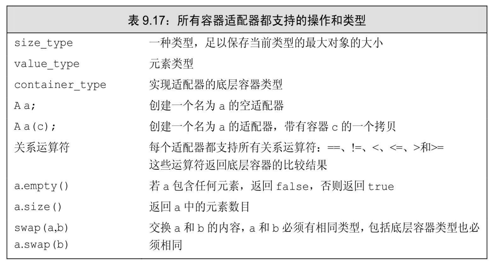
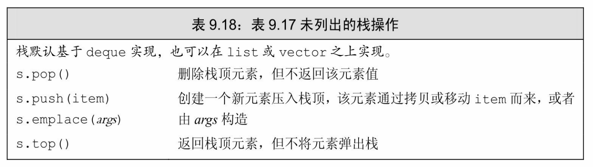
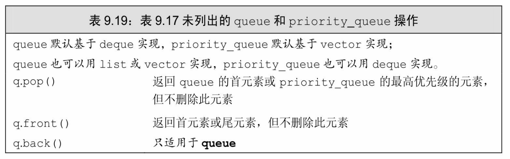
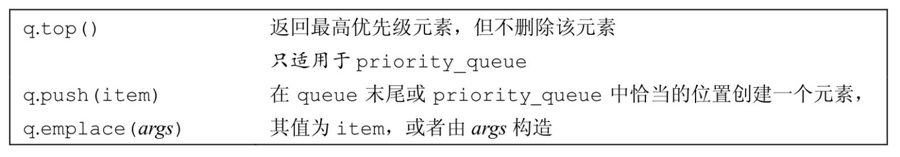

[总目录](<../目录.md>) · [本章目录](<01 章节导读.md>) · [上一篇](<../第9章 顺序容器/9.5 额外的string操作.md>) · [下一篇](<../第9章 顺序容器/小结.md>)

> 原 PDF 第 548–551 页。

<!-- PDF 第 548 页 -->

# **9.6** 容器适配器

除了顺序容器外,标准库还定义了三个顺序容器适配器:stack、 queue和priority\_queue。适配器(**adaptor**)是标准库中的一个通用概念。容器、迭代器和函数都有适配器。本质上,一个适配器是一种机制,能使某种事物的行为看起来像另外一种事物一样。一个容器适配器接受一种已有的容器类型,使其行为看起来像一种不同的类型。例如, stack适配器接受一个顺序容器(除array或forward\_list外),并使其操作起来像一个stack一样。表9.17列出了所有容器适配器都支持的操作和类型。



#### 定义一个适配器

每个适配器都定义两个构造函数:默认构造函数创建一个空对象, 接受一个容器的构造函数拷贝该容器来初始化适配器。例如,假定deq 是一个deque<int>,我们可以用deq来初始化一个新的stack,如下所示:

<!-- 代码原图: ../images/_page_547_Picture_70.png -->
```c++
stack<int> stk(deq); // 从 deq 拷贝元素到 stk
```

<!-- PDF 第 549 页 -->

默认情况下,stack和queue是基于deque实现的,priority\_queue是在 vector之上实现的。我们可以在创建一个适配器时将一个命名的顺序容器作为第二个类型参数,来重载默认容器类型。

<!-- 代码原图: ../images/_page_548_Picture_119.png -->
```c++
// 在 vector 上实现的空栈
stack<string, vector<string>> str_stk;
// str_stk2 在 vector 上实现，初始化时保存 svec 的拷贝
stack<string, vector<string>> str_stk2(svec);
```

对于一个给定的适配器,可以使用哪些容器是有限制的。所有适配器都要求容器具有添加和删除元素的能力。因此,适配器不能构造在 array之上。类似的,我们也不能用forward\_list来构造适配器,因为所有适配器都要求容器具有添加、删除以及访问尾元素的能力。stack只要求 push\_back、pop\_back和back操作,因此可以使用除array和forward\_list之外的任何容器类型来构造stack。queue适配器要求back、push\_back、 front和push\_front,因此它可以构造于list或deque之上,但不能基于 vector构造。priority\_queue除了front、push\_back和pop\_back操作之外还要求随机访问能力,因此它可以构造于vector或deque之上,但不能基于 list构造。

#### 栈适配器

stack类型定义在stack头文件中。表9.18列出了stack所支持的操作。 下面的程序展示了如何使用stack:

<!-- 代码原图: ../images/_page_548_Picture_120.png -->
```c++
stack<int> intStack; // 空栈
// 填满栈
for (size_t ix = 0; ix != 10; ++ix)
    intStack.push(ix);        // intStack 保存 0 到 9 十个数
while (!intStack.empty()) {   // intStack 中有值就继续循环
    int value = intStack.top();
    // 使用栈顶值的代码
    intStack.pop(); // 弹出栈顶元素，继续循环
}
```

其中,声明语句

<!-- 代码原图: ../images/_page_548_Picture_121.png -->
```c++
stack<int> intStack; // 空栈
```

<!-- PDF 第 550 页 -->

定义了一个保存整型元素的栈intStack,初始时为空。for循环将10 个元素添加到栈中,这些元素被初始化为从0开始连续的整数。while循环遍历整个stack,获取top值,将其从栈中弹出,直至栈空。



每个容器适配器都基于底层容器类型的操作定义了自己的特殊操作。我们只可以使用适配器操作,而不能使用底层容器类型的操作。例如,

<!-- 代码原图: ../images/_page_549_Picture_86.png -->
```c++
intStack.push(ix); // intStack 保存0到9十个数
```

此语句试图在intStack的底层deque对象上调用push\_back。虽然stack 是基于deque实现的,但我们不能直接使用deque操作。不能在一个stack 上调用push\_back,而必须使用stack自己的操作——push。

### 队列适配器

queue和priority\_queue适配器定义在queue头文件中。表9.19列出了它们所支持的操作。



续表

<!-- PDF 第 551 页 -->



标准库queue使用一种先进先出(first-in,first-out,FIFO)的存储和访问策略。进入队列的对象被放置到队尾,而离开队列的对象则从队首删除。饭店按客人到达的顺序来为他们安排座位,就是一个先进先出队列的例子。

priority\_queue允许我们为队列中的元素建立优先级。新加入的元素会排在所有优先级比它低的已有元素之前。饭店按照客人预定时间而不是到来时间的早晚来为他们安排座位,就是一个优先队列的例子。默认情况下,标准库在元素类型上使用<运算符来确定相对优先级。我们将在11.2.2节(第378页)学习如何重载这个默认设置。

### **9.6**节练习

练习**9.52**:使用stack处理括号化的表达式。当你看到一个左括号,将其记录下来。当你在一个左括号之后看到一个右括号,从stack中pop对象,直至遇到左括号,将左括号也一起弹出栈。然后将一个值(括号内的运算结果)push到栈中,表示一个括号化的(子)表达式已经处理完毕,被其运算结果所替代。


