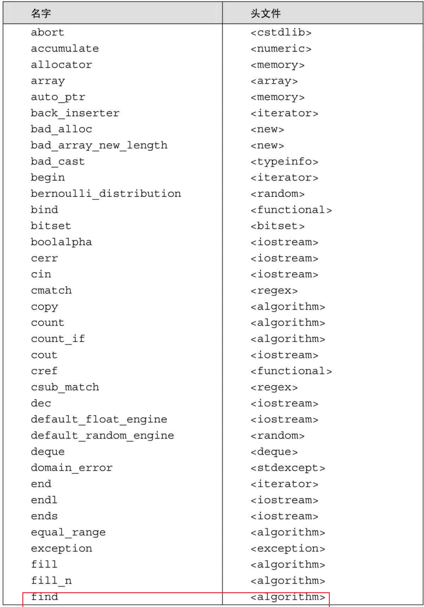
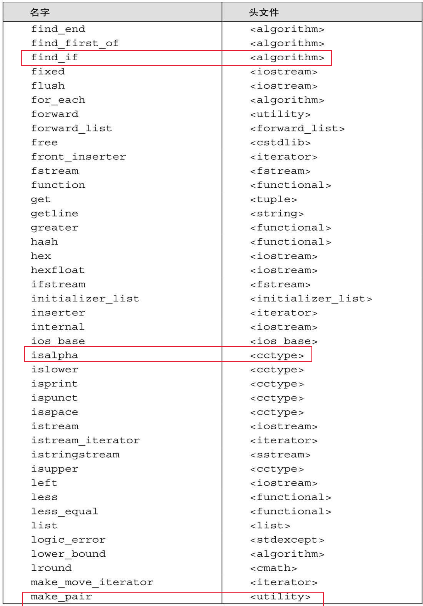
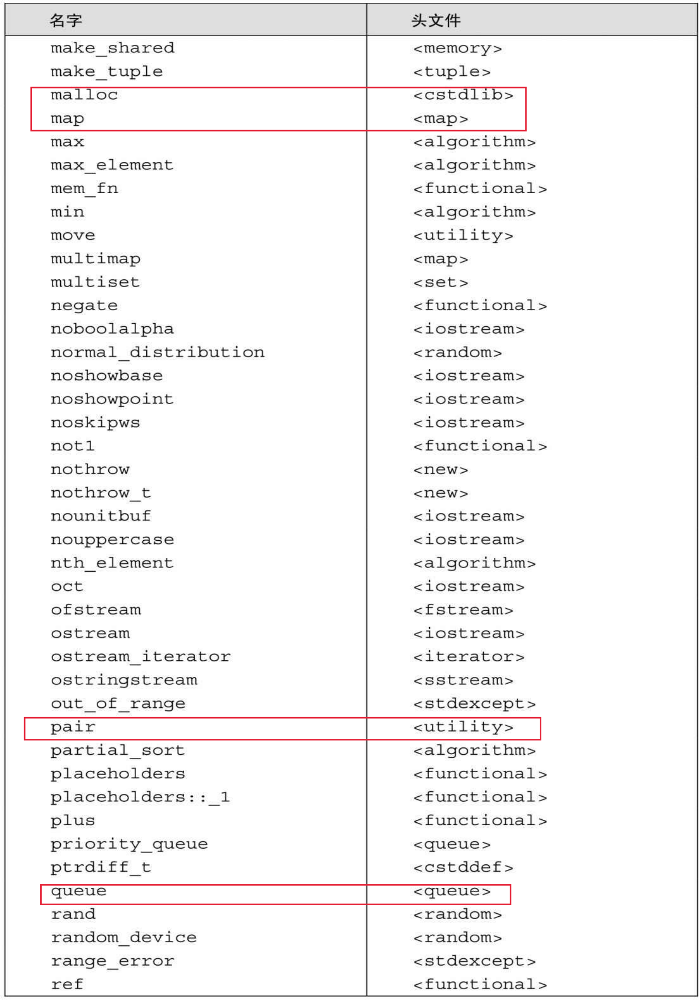
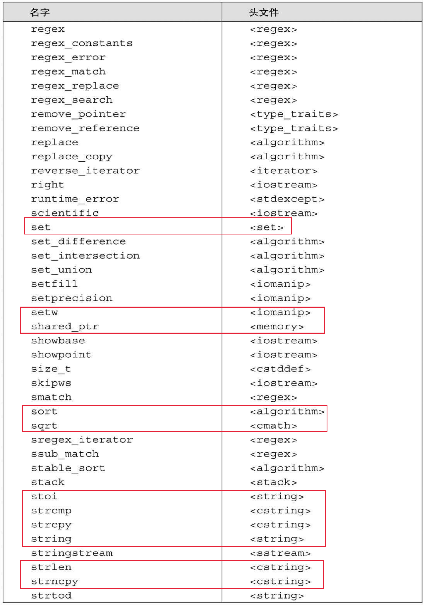
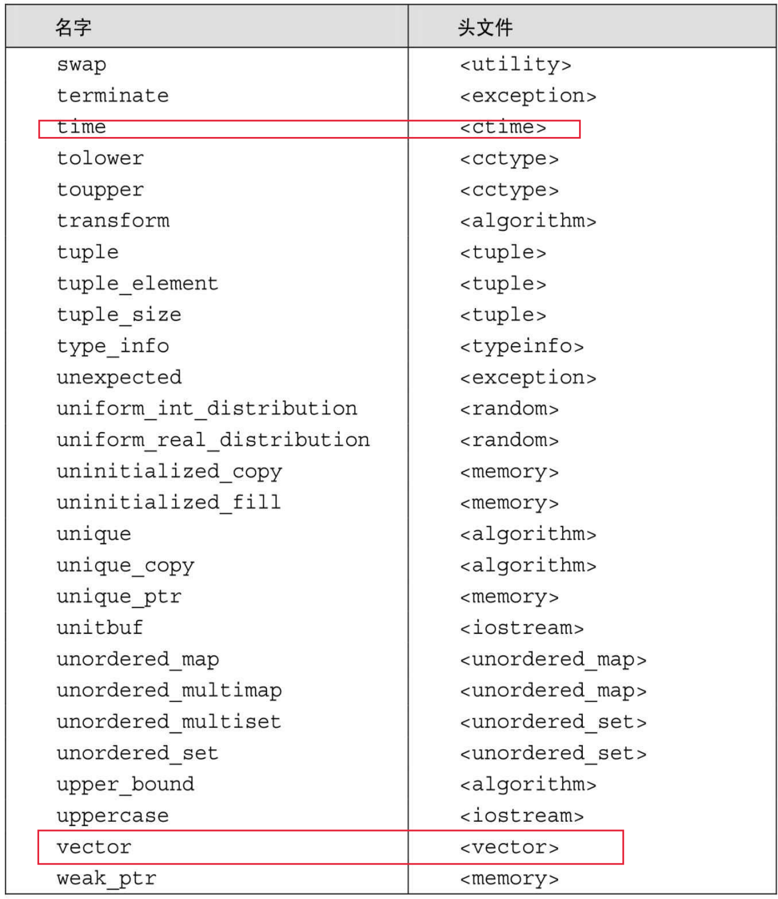

[总目录](<../目录.md>) · [本章目录](<01 章节导读.md>) · [上一篇](<../附录A 标准库/01 章节导读.md>) · [下一篇](<../附录A 标准库/A.2 算法概览.md>)

> 原 PDF 第 1244–1252 页。

<!-- PDF 第 1244 页 -->

# **A.1** 标准库名字和头文件

本书中大多数代码没有给出编译程序所需的实际#include指令。为了方便读者,表A.1列出了本书程序用到的标准库名字以及它们所在的头文件。

表A.1:标准库名字和头文件

<!-- PDF 第 1245 页 -->

<!-- PDF 第 1246 页 -->

续表

<!-- PDF 第 1247 页 -->

<!-- PDF 第 1248 页 -->

续表

<!-- PDF 第 1249 页 -->

<!-- PDF 第 1250 页 -->

续表

<!-- PDF 第 1251 页 -->

<!-- PDF 第 1252 页 -->

续表

